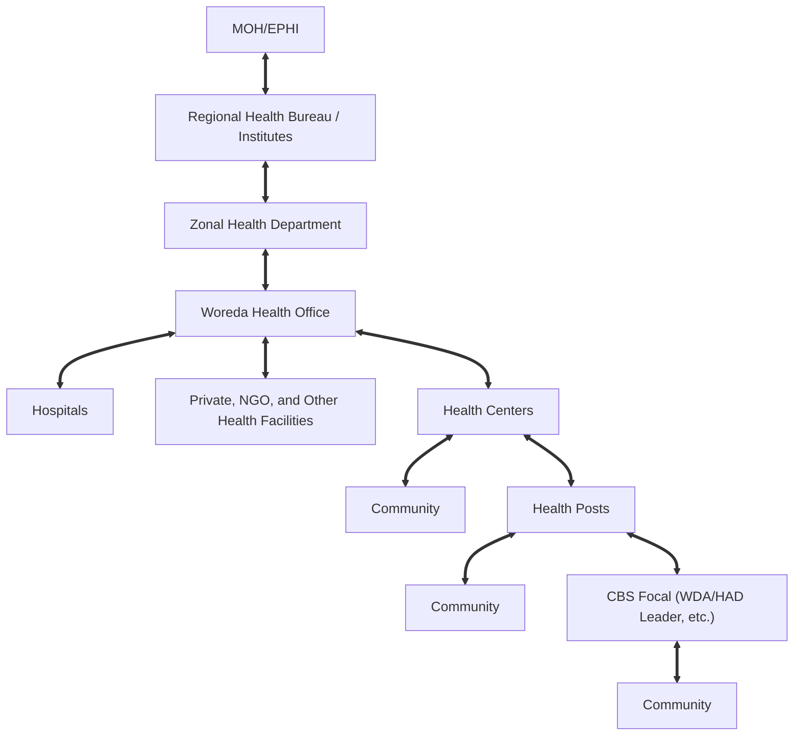
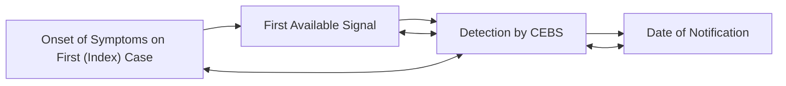

logo: Ethiopian Public Health Institute

## **COMMUNITY AND EVENT BASED SURVEILLANCE**

### **IMPLEMENTATION MANUAL**

**ETHIOPIAN PUBLIC HEALTH INSTITUTE**

**CENTER FOR PUBLIC HEALTH EMERGENCY MANAGEMENT**

icon: people with magnifying glasses over a blue pyramid

**September, 2021**
**Addis Ababa, Ethiopia**

## **Acknowledgement**

Ethiopian Public Health Institute (EPHI) would like to thank all individuals who had participated in the development of this Community and Event Based Surveillance implementation manual. EPHI would like to extend gratitude to all regions for assigning experts to contribute in the manual development. A heartfelt gratitude also goes to partners (WHO, Core Group, Transform-PHC, etc.) for their technical support. The last but not the least we would like to extend our gratitude to ‘Building Resilience in Ethiopia’ (BRE) programme funded by the UK Foreign, Common wealth & Development Office (FCDO) and USAID and implemented by the government of Ethiopia in coordination with Oxford Policy Management for financial support to make the printing of the manual possible.

i

## **Table of Contents**

| Acknowledgment | i |
| --- | --- |
| Table of Contents | ii |
| Forward | iv |
| Acronyms | v |
| Definition of Terminologies | vi |
| I Introduction | 1 |
| Background | 1 |
| Purpose of the manual | 3 |
| Users of the manual | 3 |
| II Priority Diseases and Conditions | 4 |
| III Actors and Stakeholders | 8 |
| Actors | 8 |
| Stakeholders | 9 |
| Key functions of Actors | 9 |
| IV Strategies | 10 |
| Capacitate CEBS Focal Persons and Actors | 10 |
| Community Networks | 10 |
| Linkages among Community, CEBS Focal Persons and HEWs | 11 |
| CEBS Committee at Kebele levels | 11 |
| Resource Mapping and Mobilization | 11 |
| Establish and maintain CEBS Monitoring and Evaluation | 12 |
| V Information | 13 |
| Sources of Information | 13 |
| Information Capturing and Sharing | 14 |
| VI Activities | 15 |

ii

| VII Roles and Responsibilities | 18 |
| --- | --- |
| Community | 18 |
| CEBS Focal Persons | 18 |
| HEWs/Health Posts | 18 |
| Private Health Facilities | 19 |
| Health Centers/ Hospitals | 19 |
| Woreda/Town Health Offices | 20 |
| Zonal/Subcity Health Departments | 21 |
| Regional/City Administration Health Bureaus | 21 |
| Ethiopian Public Health Institute | 21 |
| Ministry of Health | 22 |
| Partners | 22 |
| VIII Implementation | 23 |
| Implementation Arrangement and Coordination | 23 |
| IX Monitoring and Evaluation | 28 |
| General Principles | 28 |
| Attributes | 28 |
| Performance Indicators | 34 |
| Supportive Supervision and Feedbacks | 34 |
| X References | 35 |
| Annexes | 36 |
| Indicator Matrix | 36 |
| Lists of Contributors | 40 |

iii

## **Foreword**

The Public Health Emergency Management (PHEM) system is well established up to the health post level. However, the existing surveillance system detects cases at health facility level when patients seek treatment. There hasn’t been a strong surveillance system at community level; most outbreaks are neither being promptly detected nor timely responded. Now adays, disease travel far and fast which underscore the importance of robust surveillance system at community level. The concept and practice of the Community and Event Based Surveillance (CEBS) are not new in the Ethiopian PHEM system but, there were not guidelines that clearly spell out the implementation of CEBS in the country despite such surveillance system play an indispensable role to improve early detection and notification of any public health threat and events in the community.

Moreover, CEBS fosters timely communication to alert other adjacent areas and regions by giving a voice to the existing local knowledge to identify any public health threats or events as early as possible. Developing community ownership, participation and engagement in reliable public health emergency detection, notification and response network is key features of an effective Community and Event Based Surveillance (CEBS). The implementation of CEBS is intended to collect data on rumors of events and diseases using simplified (syndromic) case definitions from the community to be reported to the catchment health facility for investigation as necessary. Therefore, all CEBS actors and focal need to clearly understand the case definitions/syndromes of prioritized diseases and occurrence of any public health risky events.

Based on the mandate given to the Federal Ministry of Health/Ethiopian Public Health Institute to prepare and distribute health and health related manuals, guidelines and standards, this manual is prepared by the Ethiopian Public Health Institute (EPHI); Public Health Emergency Management (PHEM) Center in collaboration with regional health bureaus/regional public health institutes and partners. EPHI hope that this manual meets the needs of stakeholders who are participating in the implementation of community and event based surveillance.

signature: Aschalew Abayneh

Aschalew Abayneh
Ethiopian Public Health Institute
Deputy Director General

iv

## **Acronyms**

| BCC | Behavioral Change Communication |
| --- | --- |
| CEBS | Community and Event Based Surveillance |
| CIDSR | Community Integrated Disease Surveillance and Response |
| CORE Group | Child Survival Collaboration and Resource Group |
| COVID-19 | Corona Virus Disease 2019 |
| CVs | Community Volunteers |
| EPHI | Ethiopian Public Health Institute |
| EPRP | Emergency Preparedness and Response Plan |
| HDA | Health Development Army |
| HEW | Health Extension Worker |
| HPDP | Health Promotion and Disease Prevention |
| IBS | Indicator Based Surveillance |
| IEC | Information Education and Communication |
| ITT | Indicator Tracking Table |
| JICA | Japan International Cooperation Agency |
| MoH | Ministry of Health |
| MUAC | Mid-Upper Arm Circumference |
| NGO | Non-Governmental Organization |
| PHEM | Public Health Emergency Management |
| RRT | Rapid Response Team |
| RHB | Regional Health Bureau |
| SNNPR | South Nation Nationality and People Region |
| TOT | Training of Trainers |
| T-PHC | Transform Primary Health Care |
| VPD | Vaccine Preventable Disease |
| WDA | Women Development Army |
| WHO | World Health Organization |

v

## **Definition of Terminologies**

| CEBS Actors | Those individuals/community structures who engaged directly on public health problem identification/detection, collection, and notification, communication and response activities in their community. |
| --- | --- |
| CEBS Stakeholders | Any individual, group or/and organization who have a responsibility and could impact or be impacted through the CEBS system |
| CEBS focal | Individuals who are selected by the community under the facilitation of HEWs from CEBS actors |
| Community and Event-Based Surveillance (CEBS) | An ongoing active process in detecting, collecting (mainly unstructured ad hoc information), interpreting, reporting, responding to and monitoring public health emergencies and events in the community. |
| Community volunteers (CVs) | Individuals who are voluntarily working in the community to strengthen the existing surveillance system. These volunteers are not usually health professional, but trained and engaged in CEBS to actively seek out any public health emergencies and risks happening in the community. |
| Dagu / Da’iimtu | A cultural way of exchanging information on every event across the community in Afar and Borena zone of Oromia regions, respectively. |
| Health Development Army (HDA) | A network of people voluntarily organized to promote health and prevent disease through community participation and empowerment. |
| Health Extension Workers (HEWs) | Female health workers who receive a minimum of one-year training and assigned at a health post by the government with a monthly salary. In some regions, trained male workers and diploma nurses are assigned to work as a health extension worker. |

vi

| Public Health Emergency Management (PHEM) | The process of anticipating, preventing, preparing for, detecting, responding to, controlling, and recovering from consequences of public health threats in order that health and economic impacts are minimized. |
| --- | --- |
| Public Health Surveillance | The continuous, systematic collection, analysis and interpretation of health and health related information for the purpose of proper planning, implementation and evaluation of health services/interventions. It is just information for action. |
| Syndromic case definition | A simple and user-friendly case definition (lay definition) which can be used by CEBS actors at community level. |
| Women Development Army (WDA) | A group of women who live in the same geographical area and could hold up to 30 households. This team is further divided into five smaller groups of six members each, referred as one-to-five networks. The teams have one leader selected by members based on their good performance on the implementation of the health extension packages and have trust by the members in mobilizing the community. The team is trained by health extension workers on the health extension packages including public health emergency related issues. |

vii

## **I Introduction**

### **Background**

Emerging and re-emerging events with a potential to cause disease outbreak remains a constant threat to global health security. The public health system is also continually challenged by recurrent and unexpected disease outbreaks such as cholera, measles, yellow fever, COVID-19, dengue fever etc and is facing the challenge of managing health consequences of natural and human-made disasters, emergencies, crisis, and conflicts. These problems continue disrupting the health care system and the successful detection and response to these public health emergencies is becoming increasingly complicated along with the poor capacity of the country.

Ethiopia has been implementing PHEM since 2009 with a multi-hazard approach. PHEM system is mainly integrated diseases surveillance system designed to ensure rapid detection, notification and investigation of any public health threats and preparedness related to logistic and fund administration, prompt response and recovery from various public health emergencies. The indicator-based disease surveillance system structure has been functioning starting from the health post level. So as to strengthen the indicator-based public health surveillance system, engagement of community members in public health surveillance and response activities is crucial. Establishing Community and Event Based Surveillance system is the best strategy to ensure the ownership and engagement of the community members in public health surveillance, response and other related activities.

Simplified/syndromic case definitions are used to facilitate rapid detection of priority diseases, events/conditions and other public health hazards in the community. CEBS could function during pre-emergency, emergency, and post-emergency period. During the pre-emergency period, it provides transfer of early warning messages and alerts about the incoming/forecasted threat by considering the previous history, weather conditions, season and the data on hand. CEBS during emergency period can actively detect and notify cases and deaths and engage in response activities. CEBS at the post-emergency period can monitor the progress towards emergency control.

1

Activities and outcomes of the system can potentially empower the community to identify and notify the risks they see and hear about. Besides empowering, CEBS provides a reliable and immediate communication structure to alert bordering areas by giving voice to the existing local knowledge to identify and notify public health emergencies and other risks as early as possible. Active community participation/engagement in a reliable response network is key features of an effective Community and Event Based Surveillance system.

Community and Event-Based Surveillance strategies focus on two approaches to collect information from the community. The first approach relies on identifying and reporting events based on agreed indicators (syndromic case definitions). Trusted community members are trained to identify diseases such as measles, cholera, polio and Guinea worm using community (simple) case definition and follow the standardized reporting system for notification. The second approach relies on reporting of unusual events (alerts) which can alert the early stages of an outbreak or any other public health threat in the community. Alerts may capture a wide variety of unusual events emerging at the community level and information from these alerts may be incomplete and unconfirmed that need to be triaged and verified.

The community and Event based surveillance has been implemented in a fragmented way with different approaches by different regions and partners. Regions such as Southern Nation Nationality and Peoples and Amhara national regional state in collaboration with World Health Organization (WHO), Japan International Cooperation Agency (JICA), Transform Primary Health Care (T-PHC) have implemented CEBS. On the other hand, community and Event based Vaccine Preventable Disease (VPD) surveillance is being implemented in Somali, Oromia, Benishangul Gumuz, Gambella and SNNP Regions in collaboration with CORE Group and T-PHC to engage community in case detection, notification and awareness raising activities. In addition to that, informal notification mechanism has been exercised in the community such as Dagu in Afar Region and Da’iimtu Borana zone of Oromia Region.

The result of CEBS pre-implementation assessment which was conducted by PHEM system in April/2019 has shown gaps such as lack of CEBS implementation manual and poor utilization of the

2

existing community structures. The current public health surveillance system collects health and health-related information from health facilities regularly. However, health threats can occur in areas where existing health facilities cannot reach, or which may not be sensitive enough to detect small changes that are an indicators/signals for public health emergency occurrence.

CEBS widens the surveillance network to reach communities and enable to capture public health related events that are not collected by health facilities/routine surveillance. It also helps to collect real-time data for timely/early investigation and response than indicator-based surveillance system. Hence, to improve the performance of the public health surveillance system, community and Event based surveillance system should be established to engage the community in the identification and notification of any public health emergencies and to make them part of the response in addressing public health actions.

The objective of implementing CEBS is to reduce the morbidity and mortality of people through active community engagement in surveillance and response activities in public health emergencies.

## **Purpose of the manual**

This manual provides guidance for establishing, strengthening and coordinating community and event-based surveillance by engaging community members so as to facilitate public health problems early detection, notification, response and related activities. Moreover, the manual helps to create a sense of responsibility, urgency and ownership by ensuring maximum coordination and cooperation among the community, all level health structures and partners.

## **Users of this manual**

This manual is intended to be used by health development army (HDA)/women development army (WDA), community volunteers, health professionals, health extension workers (HEWs) and all other stakeholders during the planning, implementation, and monitoring and evaluation phases of CEBS to enhance PHEM activities.

3

## **II Priority Diseases and Conditions**

In Ethiopia, there are 23 priority diseases and conditions/events which should be reported on immediately and on weekly basis. These prioritized diseases and conditions/events are selected/prioritized based on the following criteria according to PHEM guideline 2012:

* Diseases which have high epidemic potential
* Diseases stated to be reported internationally under International Health Regulation 2005
* Diseases targeted for eradication and elimination
* Diseases/conditions which have significant public health importance and
* Diseases/conditions that have available and effective prevention and control measures

Additionally, policy priority and/or request by the country/MOH can also be taken as a criterion for prioritizing diseases/conditions under surveillance.

The PHEM system uses community case definitions for prioritized reportable diseases and conditions mainly used by HEWs at health post level. The 23 priority diseases or conditions are reclassified in to 16 priority diseases/conditions considering the community case definition utilized by the health extension workers and 13 syndromic case definitions to be used by the community dwellers. This will enhance community participation, ownership and sensitivity of the existing surveillance system.

### **Syndromic Case Definitions**

Community members living in Ethiopia can use the following listed syndromic case definitions of the prioritized diseases/conditions:

* Any person with sudden onset of paralysis in their legs and/or arms
* People sick after eating meat or have contact with dead or sick animals within 7 days
* Any person with diarrhea with or without blood

4

* Any person with painful blister or/and emerging worm
* Any person with fever and cough, or sore throat or nasal discharge
* Any person with rash and/or fever
* Any person bitten or scratch by a dog or other animal
* Any person with fever and frequent bleeding from the nose, mouth or any other natural orifices
* Death of a woman between 15-49 years age (reproductive age)
* The birth of a dead fetus or death of new born within a month of age
* Any person with fever and headache or joint pain
* Any child less than 5 years old with bilateral leg swelling or/and wasting
* Any new born less than a month age unable to suck and has a stiff neck

**Table 1:** Case definitions for prioritized diseases and conditions to be used by the HEWs:

| S N | Diseases/ Conditions | Community Case definition | Pictorial presentation of the disease/condition |
| --- | --- | --- | --- |
| Immediately Notifiable |  |  |  |
| 1 | Acute Flaccid Paralysis | Any person with sudden onset of paralysis of the limbs | photo: child with acute flaccid paralysis Non-polio acute flaccid paralysis (NPAFP) is characterized by weakness, paralysis, and sudden in children under 15 years old. |
| 2 | Anthrax | A person who gets ill within 7 days after eating meat of sick animals or close contacts with animals that have bleeding from nose, mouth and anus | photo: Anthrax symptoms in animals and humans |

5

| 3 | Acute Watery Diarrhea | Any person 5 years of age or more with profuse acute watery diarrhea and vomiting. |  |
| --- | --- | --- | --- |
| 4 | Dracunculiasis/Guinea Worm | A person who has painful, burning blister OR A ruptured blister with the emergence of one or more guinea worms. | photo: person being treated for Guinea Worm |
| 5 | Influenza like illness | Any individual with fever, cough, sore throat, shorten breathing, chest pain; AND/OR Has history of contact during the 7 days prior to the onset of symptoms with sick or dead birds, including chickens. |  |
| 6 | Rashes | Any person with fever and vesicular, maculopapular or pustular rashes on any part of the body. | photo: child with a rash |
| 7 | Neonatal Tetanus | Any newborn with a normal ability to suck and cry during the first two days of life, and who, between the 3rd and 28th day of age, cannot suck normally, and becomes stiff or has convulsions or both. | photo: newborn with neonatal tetanus |
| 8 | Rabies | A person bitten by suspected mad dog or other animal. |  |
| 9 | Hemorrhagic diseases | Any person who has severe illness with fever and bleeding from gums, nose, eye or skin |  |
| 10 | Maternal death | Death of a woman aged 15-49 years |  |

6

| 11 | Perinatal death | The birth of a dead fetus or death of a new-born OR/plus ● Birth after 7 months of pregnancy and ● New-born dead at the time of birth OR ● Death within 28 days of delivery |  |
| --- | --- | --- | --- |
| Weekly Reportable |  |  |  |
| 1 | Acute Febrile Illness | Any person with fever, severe headache and /or diarrhea |  |
| 2 | Bloody diarrhea | Any person with diarrhea and visible blood in the stool |  |
| 3 | Malaria | Any person with fever OR fever with headache, back pain, chills, rigor, sweating, muscle pain, nausea and vomiting OR suspected case confirmed by RDT |  |
| 4 | Meningitis | Any person with fever, severe headache and neck stiffness |  |
| 5 | Severe Acute Malnutrition (SAM) | Children age 6 months to 5 years with MUAC less than 11.5cm and bilateral leg edema OR Children age 6 months to 5 years with bilateral leg edema. | photo: children with severe malnutrition |

In addition to the above reportable diseases and conditions the following events are required to be notified immediately:

* Unusual and unknown occurrence of diseases or/and conditions
* Cluster of cases and/or death of humans and animals that may indicate public health hazards
* Rumors of unexplained death of humans and animals,

These unusual and unknown occurrences/increase of diseases and/or conditions, cluster of case and deaths in human and animal and any rumor of deaths in human as well as in animal are targeted in the Community and Event Based Surveillance system implementation.

7

## icon: III **Actors and Stakeholders**

### **Actors of Community and Event Based Surveillance**

Actors of CEBS are those individuals/community structures who engaged directly on public health problem identification/detection, collection, notification, communication and response activities. Actors of CEBS are responsible to work on early warning, preparedness, response and recovery activities for public health emergency related issues. Therefore, immediate notification of suspected cases by community actors reduces the delays from onset of symptoms to investigation and actual response initiation. Community-Based Surveillance is applicable at the community level while Event-Based Surveillance can be applicable at every structural levels. Therefore, the actors of Community-Based Surveillance are found at the community level (maximum to health facility level) and actors of Event-Based Surveillance can be found at all structural levels.

The main actors of community and event-based surveillance are:

* Health Extension Workers
* Women Development Army
* Health Development Army
* Community/clan/kebele leaders
* Religious leaders
* Civic associations for instance Peasant, youth, women, Edir etc
* Public institutions such as schools, prisons, agricultural offices
* Private institutions for instance, Investment area, Factories, etc
* Traditional healers
* Community volunteers
* Any member of functional community network
* IDPs/refugee/military camps
* Health facilities
* Regional health bureau/public health institutes
* Ethiopian Public Health Institute
* Ministry of Health etc

8

## **Stakeholders for Community and Event Based Surveillance**

Different governmental and non-governmental organizations are engaged in CEBS implementation. This stakeholder’s engagement starts from the community to National level. A participatory and inclusive approach during the preparation and implementation phases allow to create strong ownership at all levels of the health system.

The major stakeholders of CEBS are:

* Federal Ministry of Health
* Ethiopian Public Health Institute
* Ethiopian Public Health Association
* Regional Health Bureaus/ City administration Health Bureaus
* Regional public health institutes
* Zonal / Sub city/town health departments
* Woreda/Council/Town administration (like in Somali region) Health Offices
* Hospitals
* Health centers
* Health posts
* Private health institutions
* Governmental organizations contributing on CEBS like agricultural office
* Non-governmental organizations (NGOs) and developmental partners
* Community associations and any other structure supporting CEBS implementation
* Community structures
* Community as a whole etc

### **Key Functions of Actors and Stakeholders**

Community and event-based surveillance works in line with the existing health facility-based surveillance system. CEBS actors and stakeholders should participate in detecting and notifying priority health problems, conduct active case searching, investigate rumors, participate in emergency response activities, provide health education/awareness creation, monitor and evaluate CEBS performance and document CEBS related information for future use.

9

## **IV Strategies**

The following six key strategies are selected in setting-up of a feasible Community and Event-Based System across all levels:

### **Capacitate CEBS Focal Persons and Actors**

For the effective implementation of CEBS system the capacity of the CEBS focal and actors need to be improved. To do so, they need to be provided the basic and refreshment CEBS training on CEBS related activities such as notifiable conditions, detection, notification, CEBS data utilization, engagement in emergency management, their role and responsibility and other related issues. Besides the training, they should be provided with the necessary supplies such as implementation manual, rumor logbook, leaflet, Brochure, updated HEW weekly reporting format to incorporate CEBS notifications. All necessary materials such as manuals, Brochure etc need to be translated to the local languages for the ease of understanding. A computer and an internet also need to be accessible for media scanning. A regular supportive supervision also needs to be maintained to identify the gaps/challenges and provide them feedback and on job training. The HEW should document CEBS related activities and best practices using appropriate forms such as rumor log book for future use and continuous improvement.

### **Establish/Strengthen Community Networks for CEBS**

Having strong and functional community network is a base for functional and vibrant community and event-based surveillance system to support the existing facility-based surveillance system. Selecting CEBS focal based on early determined criteria from available community networks and influential community members with active monitoring and evaluation is crucial to establish functional community networks. For areas with available community networks, leaders of the available community network (Like Women’s development army leaders) are used as CEBS focal. For those areas without available community networks the CEBS focal person need to be selected based on predetermined selection criteria. The health extension worker working in the catchment health post is responsible to list and document the contact of assigned CEBS focal person in the kebele for further communication, support, monitoring and evaluation.

10

## **Establish /Strengthen close linkage between Community, CEBS Focal and HEWs**

A functional community structure needs to be established for effective implementation of CEBS. If community structures are already available, it should be strengthened and shaped for implementing the CEBS. A suitable working environment created between the community/community structures and CEBS focal will favor the active and immediate detection and notification of public health risky conditions. The better communication between CEBS focal and HEWs also encourage CEBS focal for active case searching, and engagement in awareness creation, emergency response and related activities. The close linkage can be strengthened and maintained by conducting regular meeting, orientation, regular community association and household visit and feedback on CEBS related issues. Providing an official recognition/certification will also help to strengthen the linkage between HEW and CEBS focal and Community. This will also increase the commitment of CEBS actors and encourage the community/CEBS focal to effectively implement CEBS system.

### **Establish and Strengthen CEBS Committee at Kebele level**

For a better coordination and communication, a kebele level committee working on CEBS implementation should be established. The members of the committee will include kebele leaders, traditional healers, local associations and organization representatives, religious leaders, CEBS focal, HEWs and other pertinent CEBS actors. The committee will be chaired by the kebele leader and the HEW will serve as a secretary. The HEW also act as a chair in the absence of the kebele leader. This committee needs to be strengthened by conducting regular meeting and orientation on their roles and responsibilities, case detection, notification and participation in suspected case investigation and response activities. This will enable to provide responsibility and accountability as well as ownership for the community by the kebele leaders.

### **Conduct Resource Mapping and Mobilization**

For effective CEBS implementation the necessary supplies (human work force, logistic and finance) should be secured at each level of the governmental structure. To do so, every governmental and non-governmental organizations working/interested to support CEBS system implementation need to be identified. The supporting areas of the partners will be identified and communication maintained accordingly. There will also be a coordination mechanism for effective utilization of limited resources

11

by avoiding duplication. This communication, coordination and resource mobilization need to be maintained for the continuity of the implementation. The CEBS should be well advocated for stakeholders to create community ownership and easily secure budget to support the implementation and its continuity.

## **Establish and Maintain CEBS Monitoring and Evaluation**

The CEBS implementation need close follow-up and monitoring for effective implementation. After implementing the CEBS system, it should be evaluated against pre-defined measurement indicators. The overall CEBS related activities will be monitored and evaluated based on the established monitoring and evaluation tools to identify gaps/limitations and challenges to give feedbacks and recommendations for continuous improvement. To monitor and evaluate the system at different phases of implementation, we will use input, process, output, outcome and impact indicators. To do so, we will conduct supportive supervision and review documentation files on CEBS relate activities.

12

## **V Information**

### **Sources of Information**

Community and event-based surveillance system collects various types of information from different sources such as community members, public and private institutions, traditional healers, local associations and organizations and medias depending on the local context across the country. The different formal and informal sources of information can provide timely information on health events/conditions such as cluster of cases, diseases outbreak, unexpected or unusual illnesses and deaths, rumors, new occurrence and any changes of risk factors for human health. CEBS focal receive public health and related information from household members during daily activities, local media or rumors circulating at the community level, at school, market place and other people gathering areas.

The following entities would be used as key sources of information for the successful implementation of CEBS in Ethiopia:

* Community member, community volunteers and women/health development armies
* Teachers, Agriculture Extension Workers, Kebele/clan leaders, witchcrafts, religious leaders, water and sanitation officers, animal health experts, traditional healers (herbalist), etc.
* Local Public and private institutions, for instance school health clubs, religious organizations, drug venders (human and animal), farmer training centers, Refugee camp, Investment area etc
* Local civic associations including youth, women, Edir, Equb, Tsewa, farmer associations, etc.
* Local Media such as TV, Radios, newsletters, social media (Facebook, telegram, imo, WhatsApp, viber, etc), internet sources,
* Traditional communication methods like, Dagu in Afar, Da’iimtu (in Guji and Borena zones of Oromia region) etc.

13

* Hot lines/Call Center

## **Information Capturing and Sharing**

Different types of public health related information and rumors would come from the community through the above-mentioned key sources of information. These information are expected to be gathered by the CEBS focal and notified to the nearest health post immediately within 30 minutes of rumor detection. The minimum requirement for this timeliness is 80%, same as with the national indicator based surveillance (IBS) timelines requirement. The notification can be done through different means of communication including in person notification, via phone call, Short Message Service, by using notification cards etc. Regions choose one best or mix of reporting mechanisms based on their real situational difference even between woredas situation difference.

After receiving the notification from the CEBS focal persons, the health extension workers should register on the rumor log book properly and verify the rumor/event with in 1 hour of notification by using the community case definition. If the event fulfils the case definition, she/he immediately notifies to the next higher level / health center for further investigation and intervention and refer the case as required. On the contrary if the event doesn’t fulfill the community case definition, she/he should not notify the rumor to the next higher level.

The Health Extension Workers compile the total notification and those fulfilling the community case definition to be reported to the next level/health center by integrating with the weekly IBS reporting format on a weekly basis. The health center also adds a variable to know the total number of notifications fulfilling the standard case definition in their weekly reporting format.

14

## **VI Activities**

The following components are the logical steps and detail activities that are needed be to followed for establishing Community and Event-Based Surveillance System:

#### **(a) Prepare and translate the necessary tools**
* All necessary tools to be used for CEBS implementation such as training materials, manuals, updated HEW weekly reporting format, rumor log book need to be prepared and translated to local languages

#### **(b) Identify and use locally available capacities and resources**
* The locally available resources (human resources and existing structures) and capacities that can be used for CEBS implementation need to be identified. The capacities of locally available HEWs, HDA, kebele leaders, volunteers and other CEBS actors need to be identified and used.

#### **(c) Assign designated health post CEBS focal / Health Extension Worker**
* The assigned health post surveillance focal/health extension worker is expected to have a clear understanding of CEBS strategies to effectively coordinate CEBS related activities. S/he is responsible to closely coordinate and monitor the implementation of CEBS in his/her locality.

#### **(d) Identify CEBS Focal Persons**
* The CEBS focal person that collect information from the community and notify to the nearby health post need to be assigned. In most of the situation WDA/HAD leader can be assigned as a CEBS focal person. In situations where these structures do not exist or not functional the CEBS focal person can be selected based on the following criteria:
    - Hard working and committed to notify any public health and related rumor
    - Permanent resident in the community to avoid frequent turn-over of focal persons

15

* Well known, trusted, respected and accepted by the community to have good communication with inhabitants
* Can be selected irrespective of gender
* Recognized by the community where ethnic and religious difference exists
* Able to communicate in local language(s)

* There will be one CEBS focal person per each WDA/HDA, meaning that one CEBS focal person will manage up to 30 households or based on local implementation of community structures.

## **(e) Conduct capacity building activities (provide training/orientation etc)**

* Provide a (training of trainers) TOT for national, regional, zonal and woreda PHEM officers
* Provide basic training for HEWs
* Train/orient WDA/HDA leaders and community volunteers at Kebele level
* Orient WDA/HDA members through their leads

## **(f) Conduct Community and Event-Based Surveillance advocacy**

* Each level PHEM structure needs to conduct an advocacy by arranging workshop or other means to create awareness on CEBS system to get leadership and partner’s attention for mobilizing resources for the implementation of the action plan and to create community ownership.

## **(g) Distribute the necessary Community and Event-Based Surveillance tools**

* All necessary tools to be used for CEBS implementation such as training materials, manuals, updated HEW weekly reporting format, rumor log book need to be distributed to the lower level

## **(h) Develop Community and Event-Based Surveillance implementation action plan**

* All level PHEM structures up to the health post level need to develop CEBS implementation action plan

## **(i) Implement Community and Event-Based Surveillance**

* Identify CEBS health determinants/syndromes
* Distribute syndromic case definitions
* Establish and strengthen community participation on CEBS

16

* Provide regular feedback to CEBS actors during meetings, supportive supervisions and HEWs site visit
* Provide capacity building training for CEBS actors

## **(j) Monitoring and Evaluation of the Implementation of CEBS Activities**

* Analyze data and interpret findings of CEBS system
* Communicate the findings to stakeholders
* Strengthen feedback loop at all level to improve the system
* Put way forward based on the analysis finding to improve the system further

## **(k) Sustainability and continuous improvement of the system**

* Learn from own experience
* Learn from other countries experience
* Use feedbacks given during supportive supervision
* Take lessons from monitoring and evaluation result/findings and made corrective actions accordingly
* Conduct CEBS implementation impact assessment and use the findings for CEBS system advancement

17

## **VII Roles and Responsibilities**

Stakeholders of the Community and Event-Based Surveillance system have the following listed roles and responsibilities in ensuring the effective implementation of the CEBS activities.

### **Community**

* Detect and notify any unusual diseases/events/conditions, and other public health hazards to the CEBS actor or nearby health facility
* Participate in public health emergency response activities

### **CEBS Focal Persons**

* Social mobilization and awareness creation on prioritized public health events to bring behavioral change
* Dissemination of key health messages to the community
* Work in collaboration with local associations, institutions and households
* Conduct household visit on a regular basis
* Find and notify public health risks (diseases, event, condition) in their households, neighbors, local holy water sites, traditional healer sites, etc.
* Refer suspects to the nearest health facility as needed
* Participate in risk mapping of potential hazards
* Attend the 1 to 5 and other social network meetings based on local implementation of community structures
* Participate in meetings organized by Health post, health center and woreda health office
* Support and participate in emergency response activities including logistics distribution, vaccination campaign, contact tracing, social mobilization, etc
* Give feedback to community members about notified cases, events/alerts and other CEBS related activities
* Ensure community participation in public health interventions

### **Health Post / HEWs**

* Increase community awareness in seeking health care immediately in case of emergency/disease/ events.
* Mobilize resources appropriate for the activity
* Conduct regular supervision to CBS actors
* Coordinate and organize orientation to CEBS actors

18

* Distribute IEC materials for the community
* Identify and post list of at-risk areas with time of risky period
* Detect priority diseases/events using community case definitions and public health related hazards
* Verify rumors notified by the CEBS focal/community
* Conduct active case searching at household, traditional and religious healing sites, schools etc in their community
* Immediately notify rumors of priority diseases and events to the catchment health center
* Involve community leaders in observing, describing and interpreting disease patterns, events and trends in the community.
* Coordinate and lead rumor investigation activities
* Document and report essential information on priority diseases events, and hazards to catchment health center on weekly basis
* Assist public health emergency response activities
* Advice the community to implement recommended precautions (e.g. isolation) during emergency
* provide feedback to CEBS actors about reported cases, events and CEBS related activities
* Participate on filling of case-based information for immediately notifiable diseases/events

## **Private Health Facilities**

* Detect and notify any priority and unusual diseases/events/conditions to the nearest reporting unit
* Cooperate and participate in public health emergency response activities
* <u>Manage cases and contacts according to standard case management protocol</u>
* Keep proper registration and documentation of event/conditions, reports and surveillance activities
* Use available laboratory capacity to confirm suspected cases
* Collect, package, store and transport specimens for laboratory confirmation whenever needed

## **Health Centers / Hospitals**

* Integrate CEBS implementation into their annual plan
* Verify rumors received from the Health Extension Worker/community using the standard case definition
* Use local laboratory capacity to confirm suspected cases

19

* Collect, package, store and transport specimens for laboratory confirmation whenever needed
* Compile summary data collected from the community/health post and report to next level on weekly basis
* Fill and report case-based information for immediately notifiable diseases/events
* Compile and report line lists and daily outbreak summary reports as needed
* Keep proper documentation of CEBS related reports and surveillance activities at their catchment
* Analyze CEBS data and regularly update graphs, tables, and charts to describe Cases/notifications epidemiologically
* Interpret results and initiate possible public health actions with local authorities
* Establish/revitalize and orient rapid response teams (RRT) to support CEBS
* <u>Participate/lead investigation of rumors and outbreaks notified by CEBS system</u>
* <u>Manage cases and contacts according to standard case management protocol</u>
* Communicate with community members about the outcome of reported cases and related activities
* <u>Conduct periodic supervision to the health post and communities</u>
* Evaluate CEBS activities regularly
* Print and distribute community case definitions to the health post
* <u>Coordinate and organize training/orientation for HEWs and CEBS actors</u>

## **Woreda/Town Health Office**

* Participate in the customization and dissemination of IEC/BCC materials
* Use CEBS data during the annual woreda Emergency Preparedness and Response Plan <u>(EPRP) development</u>
* Collect, analyze and interpret CEBS data
* Conduct regular CEBS supportive supervision to lower level and provide feedbacks
* Conduct/integrate regular review meetings on CEBS
* Print and distribute materials such as rumor logbook to the lower level
* Provide CEBS training to health posts and health centers
* Participate/lead in outbreak investigations
* Follow and use allocated budget and logistic supplies for the intended purpose
* Advocate CEBS system for local stakeholders (woreda higher officials, health workers, CEBS focal and actors, etc)
* Document and share CEBS best practice

20

## **Zonal/Subcity Health Department**

* Participate in the customization, development and dissemination of IEC/BCC materials
* Follow and support the woreda in the development of annual woreda EPRP focusing on the <u>CEBS consideration</u>
* Collect, analyze and interpret CEBS data
* Conduct regular supportive supervision and provide feedbacks
* Conduct regular review meetings
* Support printing and distribution of materials such as rumor logbook to the lower level
* Provide trainings to the woreda health office, health centers and health posts
* Document and share CEBS best practices
* Follow and support outbreak investigations
* Facilitate sample transportation, testing and timely result update
* Advocate CEBS system for zonal level stakeholders such as higher officials, HWs, etc

## **Regional/City Administration Health Bureaus/Regional Public Health Institutes**

* Develop and disseminate IEC/BCC materials
* Follow and provide technical and financial/logistic support for CEBS and woreda EPRP <u>implementation</u>
* Collect, analyze and interpret CEBS data, communicate information and intervene accordingly
* Conduct regular supportive supervision and provide feedbacks
* Conduct/integrate regular review meetings
* Support Printing and distribution of materials such as rumor logbook, manuals etc to the lower level
* Provide/support trainings to the zonal health department, woreda health office, health centers and health posts
* Document and share CEBS best practices
* Follow and support outbreak investigations
* Facilitate sample transportation, testing and timely result update
* Advocate CEBS system for regional stakeholders such as higher officials, HWs, etc

## **Ethiopian Public Health Institute (EPHI)**

* Develop and disseminate IEC/BCC materials
* <u>Provide technical and financial support to regions for CEBS activities</u>
* Collect, analyze and interpret CEBS data

21

* Conduct regular supportive supervision and provide feedbacks
* Conduct/integrate regular review meetings
* Print and distribute materials such as rumor logbook, manual etc to the lower level or support regions to do so
* Provide TOT to the regional health bureau
* Document and share CEBS best practices
* Follow and support outbreak investigations
* Facilitate sample transportation, testing and timely update test results
* Advocate CEBS system for national level stakeholders

## **Ministry of Health (MOH)**

* Participate in the development of IEC/BCC materials
* <u>Provide technical and financial support for CEBS activities</u>
* Participate in outbreak investigations and response
* Facilitate CEBS activities and incorporate in the HEW package and PHCU regular activities
* Integrate CEBS in to HEW Integrated Refreshment Training (IRT)
* Integrate CEBS into electronic reporting (CHIS2)
* Participate in best practice sharing

## **Partners**

* Participate in the development of IEC/BCC materials
* Support printing and distribution of materials such as rumor logbook, manual etc to the lower level
* Support provision of trainings at each level
* Participate/support in outbreak investigations
* Support sample transportation and testing

22

## **VIII Implementation**

### **Implementation of CEBS System**

The implementation of surveillance in community settings is essential for early detection, reporting, and response to emerging public health events. Indicator-based surveillance (IBS) systems generally collect surveillance data from healthcare sources, and may miss public health events or emerging outbreaks within a community, especially in areas where access to healthcare is low and/or where there is underutilization of formal health services. Community and event based surveillance (CEBS) has been useful in monitoring diseases that are targeted for eradication (e.g., Guinea worm), monitor the baseline occurrence and trends of illness in a community (especially in refugee camps), and to detect outbreaks.

Community residents can be motivated to self-report events that may impact the public’s health, including emerging public health events or outbreaks. Within the context of community and event-based surveillance (CEBS), self-reporting from the community requires clear and simple channels of communication to appropriate health authorities within a country. Prior to CEBS implementation, official focal points should be assigned as contacts during the verification process, according to the nature and location of the event.

It is necessary to design an approach for coordination, monitoring, support, collaboration, partnership, vertically from community to the national level, and horizontal linkages at each level of the health system. CEBS is part and parcel of the general health system that follow the same procedures of implementation, support, reporting, monitoring and evaluation. The main actors at each level that should participate in CEBS planning, implementation, coordination, supervision, monitoring and evaluation are indicated below.

### **Implementation Arrangement and Coordination**

* **At Community Level:** Women Development Army/Health Development Army networks are the bases for CEBS implementation and civil societies (Edir, Equb etc.) can also play an

23

important role. The WDAs/HDAs are responsible to continuously detect public health problems and notify to the nearby health post through their leader and participate in preparedness and response activities of any health emergencies occurring in their locality. In areas where WDAs/HDAs do not exist, other community structures can be considered and volunteers can be selected to act as CEBS focal person.

* **At Health Post/ Kebele Level:** HEWs, Kebele administrators, local and international non-government organizations (NGOs) and other health partners working at community level are the actors of CEBS at kebele level. The HEWs are the technical coordinator of CEBS at Kebele level. S/he should provide all the necessary support to the WDAs/HDAs during implementation, training, resource distribution and monitoring of CEBS activities.

The HEW should receive rumor notifications and other activity reports from CEBS focal and provide feedback/response accordingly. The Kebele administrator and other concerned parties have roles and responsibilities to contribute to establishing effective CEBS system. The HEW should document and report community notifications to the catchment health center on immediately and/or weekly basis. The HEWs should also collaborate with the catchment health center surveillance focal and Rapid Response Team (RRT) team in preventing and responding to public health emergencies.

* **At Health Center/hospital Level:** The health center/hospital PHEM focal/officer, RRT, health extension supervisor, local and international NGOs and other health partners should provide support for CEBS implementation. The health center is responsible for overall planning, implementation, monitoring and evaluation of CEBS in the catchment area.

* **At Woreda/town Level:** The Woreda/town PHEM, Woreda/town Health office, Woreda/town RRT and Woreda/town women affaire office are the primary focal points for the planning, implementation, monitoring and coordinating CEBS related activities. Moreover, the administration and working structures at Woreda level should be involved in the process of implementing and monitoring CEBS.

24

* **At Zonal/Subcity Level:** Zonal/Subcity Health Department, zonal/subcity steering committee and zonal/subcity health partners are responsible to support, monitor and evaluate the status of CEBS implementation.

* **At Regional/City Administration Level:** Regional/City Administration Health Bureau PHEM/regional Public Health Institutes and regional/City Administration level health partners are responsible for planning, implementing, monitoring and evaluating CEBS status in the Region/City Administration. RHBs/City Administration Health Bureaus can made necessary adaptations of CEBS to suit the existing contexts in their respective regions. Public Health Emergency Operation Centers are the hub for conduct of event based surveillance.

* **At National Level:** MoH, EPHI and National level health partners are responsible for the coordination and implementation of CEBS. The center for Public Health Emergency Management is the principal owner of CEBS and responsible for designing the general CEBS strategies and coordinate partners at each level that support CEBS planning, implementation, monitoring and evaluation at their respective working level. Public Health Emergency Operation Centers are the hub for conduct of event based surveillance.

* **At Port of Entry (PoE) Sites:** Information for unknown public health events at the points of entry may be obtained from passengers, conveyance operators/cabin crews, air traffic controllers, passengers customer handlers, points of entry health team and other stakeholder’s staff. Passengers and others may provide evidence of any health and health related events/rumors they have observed during their voyage to the arrival points of entry and at the arrival points of entry terminal.

Travel for unexplained and unknown medical condition is traced by interview or review of passengers’ travel itinerary, health documents, and non-invasive medical examination. Any findings suspected to be risk for public health are captured by the inspection on the passenger’s baggage, cargo, containers, conveyances, goods, postal parcels, dead body/human remain/ash, aircraft general declaration and traveler’s health declaration form.

25

The community residing at the districts of points of entry should also notify any public health risks/unknown events happening at the cross-border areas of both neighboring countries to their nearest points of entry, for further investigation.

* **At Internally Displaced People (IDP) and Refugee sites:** any established structure at IDP and refugee sites can be used to implement CEBS system. Local Health extension workers, Women Development Army/Health Development Army networks, volunteers and IDP/refugee site health delegates are responsible in the implementation of CEBS at IDP and refugee sites. They are expected to notify any public health events and risks happening in the IDP and refugee sites to the nearby health post or health department. They also need to mobilize the community for active engagement in preparedness, surveillance, response and other related activities.

26

flow_chart: health system data flow diagram

**Legend:**
* Red arrow: Feedback
* Blue arrow: Reporting

Figure-1: Diagram illustrating flow of public health surveillance data and feedback throughout the health system including CEBS.
NB: Region, zone and woreda indicated here also stands for City Administration, subcity and town respectively.

27

## **IX Monitoring and Evaluation**

### **General Principles**

Monitoring and evaluation are integral to successful implementation, ongoing operations and improvement community Event based surveillance system from failure and ensuring achievement of desired outcomes and overall objectives.

* Monitoring refers to the routine and continuous tracking of the implementation of planned surveillance activities and of the overall performance of community Event based surveillance systems.
* Evaluation is the periodic assessment of the relevance, effectiveness and impact of activities in the light of the objectives community Event based surveillance systems.

Monitoring and evaluation CEBS components help to ensure the continuous performance of the system and should be established when designing the system. Special emphasis should be placed on the exhaustive collection, reporting and analysis of quality data on events and on the promptness of event reporting, data verification, analysis and response.

* As a general principle, indicators used for monitoring and evaluation can be grouped into categories: input, process, output, outcome and impact indicators. At the Early phase of implementing CEBS system emphasis should be placed on the input and process indicators.
* As the system sustained and stabilized over time, the emphasis shifts systematically to outcome inductors.

### **Attributes**

The PHE surveillance system has a common global framework which is used across various countries and systems. The CEBS framework is adapted from the conventional Indicator-Based

28

Surveillance (IBS) system monitoring and Evaluation framework. As some of the IBS indicators, data quality dimensions for reporting (completeness, timeliness) or the acceptability (willingness of reporting) are not applicable of CEBS, they are excluded from the CEBS framework. In the contrary, the other IBS indicators including Timeliness, Sensitivity, Positive Predictive Value (PPV), Representativeness and Flexibility are incorporated as the major components of the CEBS monitoring and Evaluation. Details of these indicators are described below:

* **Timeliness:** Community event-based surveillance main objective is creating early detection of health risk and timely response. Timeliness indictors measure the time interval of measure different paths of health risk detection. from the onset of symptom to the CEBS detect the health risk and notifies to the next health care system.

flow_chart: timeline diagram showing the progression from onset of symptoms to date of notification with three timeliness measures

* **Intrinsic timeliness** of detection: timelines 1 estimate the interval of time between the first case detected by the CEBS and occurrence of first case. These will be used as the baseline or reference value for the progress of CEBS system. The data collection made retrospective and it is one of the easiest and straight forward. The major limitation is it is not used for all health Events. (e.g. toxic exposure)

* **Timelines two or Alternative approach;** determine the time interval between the first available signal related to this event and the detection of the event by CEBS. More complex and resource intensive process because it requires the retrospective

29

search for missing event not detected by CEBS. Implementation need surveys that can be carried out over a short period of time and regularly repeated.

* **Extrinsic timeliness** represented 3 timeliness in the figure the time interval between the notification of Event to the health facilities or next reporting level and detected by CEBS system (community). It will show the value added by CEBS to the conventional surveillance system (IBS). One of the major objectives of the CEBS is contribute for early warning and timely response. Measuring this kind of timeliness is required reference point not available in all setting.

CEBS performance is not solely measured by timeliness only, but it will show the attribute of CEBS in conjunction with other attributes take the consideration of number of events would not have been detected by other health systems.

* **Sensitivity and Positive Predictive Value (PPV):** Sensitivity, Specificity and Positive Predictive Value closely associated. Their demarcation needs to define between very specific CEBS system that miss genuine health risk and detect real events only. And very sensitives CEBS systems with numerous false positive events due to it requires treating huge amount of information.
    - **Sensitivity** defined as CEBS ability to detect health risk. It refers the proportion of health risk effectively detected through CEBS overall health risks occurred in specific time period. To calculate this indictor, need to consider the list of health risk under CEBS.
    - **Positive predictive value** when calculating specificity is not visible calculate PPV is very important for CEBS performance. Measuring PPV allow to measure costs associated to health risk detection. And help for Adjusting the objective of CEBS.

A high PPV value indicates a high probability for the signal to correspond to a real event (i.e. not a false rumor), but is likely correlated with reduced sensitivity (i.e. not all events are detected). Conversely, a low PPV might correspond to a higher sensitivity.

* **Representativeness:** Some Events may be easily reported than other public health risks for example:
    - Due to extreme clinical manifestation

30

* Environmental pollution with moderate toxic agents can easily detected still some poisonous agents may missed or not detected.

Representativeness is therefore defined as the capability of CEBS to accurately reflect the occurrence of health risks over time, and their distribution in the population by place and person.

Two characteristics need to be taken into consideration:

* **Geographic Coverage**: a representative CEBS would be able to detect evenly health risk across the geographic area of reference (i.e., national, regional, zonal, woreda and kebeles and districts).
* **Subject Matter**: a representative CEBS would be able to detect evenly all health risks that have been targeted (e.g., communicable diseases, chemical risks)

* **Usefulness**: reflects the contribution of EBS to the detection, the prevention, the mitigation and the control of acute public health events. A simple way to assess EBS’s usefulness is to determine the proportion of health events that were detected primarily through the EBS function. Of Community and Event Based Surveillance program monitor and evaluate the performance the following other areas will also consider:

    - Monitor and evaluate program through performance indicators with respect to the targets for measuring CEBS implementation
    - Conduct process monitoring CEBS implemented under the planned activities and identify program gaps up to figure out the possible solution.
    - Conduct self-assessment on the surveillance activities in relation to CEBS implementation from baseline assessment up to program evaluation.
    - Carry out review meetings at each level in relation to CEBS implementation by engaging CEBS actors that will be available at each setting, provide direction on the implementation and scale up of lessons learned.

31

## **Table-2:** CEBS Monitoring and Evaluation Framework

|  | Input | Activities | Output | Outcome |
| --- | --- | --- | --- | --- |
| Main components |  | 1. Joint stakeholder meeting to raft signals and plan implementation |  |  |
|  | 2. Completion of: | 1. List of signals available | Immediate Outcomes |  |
| • Provision of resources | × Technical manuals | 2. Materials completed | • Signals detected and reported |  |
| • Formation of groups | × Training materials × Reporting tools | 3. Trainings conducted as planned | • Events reported and responded |  |
| • List of signals or Events | 3. Trainings × Training of Trainers | 4. CEBS FPs designated | Intermediate Outcomes: |  |
| • Material and Equipment’s | × Cascade trainings | 5. Materials/ equipment distributed to all levels | • Time of notification and response |  |
|  |  | 4. CEBS FPs identified | 6. Monitoring visits conducted by provinces | • High acceptance of CEBS by implementers at each level |
|  |  | 5. Distribution of materials/ equipment |  | • Increased trust among the community |
|  |  | 6. Monitoring visits |  |  |
| Questions | Process Evaluation Questions: | Outcome Questions: |  |  |
| 1. Were all necessary resources available to implement CEBS at each level? | 1. How many signals and events were reported and responded? |  |  |  |
| 2. Were CEBS training and monitoring visits carried out as planned at each level? | 2. Were events reported and responded to in 24 hours standard? |  |  |  |
| 3. Were the trainings effective? | 3. What is the acceptance of CEBS? |  |  |  |
|  | 4. What were the barriers and facilitators identified by CEBS implementers at each level? | 4. What is the understanding of CEBS |  |  |

32

| Indicators |  | 1. Number of focal persons assigned | Signals and Events reported: |
| --- | --- | --- | --- |
| • Working Group created and functional | 2. Number of community Advocacy meeting conducted | 1. Number of signals reported |  |
| 3. Number of log books distributed to CEBS focal points at district level | 2. Number of signals triaged |  |  |
| 4. Number of log books distributed to CEBS focal points at health posts | 3. Number of signals verified |  |  |
| 7. Number of training of trainers conducted by EPHI and regional public health institutes | 4. Number of events reported |  |  |
| 8. Number of cascade trainings conducted at each level | 5. Number of events assessed |  |  |
| 9. Number of assigned CEBS focal point trained in CEBS in regions | 6. Number of events responded to |  |  |
| • Materials and equipment’s Available | 10. Number of village health workers trained in CEBS | Timeliness of Reporting/Response: |  |
| 11. Number of regions implementing CEBS in each kebele | 7. Time in hours from signal detection to event reporting to the district level |  |  |
| 12. Number of public hospitals implementing CEBS | 8. Time in hours from signal detection to the response |  |  |
| 14. Number of monitoring visits conducted by | Sensitivity and Specificity: |  |  |
| 15. Barriers and facilitators identified by CEBS implementers at each level | 9. Signals appropriately sensitive detect real events |  |  |
| 16. Fidelity of CEBS technical manuals implementation at each level | 10. positive predictive value |  |  |
|  |  | Acceptance of CEBS: |  |
|  |  | 11. % of survey respondents at each level who agreed that CEBS is very important in the detection of events |  |
|  |  | 12. % of survey respondents at each level who agreed that CEBS helps detect events earlier than before implementation |  |
|  |  | 13. % of survey respondents at each level who were willing to continue taking part in CEBS |  |
|  |  | 14. % of survey respondents at each level who agreed that CEBS should be continued |  |
| Data collection tools | For Monitoring: Supervisory checklist | For evaluation: Desk review tool; key informant interview guide; focus group discussion guide; timeliness form; online acceptability survey |  |

33

## **Performance Indicators of CEBS**

Performance indicators are critically important in measuring the expected results of the CEBS and tracking off-track activities and take timely corrections for improvements. In the designed Monitoring and Evaluation framework, the CEBS performance indicators are incorporated with the methods for of data collection and calculation of the indicators. The framework has also been aligned with a basic Indicator Tracking Table (ITT), which enables the CEBS system implementers to track the performance and simplifies data collection system.

Most of the CEBS performance indicators can be calculated based on the incoming CEBS data, in combination with documents, such as registers (rumor log book, minutes), notifications/reports (immediately/weekly, training, assessment, etc.), implementation plans and other existing PHEM system data. For the follow up of CEBS implementation the following performance measurement indicators are stated. Based on the stated indicators the health system at each level and stakeholders makes a CEBS plan and/or to be the part of their plan, by setting their own targets and baselines.

## **Supportive Supervision and Feedback for CEBS**

The Health Centers/hospitals, Woreda/town Health Office, Zonal/subcity health department, regional/City Administration health bureaus and EPHI conduct supervisory visits on the implementation of CEBS. The objective of supervisory visits is to determine whether: the appropriate CEBS supplies such as rumor log books and case definitions are available and used properly, availability of CEBS manuals, at each level and properly documented all activities related to CEBS. Finally, the supervision helps to confirm whether the CEBS actors know how to use the syndromic case definitions to detect and notify suspected public health risks/events in their catchment area. During supervisory visit: Feedback is also given to the community and event-based surveillance focal person and on-the-job training is provided as needed. The successful activities performed by the CEBS actors/focal are recorded and used as encouragement for the continuation of these good experiences. It can also be used as an example/model to teach other CEBS focal in another area. Feasible solutions are also provided for identified problems and the feedback needs to be documented.

34

## **X Reference**

1. Public Health Emergency Management (PHEM), Guidelines for Ethiopia 2012.
2. Community-based Surveillance (CBS) Training Manual, WHO Regional Office for Africa, 2015.
3. A Guide to Establishing Event-based Surveillance, World Health Organization 2008.
4. Africa CDC Event Based Surveillance Framework, Interim Version, Nov 2018.
5. Implementation of Early Warning and Response with a focus on Event-Based surveillance, Interim Version, World Health Organization 2014.

35

## **Annex 1: Indicator matrix of Community and Event Based Surveillance**

| Indicators | Calculation | Source of Data | Frequency of Data Collection | Aggregated by | Responsibility |  |
| --- | --- | --- | --- | --- | --- | --- |
| Numerator | Denominator |  |  |  |  |  |
| 1. Number of syndromic case definitions distributed to the CEBS actors in the catchment area | No formula |  | Registers | Annually | × Region × Zone × Woreda × Language Type | + EPHI + RHB + ZHD + WorHO + HCs + HPs |
| 2. Number of health posts having rumor log book | Number of HPs with rumor log book | Total Number of HPs | Document review | Twice per year | × Region × Zone × Woreda | + EPHI + RHB + ZHD + WorHO + HCs + HPs |
| 3. Proportion of Regions/Zones/Woredas/Health centers/ Health posts having CBS implementation action plan | Number of Regions/Zones/Woredas/Health Centers/ Health Posts with Action Plan | Total number of Regions/Zones/Woredas/Health Centers/ Health Posts | Document review | Annually | × Region × Zone × Woreda × Health centers × Health posts | + EPHI + RHB + ZHD + WorHO + HCs + HPs |
| 4. Proportion of Regions/Zones/Woredas/Health centers that allocated budget for CBS implementation | Number of Regions/Zones/Woredas/Health Centers which allocated budget | Total number of Regions/Zones/Woredas/Health centers | Document review | Annually | × Region × Zone × Woreda × Health centers | + EPHI + RHB + ZHD + WorHO + HCs |

36

| 5. | Proportion of CBS focal persons who received training /orientation on CBS | Number of trained CBS focal persons | Total number of CBS focal persons | Reports / Registers | Twice per year | × Region × Zone × Woreda × Health centers | + EPHI + RHB + ZHD + WorHO + HCs |
| --- | --- | --- | --- | --- | --- | --- | --- |
| 6. | Proportion of CBS actors who were able to correctly state syndromic case definitions of priority diseases and events using their local language | Number of CBS actors who were able to correctly state syndromic case definitions | Number of CBS actors who were participated in the assessment | Assessment Reports | Twice per year | × Region × Zone × Woreda × Health centers × Kebele | + EPHI + RHB + ZHD + WorHO + HCs + HPs |
| 7. | Proportion of health centers that had posted community case definitions | Number of health centers that had posted community case definition | Total number of observed health centers | Assessment Reports | Twice per year | × Region × Zone × Woreda × Health centers | + EPHI + RHB + ZHD + WorHO + HCs |
| 8. | Proportion of health posts that had posted syndromic case definitions | Number of health posts that had posted syndromic case definition | Total number of assessed health posts | Assessment Reports | Twice per year | × Region × Zone × Woreda × Health centers × Health Posts | + EPHI + RHB + ZHD + WorHO + HCs + HPs |
| 9. | Number of events and/or syndromes notified by the community |  |  | Reports and/or Rumor Log Books | Quarterly | × Region × Zone × Woreda × Health centers × Health Posts | + WorHO + HCs + HPs + WDA |

37

| 10 | The ratio of events and diseases that were notified by communities to HEWs and HWs | Number of events and diseases that were notified by communities | Number of events and diseases that were notified by HEWs and HWs | Reports | Twice per year | × Region × Zone × Woreda × Health centers × Health Posts × Time × Disease/Event type | + EPHI + RHB + ZHD + WorHO + HCs + HPs |
| --- | --- | --- | --- | --- | --- | --- | --- |
| 11. | Proportion of events /syndromes notified within 1 hour of detection | Number of events/syndromes notified within 1 hour of detection | Number of total events/syndromes notified | Reports and/or Rumor Log Books | Quarterly | × Region × Zone × Woreda × Health centers × Syndrome / Event type | + HCs + HPs + WDA |
| 12 | Proportion of reported events/ syndromes meeting the community case definition | Number of reported events/diseases meeting community case definition | Total number of reported events/syndromes | Reports and/or Rumor Log Books | Quarterly | × Region × Zone × Woreda × Health centers × Syndrome / Event type | + HPs + WDA |
| 13. | Positivity rate of notified syndromes by community | Number of positively tested samples among those notified by the community | Total number of samples tested among those notified by the community | Lab result reports and/or Case based reports | Twice per year | × Region × Zone × Woreda × Health centers × Syndrome / Event type | + EPHI + RHB + ZHD + WorHO + HCs |
| 14 | Number of feedbacks (twice per month) given to WDA leaders |  |  | Meeting minutes | Quarterly | × Region × Zone × Woreda × Health centers × Health posts | + EPHI + RHB + ZHD + WorHO + HCs + HPs |

38

| 15. Proportion of CBS focal persons who had participated in PHEs response activities | Number of CBS focal persons who had participated in PHEs response activities | Number of CBS actors and focal persons in a kebele in which a PHEs occurred | Minutes and/or Reports | Twice per year | × Region × Zone × Woreda × Health centers × Health posts × Response types × Event/ syndrome types | + WorHO + HCs + HPs + WDA |
| --- | --- | --- | --- | --- | --- | --- |
| 16. Proportion of health posts that have a documentation file for CBS activities | Number of health posts that have documentation file for CBS activities | Total number of observed health posts | Document review | Twice per year | × Region × Zone × Woreda × Health centers × Health posts | + WorHO + HCs + HPs |
| 17. Proportion of health posts that have a copy of weekly report | Number of health posts that have a copy of the weekly report | Total number of assessed health posts | Document review | Twice per year | × Region × Zone × Woreda × Health centers × Health posts | + WorHO + HCs + HPs |
| 18. Proportion of health posts that posted potential risky areas in their kebele | Number of health posts that posted the identified potential risky areas in their kebele | Total number of assessed health posts | Assessment Reports | Twice per year | × Region × Zone × Woreda × Health centers × Health posts | + WorHO + HCs + HPs |
| 19. Number of review meetings conducted with CBS focal persons |  |  | Minutes and/or Report | Twice per year | × Region × Zone × Woreda × Health centers × Health posts | + WorHO + HCs + HPs |
| 20. Number of supervisions conducted on CBS by each structural level |  |  | Feedbacks and/or Report | Twice per year | × Region × Zone × Woreda × Health centers | + EPHI + RHB + ZHD + WorHO + HCs |

39

## **List of Contributors**

| Sn. | Name | Organization |
| --- | --- | --- |
| 1 | Mohammed Ali | Afar Regional Health Bureau |
| 2 | Tadelech Siname | Transform Primary Health Care Project |
| 3 | Agegnehu Tsegaye | SNNP Regional Health Bureau |
| 4 | Legesse Kidanne | Core Group |
| 5 | Belay Makonnen | Amhara Regional Health Bureau |
| 6 | Asrat Asress | Core Group |
| 7 | Habtamu Ayigegn | Ethiopian Public Health Institute |
| 8 | Aemro Yibeltal | Ethiopian Public Health Institute |
| 9 | Agidew Tasew | Assosa Woreda Health Office |
| 10 | Mohamed Hassen | Somali regional Health Bureau |
| 11 | Fikadu Ayalew | Benishangul Gumuz Regional Health Bureau |
| 12 | Neamin Tesfaye | Ethiopian Public Health Institute |
| 13 | Lezhialem Almew | Gambella Regional Health Bureau |
| 14 | Arone Mebrhatu | Ethiopian Public Health Institute |
| 15 | Samuel Aregay | Tigray Regional Health Bureau |
| 16 | Abdulhafiz Hassen | Ethiopian Public Health Institute |
| 17 | Daniel Awraris | Addis Ababa Regional Health Bureau |
| 18 | Misgana Bancha | Ethiopian Public Health Institute |
| 19 | Dr.Abiy Girmay | World Health Organization |
| 20 | Temesgen Lemi | Ethiopian Public Health Institute |
| 21 | Yoseph Nigussie | Ethiopian Public Health Institute |
| 22 | Emana Alemu | Ethiopian Public Health Institute |
| 23 | Eyob Getachew | Ethiopian Public Health Institute |
| 24 | Melaku Seyoum | Ethiopian Public Health Institute |
| 25 | Nafkot Abadora | Core Group |
| 26 | Endale Edea | Gambella Regional Health Bureau |
| 27 | Dejene Keneni | Diredawa City Administration Health Bureau |
| 28 | Gizachew Yaregal | Benishangul Gumuz Regional Health Bureau |

40

| 29 | Alie Ayal | Amhara Regional Health Bureau |
| --- | --- | --- |
| 30 | Habtamu Yimer | Ethiopian Public Health Institute |
| 31 | Tariku Takele | Ethiopian Public Health Institute |
| 32 | Kassahun Demissie | Ethiopian Public Health Institute |
| 33 | Getaneh Abrha | Ethiopian Public Health Institute |
| 34 | Tessema Debela | Oromia Regional Health Bureau |
| 35 | Getachew Alemu | SNNP Regional Health Bureau |
| 36 | Abdulfatah Mohammed | Somali Regional Health Bureau |
| 37 | Mulugeta Assefa | Ethiopian Public Health Institute |
| 38 | Biruk Tadese | Ethiopian Public Health Institute |
| 39 | Maeregu Seboka | Diredawa City Administration Health Bureau |
| 40 | Amogne Belay | Amhara Regional Health Bureau |
| 41 | Abay Belay | Gambella Regional Health Bureau |
| 42 | Mekonen Glmichael | Tigray Regional Health Bureau |
| 43 | Misgana Matusala | SNNP Regional Health Bureau |
| 44 | Natneel Teferi | Oromia Regional Health Bureau |
| 45 | Dr. Negash Abera | Ethiopian Public Health Institute |
| 46 | Shambel Habebe | Ethiopian Public Health Institute |
| 47 | Girma Demisse | Ethiopian Public Health Institute |
| 48 | Habtamu Tilahun | Ethiopian Public Health Institute |
| 49 | Yamlak Gindola | Ethiopian Public Health Institute |
| 50 | Tesfahun Abye | Ethiopian Public Health Institute |
| 51 | Merhatidik Tessema | Ethiopian Public Health Institute |
| 52 | Asrat Yehualashet | Ethiopian Public Health Institute |
| 53 | Zekarias Getu | Ethiopian Public Health Institute |
| 54 | Diriba Sufa | Ethiopian Public Health Institute |
| 55 | Dr Feyesa Regasa | Ethiopian Public Health Institute |
| 56 | Dr Eshetu Wassie | World Health Organization |
| 57 | Dr Miriam Shiferaw | World Health Organization |
| 58 | Yoseph Biru | Ethiopian Public Health Institute |

41

| 59 | Medhanye Habtetsion | Ethiopian Public Health Institute |
| --- | --- | --- |
| 60 | Yohanis Dugasa | Ethiopian Public Health Institute |
| 61 | Ciara Sugerman | US CDC |
| 62 | Etsehiwot Zemelak | Ministry of Health |
| 63 | Filimona Bisrat | Core Group |
| 64 | Kefyalew Amene | Ethiopian Public Health Institute |
| 65 | Zewdu Assefa | Ethiopian Public Health Institute |
| 66 | Dr. Beyene Moges | Ethiopian Public Health Institute |
| 67 | Aschalew Abayneh | Ethiopian Public Health Institute |

42