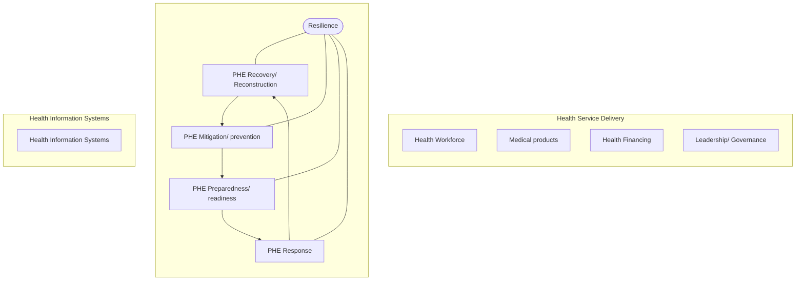
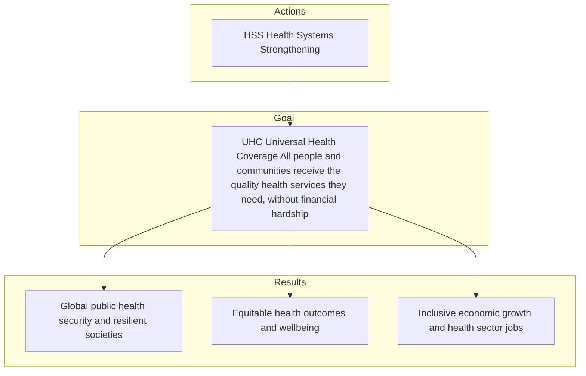
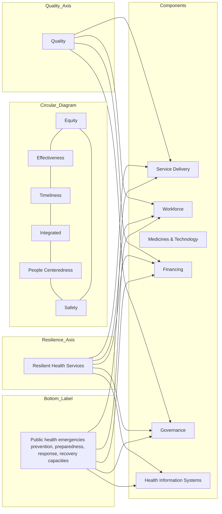
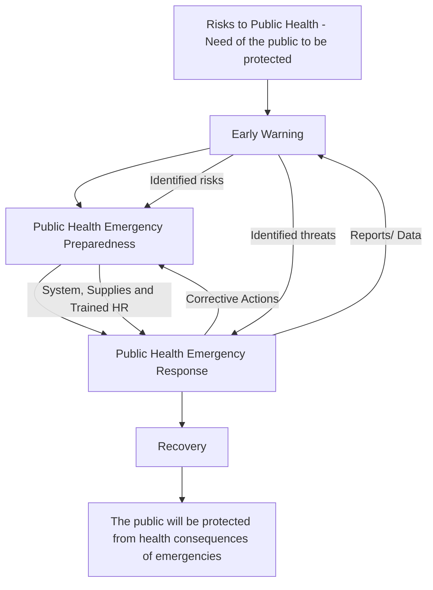
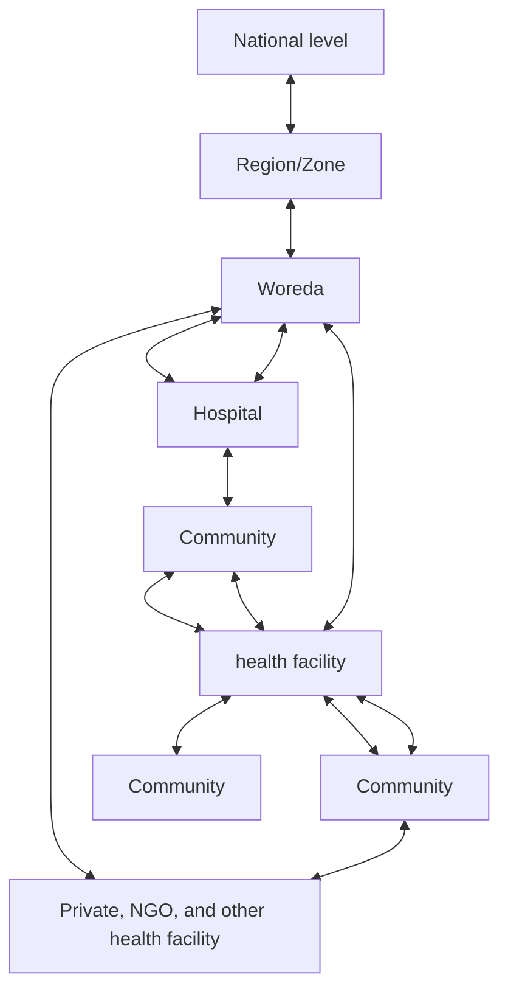
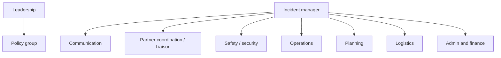
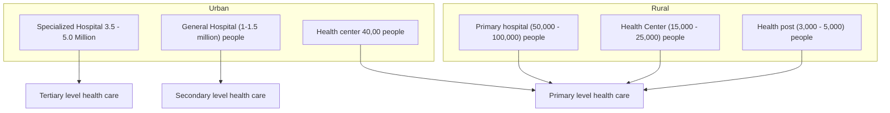

logo: Ministry of Health - Ethiopia

logo: Ethiopian Public Health Institute

## **Public Health Emergency Management at Healthcare Facilities Training for Health Facility Leaders in Ethiopia**

### **Participant Manual**

**Ethiopian Public Health Institute**
**Ministry of Health**

**Addis Ababa, Ethiopia**
**April, 2023**

## **Table of contents**

| Table of contents | i |
| --- | --- |
| Foreword | iii |
| Approval Statement of the Ministry/ Addis Ababa University | iv |
| Acknowledgement | v |
| List of Acronyms | vii |
| List of figures | x |
| Introduction to the Manual | xi |
| Course Schedule | xiv |
| Chapter One: Basic Terminologies and Concepts | 1 |
| 1.1 Health System | 2 |
| 1.2 Universal health coverage (UHC) | 4 |
| 1.3 Health security | 5 |
| 1.4 International Health Regulation (IHR 2005) | 7 |
| 1.5 One Health (OH) | 10 |
| 1.6 Public Health Emergency and its impacts on health system | 10 |
| 1.7 Chapter summary | 15 |
| Chapter Two: Public Health Emergency Management | 16 |
| 2.1 Introduction to PHEM | 17 |
| 2.2 Early Warning | 19 |
| 2.2 Preparedness | 22 |
| 2.2.1 Vulnerability Risk Assessment and Mapping (VRAM) | 23 |
| 2.2.2.Emergency Preparedness Response Plan (EPRP) | 26 |
| 2.2.3 Simulation exercise (SIMEX) | 30 |
| 2.2.4 Surge capacity | 31 |
| 2.3 Response | 33 |
| 2.3.1 Outbreak investigation and response | 34 |
| 2.3.2 Deploying Rapid Response Team (RRT) and other emergency response team | 34 |
| 2.3.3 Establishment Public Health Emergency Operation Center (PHEOC) | 38 |
| 2.3.4 Ensuring Essential Health Services Continuity | 47 |

i

| 2.4 Recovery and Rehabilitation | 50 |
| --- | --- |
| 2.4.1 Preparation of Post Disaster Recovery Plan | 52 |
| 2.4.2 After Action Review (AAR) | 54 |
| 2.5 Chapter Summary | 56 |
| Chapter Three: Global and National Context of Public Health Emergency Management . | 57 |
| 3.1 PHEM in A Global Context | 58 |
| 3.2 PHEM in African Context | 60 |
| 3.3 Health System and PHEM in Ethiopia | 62 |
| 3.3.1 The Ethiopian health system | 62 |
| 3.3.2 PHEM in Ethiopia | 63 |
| 3.4 Chapter Summary | 77 |
| Chapter Four: Public Health Emergency Management at Health Facility National Implementation Plan | 78 |
| 3.1 Objective of the Implementation Plan | 79 |
| 3.2 Scope of the plan, | 79 |
| 3.3. Period of the implementation | 79 |
| 3.4. Expected Outcomes | 79 |
| 3.5 Health Facilities PHEM Structure & Function | 80 |
| 3.6 Major Activities | 87 |
| 3.6.1 Assigning Dedicated PHEM officer/s | 87 |
| 3.6.2 Training | 88 |
| 3.6.3 Provision of Required Equipment, Documents and Supplies | 89 |
| 3.7 Implementation Strategies | 89 |
| 3.8 Mentoring and coaching | 90 |
| 3.9 Monitoring and Evaluation | 90 |
| 3.10 Implementation Arrangement | 91 |
| Reference | 92 |
| Annex | 94 |
| Annex: 1: Action Plan Development Template | 94 |

ii

## **Foreword**

The public health system is continually challenged by recurrent and unexpected disease outbreaks and is facing the challenges of managing health consequences of natural and human made disasters, emergencies, crisis and conflicts. The number of public health emergencies or humanitarian emergencies being experienced is increasing from time to time. These emergencies had significant health, social, economic and political impacts.

Real-world experience from the COVID pandemic, Ebola and other large-scale epidemics has shown that early detection, early notification and initiation of response actions contributes significantly towards lessening the health and socioeconomic impacts from these emergencies. Health care facilities serve as an important gateway for the detection, notification and initial response to any public health emergency and strengthening emergency management functions at healthcare service level including primary health care facilities is a critical component of pandemic preparedness.

As part of strengthening the capacity of health facilities to do so, the national Public Health Emergency Management (PHEM) center developed this course manual for health facility leaders across the health system to implement and monitor public health emergency preparedness, response and recovery functions at health facility level.

Therefore, this course material is prepared with the objective of building the capacity of health facility leadership particularly leaders of hospitals and health centers in Ethiopia.

Aschalew Abayneh,
Deputy Director General
Ethiopian Public Health Institute

iii

## **Approval Statement of the Ministry/ Addis Ababa University**

iv

## **Acknowledgement**

Ethiopian Public Health Institute (EPHI) would like to acknowledge the Deputy Director General Mr. Aschalew Abayneh & his Office for timely decision to strengthen Pubic Health Emergency Management at health facility level and giving opportunity of coordinating it to Recovery and Resilience Directorate.

The EPHI would also acknowledge Resilience and Recovery Directorate director Dr. Yaregal Fufa for coordinating the initiative and the directorate staffs for their contribution to preparation of this training participant manual for health sector leadership in collaboration with all relevant stakeholders.

We also would like to thank Building Resilience in Ethiopia (BRE-Ethiopia) & Oxford Policy Management (OPM) and the World Health Organization (WHO) Ethiopia for their technical input in development of this document. Our appreciation also goes to Resolve To Save Lives for their reviewing and technical inputs.

Lastly, we would like to thank workshop participants and reviewers from Ethiopian Public Health Institute, Ministry of Health, regional health bureaus and other government and non-governmental offices some of who are listed below:

| Name | Qualification | Organization |
| --- | --- | --- |
| Dr. Yaregal Fufa | MD, MPH | Ethiopian Public Health Institute |
| Dr. Kinfu Manzura | MD, MPH | Ethiopian Public Health Institute |
| Dr. Ayana Yeneabat | MD, MPH | Building Resilience in Ethiopia-OPM |
| Dr. Belay Mekango | MD, MPH | Ethiopian Public Health Institute |
| Dr. Negash Abera | MD, MPH | Ethiopian Public Health Institute |
| Tesfaye Solomon | MPH | Ethiopian Public Health Institute |
| Dr. Nathan Fikre | MD | Ethiopian Public Health Institute |
| Dr. Berihun Anagaw | MD | Ethiopian Public Health Institute |
| Dr. Abel Getu | MD | Ethiopian Public Health Institute |
| Dr. Shiferaw Tesfaye | MD | Ethiopian Public Health Institute |
| Dr. Misganaw Befikadu | MD | Ethiopian Public Health Institute |
| Yonas Asefa | MPH | Ethiopian Public Health Institute |
| Dr. Ermias Gebre | MD | Ethiopian Public Health Institute |
| Tewodros Girma | MPH | Ethiopian Public Health Institute |
| Dawit Teklu | MPH | Ministry of Health |

v

| Dagisew Derso | MPH | Ministry of Health |
| --- | --- | --- |
| Dr. Nahom Tadesse | MD | Ministry of Health |
| Kalkidan Hailu | MPH | Ethiopian Psychologist Association |
| Tilahun Desta | MPH | Addis Ababa Health Bureau |
| Almaz Tadesse | MPH | SNNPR Health Bureau |
| Tesfatsion Terefe | MPH | SWE Peoples Region Health Bureau |
| Sisay Awoke | MPH | Amhara Public Health Institute |
| Abate Zewdie | MPH | Oromia Regional Health Bureau |
| Shibiru Hoche | MPH | Sidama Public Health Institute |
| Fikadu Ayalew | MPH | B/Gumuz Regional Health Bureau |
| Chekole Hailu | MPH | Afar Public Health Institute |
| Marcus Ocol | MPH | Gambela Regional Health Bureau |
| Dr. Fekadu Adugna | MD, MPH | WHO Ethiopia Country Office |
| Dr. Desalegn Helemo | MD, MPH | Resolve To Save Lives |
| Molla Godif | MSc | Resolve To Save Lives |

vi

## **List of Acronyms**

| AAR | After Action Review |
| --- | --- |
| A-FETP | Advanced Field Epidemiology Training Program |
| AWD | Acute Watery Diarrhea |
| COVID-19 | Corona Virus Disease 2019 |
| DHIS | District Health Information System |
| EBS | Event-Based Surveillance |
| EOC | Emergency Operations Center |
| EPHI | Ethiopian Public Health Institute |
| EVD | Ebola Virus Disease |
| F-FETP | Frontline Field Epidemiology Training Program |
| GBV | Gender Based Violence |
| GHSA | Global Health Security Agenda |
| HCW | Health Care Workers |
| HF | Health Facility |
| HSTP | Health Sector Transformation Plan |
| IAR | Inter Action Review |
| IBS | Indicator-based surveillance |
| IDP | Internally Displaced People |
| IDSR | Integrated Disease Surveillance and Response |
| IHR | International Health Regulations |
| IPC | Infection Prevention and Control |
| MOH | Ministry of Health |
| NGO | Non-Governmental Organization |
| ODK | Open Data Kit |
| OH | One Health |
| PHE | Public Health Emergency |
| PHEM | Public Health Emergency Management |
| PHEIC | Public Health Emergencies of International Concern |
| PHEOC | Public Health Emergency Operation Center |
| PPE | Personal protective Equipment |

vii

| RHB | Regional Health Bureau |
| --- | --- |
| RRT | Rapid Response Team |
| SITREP | Situational Report |
| SPM | Strategic Planning and Monitoring |
| SWOT | Strengths, Weakness, Opportunities and Threats |
| UHC | Universal Health Coverage |
| VPD | Vaccine Preventable Disease |
| WoHO | Woreda Health Office |
| WHO | World Health Organization |

viii

## **List of tables**

| Table 1: The core components of International Health Regulations (IHR 2005) technical areas .. | 9 |
| --- | --- |
| Table 2: Organizational structure of incidence management system of health facility | 45 |
| Table 3: Logistic section of Organizational structure of incidence management system | 46 |
| Table 4: List of priority reportable diseases under surveillance in Ethiopia | 65 |
| Table 5: Timeline of reporting diseases under surveillance system in Ethiopia | 66 |
| Table 6: Distribution of assessed health facilities among regional states in Ethiopia, July 2022 | 67 |
| Table 7: Health workforce among selected health facilities in Ethiopia, July 2022 | 69 |
| Table 8: Establishment and functionality of RRT at health facilities in Ethiopia, July, 2022 | 70 |
| Table 9: Distribution of patient care and supportive services among selected health facilities in Ethiopia, July 2022 | 72 |
| Table 10: Summary of SWOT analysis for public health emergency management in Ethiopia .. | 73 |
| Table 11: Minimum PHEM human workforce required at facility level | 87 |

ix

## **List of figures**

| Figure 1: Health System Building blocks | 3 |
| --- | --- |
| Figure 2: Health system building blocks and public health emergency management interface | 3 |
| Figure 3: The Health System, Health Security and Universal Health Coverage | 7 |
| Figure 4: Quality Health Service and Health Emergency Management Interlinkages | 14 |
| Figure 5: Pillars of Public health Emergency Management System | 18 |
| Figure 6: Surveillance Data Flow of reporting and feedback information sharing | 21 |
| Figure 7: Organizational structure of incidence management system of health facility | 44 |
| Figure 8: Organization of health services delivery in Ethiopia | 63 |

x

## **Introduction to the Manual**

Ethiopian Public Health Institute (EPHI) as a technical arm of the Ministry of Health is mandated to coordinate the prevention, preparedness, detection, response, and recovery from public health emergencies. Understanding that health facilities are the gateways of public health emergencies - strengthening/establishing public health emergency management (PHEM) functions at health facility level is vital for early detection, early notification and early response of public health emergencies to avert or minimize the impact of these emergencies.

In order to establish/strengthen PHEM at health facility level, EPHI’s center for public health emergency management conducted a situational assessment of health emergency management functions in selected health facilities. One of the major findings of the assessment was lack of the required knowledge and skills among health facility leaders on public health emergency management functions. To address this gap, EPHI has prepared this training manual in collaboration with ministry of health, regional health bureaus and other stakeholders.

The training manual is developed based on Instructional Design Skill (IDS) and utilized different adult learning approaches to equip health sector leadership with necessary knowledge, skill and attitude on public health emergency management. It’s primarily aimed to enhance all health facilities/sector leadership knowledge, skill and attitude on PHEM so that they can contribute towards strengthening/establishment of PHEM at health facility level.

The manual has four chapters (Basic terminologies and concepts, components of Public Health Emergency Management (PHEM), global and national context of PHEM, and PHEM implementation plan at health facilities).

This PHEM at health facility leadership training package has the following core competencies:

* Describe the basic terminologies and concepts (health system, universal health coverage, health security, IHR 2005, PHEs and its impacts)
* Analyze the public health emergency management, its current status globally, continental and country levels.
* Develop action plan for PHEM at health facility level based on existing problems/gaps

xi

## **Course Syllabus**

**Course Description:** This is a 2 days training course prepared for health facilities/health office leadership at sub-national level on Public Health Emergency Management (PHEM). It enables them understand public health emergency management and strengthen/establish PHEM at the health facility level.

**Course Goal:** To provide participants with knowledge, skill and attitude needed to establish/strengthen PHEM at the health facility level.

**Learning Objectives:** By the end of this course participants will be able to:

* Describe basic terms (health system, universal health coverage, international health regulation 2005, health security, public health emergency and its impacts)
* Elaborate activities during public health emergency management (early warning, preparedness, response, and recovery)
* Describe national and global PHEM gaps/challenges
* Identify priority notifiable diseases in Ethiopia
* Understand PHEM gaps at health facility level
* Elaborate the recommendations to strengthen/establish PHEM at health facility level
* Develop action plan/implementation plan for establishing/strengthening PHEM at their facility/offices.

**Training Methods:**

* Interactive presentations
* Individual self-reflections
* Group discussions
* Reading

**Training Materials:**

* Training Package (Participant Manual, facilitator guide and PPT)
* LCD, laptop, flip chart, markers
* National PHEM Guideline

**Participant selection criteria:** Participants of this course should be health facilities leadership and includes:

* Health Facilities’ Chief Executive Officer (CEO)

xii

* Medical Directors/Facility Directors
* Health Facilities’ Board Chair
* Woreda, zonal and regional health offices’ PHEM leadership
* Disaster or emergency coordination committee (ECC) chair persons or woreda, zonal or regional administrators

**Trainers’/facilitators’ selection criteria:** trainers of this course will be:

* Those who developed this training material and have facilitation skill
* PHEM directorates at federal and regional level with experience on PHEM for at least for 2 years
* Advanced pre-service course on PHEM (e.g. advanced FELTP)
* Those who have been provided Trainee of Trainer’s (ToT) training on this course

**Method of Evaluation:**

**Participant Evaluation**

**Formative:**

* Individual and group exercises

**Summative:**

* Knowledge assessment: Post-test (70%)
* Skill assessment: Action plan development (30%)

**Course Evaluation**

* Daily and at the end of course participants’ evaluation
* Trainers’ feedback

**Certification Criteria:** participants will be certified when they score **≥70%** on summative assessment

**Training Venue:** Accredited in-service training centers with internet access

**Course duration:** 2 days

**Composition:** 30 participants, 5-6 facilitators/trainers

xiii

## **Course Schedule**

| Day 1 | Day 2 |
| --- | --- |
| 2hours • Participant registration • Self-introduction and welcome | 1hour 10 minutes Recovery • Recovery plan & AAR |
| Tea break |  |
| 2hours Basic Terminologies & Concepts • Health system, • Universal health coverage, • Health Security, • IHR 2005, • One Health, • PHE & its impacts | 1hour 30 minutes • Global and national PHEM context • PHEM at HF assessment finding • Findings from retrospective review |
| Lunch break |  |
| 1hour 30 minutes Introduction to PHEM • Early warning & public health surveillance PHE Preparedness • VRAM, EPRP, SIMEX, Surge Capacity | 3hours • PHEM at HF implementation plan & arrangement • Action plan development |
| Tea-break |  |
| 1hour 40 minutes Response • Outbreak Investigation • RRT, EOC & IMS • Medical countermeasures • Essential health service | 1hour • Action plan presentation, feedback incorporation and submission • Closing |

xiv

## **Chapter One: Basic Concepts and Terminologies**

**Duration: 2 Hours**

### **Chapter description:**

* This chapter focus on basic terminologies and concepts of Health system, and public health emergency management. This includes health system, Universal Health coverage (UHC), Health security, International Health regulation (IHR), one health and public health emergency (PHE) and its impacts on health system.

### **Chapter objectives:**

* After completing this chapter, the participants will be able to describe basic terminologies and concepts of Health system

### **Enabling objectives:** By the end of this chapter, participants will be able to:

* Describe the health system
* Explain Universal Health Coverage (UHC)
* Define health security
* Identify national & global health security agendas
* Elaborate international health regulations 2005
* Describe the One Health approach
* Define public health emergency (PHE)
* Discuss on the impacts of PHE on health system

### **Chapter Outline**

1.1 Health system
1.2 Universal Health Coverage
1.3 Health Security
1.4 International Health Regulations 2005 (IHR 2005)
1.5 One Health
1.6 Public Health Emergency and its impacts on health system
1.7 Chapter Summary

1

## **1.1 Health System**

### **Activity 1.1 Individual reflection**

icon: head silhouette with light rays

**Instruction:** Read the following questions and reflect

**Questions:**

* What is heath system?
* What are the building blocks of health system?
* When do we say the health system is functional?

**Time allowed:** 5 Minutes

### **Health System**

Health system consists of all the organizations, institutions, resources and people whose primary purpose is to improve health. It also includes patients, families, communities, ministries of health, health providers, health financing bodies etc. In order to function, a health system needs staff, funds, information, , transport, communications, and overall guidance and direction. It needs to provide services that are responsive, financially fair, and that treat people with respect (WHO 2010).

### **Health System Building Blocks**

Like any other system, is a set of inter-connected parts (known as building blocks) that must supplies function together to be effective. It delivers preventive, promotive, curative and rehabilitative interventions through a combination of public health actions and personal health care (health services). WHO has placed additional emphasis on health systems as the means to deliver effective and affordable care and to achieve increased health equity.

2

## **Health system building blocks**

## **Overall goals / outcomes**

flow_chart: Health system building blocks and their corresponding overall goals/outcomes

Figure 1: Health System Building blocks

Every health system building blocks are very important for all the stages of Public Health

Emergency Management (PHEM) as seen in figure 1 below

flow_chart: Health Service Delivery and PHE cycle diagram

Figure 2: Health system building blocks and public health emergency management interface

3

## **Requirements for Functional Health System**

A well-functioning health system is built on having;

* Trained and motivated health workers
* Reliable supply of medicines and technologies and well-maintained infrastructure
* Adequate and accessible funding
* Timely and adequate health information
* Evidence-based policies and plans – governance & leadership
* Participation of the community - community engagement
* All of this work together to ensure functionality and resilience of health services

### **1.2 Universal health coverage (UHC)**

#### **Activity 1.2 Individual reflection**

icon: head with lightbulb

**Instruction:** Read the following question and reflect

**Question:**

* What does ‘Universal Health Coverage ‘mean?

**Time allowed:** 3 Minutes

Universal Health Coverage means that “all people and communities receive the quality health services they need without financial hardship” (WHO). It provides equitable and quality promotive, preventive, curative, rehabilitative and palliative health services to all people without financial hardship.

Primary health care can cover the majority of a person’s health needs throughout their life including prevention, treatment, rehabilitation and palliative care within and beyond PHE contexts. It applies a whole-of-society approach to health and well-being centered on the needs and preferences of individuals, families and communities; this approach is critical for effective PHE management.

4

In 2015, the Ethiopian Government introduced a 20-year plan to achieve UHC. The three pillars of the current health policy of Ethiopia targeted for UHC include the development of an equitable and acceptable standard of health service, assurance of accessibility of health care for all, and provision of health care for the people on a scheme of payment with special assistance mechanisms.

## **1.3 Health security**

### **Activity 1.3 Individual reflection**

icon: head silhouette with lightbulb

**Instruction:** read the following questions and reflect

**Questions:**

* What does health security mean?
* What are the three strategic pillars of the current national action plan for health security (NAPHS)?

**Time allowed:** 5 Minutes

**Health Security refers to the** “activities required, both proactive and reactive, to minimize the danger and impact of acute public health events that endanger people’s health across geographical regions and international boundaries” (*WHO*). Health security and UHC require investment in all health system building blocks.

### **Global Health Security Agenda (GHSA)**

GHSA intends to pursue the following **strategic objectives** and achieve measures of success by December 31, 2023. It promotes international initiatives, instruments, and frameworks relevant for health security. Increase domestic and international partner financial support for strengthening and maintaining capacities to prevent, detect and respond to infectious disease outbreaks, including health system strengthening;

* ✓ Strengthen and support multi-sectoral engagement and commitment to health security;

5

* ✓ Improve sharing of best practices and lessons learned, and support the use and development as needed of relevant tools and mechanisms; and
* ✓ Strengthen accountability of all members under GHSA
* ✓ Capacities for managing PHEs is better achieved and sustained when embedded in the health system – avoiding the siloes approach
* ✓ Resilience building requires all health system building blocks and emergency management functions working together within the frame of essential public health functions with PHC using an integrated approach

## **National Action Plan for Health Security (NAPHS)**

As a signatory to the International Health Regulations (IHR 2005), Ethiopia is expected to take the necessary steps to prepare and carry out national implementation plans in order to strengthen, develop, and maintain core public health capacities. In line with this, the Health Sector Transformation Plan (HSTP), the second Growth and Transformation Plan of Ethiopia (GTP II), and the 2015 Global Health Security Agenda Roadmap together outline complementary strategies to ensure the health security of the community.

According to the 2016 Joint External Evaluation (JEE), out of the 46 indicators assessed under 19 action packages, there was no capacity for 9% of the indicators, limited capacity and developed capacity for 37% and 35% of the indicators respectively, and demonstrated capacity for 20% of the indicators. No sustainable capacity was recorded for any of the indicators. Based on this outcome, the development of the National Action Plan for Health Security (NAPHS) was initiated in November 2017.

The plan has set out three strategic pillars, which will help the country achieve its mission and vision in line with prevention, detection, and response of public health threats. These are:

1. Preparedness and Coordination

2. Detection Capacity and Communication

3. Response Capacity

6

These strategic pillars contain more than 74 objectives under the 46 JEE indicators of the 19 action packages indicated in the IHR to improve health security. These activities were categorized into four main thematic areas of IHR-health security: Prevent, Detect, Response, and Other IHR-related hazards.

The proposed objectives and activities under the 19 action packages are being implemented in a five-year period (2019 – 2023) through the involvement of different sectors in a One Health approach. The successful completion of the plan will ensure Ethiopia has demonstrable capacity of IHR requirements to detect, prevent, and respond to different health security issues, subsequently improving the overall health security in the country.

flow_chart: The Health System, Health Security and Universal Health Coverage

Figure 3: The Health System, Health Security and Universal Health Coverage

## **1.4 International Health Regulation (IHR 2005)**

### **Activity 1.4 Think/pair/share**

image: Think/pair/share activity instructions

**Instruction:** Read the following question discuss in pair and share your ideas to others

**Question:**

* What is International Health Regulation 2005?
* What are the three main categories of conditions required to be notified under the IHR 2005?

**Time required:** 5 min

June 2007. The public health emergency management (PHEM) system considers and encompass international obligations that Ethiopia ratified. Hence, most of the components of the IHR 2005 are also included and its capacities are being monitored under PHEM.

The scope of the regulation embraces all the public health emergencies of international concern (PHEIC), which includes those caused by infectious diseases, chemical agents, radioactive materials, and contaminated food. In order to implement the IHR successfully, it is important that building the core capacities such as coordination, surveillance, response, preparedness, risk communication, human resource development, and laboratory capacity are emphasized. These functions are also the main components of PHEM. Therefore, building a strong PHEM system process and strengthening its capacity will ensure the proper implementation of IHR 2005.

The three main categories of events that require to be notified under the IHR 2005 are:

1. Four conditions that must be notified to WHO: smallpox, poliomyelitis due to wild- type poliovirus, human influenza caused by a new subtype, and severe acute respiratory syndrome.
2. Other diseases and events with potential international public health concern that include the following: cholera, plague, yellow fever, viral hemorrhagic fever, other diseases that are of special national concern.
3. Any event of potential international public health concern including those of unknown cause or source, and other events or diseases than those listed in the above two bullet points.

The definitions of event and disease in the IHR (2005) are the building blocks of the expanded surveillance and notification obligations. The term “event” is defined as a manifestation of disease or an occurrence that creates a potential for disease. “Disease” means an illness or medical condition, irrespective of origin or source that presents or could present significant harm to humans.

* Accordingly, notification may be required for: Events, irrespective of their origin or source, including those caused by biological, (both of an infectious and non-infectious nature) chemical agents or radio-nuclear materials;

8

* ✓ Events where the underlying agent, disease or mode of transmission is new, newly-discovered or as yet unknown at the time of notification; Events involving transmission or potential transmission through persons, vectors, cargo or goods (including food products) and environmental dispersion;

* ✓ Events that carry potential future impact on public health and require immediate action to reduce the consequences;

* ✓ Events arising outside of their established patterns of occurrence.

Strong IHR capacities are important for reducing the risks, occurrence, severity of PHEs and therefore its impact of on health system/services

Table 1: The core components of International Health Regulations (IHR 2005) technical areas

| Prevent |  |
| --- | --- |
| 1 | National legislation, policy and financing |
| 2 | Coordination, communication and advocacy |
| 3 | Antimicrobial resistance |
| 4 | Zoonotic disease |
| 5 | Food safety |
| 6 | Biosafety and biosecurity |
| 7 | Immunization |
| Detect |  |
| 8 | National laboratory system |
| 9 | Surveillance |
| 10 | Reporting |
| 11 | Human resources |
| Respond |  |
| 12 | Emergency preparedness |
| 13 | Emergency response operations |
| 14 | Linking public health and security authorities |
| 15 | Medical countermeasures and personnel deployment |

9

| 16 | Risk communication |
| --- | --- |
| IHR related hazards and points of entry |  |
| 17 | Points of entry |
| 18 | Chemical events |
| 19 | Radiation emergencies |

## **1.5 One Health (OH)**

**One Health (OH)** is an approach to address a shared health threat at the human-animal-environment interface with an ultimate goal of achieving optimal health outcomes for humans and animals. The One Health approach is intrinsic to and strongly reinforced by WHO’s IHR (2005) and the IDSR strategy. OH meant to improve indicator- and event-based surveillance. The approach also offers a comprehensive framework for IHR (2005) implementation and helps to address PHEIC of all sources.

The IDSR is a strategic approach to improve public health surveillance for priority diseases, conditions and events at the community, health facility, district and national levels. The IDSR promotes rational and efficient use of resources by integrating and streamlining common surveillance activities and functions.

## **1.6 Public Health Emergency and its impacts on health system**

### **Activity 1.5 Group activity**

icon: illustration of a group of people sitting in a circle for a discussion

**Instruction:** Be in group of 4-5, discuss on the following questions and present to the class

**Questions:**

* What is public health emergency?
* Select one of the PHEs in your locality (e.g. COVID-19) and discuss on its impact on all health system/its building blocks

**Time required:** 30 mins

10

## **Public Health Emergency (PHE)**

Public Health Emergency is a situation that has an impact on the lives and well-being of a large number of people or a significant percentage of a population and requires substantial multisectoral assistance or which requires extra ordinary effort (WHO). Public health emergencies (PHE) including disasters impacting or threatening the lives and well-being of a large number of people and requiring substantial multi-sectoral assistance, not limited to acute events. Events may be requiring the government to declare a state of public health emergency.

## **Major Impacts of PHEs on Health System Building Blocks**

### **Leadership & Governance**

* Collapse of strategic health policy framework
* Leaders busy with fire fighting
* Lack of oversight function and coordination
* Inability to enforce health regulations & ensure accountability

### **Health Financing**

* Budget strain due to increased expenditure on emergency response
* Diversion/reduction of funding for the health system strengthening
* Inadequate funds for maintenance of essential health services
* Decreased affordability of healthcare due to increased poverty or increased cost

### **Health Information System**

* Health information management systems collapse
* Inability to effectively monitor health system performance e.g. due to diversion of required resources

### **Medical products, vaccines and technologies**

* Supply chain management breakdown
* Drug and supplies stock-out due to increased demand
* Looting, damage, destruction, contamination of medical items and infrastructure
* Production of Poor-quality medical products

11

## **Health workforce**

* Healthcare associated infection, illness, disability & death
* Fatigue or burn-out from work overload
* Psychosocial stress or trauma e.g., anxiety due to knowledge / skill gap to handle PHE, fear of PHE related risk (e.g., infection risk) to family & friends
* Hardship from difficult working conditions e.g., responding to PHE in hard-to-reach areas inaccessible to vehicles, financial hardship
* Social effects such as stigmatization from other community members e.g., due to fear of the type of PHE (like COVID-19)
* Security risks e.g. attack on health workers due to community dissatisfaction or lack of trust in health workers

## **Community**

* Health Impacts including mental health, increased morbidity and mortality due to the PHE or health service disruption
* Socio-economic impacts e.g. stigmatization, displacement, loss of livelihoods, Food insecurity, financial hardship from high cost of healthcare due to PHE
* Environmental impacts e.g. destruction due to disaster like earth quake, flooding, pollution from increased use of disinfectants for infection control,

## **Health Service Delivery**

* Reduced access to health services e.g. due to reduced affordability, proximity or road/transport accessibility
* Decreased availability and coverage of health services
* Reduced public confidence or trust in health services
* Reduced utilization of health services
* Decreased quality (including safety, effectiveness, equity, responsiveness, timeliness, efficiency) of available health service

12

## **Consequences of Health Service Disruption by PHEs**

As seen in Cholera, COVID19 and other PHEs; when health services are disrupted by PHEs, there are direct and indirect health and non-health consequences.

Examples include;

* Prolongation of the PHE and its direct consequences such as increased fatality e.g. due to poor IPC and case management
* Excess mortality and morbidity due to other illnesses e.g. communicable (HIV, malaria etc.) and non-communicable diseases (e.g. hypertension, mental health disorders etc.)
* Non-health impacts e.g. economic hardship from increased cost of accessing health care due to the PHE. E.g. Increased transportation cost to access health care that is no-longer available nearby;
* Social impacts e.g. social disintegration of the society, social isolation, stigma, etc.

## **Preventing and Mitigating PHE Impacts on the Health System**

* The ability to withstand the shocks of PHEs by avoiding or minimizing their potential impact and maintaining routine health services is a demonstration of public health emergency management in the health system
* While public health emergency management is demonstrated during shock events, it is built over time, ideally before PHEs strike and further developed based on experience and learning.
* The attributes and capacities associated with health system/services public health emergency management can therefore be framed around the emergency cycle Before, during and after emergencies / events

## **Health Service Quality and public health emergency management Interlinkages**

* Health care quality is the degree to which health care services for individuals and populations increase the likelihood of desired health outcomes (*"Understanding Quality Measurement". www.ahrq.gov. Retrieved 2016-11-21.*). One of the priority agendas of our country is improving health service quality. Improving all health system building blocks

13

helps to build resilient health care system. Health system/service resilience can be seen as an outcome of quality healthcare services in combination with capacities for essential public health functions in emergency prevention, preparedness, response and recovery.

* **Health system resilience** can be defined as the capacity of health actors, institutions, and populations to prepare for and effectively respond to public health emergency/Shock/crises; maintain core functions when a crisis hits; and, informed by lessons learned during the crisis, reorganize if conditions require it (Kruk et al., 2015)

flow_chart: Quality Health Service and Health Emergency Management Interlinkages

**Figure 4: Quality Health Service and Health Emergency Management Interlinkages**

14

## **1.7 Chapter summary**

* Health system building blocks include: service delivery, health workforce, health information, medical supplies, financing, leadership and community.
* Health security refers to the “activities required, both proactive and reactive, to minimize the danger and impact of acute public health events that endanger people’s health across geographical regions and international boundaries”
* NAPHS has set out three strategic pillars: preparedness and coordination, detection capacity and communication and response capacity
* IHR 2005 is a legally binding agreement among state parties to build their capacity to detect, assess, report and respond promptly and effectively to public health events of international concern
* PHE is a situation that has an impact on the lives and well-being of a large number of people or a significant percentage of a population and requires substantial multisectoral assistance or which requires extra ordinary effort.

15

## **Chapter Two: Public Health Emergency Management**

**Duration: 4 hours**

### **Chapter description:**

* This chapter focus on management of public health emergencies through the public health emergency management (PHEM) cycle: early warning, preparedness, response, and recovery and rehabilitation.

### **Chapter objectives:**

* After completing this chapter, the participants will be able to elaborate management of public health emergencies using PHEM cycle

**Enabling objectives:** By the end of this chapter, participants will be able to:

* Define Public Health Emergency Management (PHEM)
* Elaborate early warning system as well as public health surveillance
* Identify pre-emergency preparedness activities
* Describe activities during public health emergency response
* Discuss recovery and rehabilitation activities

#### **Chapter Outline**

2.1 Introduction to PHEM
2.2 Early Warning
2.3 Preparedness
2.4 Response
2.5 Recovery and rehabilitation
2.6 Chapter summary

16

## **2.1 Introduction to PHEM**

### **Activity 2.1 Individual reflection**

icon: head silhouette with lightbulb

**Instruction:** Read the following questions and reflect

**Questions:**
* What is Public Health Emergency Management (PHEM)?
* List pillars of PHEM?

**Time allowed:** 5 Minutes

PHEM involves the process of anticipating, preventing, preparing for, detecting, responding to, controlling, and recovering from consequences of public health and nutritional threats so that health and economic impacts are minimized (EPHI, 2020). It involves early warning, emergency preparedness, response and recovery. The presence of integrated structures, partnerships, and accountability with clear leadership is critical to support a coordinated inter-operational system (Ethiopian Health and Nutrition Research Institute, 2012).

### **Guiding Principles of PHEM:**

* **Multi-Hazard-Approach:** The PHEM system evolved from a traditional communicable disease orientation to a more modern multi-hazard approach.
* **Risk Assessment to Recovery:** PHEM will cover the entire cycle of an emergency or disaster; from prevention and detection to response and recovery.
* **Risk Assessment and Mitigation:** Each and every level in the health system is required to understand the health hazards and risks posed on their population.
* **International Health Regulation (IHR 2005):** The IHR 2005 is a legally binding document that entered into force on 15 June 2007 with the purpose to: Prevent, protect

17

against, Control and provide public health response to the international spread of disease in ways that are relevant and restricted to public health risks, and which avoid unnecessary interference with international traffic and trade.

## **Pillars of PHEM**

❖ The four areas highlighted in the figure correspond to the four **pillars** of PHEM:

* ✓ Early warning System;
* ✓ Public Health Emergency Preparedness;
* ✓ Public Health Emergency Response and
* ✓ Recovery

flow_chart: Pillars of Public health Emergency Management System

Figure 5: Pillars of Public health Emergency Management System

18

## **2.2 Early Warning**

### **Introduction**

The purpose of early warning is to enable the provision of timely and effective information to the public, health authorities and front-line responders, through identified institutions that allow preparing for effective response or taking action to avoid or reduce risk. Monitoring of different public health risks (through Medias) and conducting public health surveillance are activities during early warning.

### **Public health Surveillance system**

#### **Activity 2.2 Individual reflection**

icon: head with lightbulb

**Instruction:** Read the following questions and reflect

**Questions:**

* What is public health surveillance? How do you call in your local language? Why is it needed?
* What types of surveillance do you know?
* Share your experience of using it

**Time allowed:** 5 Minutes

Public health surveillance is an on-going and systematic health data collection, compilation, analysis and interpretation for public health action. Public health surveillance serves as **an “early warning system”** – providing timely information needed for action. It is information collected for action; action can be Responding, Planning, Evaluation and Policy making.

The approach of surveillance system is integrated Disease Surveillance and Response (IDSR) that aims at collecting health data for multiple diseases to ensure robust early warning and prompt response. The IDSR data collection and analysis system relies on two main channels of information or signal generation; Indicator-based surveillance (IBS) and Event-based surveillance (EBS).

19

## Objectives of Public Health Surveillance

* ✓ To estimate magnitude of the problem
* ✓ Early recognition of epidemics - detect sudden changes in disease occurrence.
* ✓ To predict and prevent entry/exit and spread of infectious disease
* ✓ To follow secular (long-term) trends
* ✓ Projections of future trends
* ✓ To evaluate public health programs
* ✓ To generate hypotheses and stimulate research

### **Critical Information in Surveillance**

Generally, a surveillance system should determine the *Who, What, When, Where, and How* questions. The critical information should include: **Person**: Age, sex; **Time**: onset of disease, reporting period and **Place**. **Risk factors**, **Number of cases** (magnitude) and **Treatment outcome** such as deaths, recovery (seriousness), **Mode of treatment** and **inpatient/outpatient information** should be included.

### **Types of Surveillance approach**

1.  **Passive Surveillance**: A surveillance where reports are awaited and no attempts are made to seek reports
2.  **Active Surveillance**: public health officers seek reports from participants in the surveillance system
3.  **Sentinel surveillance**: it is an efficient way to collect high-quality data in a timely manner systematically and routinely from representatives of the population under surveillance so that the information gathered can be applied to the population or among subpopulations at higher risk of developing severe disease.

### **During special events**

Modified forms of surveillance:

**1. Intensified Surveillance**: The upgrading from a passive to an active surveillance system for a specified reason and for a limited period (could be because of an outbreak).

20

**2. Enhanced Surveillance:** The collection of additional data about cases reported under routine Surveillance

### **Surveillance flow chart**

flow_chart: Surveillance data flow diagram

**Legend**
Upward transmission of reports, data & information
Feedback and information sharing

Figure 6: Surveillance Data Flow of reporting and feedback information sharing

21

## **2.2 Preparedness**

### **Activity 2.3 Group activity**

icon: illustration of a group of people sitting in a circle for discussion

**Instruction:** Be in a group of 4-5 and discuss on the following questions and present to the class
**Questions:**
* What is public health emergency preparedness?
* What are the activities during public health emergency preparedness?
**Time required:** 25 mins

Preparedness is defined as "the range of deliberate, critical tasks and activities necessary to build, sustain, and improve the operational capability to prevent, protect against, respond to, and recover from incidents". Preparedness activities and tasks are those things that should be done prior to the occurrence of emergency. Development of plans, procedures, protocols, and systems; establishment of mutual aid agreements; provision of training; and the conduct of exercises are among other preparedness tasks. Preparedness is a responsibility shared by all level of government, private sector not for profit, institutes and professional association.

The main objectives of health emergency preparedness:

* Preventing avoidable crisis and catastrophes
* Reducing morbidity and mortality effects
* Availing resources
* Minimizing disruption to health services
* Maintaining business continuity as far as possible
* Reducing disruption to society as much as possible

The public health emergency preparedness capabilities:

1. Putting in place the necessary logistics and funding
2. Building the essential systems specific to protection, prevention and response

22

3. Equipping public health personnel and respondents with the necessary knowledge and tools.
4. Educating the public on related measures to be taken to prevent and control the event.
5. System infrastructure development and resilience activity based on the event condition
6. Documenting findings and knowledge sharing for anticipation and responding further emergencies.

## **Activities/ sub-process of Preparedness**

* Vulnerability assessment and risk mapping;
* Planning for identified risks and hazards;
* Capacity building;
* Strengthening medical counter measures;
* Monitoring and evaluation;
* Rehearsal or simulation and
* Resource mobilization

### **2.2.1 Vulnerability Risk Assessment and Mapping (VRAM)**

| Activity 2.4 Think/pair/share |  |
| --- | --- |
| icon: Think, Pair, Share process diagram | Instruction: Discuss in pair and share your ideas to others from your experience on VRAM Questions: • What is VRAM? • What is the importance of VRAM? Time required: 5 min |

**Risk assessment** is a methodology to determine the nature and extent of risk by analyzing potential hazards and evaluating existing conditions of vulnerability that together could potentially harm exposed people, property, services, livelihoods and the environment on which they depend.

23

Hazard identification, risk assessment and control are an on-going process. Therefore, regularly review the effectiveness of your hazard assessment and control measures.

**Vulnerability assessment** is a continuing, dynamic process of assessing hazards and risks that threaten the population and the health system and determining what can be done about it. Vulnerability assessments also include a method of structured data collection geared towards understanding the levels of potential threats, population likely to be affected, coping capacity, relief needs and available resources to address them.

**A vulnerability assessment provides:**

* A means to inform decision-makers about the needs of preparedness at different levels;
* A starting point to construct an overall plan that corresponds to the dimensions of identified risks. This can also help to measure the levels of preparedness or unpreparedness
* The basis for monitoring trends of risks in emergency prone areas. In that sense, the initial effort of developing a data base through vulnerability assessments should become the basis for maintaining and updating an essential informational tool for development planning purposes.

**Steps while conducting VRAM are:**

**Step 1: Contextualization:** Define the physical, social, environmental and statutory environment within which the risk exists. Take into account all the stakeholders relevant to the risk management.

**Step 2: Hazard identification:** identify those hazards that present significant risks (i.e., could give rise to an emergency) in functional areas for which they have lead responsibility.

**Step 3: Risk analysis:** Assessing the likelihood of hazards. An assessment of the likelihood of the hazards occurring within the next two years should always be done.

**Step 4: Risk evaluation:** risk assessments are produced by combining the assessed likelihood and impact scores of a hazard or threat by plotting them on a risk matrix. The risk assessment can be calculated as **Risk= Likelihood X Impact**

Each sector should have its own risk matrix for the risks for which it has lead responsibility. Based on the evaluation, the risk matrix could show very high risk, high risk, medium risk and low risk.

24

**Step 5: Risk Reduction:** Prioritizing contingency activities on an objective basis and to measure the effectiveness of actions in reducing risk or making response plans. The process of risk reduction has a number of stages that are described below:

* Assess the type and extent of the capabilities (equipment, trained staff, facilities, plans) required for managing and responding to the hazards.
* Identify the capabilities that are already in place.
* Identify the additional resources needed with a priority order keeping in mind the economic reality of the region.
* Identify what other organizations may contribute.
* Align actions with what is available at hand and other organizations’ contributions to minimize or fill gaps.

**Step 6: Monitoring, reviewing and publishing:** reviewing regularly the risks and risk treatment programs. A good opportunity is the experience of an emergency elsewhere questions to ask include “Could it happen here?” “Are our assumptions still valid?” and “Were there any impacts which were not taken into account in our risk assessment?”

### **2.2.2 Strategic Toolkit for Assessing Risk (STAR)**

The STAR is a comprehensive toolkit that enables national, subnational, and local authorities to rapidly conduct a strategic and evidence-based assessment of public health risks

* Offers whole of society, multi-sectoral, practical and participatory methodology
* Identify potential health emergencies and disasters that may trigger a coordinated response
* Provide the basis for evidence-based planning, policy, strategy and decision-making with clear risk prioritization
* Allocate resources, considering limited means and competing priorities to prevent, mitigate, prepare for, be ready, respond to and recover from risks

### **STAR key principles**

#### A. **Risk Informed Evidence Compilation**

* STAR is based on both evidence available and knowledge of experts working in the country for both biological and non-biological hazards and evaluations of previous emergencies and disasters

25

## **B. All-hazards Approach**

* STAR acknowledge that, while hazards vary in source (natural, technological, societal), they often challenge health systems in similar ways. STAR cover a full spectrum of emergencies or disasters

## **C. Whole of Society**

* The process is inclusive, ensuring all relevant sectors involved are participating, inclusive of civil society

## **D. Health System approach**

* Considers the impact to the health system at all levels including primary, secondary and tertiary levels as well as community health, and research

## **E. Transparency**

* Data and information sharing within the workshop should be agreed across stakeholders and results rely upon objectivity and openness of participants

## **F. Flexibility**

* The scope is flexible and adaptable. The tool can be used at national, sub-national or municipality levels.

## **2.2.3. Emergency Preparedness Response Plan (EPRP)**

### **Activity 2.5 Individual reflection**

icon: head silhouette with light rays

**Instruction:** read the following questions and reflect

**Questions:**

* What is emergency preparedness response plan?
* What is the importance of EPRP?
* Share your experience on EPRP?

**Time allowed:** 5 Minutes

The EPRP is a comprehensive document that describes how an agency, organization or a country will manage its responses to emergencies of various types by providing a description of the objectives, policy and concept of operations for the response to an emergency. The plan will clearly

26

delineate the roles, structure, authorities and responsibilities for a systematic, coordinated and effective emergency response. A national/regional/woreda health EPRP describes how the health sector structures organizes itself for the management of an emergency response.

Planning is the theme of the whole emergency preparedness exercise. Plans should be updated regularly and exercised periodically especially following major incidents and mock exercises to include lessons learned. The plans should form the basis of estimation of required resources for predictable emergencies including training.

EPRP establishes the operational framework for the response phase of risk management in countries at national level and links to the response of communities as the first responder. Hazard specific emergency preparedness and response plan is prepared for all high scoring hazards identified by national level VRAM exercise for the country. Previous years mortality and morbidity data from different sources were used to quantify planning assumptions for every hazard.

EPRP can only describe "how" to respond to an event using what is available at that time and can only refer to what already exists or what may become available during the response.

The activities and steps in EPRP:

* Identify and convene preparedness planning team(s)/experts from different sectors including partners,
* Coordinate and integrate all response and recovery agencies/organizations in the planning process,
* Identify needs required to respond to potential emergencies
* Discuss with partners to identify, endorse and agree on their roles and responsibilities,
* Develop plans, to prevent, protect against, respond to, and recover from natural and man-made disasters,
* Prepare monitoring mechanisms/ tools to ensure preparedness plan is operationalized

27

## **2.2.4 Hospital or Health Facility Disaster Response Planning**

### **Activity 2.6 Group activity**

icon: illustration of a group of people sitting in a circle for discussion

**Instruction:** Be in a group of 4-5 and discuss on the following questions and present to the class

**Questions:**
* What is hospital/health facility disaster response plan?
* What are the objectives of hospital/health facility disaster planning?
* What are considerations during its preparation?

**Time required:** 20 mins

During times of disaster, health facilities play an integral role within the health-care system by providing essential medical care to their communities. The responsible hospital/health facility administrator/chief executive officer or medical director should facilitate preparation of detailed plans for hospital/health facility service continuation while responding to the emergency event or a disaster. These plans should ideally be available in all hospitals/health facilities (from primary to tertiary levels). The plan should also have detailed structural and functional relationships.

#### **Objectives and goals of a Hospital Disaster Plan**

The main objective of a hospital/health facility emergency/disaster plan is to optimally prepare the staff and institutional resources of the health facilities for effective performance in different disaster or emergency situations. The hospital/health facility disaster plans should address not only the mass casualties which may result from mass causality incidents that may occur away from the facility, but should also address the situation where the health facility/hospital itself has been affected by a disaster – such as, fire, explosion, flooding or earthquake.

#### **Principles of a Hospital Disaster Plan**

* **Predictable:** The hospital/health facility disaster plan should have a predictable chain of management.
* **Simple:** The plan should be simple and operationally functional.
* **Flexible:** Plan should have wiggle room.
* The plan should be **executable** for various forms and dimensions of different disasters.

28

* **Concise:** Short and clear definition of authority
* **Clear functional structure:** The plan should specify various roles, responsibilities, work relationships of administrative and technical groups.
* **Comprehensive:** Compatible with various hospitals. It should be comprehensive enough to look at the network of various other health care facilities along with formulation of an inter-hospital transfer policy in the event of a disaster.
* **Adaptable:** Although the disaster plan is intended to provide standard procedures which may be followed with little thought, it is not complete if there is no space for adaptability.
* **Anticipatory:** All hospital plans should be made considering the worst-case scenarios.
* **Integration:** The hospital plans have to be integrated with the regional (Woreda/Zone) plan for proper implementation.

## **Approach for making Disaster Plan for hospital**

The hospital disaster planning can be divided into three phases:

### **a) Pre disaster phase**

* ✓ **Planning:** Most of the assessment and planning is done in the pre disaster phase, the hospital plans are formulated and then discussed in a suitable forum for approval.
* ✓ **The disaster manual:** The hospital disaster plan should be written down in a document form and copies of the same should be available in all the areas of the hospital.
* ✓ **Staff education and training:** It is very important for the staff to know about and get trained in using the hospital disaster/emergency manual.
* ✓ **Regular staff training by suitable drills** should be undertaken in this phase.

### **b) Disaster Phase**

* ✓ **Phase of activation:** Alter and notification of emergency.
* ✓ **Activation of the chain of command in the hospital.**
* ✓ **Operational phase:** This is the phase in which the actual tackling of mass casualties is performed according to the disaster/emergency plan.
* ✓ **Phase of deactivation:** An important phase of the hospital emergency plan when the administration/command of the hospital is satisfied that the influx of mass casualty victims is not continuing to overwhelm the hospital facilities.

### **c) Post Disaster Phase**

29

* ✓ This is an important phase of disaster planning where the activities of the disaster/emergency phase are discussed and the inadequacies are noted for future improvements.

## **2.2.5 Simulation exercise (SIMEX)**

### **Activity 2.7 Individual reflection**

icon: head with lightbulb

**Instruction:** read the following questions and reflect
**Questions:**
* What is the use of simulation exercise?
* What are the types of simulation exercises?
**Time allowed:** 5 Minutes

A simulation exercises is a fully simulated, interactive exercise that tests the capability of an organization or other entity to respond to a simulated emergency, disaster or crisis situation. Simulation exercises can help develop, assess, and test the functional capabilities of emergency systems, procedures and mechanisms to respond to outbreaks and public health emergencies. Simulation exercises are normally run as field exercises and include a scenario that is as close to reality as possible. The scenario takes place in real-time, and requires a variety of resources to operate – both human and material.

SimEx’s are exercises for practical operations in which the participants’ actions are evaluated. The actions that are taken and the way decisions are made in response to the particular situation will determine the development of the exercise.

### **Types of simulation exercises**

There are four types of simulation exercise.

1.  **Tabletop Exercise**
2.  **Drill**
3.  **Functional Exercise**
4.  **Full-Scale Exercise**

30

**Table top Exercise:** Facilitated analysis of an emergency situation in an informal stress-free environment. It is designed to elicit constructive discussion as participants examine and resolve problems based on existing operational plans and identify where plans need to be refined. Minimal attempt at simulation in which equipment is not used, resources are not deployed, and no time pressures are introduced.

**Drills:** A coordinated, supervised exercise activity, normally used to test a single specific operation or function of one small response plan. There is no attempt to coordinate organizations. The effectiveness is its focus on a single, relatively limited portion of an overall system.

**Functional Exercises:** A fully simulated interactive exercise that tests the capability of an organization to respond to an event. It tests multiple functions of the organization’s operational plan. It is the coordinated response to a situation in a time pressured, realistic simulation and focuses on the coordination, integration, and interaction of an organization’s policies, procedures, roles and responsibilities before, during, or after the simulated event.

**Full-Scale Exercise:** Simulates a real event as closely as possible and designed to evaluate the operational capability of emergency response. It is conducted in a stressful environment that simulates actual response conditions which requires the mobilization and actual movement of emergency personnel, equipment, and resources that tests and evaluates most functions of the emergency plans.

## **2.2.6 Surge capacity**

### **Activity 2.8 Individual reflection**

icon: lightbulb with a green line

**Instruction:** read the following questions and reflect
**Questions:**
* What is surge capacity?
* How can increase your facility surge capacity?
**Time allowed:** 5 Minutes

**Surge capacity** – defined as the ability of a health service to expand beyond normal capacity to meet increased demand for clinical care. It is an important factor of hospital disaster response and should be addressed early in the planning process. Surge capacity is the increased capacity

31

available during mass casualty situations and disasters. Surge capacity must be developed and maintained, which requires action by health systems, and must include continued medical care of all other patients. Surge capacity is not defined by time. When capacity is breached, patients must be transferred safely to other treatment facilities.

## **4 S’s of Surge**

**Space** - physical structures, temporary facilities
**Staff** - capability, sufficiency, training
**Supplies** - and equipment
**System** - SOPs, protocols

## **Recommended action surge capacity**

* Calculate maximal capacity required for patient admission and care based not only on total number of beds required but also on availability of human and essential resources and the adaptability of facility space for critical care.
* Estimate the increase in demand for hospital services, using available planning assumptions and tools.
* Identify methods of expanding hospital inpatient capacity (taking physical space, staff, supplies and processes into consideration).
* Designate care areas for patient overflow (e.g., auditorium, lobby).
* Increase hospital capacity by outsourcing the care of non-critical patients to appropriate alternative treatment sites (e.g., outpatient departments adapted for inpatient use, home care for low-severity illness, and chronic-care facilities for long-term patients).
* Verify the availability of vehicles and resources required for patient transportation.
* Establish a contingency plan for inter-facility patient transfer should traditional methods of transportation become unavailable.
* Identify potential gaps in the provision of medical care, with emphasis on critical and emergent surgical care. Address these gaps in coordination with the authorities and neighboring and network hospitals.
* In coordination with the local authorities, identify additional sites that may be converted to patient care units (e.g., convalescent homes, hotels, schools, community centers, gyms).

32

* Prioritize/cancel nonessential services (e.g., elective surgery) when necessary.
* Adapt hospital admission and discharge criteria and prioritize clinical interventions according to available treatment capacity and demand.
* Designate an area for use as a temporary morgue. Ensure the adequate supply of body bags.
* Formulate a contingency plan for post mortem care with the appropriate partners (e.g. morticians, medical examiners and pathologists).

## **2.3 Response**

### **Activity 2.9 Group activity**

icon: illustration of a group of people sitting in a circle

**Instruction:** Be in a group of 4-5 and discuss on the following questions and present to the class

**Questions:**

* Select one/two of the public health emergencies you experienced and describe the response activities you conducted
* What were the strengths, gaps and challenges during your response

**Time required:** 30 mins

Public health emergency response to disease outbreaks, disasters, displacements, and other public health issues requires the integration and effective application of skills of multidisciplinary experts and logistics. There must be a series of measures that are operating at the same time, each to a high level of efficiency.

Rapid response limits the number of cases and geographical spread, shortens the duration of the public health emergency, and reduces fatalities. These benefits not only help save resources that would be necessary to tackle public health emergencies, but also reduce the associated morbidity and mortality.

## **Health care practices and approaches during Public Health Emergency Response**

The following health care practices expected during response will be elaborated below:

1. Outbreak investigation and response
2. Deploying RRT and other emergency responders

33

## 3. Establishing Emergency Operation Center

### **2.3.1 Outbreak investigation and response**

Conduct an investigation when a report of a suspected epidemic of an immediately notifiable disease is received, an unusual increase is seen in the number of deaths during routine analysis of data, alert or action thresholds have been reached for specific priority diseases, communities report rumors of deaths or a large number of cases that are not being seen at a health facility, a cluster of deaths occurs for which the cause is not explained or is unusual (for example, an adult death due to bloody diarrhea).

In investigating an outbreak both speed of the investigation and getting the right answer are essential. To satisfy both requirements follow the following 10 steps:

1) Prepare for field work
2) Establish the existence of an outbreak
3) Verify the diagnosis
4) Define and identify additional cases
5) Analyze data collected in terms of time, person and place
6) Develop a hypothesis
7) Evaluate hypotheses.
8) Refine hypotheses and carry out additional studies.
9) Implement control and prevention measures.
10) Communication (regular response situation update)

### **2.3.2 Deploying Rapid Response Team (RRT) and other emergency response team**

The RRT is a multi-disciplinary team, trained to provide support to regional / district and local health authorities in the event of any public health emergency. The RRT is ready to be deployed and provide surge capacity, and complimentary expertise to responses to emergencies. The RRT will participate in all training and exercise programs planned by the PHEOC. During responses to PHE, experts will be deployed to the tactical level to conduct investigation and support response operations.

It should ideally involve the following experts but might be expanded depending on the disease suspected and the control measures required. The RRT should include: An epidemiologist;

34

Clinician; Laboratory technician; Environmental health specialist; Public health officer; a representative of the local health authority; and more professionals based on the type of the PHE. Prior to deployment, all members of the RRT should be briefed on the situation, the roles and responsibilities they are expected to play, means, time, and frequency of communication etc. The RRT should have regular meeting to maintain their functionality.

**The main activities of emergency response team including RRT are elaborated below:**

**Triage:** Triage is a system that allows the establishment of priorities for care and transport to save as many as possible. The triage result should influence the order and priority of emergency treatment, the order and priority of emergency transport, or the transport destination for the patient. In an acute case, triage assessment is usually done in at least one setting of the EMS, and sometimes triage takes place in all relevant settings of the acute chain, i.e., by the emergency telephone responder, by the first ambulance crew on scene, by primary care physician(s), at the emergency clinic, and at the emergency room/emergency department (ED) in a hospital. It is a critical aspect of emergency medical-care system during PHEs.

Primarily consists of a quick evaluation of all the victims so decisions can be made regarding treatment priorities.

* Triage processes during emergencies can contribute to health services resilience by ensuring: Timely identification & appropriate management e.g., to prevent further spread in case of infectious diseases and prevent PHE impacts on health services.
* Timely identification & management of patients with other conditions that require urgent management to maintain functionality of health services.
* Most efficient use of resources and maintain routine/ essential health services for the best possible patient outcomes.

**Infection Prevention and Control:** IPC can contribute to health services resilience during emergencies by:

* Reducing risk, preventing and controlling the surge of cases thereby reducing stress on the health services

35

* Preventing of healthcare associated infections (HCAI) which helps to
* Save health workers lives
* Preserve availability of health workers
* Prevent prolonged hospitalization of patients and
* Prevent cost and suffering and stress on healthcare
* Prevent associated negative impact on services utilization due to fear and lack of trust in health services by the community

**WASH:** WASH practices can contribute to health services during emergencies by:

* Ensuring infrastructure for safe drinking water, sanitation and hygiene needed to promote quality of health services e.g., safety and effectiveness thereby supporting case management and controlling disease outbreaks and maintenance of essential health services.
* Ensuring that persons seeking healthcare are not discouraged by deplorable sanitation and hygiene conditions in health facilities which could lead to poor services utilization.

**Ensuring Patient Safety:** Patient safety practices can contribute to health services during emergencies by:

* Preventing and restoring loss of public or communities’ trust in health services due to any form of harm to patients
* Preventing escalation or complication of an emergency e.g., due to HCAI which further stress the health services.
* Increasing health workers confidence in identifying and reporting risk to patients.

**Ensuring Health Workers Occupational Safety:** Health workers are at high risk of injuries, infections, psychosocial stress, etc. during PHEs including fatalities. The key Requirements for OSH Management for Emergency Response Workers include:

* Selection of the right persons with qualifications and skills for the required job.
* Training of selected professionals in health and safety risk assessment, management & communication management.
* Assessment and management of OSH risks during deployment.

36

* Health surveillance covering adverse impacts of deployment on the physical, mental and social health of responders, and management of these impacts, including through psychological support.
* Free medical service and insurance for responder.
* Low risk to specified infectious agent.

## **Community Engagement and Emergency Risk Communication:** Why Community Engagement (CE) and ERC is Important for Health Services during Emergencies

* Providing better understanding of community perceptions, beliefs and values to inform interventions e.g., why services are unutilized
* Building trust between the communities and health services providers e.g. through rumor management, context-appropriate messaging
* Mobilizing community resources and participation to support the health system e.g. community health and non-health volunteers
* Advocating to partners and other stakeholders for increased focus on maintenance of essential health services & an integrated approach
* To create sense of ownership
* Everyone has a right to know about risks to their health and well-being
* Action taken by individuals, families and communities affected are key to controlling the public health threat/problem
* Emergency Response and Control (ERC) is an integral part of PHE management.
* It is an intervention performed before (as part of preparedness activities), during and after (to support recovery) an emergency.
* is by far the greatest factor in communicating risk and also essential for building health Trust system resilience

## **Communication with Media (including social media):** Only designated persons with the requisite knowledge, communication skills and authority to communicate with the media on behalf of organizations etc. Establish alliance with media, acknowledge them as critical partners to facilitate the transmission of messages generate assistance & inform public behavior. Beware that media can be instruments of criticism and scrutiny.

37

## **2.3.3 Establishment Public Health Emergency Operation Center (PHEOC)**

### **Activity 2.10 Think/pair/share**

image: Think/pair/share process diagram

**Instruction:** Read the following question discuss in pair and share your ideas to others

**Question:**

* What do you understand about EOC and IMS?
* What is your experience regarding EOC/IMS?

**Time required:** 5 min

Public Health Operations Center (PHEOC) is a physical or virtual space that public health emergency management personnel assemble, coordinate operational information and resources, strategically manage public health events and emergencies. Essential elements of a PHEOC are a facility, a body of data information, a set of policies, guidelines, plans and procedures, a roster of skilled, trained personnel among others.

The Incident Management System (IMS) is expected to be a scalable, flexible system for organizing emergency response functions and resources characterized by principles. An effective IMS hinges on the integration and coordination of staff, systems and infrastructure, which is typically managed from an EOC.

The EOC serves as the entity for coordinating public health emergency response operations. During EOC activation, a daily core structure combined with scientific Subject Matter Experts from various departments, depending on the magnitude and seriousness of the situation on the ground, make up the incident command system.

Leadership in each administrative level may activate the EOC and implement the response plan to support an agency response of public health events based upon the situation analysis and recommendation of section heads for the specific outbreak/incident. Once activated, the EOC will use the incident command system to organize the management and coordination of public health activities during the response mode.

The Incident Manager (Commander) is responsible for ensuring that response activities are coordinated across the board and with stakeholders including all national regional, district, and/or

38

sector offices and health departments. Whenever there is a public health emergency condition in Ethiopia, according to the severity of the situation, the Public Health Emergency Operations Centers (PHEOCs) at the relevant level shall coordinate the preparedness and response activities. A PHEOC will bring together multi-disciplinary and multi-sectoral experts to coordinate responses to PHEs in a structured manner using the IMS, which is a standard and proven response management system.

The primary objectives of the PHEOC at national, regional and district levels are improving continuity, collection, organization, analysis, presentation and utilization of data and information, communication and coordination with internal and external response partners, preparation of public communications to support community awareness, outreach and social mobilization, identification, prioritization, acquisition, deployment and tracking of resources such as human, material and financial to support all PHEOC functions, mobilization of resources, monitoring financial commitments and providing administrative services.

## **Activation of EOC and Deactivation of EOC**

### **Activity 2.11 Individual reflection**

icon: head with lightbulb

**Instruction:** read the following questions and reflect
**Questions:**
* What are the criteria to activate and deactivate EOC?
* Who is responsible to activate/deactivate it at your level?
**Time allowed:** 5 Minutes

### **Activation of EOC**

Activation of the EOC enhances the ability to provide immediate response in the event of a public health emergency. An activated EOC supports rapid response through various activities, including not limited: mobilization of staff and resources, organizations of response actions and centralized location of technical expertise and subject matter experts for decision making and the drafting of plans.

The Incident Commander on scene of an event can initiate activation of the EOC when it is determined that the scope of the incident is such that additional resources and call out will be

39

necessary. Public Health Emergency Leads or local officials may also initiate activation when it is determined that an incident or potential incident would overwhelm local resources. The EOC may be activated for an event anywhere within the district, region or the nation.

To ensure coordination, EOCs should follow an established management system consistent with the National Public Health EOC guideline. The EOCs guideline should be designed to enable effective and efficient domestic incident management by integrating a combination of facilities, equipment, personnel, procedures, and communications operation within a common organizational structure. The EOC guideline includes the Incident Command System which is normally structured to facilitate activities in five major functional areas: command, operations, planning, logistics, and finance and administration.

The Incident Manager (IM) can be assigned from within or outside an organization based on skills. During a response or activation, the designated IM shall be responsible for reporting response information to the responsible health authorities. The PHEOC Manager assists the IM in ensuring the updated PHEOC plans and procedures are in place, required PHEOC facilities are maintained and functional during the entire response process.

EOC staff should have a clear, written set of responsibilities and expectations based on their experience and expertise.

The rapid response team (RRT) from national or the different levels, depending on the geographical area and nature of the outbreak, shall be deployed to the affected area to investigate the situation and initiate immediate intervention measures and is linked with the operation section in the PHEOC. The team leader of the RRT will share resource requests and situational reports (SITREP) with PHEOC. It is responsible for the on-scene / field level activities.

## **Notification of EOC Activation**

Overall, the Emergency Operations Center (EOC) is expected to utilize several tools to communicate with EOC staff, relevant departments and organizations that may include planning meetings, training opportunities, unfolding events, an EOC activation, and other potential notification needs. Each organization and their staff may have different reasons for receiving the variety of information provided by EOC management and as such will require each EOC liaison desiring to be a part of the notification and information sharing process to complete the required form and identify which type of information they desire to be informed or as a requirement of their

40

duties. Whenever any of the public health emergency response activation criteria are met, the PHEOC Manager informs all key stakeholders and partners within 1 hour through a phone call followed by email or other available communication tools. National, Regional or Local Public Health Authorities will decide whether to activate the PHEOC for their levels of response. If activation is decided, the PHEOC Manager and Watch staffs reach out to relevant surge staff from the available roster through phone calls and emails. Official letter signed by relevant authorities or delegates shall be sent to all stakeholders and external partners to notify them about the PHEOC activation within 24 hours.

## **Deactivation of EOC**

EOC deactivation is a process that begins while the EOC is activated and requires the attention of EOC staff during the response phase of a public health emergency. The objective of an EOC is reaching deactivation, because it indicates that the public health threat has been stabilized. When the response is declared over or incident is stabilized, the PHEOC will be deactivated and return to normal or routine operation. The EPHI DG or designee is responsible for approving the deactivation of the PHEOC.

## **EOC Deactivation Criteria**

During the response phase there will be criteria that encourage the transition to long-term recovery activities such as program management, surveillance, risk communication, etc. The PHEOC is deactivated on the basis of resources that were deployed on the ground to support the response are no longer required, there is no need of additional resources, response objectives are met, the trends and data from the field begin to suggest that the issue being addressed is on the decline, the issue is no longer a public health threat or the affected area can manage the situation, and the incident or state of emergency has been declared over by the DG EPHI or designated body.

Following the deactivation, make sure to use a checklist which contains the following points to ensure appropriate deactivation process. Notify appropriate agencies through mail &/or phone regarding the individual sites where the PHEOC activation is being closed out; Collect data, logs, situation reports, message forms, and other significant documentation; Place in a secure file box; Mark the outside with the date and any Regional or National numbers associated with the response; Deliver the information to the PHEOC Manager; Fold and repack re-usable maps, charts, materials; Collect items that have been deployed in the field for future response use; Make a list

41

of all supplies that need replacement and forward to the Logistician; Return identification credentials to the PHEOC Manager; Develop close out report; Deactivate then return to steady state.

Transitioning from response to recovery requires an EOC deactivation plan that will guide recovery operations on an orderly basis by identifying key activities that must be sustained or incident specific initiatives started as part of the response that should be shifted to mitigation and prevention programs for continuation.

## **The Incident Management System (IMS)**

### **Activity 2.12 Individual reflection**

icon: head silhouette with lightbulb

**Instruction:** read the following questions and reflect
**Questions:**
* List the IMS functions and their responsibilities?
**Time allowed:** 5 Minutes

World Health Organization defines the IMS as the standardized approach and structure to manage the Organization's response to public health events and emergencies. An **incident** is an unplanned interruption to a health service, or reduction in the quality of health service, or a failure of the health service. Therefore, **Incident management** is the process that responsible for managing the life cycle of all incidents.

An Incident Management System is more than just a team of people. It brings together a combination of facilities, equipment personnel, procedures and communications that work together in an emergency to react, understand and respond. The PHEOC uses the IMS to coordinate, manage, and mitigate the effects of PHEs. The five recognized essential IMS functions: Management, Operations, Planning, Logistics and Administration/finance, will be developed during the response to PHEs depending on the scale, type and complexity of the incident.

Incident management activities involve working toward restoring, regular operation of the health service or resolving specific type of incidence. The goal of IMS is returning the health service in

42

to normal as quickly as possible after a disruption, in a way that aims to reduce the impact as little as possible.

## **The Role of Incident Management Systems**

With an increasing number of health services being considered “always on,” it is becoming even more crucial for health teams to have incident management systems in place to ensure they can stay in control during incidents (and respond effectively). If the health systems have the ability to plan ahead and prepare for the incidents that will occur is essential for effective operations. When the incidence occurs, it is important that alerts are never missed and that the right people are notified about the incidence. At time of the incident, the health professionals need the ability to analyze response activities and identify areas for improvement.

## **Principles of Incident Management**

* An all-hazards approach.
* Modular, scalable or adaptable management structures.
* Support for joint involvement of multiple jurisdictions, sectors, and organizations
* Clear lines of accountability.
* Clearly defined roles and responsibilities.
* Clearly articulated authorities, threat thresholds and procedures.
* Clearly articulated policies and procedures.
* Common terminology, functions and technology.
* Capacity for integration or involvement with partner and stakeholder agencies including international partners.
* Sufficient capacity to manage public communications opportunities.

## **Basic organizational structure and function of the IMS**

The Incident Manager (Commander) is in charge of the entire IMS. This person is assisted by a group of specialists known as the Management Staff. There are four major sections under the Management Staff: Administration, Planning, Logistics, and Operations. The management staff and the chiefs of these four sections form the backbone of the IMS structure.

Incident Management System (IMS) is a common organizational model for all emergencies and it is established at various levels (e.g., national, regional, and district and health facilities). It involves establishment of the following functions:

43

flow_chart: organizational structure diagram

Figure 7: Organizational structure of incidence management system of health facility

## **IMS Functions**

**I. Management:** The Incident Manager (IM) sets the response objectives, strategies and priorities. The IMS includes the public information officer, liaison, and safety officers. The IM is responsible for overall management of the response operation. The role of the IM can be assumed by designated deputy IM. When necessary, the IM will delegate the other four sections (operations, planning, logistics and administration/finance), depending on the nature and scale of the incident. Section chiefs who oversee each section established shall be responsible for managing or supervising their respective sections and will directly report to the IM. Depending on the size and type of the incident, divisions, groups or units will be formed under the sections.

**II: Operation:** This section guides the use of resources to directly respond to the event. At the national level, it provides coordination and technical guidance. The technical areas which will be established under this section include epidemiological surveillance, laboratory, data management, social mobilization and case management.

Operations are the most visible section of a humanitarian emergency response because it is involved with the dynamic, hands-on functions. Most disaster response activities will be carried

44

out by the operations section. Various operations branches may be set up during a humanitarian emergency to service the needs of the disaster-affected population. Examples operations branches are listed below:

* Relief — food, water, and shelter.
* Disease Control— sanitation, immunization, vector control.
* Basic Health Care — treatment of injuries and common diseases.
* Public Works— building and maintaining facilities and road infrastructure.
* Security — proper site planning, camp security, internal law enforcement.

**III: Planning:** This section supports the event action planning process by tracking resources, collecting and analyzing information related to the event. This function is also responsible for maintaining documentation of the event and preparing an incident action plan, which is an oral or written plan containing general objective reflecting the overall strategy for managing an incident. In IMS, Incident Managers usually have a pre-defined plan for responding to disaster incidents, including humanitarian emergencies.

The Planning section is responsible for producing an **Incident Action Plan (IAP)**, through the Incident Manager and other section chiefs. This IAP is flexible in response to the rapidly changing dynamics of the emergency situation. To ensure adequate support of the operations section, the planning section is organized into five units, which carry out different activities, such as collecting, analyzing, and storing information, estimating available resources.

Table 2: Organizational structure of incidence management system of health facility

| Unites | Functions |
| --- | --- |
| Situation | Collect and display incident status and situation information. Evaluate, analyze, and display information for IMS decision makers. |
| Documentation | Collect and file all documents relating to the incident. |
| Resources | Prepare and maintain display charts of the status of vehicles, equipment, and resources. Maintain a master check-in list of all resources. |
| Technical | Possess technical expertise in disciplines needed for the effective management of the incident. |

45

| Demobilization | Prepare the demobilization plan. |
| --- | --- |
| Assist the general staff in the effective and orderly movement of units and personnel from the incident |  |

**IV: Logistics:** This section oversees acquiring, tracking, storing, demobilization, maintaining, disposing of material resources required for incident management.

Humanitarian emergencies are in constant need of resources. In complex and chronic emergencies, resources are always inadequate. As a result, the demands for logistics are endless. The logistics section is divided in to a ***support branch*** **and a** ***service branch***, each consisting of different units for specific tasks of the logistics mission. The service branch consists of a communications unit, a medical unit and a food unit, which address the personal needs of relief workers. The support branch consists of a supply unit, a facilities unit, and a ground support unit.

Table 3: Logistic section of Organizational structure of incidence management system

| Branch | Unites | Functions |
| --- | --- | --- |
| SERVICE | Communications | Develop a communications plan. Distribute communications equipment. Manage the communications center. |
| Medical | Develop a medical plan for the IMS team. Provide medical care for IMS personnel. |  |
| Food | Develop a food plan for the IMS personnel. Prepare and serve food, and provide potable water to IMS personnel |  |
| SUPPORT | Supply | Order personnel, supplies, and equipment. Receive and store supplies, and maintain a supply inventory. |
| Facilities | Layout and maintain tents, buildings, and structures |  |
| Ground support | Fuel, maintain, and service all vehicles and equipment. Establish an incident transportation plan. |  |

46

**V: Finance:** This section organizes all financial and administrative tasks including accounting, procurement, and human resources.

## **2.3.4 Ensuring Essential Health Services Continuity**

### **Activity 2.13 Group activity**

icon: illustration of a group of people sitting in a circle

**Instruction:** Be in a group of 4-5 and discuss on the following questions and present to the class

**Questions:**

**1.** What are essential health service packages in Ethiopia?

**2.** What is your experience in ensuring continuity of these essential services during COVID-19 in your localities?

**Time required:** 30 mins

**Essential health services** are the most critical to deliver in any given context. It is a set of services that are important to saving lives and improving health outcomes. It delivers a set of interventions or services (preventive, promotive, curative, rehabilitative, and palliative) across different levels of care based upon burden of disease, cost-effectiveness analyses, budget impact, fairness, cultural acceptability and/or equity with priority to the worst off. The package should consider current capacities and performance of the health system and is based on a feasibility analysis. It is a set of services endorsed by the government at the national level or agreed to by a substantial group of actors when services are to be provided in areas outside of government control.

### **Characteristics of EHS**

⮚ EHS packages aim to provide access to quality health services without financial barriers regardless of age, ability to pay and economic status, and geographic location

⮚ Essential Health Services are tailored to the country context and revised depending on health priorities in the country.

⮚ There are “Partial” EHS packages for particular demographic or disease groups – e.g. for mental health, maternal, new-born& child health.

⮚ Routine health services include EHS and other important health services beyond EHS packages

47

* i.e., EHS are not the only routine health services to be provided.

* [ ] Health systems should build resilience with the aim to sustaining all routine health services with EHS packages as the minimum.

* [ ] During PHEs / shock events,
    - Where it is not feasible to maintain all routine health services due to negative impacts
        - Pre-determined package of essential health services should be the minimum health services
        - Be able to maintain the pre-emergency level/baseline of health services

* [ ] Strengthening interventions should aim at ensuring delivery of EHS at all times

## **Package of Essential Health Services**

* [ ] Essential health services may also be called **core or basic** health services
* [ ] Many countries have defined their package of essential health services; E.g. Ethiopia Essential Health Services Package
* [ ] EHS are to be provided especially at primary and secondary levels of care especially in LMIC contexts
* [ ] Vital to the achievement of universal health coverage (UHC)
* [ ] Identifying the most pressing health problems
* [ ] Improve health services delivery and serves as a guiding framework
* [ ] Value for building of a resilient health system,
* [ ] Improved quality,
* [ ] Building institutional capacity and
* [ ] Sustainability of health interventions

## **Package of Essential Health Services of Ethiopia**

* [ ] Launched in November 2019,
* [ ] Aims to provide access to quality health services without any
    - Financial challenges regardless of age, ability to pay and
    - Economic status, and geographic location in Ethiopia
* [ ] Strengthening the health system and introducing new initiatives

48

⮚ The main objectives of the EHSP

* To reduce high burden of diseases in Ethiopia
* To protect the population against catastrophic health expenditures
* To increase equitable access to health services and interventions.
* To increase the efficiency of the health system
* To increase public participation and transparency

## **Components of the EHSP of Ethiopia**

1. Reproductive, maternal, neonatal, child and adolescent health
2. Major communicable diseases
3. Non-communicable diseases
4. Surgical and injury care
5. Emergency and critical care
6. Neglected tropical diseases
7. Hygiene and environmental health services
8. Health education and behavior change communication services
9. Multi-sectoral nutrition interventions

## **Continuation of Essential Health Services**

Essential health services (EHS) are key component of response to humanitarian affected communities. Based on the context, essential health services need to be availed, maintained or scale up. In IDP sites where no health facility is available, essential health service should be provided using outreach services, mobile services, set up temporary clinics based on the context. in some humanitarian settings, the essential health services can be disrupted due to various reasons. Disruption of health services can be due to shortage or absence of health work force (many factors), shortage of drug and supplies or reduced demand for services by the community and/ or affected population. In such settings monitoring the continuation of essential health services is so crucial to avoid disruption of services and identified gaps captured through monitoring mechanism can be corrected immediately. In humanitarian settings where health services are available, but the service can be over stretched due to more people in need of the service and/or increase disease burden. In

49

such settings, scale up of existing health services is required to provide the essential health services through deployment of additional health work force, additional drugs, supplies and equipment, etc.

## **2.4 Recovery and Rehabilitation**

### **Activity 2.14 Think/pair/share**

image: Think/pair/share process diagram

**Instruction:** Read the following question discuss in pair and share your ideas to others
**Question:**
* What does recovery mean?
* When should the recovery activities begin?
* Mention some of the recovery and rehabilitation activities

**Time required:** 5 min

Recovery can be defined as the process of rebuilding, restoring, and rehabilitating the community following an emergency, but it is more than simply the replacement of what has been destroyed and the rehabilitation of those affected. It is a complex social and developmental process rather than just a remedial process. The way recovery processes are undertaken is critical to their success. Recovery is best achieved when the affected community can be able to exercise a high degree of self-determination.

Public health emergency/disaster response at the facility level is focused on the immediate need to protect human life and the physical infrastructure from the immediate effects of the disaster. The recovery phase should begin at the earliest opportunity following the onset of an emergency, running in a cycle with the response to the emergency. It continues until the disruption has been rectified, demands on services have returned to normal levels, and the needs of those affected have been met. Criteria and procedures should be determined for termination of public health emergency response and initiation of system recovery.

After the termination of public health emergency/disaster response, a post-action report should be provided for appropriate stakeholders that include an incident summary, a response assessment, and finance utilization. A professionally conducted debriefing should be organized for the staff within 24–72 hours after the occurrence of the emergency incident to assist with coping and

50

recovery. Access to mental health resources should be continuously provided. Appropriate recognition should be given to the health facility staff, volunteers, and external personnel for their performance during the public health emergency/disaster response.

## **The transition from Response to Recovery**

Recovery actions should be initiated as quickly as possible, generally, afterlife safety issues have been addressed, as the sooner a community focuses efforts on the increased likelihood of enabling recovery. Therefore, recovery actions shall be conducted concurrently with response activities. Response refers to actions taken to an imminent occurring emergency or disaster to manage its consequences. This phase of emergency management involves measures to limit the loss of life, minimize personal, mental, cultural, and spiritual suffering, and reduce personal injury and property damage. Importantly, it also includes the initiation of plans and actions to support recovery – with some shared and overlapping objectives – underlining that response and recovery are concurrent activities.

Due to the overlap of response and recovery actions, the transition from response to recovery is not definitive, but can be measured by the following transition conditions:

→ Integrated leadership, collaboration, and coordination were established, and situational and impact assessments were conducted;

→ Risk to life safety is reduced and life-saving activities, such as search and rescue, are nearing completion;

→ Emergency Support Services are established (physical, mental, and spiritual health, shelter, food, and water);

→ Initial assessment of damage completes for cultural land use and critical infrastructure including roads, railways, airports, ports, buildings, and systems;

→ Services restored to essential critical infrastructure; Establishment of national and sub-national staging areas, if required, with the movement of relief supplies, response personnel, and other critical resources and goods into the impacted area, including those of spiritual, cultural, and environmental importance/significance;

→ Surge capacity of additional human and other culturally appropriate resources deployed/employed to assist the local, regional and national levels of response.

51

## **2.4.1 Preparation of Post Disaster Recovery Plan**

**Phase 1: Disaster Assessment and Risk Analysis or conduct Post Disaster Need Assessment (PDNA):** inform emergency recovery operations and provide the foundation for developing a recovery plan and a baseline for monitoring and evaluation of recovery operations. PDNAs may be conducted by the functional established recovery team at the facility level.

PDNAs are iterative and begin as soon as possible and continue for weeks to months, as required, to continually inform the recovery process. The following may be suggested timelines for post-disaster/public health emergency needs assessments: initial impact assessment (24-48 hours after access to the area): informs response-related activities; short-term (days or weeks): considers infrastructure and reconstruction, environmental, people and communities, and economic impacts and community needs; medium-term (weeks to months): like short-term, considers infrastructure and reconstruction, environmental, people and communities, and economic impacts and community needs; long-term (months to years): informs the longer-term recovery process, options for development, and builds the knowledge base of the total cost of emergencies that informs risk management. The longer-term assessment should begin to look at recovery and mitigation factors the community could face in future events.

**Phase 2: Activation and Planning:** involves pulling together a team who will actively participate in planning and executing a disaster recovery solution. The role of each team member must be clearly defined. Once the team members are together, they have to begin devising a disaster recovery plan to tackle the situation and restore normalcy. Some of the important aspects of this planning are:

* Listing all resources, to be restored and also assigning priorities to the resources to be restored
* Detailing out the procedures to be followed
* Role allocation
* Setting up a communication, reporting, and review system
* Setting up timelines and schedules for activities to be performed
* Allocation of resources and equipment
* Documentation of the recovery plan

52

**Phase 3: Execution of the Hospital Disaster Recovery Plan:** This is the action phase where prepared plans are enacted.

**Phase 4: Integration of the health facility disaster recovery plan with the overall facility disaster management plan:** integrate the recovery plan with the overall disaster management plan. Integration involves testing and verification of the disaster recovery plan for feasibility.

**Phase 5: Reconstitution and Restoration:** After a disaster is managed, the last phase involved is a restoration to regularity. Resources and team member relocation to the previous designation are done. The following constitute restoration and reconstitution phase:

* Ensure that there are no remaining after-effects of the disaster and that no threats have remained unaddressed
* Team member reassignment to original roles
* Resources deployed for the recovery process have been secured and relocated to priority areas.
* The disaster recovery efforts are completely over.

## **Management and Leadership during recovery**

The post-disaster recovery process is led by the Medical Director of the health institution. The Medical Director needs to designate a Focal Person (FP) to manage the post-disaster need assessment and recovery process. The recovery focal person must have strong team-building skills and will work together with the other departments. The focal person will establish an institutional recovery coordination mechanism that allows the mobilization of technical resources from relevant departments.

**Recovery Plan:** The PDNA will inform the development of a recovery plan. A recovery plan is developed in consultation and active involvement of local authorities and the target community and must integrate into the overall recovery and rehabilitation plan, outlines recovery needs, and describes the actions envisaged in the plan to take in delivering recovery services to the affected communities, infrastructures and the health system, including funding required and timeframes for implementation. The facility and local authorities can assist with identifying programs available for communities to implement the post-emergency recovery plan; however, the community needs

53

to be involved to define how the implementation of the recovery plan looks like and should ultimately share responsibilities for the implementation.

Primary consideration for recovery priorities emphasizes protection and promotion of the health and well-being of affected citizens, including but not limited to restoration of health services; provision of mental health and wellness supports; and temporary lodging. These should be activities that lessen humanitarian impacts as soon as possible. The next phase of prioritization is identifying medium to long-term recovery needs and the generation of sustainable and resilient livelihoods. Prioritization is based on the scope and scale of recovery needs and the availability of resources by the facility.

## **2.4.2 After Action Review (AAR)**

### **Activity 2.15 Individual reflection**

icon: head silhouette with light rays

**Instruction:** read the following questions and reflect
**Questions:**
* What is After Action Review (AAR)?
* When should AAR be conducted?
* Share your experience with AAR

**Time allowed:** 5 Minutes

An after-action review (AAR) is a qualitative review of actions taken in response to an event of public health concern. An AAR is a means of identifying and documenting best practices and challenges demonstrated by the response to the event. The AAR is one component of the International Health Regulations (IHR) (2005) Monitoring and Evaluation Framework. AAR of the emergency response should be conducted within two weeks after the deactivation of the PHEOC.

It is critical to review and assess any actions taken as part of a public health response to capitalize on best practices, identify areas and actions for improvement, and promote individual and collective learning. An AAR provides an opportunity to review the functional capacity of public health and emergency response systems and to identify practical areas for continued improvement. It can be implemented as part of the preparedness and response.

54

Finally, an after-action report (AAR) should be produced for each response. Findings of the assessment or review will be documented and used to update the emergency plans, protocols, and procedures to strengthen the emergency preparedness and response capacity at the facility level.

**Documentation of Response Activities:** During and at the end of an outbreak, the district health management team should: Collect all the documents including minutes of any meeting, activity, or process; epidemic reports; evaluation reports; and other relevant documents; then prepare a cover sheet listing of all the above documents and document lessons learned and recommended improvements and accordingly update the EPR plan. This will become an essential source of data for evaluating the response.

55

## **2.5 Chapter Summary**

* Public Health Emergency Management (PHEM) involves the process of anticipating, preventing, preparing for, detecting, responding to, controlling, and recovering from consequences of public health and nutritional threats so that health and economic impacts are minimized (EPHI, 2020)
* There are 4 pillars of PHEM: Early warning, preparedness, response, and recovery
* Conducting public health surveillance as part of early warning system is vital for public health emergency management
* During preparedness conducting Vulnerability Risk Assessment and Mapping (VRAM), Preparing Emergency Preparedness and Response Plan (EPRP), Conducting Simulation Exercises and Preparing Emergency Surge Capacity is very crucial
* Outbreak investigation and response, deployment of emergency workforce including Rapid Response Team (RRTs), Activating Emergency Operation Center (EOCs) and Incident Management System (IMS), and Ensuring continuity of essential health services are some of the activities needed during emergency response.
* During recovery and rehabilitation, preparation of recovery plan and conducting After Action Review (AAR) is necessary for management of public health emergencies

56

## **Chapter Three: Global and National Context of Public Health Emergency Management**

**Duration: 1.5 hour**

**Chapter description:** This chapter is designed to provide the required knowledge on the context of public health emergency management from global to national level. It highlights the global, African, and Ethiopian PHEM status with special focus on PHEM status at health facilities level in Ethiopia

**Chapter objectives:**

* By the end of this chapter participants will be able to understand the context of Public Health Emergency Management from global to national level.

**Enabling objectives:** By the end of this chapter, participants will be able to:

* Describe the concept of PHEM in global context
* Explain the concept of PHEM in Africa
* Recognize the PHEM context in Ethiopia
* Describe the strengths and gaps of PHEM at health facilities in Ethiopia
* Explain the opportunities and threats for PHEM at health facilities in Ethiopia

### **Chapter Outline**

3.1 Public Health Emergency Management in Global Context
3.2 Public Health Emergency Management in Africa
3.3 Health System and Public Health Emergency Management in Ethiopia
3.4 Health System in Ethiopia
3.5 Public Health Emergency Management in Ethiopia
3.6 Findings of PHEM at health facilities national assessment
3.7 SWOT analysis of PHEM at health facilities
3.8 Chapter summary

57

## **3.1 PHEM in A Global Context**

### **Activity 3.1 Think/pair/share**

image: Think/pair/share process diagram

**Instruction:** Read the following question discuss in pair and share your ideas to others

**Question:**

* What PHEs of international health concern do you know?

**Time required:** 3 min

In recent years, the health impacts of infectious disease outbreaks, natural disasters, industrial and environmental catastrophes, and conflict have captured the world’s attention and reinforced the importance of strengthening public health systems to better protect communities and populations from naturally occurring and human-caused threats [1].

Keeping the world safe and protecting the vulnerable are top priorities for WHO’s Health Emergencies Programme. The World Health Organization (WHO) is a specialized agency of the United Nations responsible for international public health. Globally, the WHO works with countries and partners around the world, to research, to prepare for, prevent, detect and respond to disease outbreaks and other health emergencies. WHO works to prevent and lessen the impact of epidemics and pandemics by consolidating scientific evidence from a wide range of disciplines and sectors, translating them into comprehensive and scalable interventions for priority diseases.

WHO developed global strategies for the prevention and control of dangerous diseases. For example: Ending Cholera - Global Roadmap to 2030, which aims to reduce cholera deaths by 90% by 2030; the Pandemic Influenza Preparedness (PIP) Framework, which secures supplies such as vaccines, antiviral treatment, diagnostic kits and syringes for use in the next influenza pandemic; and the WHO Act-Accelerator, designed to accelerate vaccines, diagnostics and therapeutics to end the COVID-19 pandemic [2]

Recent pandemics and rapidly spreading outbreaks of infectious diseases have illustrated the interconnectedness of the world and the importance of improving the international community’s ability to effectively respond.

58

The US administered Centers for Disease Control and Prevention (CDC) has aspired to support nations around the world to strengthen their public health emergency management (PHEM) capacity. CDC supports PHEM by providing in-country technical assistance, aiding the development of plans and procedures, and providing fellowship opportunities for public health emergency managers. CDC partners with US agencies, international partners, and multilateral organizations support nations around the world to reduce illness and death from outbreaks of infectious diseases. Although many countries able to manage small outbreaks within their borders, the introduction of new diseases and the increased spread of disease from international travel exposed the need for a more purposeful and streamlined approach to manage these public health emergencies. [3]

CDC works with countries around the globe to comply with the IHR (2005) that require all countries to have the ability to detect, assess, report, and respond to public health events. The IHR (2005) agreement requires that all WHO member states must report events of international public health importance. As IHR future needs, recent disease outbreaks, including the COVID-19 pandemic, have demonstrated that a disease threat anywhere is a disease threat everywhere. All countries have a responsibility to one another to build healthcare systems that are strong and that work to identify and contain public health events before they spread. Only about 1/3 of the countries in the world currently have the ability to assess, detect, and respond to public health emergencies. These gaps in global preparedness leave the world vulnerable.

One of the most important aspects of IHR (2005) is the requirement that countries detect and report events that may constitute a potential public health emergency of international concern (PHEIC). Health facilities are important gate ways to detect, notify and report these diseases and events of an unusual or unexpected occurrence or significant risk.

Since IHR (2005) was put into place, WHO has declared the following PHEICs:

* H1N1 influenza (2009–2010)
* Ebola (2014–2016) & (2019–2020)
* Zika virus (2016)
* Polio (2014–2023)
* COVID-19 (2020–2023)

59

* Monkey pox (2022–2023)

When a PHEIC is declared, WHO helps coordinate an immediate response with the affected country and with other countries around the world [4]

The World Health Organization (WHO) recently released a list of 13 urgent health challenges (potential threats) the world will face over next decade, which highlights a range of issues including climate change, health care delivery in areas of conflict and crisis, health care equity, infectious disease prevention, epidemic preparedness, threat of anti-microbial resistance, health care sanitation, and others.[5]

## **3.2 PHEM in African Context**

### **Activity 3.2 Individual reflection**

icon: head silhouette with lightbulb

**Instruction:** read the following questions and share your idea

**Questions:**

* What are common public health emergencies in Africa?
* What are challenges common to African countries in managing public health emergencies?

**Time allowed:** 5 Minutes

Africa has been facing many epidemics. In the WHO Africa regions, public health event was reported in almost all countries. The top five causes of outbreaks during the period 2016–2018 were: Cholera, Measles and Viral Hemorrhagic Diseases such as; Ebola, Yellow Fever, Dengue Fever, Lassa Fever, and Rift Valley Fever. Other causes were Malaria and Meningitis. The analysis demonstrated the entire WHO African region to be at risk of health security threats and an increase in the frequency of infectious disease epidemics, disasters and other potential public health emergencies [6].

Despite great strides in promoting preparedness and resilience to public health threats, including the development of policies that guide regional and national emergency interventions, the continent faces huge public health emergency challenges due to its weak institutional and health

60

systems. Notably, most African countries have poor public health surveillance and early warning systems, poor multi-sector coordination, weak preparedness and often ineffective/inadequate first response, lack of adequate numbers of trained workers and inconsistent supply of diagnostic, treatment and prevention commodities [7]. The Johns Hopkins Center for Health Security publication also reported African continent as the least prepared to respond to health emergencies, treat the sick and protect health care workers [8].

Past experiences suggest that there are major gaps in responding to public health emergencies. This can be evidenced by the Ebola outbreak in West Africa, which exposed defective containment strategies and poor crisis management in countries worst affected by the virus. Inadequate contact tracing and detection of suspected cases coupled with poor surveillance and gaps in the community’s knowledge about the Ebola virus contributed to a rampant spread of the disease [9]. Similarly, out of the 34 African countries surveyed in the WHO COVID-19 readiness status report, only 10 countries reported adequate capacity to respond to the epidemic, including with PPE for the population [10].

Evidence shows that public health emergencies can push back years of progress in development gains. For instance, following the Ebola outbreak in west Africa an estimated US$ 2.2 billion in gross domestic product (GDP) was lost in 2015 by the 3 most affected countries (Liberia, Sierra Leona, and Guinea) [11]. The epidemic also resulted in lower investment and a substantial loss in private sector growth, declining agricultural production that led to concerns about food security, and a decrease in cross-border trade as restrictions on movement of goods and services increased. Similarly, the combination of the ongoing COVID-19 pandemic and a desert locust outbreak has exerted an enormous economic toll and an even greater burden on the health systems in East Africa. For instance, more than US$ 160 million was loaned to the East African countries of Kenya, Uganda, Djibouti and Ethiopia by the World Bank, to combat desert locusts and yet additional loans for COVID-19 had also been secured by some of these governments [12].

Strengthening the healthcare systems of African countries through increased political will, increased funding to health care, collaboration and cooperation among stakeholders, and effective leadership remains essential in ensuring inclusive responses to health emergencies [13].

Fifty-four African Member States are currently contributing to the new global architecture for health emergency preparedness, response and resilience led by WHO. Given increasing global interconnectivity, which we have seen with COVID-19, this negotiation will determine how Africa

61

will be protected from outbreaks arising elsewhere and how to manage health emergencies originating in Africa [14].

Africa CDC which is a continental public health agency of the African Union is working to strengthen the capacity and capability of Africa’s public health institutions and partnerships to detect and respond quickly and effectively to disease threats and outbreaks based on data-driven interventions and programs [<u>15</u>]. One of its cross-border networks for strengthening disease control at the continental Level is the Regional Integrated Surveillance and Laboratory Networks. Which is an integrated platform for regional surveillance and laboratory systems, emergency preparedness, disease prevention, epidemic control and response, and health research [15].

## **3.3 Health System and PHEM in Ethiopia**

### **3.3.1 The Ethiopian health system**

### **Activity 3.3 Individual reflection**

icon: lightbulb with a face

**Instruction:** read the following questions and reflect

**Questions:**

* Elaborate Ethiopian health tier system?

**Time allowed:** 3 Minutes

The health system in Ethiopia is aligned to the federal administrative structure. Accordingly, the health management structure is decentralized, with the Woreda Health Offices (WoHos) as the responsible organ for the planning and implementation of health activities for their respective catchment populations. The WoHos are accountable to the Zonal Health Departments, which in turn report to the RHBs. Budgeting for both routine and emergency health services are carried out by WoHos with support from Zonal Health Department and RHBs. Secondary and primary level hospitals are managed and supervised by the RHBs. Some referral hospitals and public health programmes directly managed by the MOH, and, in a few cases, by the Ministry of Education (such as the teaching hospitals).

62

The MOH primarily plays a regulatory and coordination role, carrying out such activities as the development of policies, guidelines and human resources for health. The RHBs oversee all health activities and play a major role in the allocation of financial and human resources to the WoHos and hospitals under their jurisdiction1.

The delivery of health services is organised across three tiers health system. The primary level concentrates on the delivery of essential health services. The primary health tiers system composed of health posts, health centres, and primary hospitals. The secondary health tiers are system composed of general hospital whereas tertiary level is composed of specialized hospital2.

flow_chart: Ethiopian Health Tier System diagram

Figure 8: Organization of health services delivery in Ethiopia

## **3.3.2 PHEM in Ethiopia**

1 Woldie, M., Jirra, C. and Azene, G. (2011) ‘Presence and use of legislative guidelines for the distribution of decentralized decision-making authority in the Jimma Zone health system, Southwest Ethiopia’, *Ethiop J Health Sci.* 21, Special Issue, August.

2 MOH (2015) *Ethiopia. Health Sector Transformation Plan.*

63

## **Activity 3.4 Individual reflection**

icon: head with lightbulb

**Instruction:** read the following questions and reflect

**Questions:**

* Which institution responsible for coordinating public health emergency management (PHEM) at federal level? What about at sub federal levels?

**Time allowed:** 5 Minutes

The MOH of Ethiopia is responsible for taking preventive measures against events that threaten the health of the public and for coordinating other stakeholders to tackle problems arising during public health and nutrition emergencies (House of Peoples Representative of Ethiopia, 2018). Ethiopian Public Health Institute (EPHI) in collaboration with the concerned bodies, conduct surveillance for the early identification and detection of public health risks and prevent public health emergencies through adequate preparedness; and alert, warn and dispatch timely information during public health emergency, respond effectively and timely and ensure rapid recovery of the affected population from the impact of the public health emergency (Regulation No-301-2013, Establishment of Ethiopian Public Health Institute, House of Peoples Representative, 2013)

EPHI is the national focal point for International Health Regulations (IHR) and is responsible for leading PHEM-related activities. EPHI is an autonomous agency and is accountable to the federal MOH and has three mandates: Public health and nutrition research, Public health laboratories capacity building, and Public Health Emergency Management (PHEM) (Council of Ministers of Ethiopia, 2013).

EPHI’s PHEM is responsible for the rapid and early detection of public health threats, preparedness, timely and effective response, and recovery after a public health emergency. It has the following core mandates and functions: early warning, emergency preparedness, response, recovery and rehabilitation, and capacity building (EPHI, 2020a; Ethiopian Health and Nutrition Research Institute, 2012).

64

## **Public health Surveillance system in Ethiopia**

### **Activity 3.5 Think/pair/share**

image: Think/pair/share process diagram

**Instruction:** Read the following question discuss in pair and share your ideas to others

**Question:**

* How many diseases/events are under surveillance in Ethiopia currently?
* List the diseases under routine surveillance in Ethiopia?

**Time required:** 5 min

In Ethiopia 32 diseases (17 immediately, 10 weekly, 4 monthly and 1 quarterly reportable events) are selected to be included into the routine surveillance system.

The approach of surveillance system is integrated Disease Surveillance and Response (IDSR) that aims at collecting health data for multiple diseases to ensure robust early warning and prompt response. The IDSR data collection and analysis system relies on two main channels of information or signal generation; Indicator-based surveillance (IBS) and Event-based surveillance (EBS).

Table 4: List of priority reportable diseases under surveillance in Ethiopia

| Immediately | Weekly |
| --- | --- |
| 1. Anthrax | 23. Malaria |
| 2. Measles | 24. Diarrhea with dehydration in children less than 5 years of age |
| 3. Human influenza caused by new subtype | 25. Acute jaundice syndrome within 14 days of illness |
| 4. Adverse events following immunization (AEFI) | 26. Severe pneumonia in children under 5 years age |
| 5. Neonatal s/ non neonatal tetanus | 27. Dysentery |
| 6. Rabies | 28. Relapsing Fever |
| 7. Smallpox | 29. Meningitis |
| 8. Severe acute respiratory syndrome (SARS) | 30. Severe Acute Malnutrition (SAM) |
| 9. Yellow fever | 31. Scabies |

65

| 10. Poliomyelitis (acute flaccid paralysis) | 32. New HIV cases |
| --- | --- |
| 11. Chikungunya | 33. Hypertension new cases |
| 12. Viral Hemorrhagic Fever (VHF) | 34. Diabetes new cases |
| 13. Cholera | 35.Tuberculosis |
| 14. Dracunculiasis (guinea worm) | 36. Moderate Acute Malnutrition |
| 15. Dengue fever |  |
| 16. COVID-19 |  |
| 17. Maternal death |  |
| 18. Perinatal death |  |
| 19. Brucellosis |  |
| 20. Obstetric fistula |  |
| 21. Rift valley fiver |  |

## **Public Health Surveillance data reporting periodicity**

**Immediate Reporting:** suspected cases of these diseases should be notified from level to level within 30 minutes of identification

**Weekly:** Reporting of the total number of cases and deaths seen within a week (Monday to Sunday) to the next level: HF - Woreda – Zone – Region – EPHI (M-T-W-T until mid-day respectively), Monthly: complete data is available monthly.

### **Timeline for immediately Reportable Diseases:**

image: timeline diagram

### **Timeline for Weekly Reportable Diseases:**

image: timeline diagram

Table 5: Timeline of reporting diseases under surveillance system in Ethiopia

66

## **3.3.2.1 Current PHEM Status at health facilities (Assessment Finding)**

Even though Ethiopia has been undertaking different measures to address the impact of public health/humanitarian emergencies, certain challenges remain, such as limited surveillance capacity at the lower levels, poor functionality of emergency operations centers (EOCs), poor documentation of rumors and a limited verification system, suboptimal laboratory-based surveillance, inadequate emergency funds, inadequate preparedness for pandemics such as COVID-19, and conflicts that lead to many internally displaced people (IDPs)3.

Similarly, national assessment conducted by the Ethiopian Public Health Institute (EPHI) on 197 health facilities indicated a number of strengths in public health emergency management. However, significant gaps were observed: inadequate access to infrastructures, low awareness on PHEM among health facility leaders, absence of designated surveillance officer at facility level, lack of isolation room, non-functional RRTs, weak surveillance data management, weak preparedness for public health emergencies, and shortage of budget and logistic supplies.4 There was also delay in time to detect, notify and respond to public health emergencies5.

Table 6: Distribution of assessed health facilities among regional states in Ethiopia, July 2022

### 

| Region | Type of Health Facilities |  |  |  |  |  |  |  |
| --- | --- | --- | --- | --- | --- | --- | --- | --- |
| Total HFs | Specialized Hospital | General Hospital | Primary Hospital | Private Hospital | Health Center | Private Clinic | Others* |  |
| Amhara | 50(25.4) | 1(2.0) | 2(4.0) | 3(6.0) | 3(6.0) | 38(76.0) | 3(6.0) | 0 |
| Oromia | 43(21.8) | 1(2.3) | 0 | 2(4.7) | 3(7.0) | 22(51.2) | 14(32.6) | 1(2.3) |
| Somali | 9(4.6) | 0 | 1(11.1) | 0 | 0 | 7(77.8) | 0 | 1(11.1) |
| Gambella | 29(14.7) | 0 | 1(3.4) | 3(10.3) | 0 | 13(44.8) | 12(41.4) | 0 |
| Sidama | 22(11.2) | 0 | 2(9.1) | 5(22.7) | 4(18.2) | 10(45.5) | 1(4.5) | 0 |

| Regional States | Number of Assessed Health Facilities |
| --- | --- |
| Addis Ababa | 10 |
| Afar | 5 |
| Amhara | 15 |
| Benishangul-Gumuz | 3 |
| Central | 12 |
| Dire Dawa | 8 |
| Gambella | 4 |
| Gonder | 6 |
| Harari | 2 |
| Hajj Hamba | 5 |
| Ida-Ida | 3 |
| Kirkos | 7 |
| Kwamano | 4 |
| Lalibela | 2 |
| Nakfa | 1 |
| Nar | 3 |
| Negash | 4 |
| Nifez | 2 |
| Oromia | 18 |
| Saho | 3 |
| Somali | 6 |
| Soy | 2 |
| Sumale | 4 |
| Tigray | 11 |
| Total | 197 |

3 MOH-Ethiopia (2021). Health Sector Transformation Plan II HSTP II 2020/21-2024/25 (2013 EFY - 2017 EFY)
4 Ethiopian Public Health Institute (2022). Baseline Assessment for PHEM at Health Facility Initiative. Addis Ababa, Ethiopia
5 Ethiopian Public Health Institute (2022). Retrospective review of disease outbreaks by 7-1-7 Project report

67

|  |
| --- |

## **Infrastructure at health facility level**

Regarding access to infrastructures, among 197 assessed health facilities, 11.1% of general hospitals, 38.5% of primary hospitals, 56.6% of health centers, and 56.4% of private clinics do not have cable internet connection and 15.4% of primary hospitals, 47.8% of health centers and 35.9% of private clinics do not have phone access whereas 9.7% of health centers and 2.6% of private clinics do not access to electricity. Majority, 116(59%) of health facilities do not have isolation room for isolation and care of highly contagious cases. Similarly, the findings of DHIS2 readiness assessment conducted by CAREs project on 69 health facilities indicated that there is no internet access in 44(64%) of facilities and 48(70%) of facilities reported that there is no computer which is dedicated for IDSR.

## **PHEM workforce at health facility**

The observed delays in the early detection, confirmation, and response to health emergencies may be explained by the inverted structure of the PHEM system and its declining capacity at lower levels2. Key informants during After Action Reviews (ARR) of disease outbreaks in Ethiopia unanimously agreed that the absence of trained professional, dedicated and capable structural arrangements at lower levels of the health system is the weakest link in Ethiopia's current PHEM system.6

6 Ethiopian Public Health Institute (2021). Facility Readiness Assessment for DHIS2 under the CARES Act Project. Addis Ababa, Ethiopia
2EPHI. The Third Strategic Planning and Management (SPM-III) 2020/21-2029/30
3MOH (2021). Health Sector Transformation Plan II HSTP II 2020/21-2024/25 (2013 EFY - 2017 EFY). Addis Ababa, Ethiopia

| Dire Dawa | 24(12.2) | 1(4.2) | 1(4.2) | 0 | 5(20.8) | 15(62.5) | 2(8.3) | 0 |
| --- | --- | --- | --- | --- | --- | --- | --- | --- |
| Addis Ababa | 20(10.2) | 0 | 2(10.0) | 0 | 3(15.0) | 8(40.0) | 7(35.0) | 0 |
| Total | 197(100) | 3(1.5) | 9(4.6) | 13(6.6) | 18(9.1) | 113(57.4) | 39(19.8) | 2(1.0) |

68

According to PHEM at health facility assessment conducted by EPHI, out of 197 health facilities assessed, only 12% had designated surveillance officers, but none of the private health facilities had designated surveillance officers. The CARES project readiness assessment done at 69 health facilities revealed PHEM focal person’s lack of commitment due to overburden with other clinical activities, high turnover, and lack of awareness among hospital staff and administration. Another issue noted was the lack of reward systems for professionals that participate in public health emergency-related tasks at facility level.7 Findings of the After-Action Reviews (AAR) indicate that absence of designated surveillance officer at facility level.

Proper orientation and training of those deployed to emergency-response missions is not often practiced.8 According to the EPHI assessment on PHEM at health facilities, 53% of health professionals involved in surveillance activities lack basic PHEM training, while 90% and 89% of them lack training in health system resilience and frontline field epidemiology, respectively (Table 3).

### Table 7: Health workforce among selected health facilities in Ethiopia, July 2022

| Indicator | Categor y | Specialized Hospital | General Hospital | Primary Hospital | Private Hospital | Health Center | Private Clinic | Others | Total |
| --- | --- | --- | --- | --- | --- | --- | --- | --- | --- |
| Designated surveillance officer | Yes | 2(66.7) | 5(55.6) | 4(30.8) | 0 | 13(11.5) | 0 | 0 | 24(12.2) |
| No | 1(33.3) | 4(44.4) | 9(69.2) | 18(100) | 100(88.5) | 39(100) | 2(100) | 173(87.8) |  |
| PHEM basic training | Yes | 3(100) | 2(22.2) | 7(53.8) | 4(22.2) | 70(61.9) | 5(12.8) | 1(50.0) | 92(46.7) |
| No | 0 | 7(77.8) | 6(46.2) | 14(77.8) | 43(38.1) | 34(87.2) | 1(50.0) | 105(53.3) |  |
| Health system resilience training | Yes | 2(66.7) | 1(11.1) | 3(23.1) | 0 | 13(11.5) | 0 | 0 | 19(9.6) |
| No | 1(33.3) | 8(88.9) | 10(76.9) | 18(100) | 100(88.5) | 39(100) | 2(100) | 178(90.4) |  |
| Frontline field epidemiology training | Yes | 0 | 3(33) | 3(23) | 0 | 16(14) | 0 | 0 | 22(11) |
| No | 3(100) | 6(67) | 10(77) | 18(100) | 97(86) | 39(100) | 2(100) | 175(89) |  |

7 EPHI (2021). Facility Readiness Assessment for DHIS2 under the CARES Act Project
8 EPHI (2021). The Third Strategic Planning and Management (SPM-III) 2020/21-2029/30

69

## **PHEM Leadership and Coordination at Facility Level**

The AAR conducted on different disease outbreaks indicated that there is delay in time to detect, notify and initiate initial response to public health emergencies which could be due to different gaps on PHEM health system building blocks. Among the reviewed AARs on Anthrax9, Dengue Fever10 and IAR on COVID-1911 indicated that there was fragmented and delayed coordination of the responses. Among 7 AARs reviewed, only 2 of them indicate establishment of RRT team prior to the outbreak This gap was also observed in the national PHEM assessment at health facilities (Table ).

Table 8: Establishment and functionality of RRT at health facilities in Ethiopia, July, 2022

| Indicators | Specialized Hospital | General Hospital | Primary Hospital | Private Hospital | Health Center | Private Clinic | Others | Total |  |
| --- | --- | --- | --- | --- | --- | --- | --- | --- | --- |
| RRT | Yes | 3(100) | 7(78) | 13(100) | 3(17) | 96(85) | 0 | 0 | 122(62) |
| No | 0 | 2(22) | 0 | 15(83) | 17(15) | 39(100) | 2(100) | 75(38) |  |
| RRT regular meeting | Yes | 3(100) | 6(86) | 10(77) | 1(33) | 76(79) | 0 | 0 | 96(79) |
| No | 0 | 1(14) | 3(23) | 2(67) | 20(21) | 0 | 0 | 26(21) |  |

## **Public Health Emergency Information Management and Availability of Documents at health facilities**

Eighty-three percent of health facilities routinely report PHEM activities, but only 34% of them analyze or use surveillance data for decision-making, according to an EPHI assessment. Only 54% of healthcare facilities have PHEM guidelines, 84% have an infection prevention and control manual, and only 24% and 43%, respectively, have emergency preparedness and response and essential health service continuity plans. In eight of the reviewed AARs performed by EPHI,

9 EPHI (2022). After Action Review Report on Anthrax Outbreak in SNNPR, Ethiopia.
10 EPHI (2021). After Action Review Report on Dengue Fever in Dire Dawa, Ethiopia
11 EPHI (2022). Intra Action Review on COVID-19, Addis Ababa, Ethiopia

70

VRAM and EPRP were not present at the facility level. Key informants also stated that response is extremely tough without the preparedness and response plan.

Forty-four percent of general hospitals, 92% of primary hospitals, 65% of health centers and private and NGO facilities do not have Emergency Preparedness and Response Plans (EPRP). Additionally, findings of AARs on disease outbreaks showed that absence of VRAM and EPRP at facility level.

## **Risk communication and community engagement (RCCE)**

Out of the 197 health facilities assessed, 88% and 84% had internal and external communication mechanisms during emergencies, respectively. Only 31% had assigned focal person for risk communicating with the public and media, 81% had feedback mechanisms with the next higher levels, 56% had mechanisms for community engagement for public health emergencies, and 40% had a resource mobilization mechanism from community for public health emergencies.

According to findings of some AAR/IAR, there were massive workforce mobilization and management via engagement of volunteers and religious personnel and training using various platforms (like mobile based and online training modality) improved the overall PHE response.

## **PHEM finance, logistics and supplies at health facilities**

For managing emergency service, only one-third (34%) of assessed health facilities have a prepositioned PHE stock/supply and 21% of HFs do not have adequate PPEs. Of the assessed health facilities, 79% of them have means of transportation during an emergency. One-third (34%) of assessed health facilities do not have free services for community affected by emergency.

## **Service delivery at health facilities**

The EPHI assessment finding revealed only 43% of the health facilities have an essential health service continuity plan. Nearly half (49%) of assessed health facilities lack triage system for managing major emergencies and disasters. More than three-quarters (76%) of the assessed facilities do not use triage tags. Almost all (98%) of facilities had established system for referral, transfer and receive patients during emergency situation. Twenty-nine percent of the assessed

71

health facilities have no mechanism for gathering, packaging, and transporting specimens during public health emergencies (Table 9).

### Table 10: Distribution of patient care and supportive services among selected health facilities in Ethiopia, July 2022

#### 

| Indicator | Catego ry | Type of Health Facilities |  |  |  |  |  |  |  |
| --- | --- | --- | --- | --- | --- | --- | --- | --- | --- |
| Specialized Hospital | General Hospital | Primary Hospital | Private Hospital | Health Center | Private Clinic | Others | Total |  |  |
| Essential Health Service continuity plan | Yes | 3(100) | 5(56) | 9(69) | 7(39) | 55(49) | 6(15) | 0 | 85(43) |
| No | 0 | 4(44) | 4(31) | 11(61) | 58(51) | 33(85) | 2(100) | 112(57) |  |
| Space expansion during mass causality | Yes | 3(100) | 9(100) | 9(69) | 11(61) | 67(59) | 23(59) | 1(50) | 123(62) |
| No | 0 | 0 | 4(31) | 7(39) | 46(41) | 16(41) | 1(50) | 74(38) |  |
| Triage for major emergencies | Yes | 3(100) | 9(100) | 9(69) | 16(89) | 57(50) | 6(15) | 1(50) | 101(51) |
| No | 0 | 0 | 4(31) | 2(11) | 56(50) | 33(85) | 1(50) | 96(49) |  |
| Triage tags and other supplies | Yes | 2(67) | 8(89) | 4(31) | 7(39) | 25(22) | 1(3) | 0 | 47(24) |
| No | 1(33) | 1(11) | 9(69) | 11(61) | 88(78) | 38(97) | 2(100) | 150(76) |  |
| System for referral | Yes | 3(100) | 9(100) | 13(100) | 18(100) | 111(98) | 37(95) | 2(100) | 193(98) |
| No | 0 | 0 | 0 | 0 | 2(2) | 2(5) | 0 | 4(2) |  |

NB: Values in the parenthesis indicates percentage values

To address these problems, it is mandatory to strengthen the public health emergency management at all levels of our health system from federal level to community level. Strengthening PHEM capacity at health facility level would have major impact in building resilient health system for the country to adequately prepare for, early detect, promptly respond and rehabilitate health system affected by public health emergencies.

72

### **3.3.2.2 SWOT Analysis of PHEM status at health facility**

Even though Ethiopia has been undertaking different measures to address the impact of public health emergencies, limited surveillance capacity, data analysis and utilization, emergency funds, and preparedness at health facilities are continued as the challenges (Table 1).

Table 11: Summary of SWOT analysis for public health emergency management in Ethiopia

|  | Enablers | Pains |
| --- | --- | --- |
| Internal environment | Strengths • Presence of organized PHEM division at the national and regional levels • Some regions started assign PHEM Officers at health facilities (Addis Ababa & Amhara) • Presence of nationally prepared PHEM guideline • Initiatives to strengthen PHEM structures • Presence advanced field epidemiology training program • Presence of Frontline field epidemiology training program • Functional integrated diseases and events surveillance system • Existed data capturing platform (DHIS2) • Presence of network of regional public health laboratories • Presence of national strategy for leading PHEM (SPM) | Weakness • Non-uniform PHEM structures across regions • Under staffed PHEM structures at lower levels (“inverted pyramid”) • Low awareness of incident management structure (IMS) at health facilities • PHEM activities are overly focused on outbreak or emergency response • Absence of specific plan for emergency (EPRP) at health facilities • Absence of plans for ensuring the continuous delivery of essential health services in times of PHEs • Lack human resources plan for health emergency management (Surge capacity) • Lack of clarity of roles and responsibilities of PHEM Officer for emergency management • Presence of untrained PHEM Officers/FPs at health facilities • No database of staffs trained on emergency management |

73

|  |  | • Weak prepositioned stockpiling of emergency drugs and supplies • No clear/specified mechanism for the procurement and distribution of supplies and equipment for emergency operations • Limited data analysis and utilization at health facility level • Poor documentation of data at health facilities • Surveillance team unable to get access to electronic health records (DHIS2) • Difficulty of getting weekly reports from rural health facilities • Limited risk communication with the public and media • Limited funds for the preparedness, management and recovery of PHEs at health facilities • No specific arrangements for the prehospital handling of patients during PHEs • Absence of isolation rooms for highly contagious diseases at health facilities • Fragmented and delayed coordination of PHE responses • Delays in early detection, notification, confirmation, and response of PHEs • Lack of established RRTs at most of health facilities |
| --- | --- | --- |
| External environment | Opportunities • Presence of the National Policy and Strategy on Disaster Risk Management | Threats • Unprecedented natural and manmade disasters occurring concomitantly |

74

|  | • Presence of a national structure for emergency management and coordination (a multisectoral committee) • Policy encourages a decentralized disaster risk management system • Presence of a national action plan for health security • Legislative provision for possible declaration of state of emergency • Partners/donors/stakeholders engagement in public health emergency response • Presence and engagement of health volunteers at community • Increased understanding of the need for public health emergency management professionals • Lessons learnt from COVID-19 pandemic | • Regular surge of cases from common conditions (e.g. measles, cholera) • Failure of other relevant sectors to collaborate on PHEM • Lack of willingness to support country led initiatives among some partners • Political instability that leads to IDPs and divert government priority • Low socio-economic status among a large proportion of the population |
| --- | --- | --- |

75

## **Activity 3.6 Individual reflection**

icon: head with lightbulb

**Instruction:** read the following questions and reflect

**Questions:**

* How do you find the PHEM assessment findings at health facilities?
* Does the finding and your health facility PHEM status closer?

**Time allowed:** 5 Minutes

## **ACTIVITY 3.7. INDIVIDUAL ACTIVITY (Project to be graded)**

icon: person writing at a desk

**Instruction:**

* Prepare action plan based on the PHEM status of your specific health facility (you can use health system building block and/or PHEM cycle)
* Use action plan template (Annex)

76

## **3.4 Chapter Summary**

* There is growing number of public health threats and emergencies. World Health Organization and other international agencies are undertaking different measures for effective public health emergency management.
* There are a number of challenges in managing public health emergencies in Africa though the emergencies are increasing.
* In Ethiopia PHEM at health facilities are not strong enough for early detection, notification and response of public health emergencies even though health facilities are the gateway of various unusual and emerging diseases, as well as the first responder to public health emergencies.
* Unlike national, regional, zonal and woreda level, there is no dedicated PHEM Officer at health facility level.
* PHEM at health facilities has been encountering certain challenges in terms of capacity, infrastructures, data management, resources, and coordination for PHEs.
* Strengthening PHEM capacity at health facility level would have major impact and helps build resilient health system
* PHEM requires transformative, authentic, and participatory leadership of human resource for manage and coordinate PHEs or crisis.

77

## **Chapter Four: Public Health Emergency Management at Health Facility National Implementation Plan**

### **Duration: 4 Hours**

**Chapter description:** This chapter focus on comprehensive national PHEM implementation plan at health facility with specific expected outcome at all levels of health facilities

**Chapter objectives:** After completing this chapter, the participants will be able to:

* Describe the scope, structure and function comprehensive PHEM planned at health facility level

**Enabling objectives:** By the end of this chapter, participants will be able to:

* To describe objective of the implementation plan
* To describe scope of the plan
* To describe Expected outcomes
* To describe Health Facility PHEM Structure & Function
* To describe Required Equipment, document and supplies
* To describe Implementation Strategies
* To describe Mentoring and coaching

#### **Chapter Outline**

4.1. Objective of implementation plan

4.2. Scope of the plan

4.3. Expected Outcomes

4.4. Health Facility PHEM Structure & Function

4.5. Assigning Dedicated PHEM officer/s

78

## **3.1 Objective of the Implementation Plan**

### **General Objective**

* To establish/strengthen public health emergency management system at health facilities in order to build resilient health system in Ethiopia

### **Specific Objectives**

* To enhance rapid and timely detection, investigation, verification, reporting of cases of reportable diseases and health events at facility level
* To heighten timely response of outbreaks and PHEs
* To foster the continuum of care during emergency/Disaster

## **3.2 Scope of the plan,**

The formation of the Public Health Emergency Management (PHEM) system and the implementation of the package at the Health facility level shall be in all health facilities but for the coming 2 yrs. in selected 250 government owned and private health facilities (hospitals, health centers and clinics)

## **3.3. Period of the implementation**

The implementation period of the selected 250 health facilities is for two years (2015-16EFY). The plan performance will be reviewed at the end of the one year and the inputs will be used to update the remaining one-year plan.

## **3.4. Expected Outcomes**

* Ensure 250 health facilities will have a dedicated or structurally assigned PHEM Officers in the next 2 years
* Ensure that a comprehensive public health emergency management training package is provided to <u>2,500</u> health care workforces at health facilities in the next 2 years

79

* Improve weekly surveillance report completeness and timeliness to nationally recommended standards in all selected health facilities
* Initiate PHE response at all selected health facilities within acceptable time period whenever public health emergency occurs
* Control PHE within acceptable rate of mortality at all selected health facilities
* Ensure the availability of Emergency Drug & Kits (EDKs) and other supplies at health facility level during preparedness and response of PHEs
* Enable at least 250 health facilities to conduct/participate in Vulnerability and Risk Assessment and Mapping (VRAM) to predict outbreaks and disasters
* Ensure continuity of essential health service at all selected health facilities during and post public health emergencies
* Ensure availability of isolation room at all selected health facilities for suspected cases and treatment corner for confirmed case management
* Ensure prevention and control of intra-hospital transmission of infectious diseases of PHEs
* Ensure all selected health facilities to have a well-organized and stand by RRT and contact tracing team for PHE response
* Improve rapid detection, isolation, investigation, and respond to PHEs at all selected health facilities

## **3.5 Health Facilities PHEM Structure & Function**

### **Comprehensive & Specialized Hospital**

* Establish a case team with 3-5 experts and assign focal person in each department
* Conduct real time surveillance for all immediately and weekly reportable disease and health events
* Validate and harmonize public health surveillance data through reviewing OPD and inpatient wards medical registration books
* Archive and document surveillance data
* Conduct regular active case search within health facilities

80

* Analyze surveillance data and draw an epidemic curve to see if the epidemic thresholds for specific diseases have been crossed in the catchment area.
* Ensure appropriate collection, storage and transportation of biological samples to appropriate referral laboratories
* Ensure availability of surveillance supplies and tools including reporting forms, guidelines, posters, case definitions, laboratory collection and transportation tools
* Provide public health emergency information on morning section and other routine forums to hospital’s medical staffs
* Disseminate or share early warning and alert letter from health authority to all staffs of the hospitals,
* Advocate PHEM mandates and its legal frameworks to all staffs of the hospital including administrative staffs
* Provide pre-service PHEM training to students
* Conduct emergency response exercises for infectious diseases and mass causality management
* Continuously train and work closely with health facility staff to ensure standards of surveillance practice are followed and case definitions are known and used to monitor disease trends
* Collaborate with regional health bureau and zonal health department and provide training to general and primary hospitals within its catchment population
* Provide technical support on EPRP, VRAM, case management, emergency exercises to general and primary hospitals under its catchment area
* Conduct regular PHEM forum with general hospitals under its catchment area under regional or zonal leadership
* Ensure the availability and functionality of isolation room
* Ensure the appropriate implementation of infection prevention and control precautions
* Facilitate the development of facility based emergency response plans
* Collaborate with university staffs and conduct operational research on public health emergency management operations
* Conduct disease outbreak verification and investigation,

81

* Coordinate with regional health bureau, zonal health department, woreda health office and partners and establish emergency treatment center in the health facility if it is applicable,
* Timely request medical supplies for case management, infection prevention, specimen collection from national and regional health bureaus
* Coordinate vaccination campaigns during outbreaks
* Facilitating the surge capacity for mass casualty care and outbreak response
* Mobilize psychiatrist from the hospital and support psychosocial response activities

## **General Hospital**

* Establish a case team with 3-5 experts and assign focal person in each department
* Conduct real time surveillance for all immediately and weekly reportable disease and health events.
* Validate and harmonize public health surveillance data through reviewing OPD and inpatient wards medical registration books
* Archive and document surveillance data
* Conduct regular active case search within health facilities
* Analyze surveillance data and draw an epidemic curve to see if the epidemic thresholds for specific diseases have been crossed in the catchment area.
* Ensure appropriate collection, storage and transportation of biological samples to appropriate referral laboratories
* Ensure availability of surveillance supplies and tools including reporting forms, guidelines, posters, case definitions, laboratory collection and transportation tools
* Provide public health emergency information on morning section and other routine forums to hospital’s medical staffs
* Disseminate or share early warning and alert letter from health authority to all staffs of the hospitals,
* Collaborate with zonal health department and woreda health office and provide training to primary hospitals under its catchment area population
* Continuously train and work closely with health facility staff to ensure standards of surveillance practice are followed and case definitions are known and used to monitor disease trends

82

* Advocate PHEM mandates and its legal frameworks to all staffs of the hospital including administrative staffs
* Provide technical support on EPRP, case management, emergency exercises to primary hospitals under its catchment area population
* Conduct regular supportive supervision to primary hospitals
* Conduct regular PHEM forum with primary hospitals under its catchment area under regional or zonal leadership
* Conduct disease outbreak verification and investigation
* Ensure the availability, readiness and functionality of the isolation room/center to isolate and treat infectious diseases
* Ensure the appropriate implementation of infection prevention and control precautions
* Facilitate the development of facility-based emergency response plans
* Conduct emergency response exercises for infectious diseases and mass causality management
* Coordinate with regional health bureau, zonal health department, woreda health office and partners and establish emergency treatment center in the health facility if it is applicable,
* Timely request medical supplies for case management, infection prevention, specimen collection from national and regional health bureaus
* Coordinate vaccination campaigns during outbreaks
* Facilitating the surge capacity for mass casualty care and outbreak response
* Mobilize psychiatrist from the hospital and support psychosocial response activities

## **Primary Hospital**

* Establish a unit with 2-3 experts and assign focal person in each department .
* Conduct real time surveillance for all immediately and weekly reportable disease and health events
* Validate and harmonize public health surveillance data
* Archive and document surveillance data
* Conduct regular active case search within health facilities
* Analyze surveillance data and draw an epidemic curve to see if the epidemic thresholds for specific diseases have been crossed in the catchment area.

83

* Ensure appropriate collection, storage and transportation of biological samples to appropriate referral laboratories
* Ensure availability of surveillance supplies and tools including reporting forms, guidelines, posters, case definitions, laboratory collection and transportation tools
* Provide public health emergency information on morning section and other routine forums to hospital’s medical staffs
* Disseminate or share early warning and alert letter from health authority to all staffs of the hospitals,
* Provide technical support on preparation of emergency response plan, case management, emergency exercises to primary hospitals under its catchment area population
* Advocate PHEM mandates and its legal frameworks to all staffs of the hospital including administrative staffs
* Conduct emergency response exercises for infectious diseases and mass causality management
* Conduct disease outbreak verification and investigation
* Ensure the availability and functionality of isolation room
* Ensure the appropriate implementation of infection prevention and control precautions
* Facilitate the development of facility based emergency response plans
* Train and sensitize health facilities’ health workers on surveillance case definitions
* Continuously train and work closely with health facility staff to ensure standards of surveillance practice are followed and case definitions are known and used to monitor disease trends
* Coordinate with regional health bureau, zonal health department, woreda health office and partners and establish emergency treatment center in the health facility if it is applicable,
* Timely request medical supplies for case management, infection prevention, specimen collection from woreda health office
* Coordinate vaccination campaigns during outbreaks
* Facilitating the surge capacity for mass casualty care and outbreak response
* Provide supportive supervision to Health Centers and provide onsite training to health center workers

84

## **Health Centers**

* Assign a full time PHEM officer and focal person in each department
* Conduct real time surveillance for all immediately and weekly reportable disease and health events.
* Verify syndromic cases such as AFP, rash, febrile and hemorrhagic cases reported from satellite health posts
* Receive weekly and immediately surveillance reports from satellite health posts
* Compile cases of reportable diseases from the satellite health posts and from the health center itself in specific week and report to woreda health office
* Validate and harmonize public health surveillance data through reviewing OPD and inpatient wards registration books
* Facilitate and lead the review of maternal death and fill out maternal death reporting form from verbal autopsy and facility based abstraction form
* Archive and document surveillance data
* Conduct regular active case search within health facilities
* Analyze surveillance data and draw an epidemic curve to see if the epidemic thresholds for specific diseases have been crossed in the catchment area.
* Ensure availability of surveillance supplies and tools including reporting forms, guidelines, posters, case definitions, laboratory collection and transportation tools
* Ensure appropriate collection, storage and transportation of biological samples to appropriate referral laboratories
* Participate in woreda level PHEM forum
* Ensure the availability and functionality of Rapid Response Team in the health center
* Provide supportive supervision to satellite health posts and provide on job training to health extension workers
* Ensure the availability, readiness and functionality of the isolation room/center to isolate and treat infectious diseases
* Ensure the appropriate implementation of infection prevention and control precautions within the health center
* Conduct disease outbreak verification and investigation

85

* Facilitate the development of facility based emergency response plans
* Conduct emergency response exercises for infectious diseases and mass causality management
* Train and sensitize health facilities’ health workers on surveillance case definitions
* Continuously train and work closely with health facility staff to ensure standards of surveillance practice are followed and case definitions are known and used to monitor disease trends
* Compile micro-plans from satellite health posts and develop vaccination micro-plan during outbreak response
* Coordinate with regional health bureau, zonal health department, woreda health office and partners and establish emergency treatment center in the health facility if it is applicable,
* Timely request medical supplies for case management, infection prevention, specimen collection from national and regional health bureaus
* Participate in VRAM
* Establish and facilitate increasing surge capacity for mass casualty and outbreak response

## **Clinics**

* Assign a full time PHEM officer and focal person in each department .
* Conduct real time surveillance for all immediately and weekly reportable disease and health events
* Validate and harmonize public health surveillance data
* Archive and document surveillance data
* Conduct regular active case search within the clinic
* Analyze surveillance data and draw an epidemic curve to see if the epidemic thresholds for specific diseases have been crossed in the catchment area.
* Ensure availability of surveillance supplies and tools including reporting forms, guidelines, posters, case definitions, laboratory collection and transportation tools
* Collaborate with the district health team and verify and investigate cases of priority diseases in the clinic
* Train and sensitize health workers of the clinic on surveillance case definitions
* Identify contacts of the suspected or confirmed cases of infectious diseases

86

* Ensure the availability and functionality of isolation room
* Ensure the appropriate implementation of infection prevention and control precautions in the clinic
* Conduct emergency response exercises for infectious diseases and mass causality management

## **3.6 Major Activities**

### **3.6.1 Assigning Dedicated PHEM officer/s**

Health facilities should have at least one or two full time dedicated PHEM officers who can perform overall PHEM activities at the facility level. Hence, a full time dedicated and qualified PHEM officer is necessary to improve the quality of surveillance and strengthen disease detection, reporting and control system at health facility and community level. The following qualifications are necessary for assigned PHEM officers to carry out their duties.

The following qualifications are important for PHEM officers:

* Master of public health/University BSc degree/college diploma certificate in public health/health officer, epidemiology, nursing, laboratory technologist, environmental health, medicine, or related disciplines.
* Good computer skills: MS Word. MS Excel and MS power point
* Experience working in control and prevention of communicable disease programs
* Demonstrated surveillance and outbreak management capacity, experience, or basic training in surveillance, data analysis, outbreak investigation, IHR and PHEM system

Table 12: Minimum PHEM human workforce required at facility level

| Ownership | Type of Health Facility | Qualification | Position | Requir ed # | Office capacity |
| --- | --- | --- | --- | --- | --- |
| Public HFs | Comprehensive and specialized hospital | BSc, MPH/MSc, MD, PHD | PHEM Officer* | 3-5 |  |
| General Hospital | BSc, MPH/MSc, MD, PHD | PHEM Officer | 3-5 |  |  |
| Primary Hospital | BSc, HO/Nurse/Lab/EH, MD, MPH/MSc | PHEM Officer | 2-3 |  |  |

87

|  | Health Center | MPH/MSc, BSc, MD, Diploma in Nurse/Lab/EH | PHEM Officer | 1-2 |  |
| --- | --- | --- | --- | --- | --- |
| Health Posts | HEWs | PHEM FP | 2 |  |  |
| Defense Hospital | MPH, MD, BSc | PHEM Officer | 2 |  |  |
| Police Hospital | MPH, MD, BSc | PHEM Officer | 2 |  |  |
| Other Governmental HF | Diploma in Nurse, EH and Lab | PHEM Officer | 1 |  |  |
| Private HFs | General Hospital | MPH/MSc, BSc in HO, Nurse, Lab, EH or MD | PHEM Officer | 1 |  |
| Specialized Hospital | MPH/MSc, BSc in HO, Nurse, Lab, EH or MD | PHEM Officer | 2 |  |  |
| Higher Clinic | MPH, MD, Diploma/BSc in HO, Nurse, Lab, EH | PHEM Officer | 1 |  |  |
| Medium Clinic | Diploma in Nurse, EH and Lab | PHEM FP | 1 |  |  |
| Lower Clinic | Diploma in Nurse, EH and Lab | PHEM FP | 1 |  |  |
| NGO | NGO facilities | BSc in HO, Nurse, Lab, EH, MD | PHEM FP | 1 |  |
| UN | UN clinics | BSc in HO, Nurse, Lab, EH, MD | PHEM FP | 1 |  |

### **3.6.2 Training**

The health facility public health emergency management officers need to get comprehensive public health emergency management related training that will help the professional on proper detection of disease or events, timely notification for the concerned bodies/next hierarchy, data manipulation, current public health emergency management structure and role and responsibility at each level, surveillance data management and utilization for response purpose, additional training for specific diseases or site for specific purposes like disease specific sentinel sites (influenza, HIV case based surveillance, AFI).

The respective health facility officer needs to take a comprehensive practical based training before engagement of the routine PHEM activities that are mentioned in his/her role and responsibility. Additionally, the officer needs to take specific training in case if the facility selected for specific surveillance activities like influenza sentinel surveillance. Refreshment training should be given for officers in case new approach or methods are introduced and refreshing the officers required.

88

The health facility PHEM officer need to conduct facility level training need assessment in a regular base and identify training related gap that exist in the facility and health post level. Based on the result of the assessment the officer should plan and provide training for facility and health post health professionals.

The training package is the five days training (basic) and seven days training (ToT) for health professionals. The PHEM at the health facility training package will be customized using the following training packages:

* Basic PHEM Training/frontline FETP training package
* Health System Resilience Training
* Comprehensive Training in humanitarian emergencies
* Mass causality management (MCM) training

Other health facility health professionals (physicians, nurses, lab, ...) need to be trained based on the training need assessment but basic refresher training on detection, notification and management reportable diseases and health conditions is important in order to enable them early detect, notify and manage these reportable diseases and health conditions

### **3.6.3 Provision of Required Equipment, Documents and Supplies**

* ✓ Office furniture’s
* ✓ IPC supplies
* ✓ Specimen packaging and transporting supplies
* ✓ Laboratory specimen collection supplies
* ✓ Tools and manuals
* ✓ Guidelines and Manuals

## **3.7 Implementation Strategies**

### **Advocacy (National and sub-national levels, government and partners)**

An advocacy strategy will help define, in a structured and systematic way, what needs to change and how to make that change happen following an advocacy event.

89

## **Different advocacy levels**

### **National:**

* Conduct advocacy workshop at national level to create structure from national to woreda level that will support, follow and capacitate the PHEM system in the health facility.

### **Regional:**

* Prepare a document that shows the importance of availing PHEM at the health facility Shows how the office will bring change on the detection capacity, surveillance, reporting , and response and capacity surge in case of PHEs
* Develop a brochure the impact of community engagement or collaboration work between the local community, the health facility and the health office
* Show how preparedness activities can minimize the burden on the health care system
* Design resources mapping and mobilization schemas
* Engage local, NGO and partners on the process for technical and financial assistance of the program
* Working with the local civil society group like women and youth associations to put pressure on the local governors and leaders of the health facilities and to take part on the implementation process

## **3.8 Mentoring and coaching**

Regions and health facilities implementing this initiative will be mentored by respective higher health offices and health facilities. Ethiopian public health institute-PHEM department will mentor regions, referral/specialized hospitals mentor general hospitals, general hospitals mentor primary hospitals and primary hospitals mentor health centers and clinics.

## **3.9 Monitoring and Evaluation**

Ethiopian Public health Institute in collaboration with Ministry of health will monitor the regions and federal/referral hospitals. Similarly, regional health bureaus and regional education bureaus

90

will monitor referral hospital in their jurisdiction. The Zonal health department and woreda health office will also monitor the implementation of the packages in hospitals, health centers, clinics and health posts in their jurisdiction. The implementation process will be monitored and evaluated based on the implementation phases. At the end of the completion of implementation process for a particular phase, the implementation status will be formally evaluated. Correction measures will be considered for the next phases of implementations.

## **3.10 Implementation Arrangement**

The Ethiopian Public Health Institute-Deputy Director General office (PHEM) and the Recovery and Resilience Directorate will lead the implementation of this plan at federal level. The regional public health institutes/health bureaus head and PHEM directors take the leadership at regional level whereas at zonal and woreda level the respective bureaus heads and PHEM directors lead the implementation. Facility heads (CEO and medical directors) will take the leadership at facility level.

91

## **Reference**

1. Rose DA, Murthy S, Brooks J, Bryant J. The Evolution of Public Health Emergency Management as a Field of Practice. Am J Public Health. 2017 Sep;107(S2):S126-S133. doi: 10.2105/AJPH.2017.303947. PMID: 28892444; PMCID: PMC5594387.

2. WHO Health Emergencies: Available at <u>https://www.who.int/our-work/health-emergencies Accessed on November 2</u>, 2022

3. Brencic DJ, Pinto M, Gill A, Kinzer MH, Hernandez L, Pasi OG. CDC Support for Global Public Health Emergency Management. Emerg Infect Dis. 2017 Dec;23(13):S183–9. doi: 10.3201/eid2313.170542. PMID: 29155652; PMCID: PMC5711305.

4. https://www.cdc.gov/globalhealth/healthprotection/ghs/ihr/index.html

5. WHO:https://www.advisory.com/daily-briefing/2020/01/15/who-health-challenges
   WHO, "Urgent health challenges for the next decade,"

6. [6]. (Talisuna AO, Okiro EA, Yahaya AA, Stephen M, Bonkoungou B, Musa EO, Minkoulou EM, Okeibunor J, Impouma B, Djingarey HM, Yao NKM, Oka S, Yoti Z, Fall IS. Spatial and temporal distribution of infectious disease epidemics, disasters and other potential public health emergencies in the World Health Organization Africa region, 2016-2018. Global Health. 2020 Jan 15;16(1):9. doi: 10.1186/s12992-019-0540-4. PMID: 31941554; PMCID: PMC6964091.)

7. AMREF Health Africa available at <u>https://amref.org/kenya/our-work/pillar-2-innovative-health-services-solutions/public-health-emergency/#:~:text=Africa%20has%20faced,and%20prevention%20commodities</u> ).

8. Lucero-Prisno, D.E., Adebisi, Y.A. & Lin, X. Current efforts and challenges facing responses to 2019-nCoV in Africa. glob health res policy 5, 21 (2020). https://doi.org/10.1186/s41256-020-00148-1)

9. Bitanihirwe Byron, Ssewanyana Derrick, Ddumba-Nyanzi Ismael, Pacing Forward in the Face of Fragility: Lessons from African Institutions and Governments' Response to PublicHealthEmergenciesvolume9,2021,
   https://www.frontiersin.org/articles/10.3389/fpubh.2021.714812).

92

10. World Health Organization. (WHO COVID-19 Preparedness and Response Progress Report. 1 February to 30 June 2020. Geneva (2020)

11. Bitanihirwe Byron, Ssewanyana Derrick, Ddumba-Nyanzi Ismael, Pacing Forward in the Face of Fragility: Lessons from African Institutions and Governments' Response to PublicHealthEmergenciesvolume9,2021,

    https://www.frontiersin.org/articles/10.3389/fpubh.2021.714812.

12. COVID-19 Highlights the Need for Inclusive Responses to Public Health Emergencies in Africa Yusuf Adebayo Adebisi,1,\* Aniekan Ekpenyong,2 Blaise Ntacyabukura,3 Mat Lowe,4 Nafisat Dasola Jimoh,5 Toyyib Oladimeji Abdulkareem,6 and Don Eliseo Lucero-Prisno <u>https://www.ncbi.nlm.nih.gov/pmc/articles/PMC7866309/</u>).

13. WHO supports the leadership role of a strong Africa Centre for Disease Control and Prevention. Available at https://www.afro.who.int/news/who-supports-leadership-role-strong-africa-centre-disease-control-and-prevention, accessed on NOV 2022

14. Africa Calls for New Public Health Order. available at: http://www.africacdc.org.)

15. disease surveillance, emergency preparedness, and outbreak response in eastern and southern africa, world bank, march 2021

16. National PHEM guide line 2021

93

## **Annex**

### **Annex: 1: Action Plan Development Template**

| Pillar | Identified gap | Improvement plan | Timeline | Responsible body/person |
| --- | --- | --- | --- | --- |
| Leadership |  |  |  |  |
| Service delivery |  |  |  |  |
| Huma resource |  |  |  |  |
| Financing |  |  |  |  |
| Infrastructure/ Vaccine/Supplies |  |  |  |  |
| Information |  |  |  |  |
| Community |  |  |  |  |

94