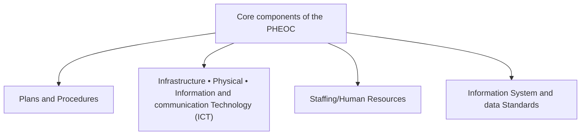
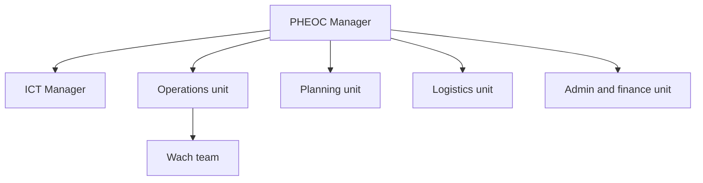
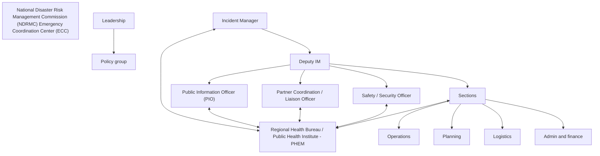
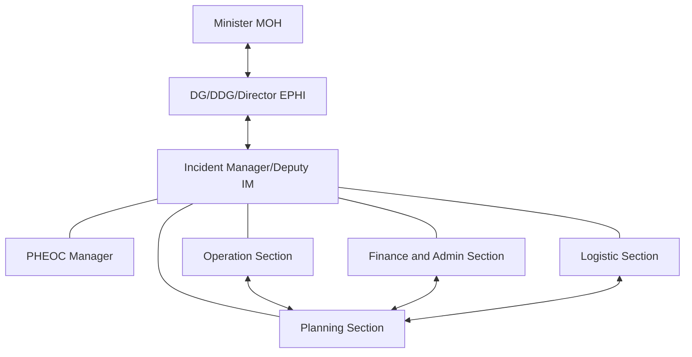
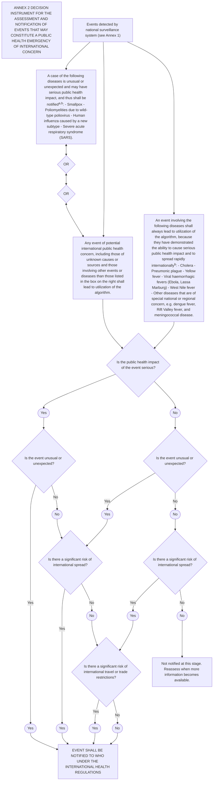

## **National Public Health Emergency Operations Center Handbook**

icon: security camera
icon: warning triangle with exclamation mark
icon: running person

**Ethiopian Public Health Institute**
**Ministry of Health**

logo: Ministry of Health, Ethiopia

logo: Ethiopian Public Health Institute

**MINISTRY OF HEALTH, ETHIOPIA**

**April 2022**
**Addis Ababa, Ethiopia**

## **National Public Health Emergency Operations Center**
## **Handbook**

logo: Ministry of Health, Ethiopia

**ሰጋ ማኅበረሰብ ኢትዮጵያ**
**MINISTRY OF HEALTH, ETHIOPIA**

logo: Ethiopian Public Health Institute

**Ethiopian Public Health Institute**
**Ministry of Health**

**April 2022**
**Addis Ababa, Ethiopia**

**Suggested citation:** National Public Health Emergency Operation Center Handbook: EPHI, 2022

## **General disclaimers:**

The owner of this handbook is Ethiopian Public Health Institute (EPHI) in particular Public Health Emergency Operation Center (PHEOC). This handbook is a live document, and it can be updated and revised when it is needed. Regions and sub-regional administrative level can customize on their own context.

All reasonable precautions have been taken by EPHI to verify the information contained in this handbook. However, the handbook material is being distributed without warranty of any kind, either expressed or implied. The responsibility for the interpretation and use of the material lies with the reader. In no event shall EPHI be liable for damages arising from its use.

## **Copyright:**

This handbook is protected by the Institute and country copyright laws. Reproduction and distribution of the handbook without written permission of EPHI is prohibited.

i

## **Table of Contents**

| Acronyms | viii |
| --- | --- |
| Acknowledgement | x |
| Foreword | xi |
| 1. Introduction | 1 |
| 1.1. Background | 1 |
| 1.2. Rationale of the Handbook | 2 |
| 2. Purpose, Scope and Applicability of the Handbook | 3 |
| 2.1. Purpose of the Handbook | 3 |
| 2.2. Scope and Applicability of the Handbook | 3 |
| 3. Legal Authority on PHEOC | 4 |
| 3.1. Article 93. Declaration of State of Emergency | 4 |
| 3.2. Council of Ministers Regulation No. 301 / 2013 | 4 |
| 3.3. Ethiopian Food and Drug Administration (EFDA) proclamation No. 1112/2019, Article No. 72/2 | 4 |
| 3.4. National Disaster Risk Management Policy | 5 |
| 3.5. The International Health Regulations (IHR 2005) | 5 |
| 4. Functions of PHEOC | 6 |
| 5. Description of the PHEOC | 8 |
| 5.1. Physical location | 8 |
| 5.2. Information System | 8 |
| 5.3. Information Technology | 9 |
| 5.4. Backup | 9 |
| 5.5. Catering services and other facilities | 9 |
| 5.6. Staffing and Training | 10 |
| 5.7. Plans and procedures | 10 |
| 5.8. Finance | 11 |
| 5.9. Call center | 11 |

ii

| 5.10. | Backup PHEOC | 12 |
| --- | --- | --- |
| 6. | Core Components of the PHEOC | 13 |
| 6.1. | Plans and Procedures | 13 |
| i. | Operational Plans | 14 |
| ii. | Functional Plans | 14 |
| iii. | Incident Action Plans (IAP): | 15 |
| 6.2. | PHEOC Infrastructure | 16 |
| i. | Physical Infrastructure | 16 |
| ii. | Information and Communication Technology (ICT) Infrastructure | 17 |
| 6.3. | Information Systems and Data Standards | 18 |
| 6.4. | Human Resources/Staffing | 20 |
| i. | Permanent Staff | 20 |
| ii. | Surge Staff | 21 |
| 7. | Incident Management System | 23 |
| 7.1 | Management | 23 |
| 7.2 | Operations | 23 |
| 7.3 | Planning | 24 |
| 7.4 | Logistics | 24 |
| 7.5 | Finance and Administration | 24 |
| 8. | Modes of Operation | 26 |
| 8.1 | Watch Mode | 26 |
| 8.2 | Alert Mode | 27 |
| 8.2.1 | Risk assessment | 28 |
| 8.3 | Response Mode | 28 |
| 8.3.1 | Partial activation | 28 |
| 8.3.2 | Full-scale activation | 29 |
| 9. | PHEOC Activation and Deactivation | 30 |
| 9.1 | PHEOC Activation | 30 |

iii

| 9.1.1 | Activation Criteria | 30 |
| --- | --- | --- |
| 9.1.2 | Activation Authority | 32 |
| 9.1.3 | Activation Notification | 32 |
| 9.1.4 | Activation Levels | 33 |
| 9.1.5 | Determination of activation levels | 33 |
| 9.1.6 | Exceptions Granted | 36 |
| 9.1.7 | Resource Mobilization | 36 |
| 9.1.8 | Activation Checklist | 36 |
| 9.2 | PHEOC De-escalation and Deactivation | 37 |
| 9.2.1 | De-escalation criteria | 37 |
| 9.2.2 | Deactivation Criteria | 38 |
| 9.2.3 | Deactivation Authority | 38 |
| 9.2.4 | Deactivation Notification | 38 |
| 9.2.5 | Deactivation Checklist | 39 |
| 10. | Concept of Operations (CONOPS) | 40 |
| 10.1 | Coordination | 40 |
| 10.1.1 | Policy / leadership Group | 40 |
| 10.1.2 | Tactical level operations | 40 |
| 10.1.3 | Rapid Response Team | 40 |
| 10.1.4 | Request for Assistance | 41 |
| 11. | Communication | 42 |
| 11.1 | Internal | 42 |
| i. | Response meeting | 42 |
| ii. | Section coordination meeting | 42 |
| iii. | Weekly plan and feedback report | 42 |
| iv. | Liaisons to the PHEOC | 42 |
| v. | PHEOC Information Systems | 43 |
| vi. | Situation Report and SPOTREP | 43 |

iv

| vii. | Communication with the field | 43 |
| --- | --- | --- |
| viii. | Strategic Communication | 43 |
| 11.2 | External | 44 |
| i. | Public | 44 |
| 12. | Information Management | 45 |
| 12.1 | Essential Elements of Information (EEI) | 45 |
| 12.2 | Critical information requirements (CIRs) | 45 |
| 12.3 | Information Flow | 46 |
| 12.4 | Recording and Documentation | 47 |
| 12.5 | Analysis and Visualization | 48 |
| 12.6 | Information Products | 48 |
| 12.7 | Partners Activity Tracking | 49 |
| 12.8 | PHEOC Activities Scheduling | 49 |
| 12.9 | Emergency contacts | 50 |
| 13. | Monitoring and Evaluation | 51 |
| 13.1 | Intra-Action Review (IAR) | 51 |
| 13.2 | After-action review (AAR) | 52 |
| 13.3 | PHEOC M&E Indicators | 53 |
| 13.4 | Training and Exercise | 54 |
| 13.5 | Continuity of Operations Plan | 55 |
| Annexes |  | 58 |
|  | Annex 1: IMS Functions Roles and Responsibilities | 58 |
|  | Annex 2: Sign-in sheet | 62 |
|  | Annex 3: Regular facility checklist | 63 |
|  | Annex 4: Staff Hiring or Surge Staff | 63 |
|  | Annex 5: Incident Action Plan | 64 |
|  | Annex 6: Situation Report (SITREP) Template | 67 |
|  | Annex 7: PHEOC Message Form | 68 |

v

| Annex 8: Activity Log sheet | 69 |
| --- | --- |
| Annex 9: Communication Log sheet | 69 |
| Annex 10: Emergency Resource Summary | 70 |
| Annex 11: Planning & Strategy Worksheet | 70 |
| Annex 12: Risk assessment of acute event template | 71 |
| Annex 13: Grading template | 76 |
| Annex 14: Job action sheet template | 77 |
| Annex 15: Summary of incident update to leadership | 78 |
| Annex 16: Request for assistance template | 79 |
| Annex 17: Corrective Action Plan (CAP) | 80 |
| Annex 18: Decision Instrument of the IHR (2005) | 81 |
| Annex 19: Phases of conducting an AAR and IAR | 82 |
| Annex 20: PHEOC Evaluation Form | 83 |
| Annex 21: SPOTREP Template | 84 |
| Annex 22: 4Ws Matrix for Partners Mapping | 85 |
| Annex 23: PHEOC Contact Information | 86 |
| Annex 24: List of Contributors | 87 |
| 14. Terminologies | 88 |
| 15. References | 92 |

vi

## **List of Tables**

| Table 1: National PHEOC staffing and training | 10 |
| --- | --- |
| Table 2: Grading criteria and levels of activation, National PHEOC | 34 |
| Table 3: Information or feedback monitoring, National PHEOC | 49 |
| Table 4: Key M and E indicators that will be tracked by the PHEOC, the frequency of their tracking and data sources | 53 |

## **List of Figures**

| Figure 1: Core-components of the PHEOC | 13 |
| --- | --- |
| Figure 2: Basic PHEOC organogram | 21 |
| Figure 3: Organogram for Incident Management System (IMS), National PHEOC | 25 |
| Figure 4: PHEOC information flow and management during activation, Ethiopian Public Health Institute, National PHEOC | 47 |

vii

## **Acronyms**

**AAR:** After Action Review

**US CDC:** United States Centers for Disease Control and Prevention

**CONOPS:** Concept of Operations

**CIR:** Critical Information Requirement

**DG:** Director General

**DDG:** Deputy Director General

**DRM:** Disaster Risk Management

**EEI:** Essential Elements of Information

**EPHI:** Ethiopian Public Health Institute

**FX:** Functional Exercise

**MOH:** Ministry of Health

**GHSA:** Global Health Security Agenda

**HEWs:** Health Extension Workers

**IAP:** Incident Action Plan

**ICAP:** ICAP at Columbia University in Ethiopia

**ICMS:** Integrated Call Management System

**ICT:** Information and Communication Technology

**IDPs:** Internally Displaced Persons

**IDSR:** Integrated Disease Surveillance and Response

**IVR:** Interactive Voice Record

**IHR:** International Health Regulation

**IM:** Incident Manager

**IMS:** Incident Management System

**JEE:** Joint External Evaluation

viii

**M&E:** Monitoring and Evaluation

**MEOC:** Mobile Emergency Operation Center

**MHPSS:** Mental Health and Psychosocial Support

**NDRMC:** National Disaster Risk Management Commission

**NTC:** National Training Center

**OSU:** Ohio State University

**PHEs:** Public Health Emergencies

**PHE:** Public Health England

**PHEIC:** Public Health Emergency of International Concern

**PHEM:** Public Health Emergency Management

**PHEOC:** Public Health Emergency Operations Center

**PIO:** Public Information Officer

**RHB:** Regional Health Bureau

**SIMEX:** Simulation Exercise

**SOP:** Standard Operating Procedure

**TOR:** Term of Reference

**TTX:** Table top Exercise

**TWGs:** Technical Working Groups

**UPS:** Uninterruptible Power Supply

**UK HSA:** United Kingdom Health Security Agency

**VEOC:** Virtual Emergency Operations Center

**WHO:** World Health Organization

ix

## **Acknowledgement**

The Ethiopian Public Health Institute (EPHI), which is the technical arm of the Federal Ministry of Health of the Federal Democratic Republic of Ethiopia, would like to express its appreciation and gratitude to all who are directly or indirectly involved in the development of this handbook for Public Health Emergency Operations Center (PHEOC).

EPHI would like to extend its appreciation to teams of experts from the Institute, US CDC, NDRMC, WHO, ACDC, OSU, ICAP, PHE, US Forest Service - International Programs for their contributions in reviewing and providing valuable feedbacks for the development and finalization of the handbook. The complete list of direct and indirect contributors is in Annex 24.

Furthermore, the Institute extends its appreciation to the following experts who facilitated and provided technical guidance of the development, review and finalization of this handbook at different times: Shambel Habebe (EPHI), Zewdu Assefa (EPHI), Abyot Bekele, Elsabet Megersa (EPHI), Adisu Daba (EPHI), Tolosa Regasa (EPHI), Abrham Lilay, Dr Nebiyu Abebe (ICAP-E), Dr Birhanu Amare (US CDC) and Fikirte Girma (EPHI).

Lastly, EPHI is grateful to the US CDC and ICAP for the financial support provided for preparation and printing of this document through the Global Health Security Agenda (GHSA) and CARES ACT funding for cooperative agreement.

x

## **Foreword**

Ethiopia continues to experience recurrent outbreaks of cholera, malnutrition, measles, COVID-19 and other public health and humanitarian emergencies. The Ethiopian Public Health Institute (EPHI) and Ministry of Health (MOH), in collaboration with their stakeholders and partners, have been detecting, preventing and responding to public health emergencies occurred in various areas at different times.

One of the findings of the Joint External Evaluation (JEE) conducted in March 2016 was lack of a well-established emergency coordination unit, a Public Health Emergency Operations Center (PHEOC) and factors that makes it function effectively including an existence of a handbook. Since then, tremendous efforts have been made to establish PHEOC in order to ensure the optimal PHEM is emplaced. To this end, it is imperative to prepare a PHEOC handbook which can guide the PHEOC activities throughout the country.

Based on the mandate given to EPHI to prepare and distribute health and health related manuals and standards, EPHI prepared this National PHEOC Handbook for PHEOC with technical support from relevant partners and stakeholders.

This handbook aims to provide PHEM staffs in general and PHEOC staffs in particular, partners and other stakeholders working at all level a step-by-step guidance on how public health emergency management efforts should be coordinated within PHEOC and the health sector.

The EPHI hopes that this handbook will help all health and other professionals engaged in PHEOC activities from government and other stakeholders in Ethiopia.

signature: Aschalew Abayneh

Aschalew Abayneh (MPH)

Deputy Director General, EPHI

xi

## **1. Introduction**

### **1.1. Background**

Public health emergency response to disease outbreaks, disasters, displacements, and other public health issues requires the integration and effective application of skills of multi-sectoral and multidisciplinary experts and logistics collaboration.

There must be a series of measures operating at the same time, each to a high level of efficiency. This requires keeping clear objectives in mind and the efficient application of resources. For the whole process to succeed, there needs to be a relatively straightforward way of thinking about and assessing the progress of disease control. This can be done by keeping simple, easily understood principled objectives, or pillars, in mind such as the establishment of a Public Health Emergency Operations Center (PHEOC).

In the last decades, Ethiopia has undergone rapid changes including demographic and massive urbanization, population movement, increase in international trade and travel, emergence of new pathogens, use of techniques which induce new risks, and chemicals. To respond to this changing environment, Ethiopia endorsed and singed the revised International Health Regulations (IHR) 2005 and conducted the External Joint Evaluation (JEE) in 2016. The IHR expands usual infectious disease notification to include surveillance of public health events from various origins and prompts nations to develop the capacities of their capabilities to detect, assess, notify, and respond to all acute health events or health risks that may constitute a threat to human health.

Although the MoH and EPHI continued to make progress in improving the overall emergency management system, the establishment of a strong control and emergency coordination mechanisms and use of information and resources effectively have been a critical challenge identified in the existing coordination forums. In addition, lack of a well-established public health emergency operation centers (PHEOC) and factors that makes it function efficiently such as having a handbook or guideline was one of the gaps identified during the Ethiopia’s Joint External Evaluation (JEE) conducted in March 2016. Since then, EPHI has been working closely with different stakeholders and partners to overcome the above limitations through equipping necessary information communication infrastructure, technical support and providing training to national and regional PHEM staff.

1

Therefore, it is imperative to develop a Public Health Emergency Operation Centers handbook to provide the overall guidance for the management and operation of PHEOC. It is also part of the whole process of strengthening the existing coordination of emergency preparedness and response efforts. This document describes the management and operational procedures of the PHEOC, its operation for effective emergency management including organizational structure, incident management system (IMS), roles and responsibilities of core functions, information management and communication mechanisms.

## **1.2. Rationale of the Handbook**

Ethiopia has established PHEOCs to serve as a central hub for better coordinating the preparation, detection, response, and recovery for public health emergencies. PHEOC must have a guideline or handbook that guides its operations and management at all times. This handbook will be utilized across the nation as a reference to guide PHEOC management and operations. Sub-national levels can adapt it to their own specific local context to enhance sub-national emergency management operations in a coordinated manner.

2

## **2. Purpose, Scope and Applicability of the Handbook**

### **2.1. Purpose of the Handbook**

The purpose of this handbook is to provide a general guidance for the management and operation of PHEOC to anticipate, prepare for, detect, respond to and recover from the PHEs.

This includes, but not limited to:

* Day-to-day management and operations of the PHEOC facility.
* Procedures to follow to activate the PHEOC to coordinate responses of PHEs.
* Operations of the PHEOC during different levels of activation.
* Organization of response and ensuring multi-disciplinary and multi-sectoral coordination.
* Management of data and information for evidence-based decision making.

### **2.2. Scope and Applicability of the Handbook**

The handbook is intended to guide PHEOC operations and management. In addition, individuals who are involved in public health emergency detection, preparedness, response and recovery efforts at all levels (federal, regional, zonal, woreda and on-scene), partners and all other stakeholders applies this handbook.

3

## **3. Legal Authority on PHEOC**

This handbook is aligned with both the national and international legally binding documents (proclamations, regulations and articles) and other legal frameworks.

### **3.1. Article 93. Declaration of State of Emergency**

(a) No. 93/a. The Council of Ministers of the Federal Government shall have the power to decree a state of emergency should an external invasion, a break down of law and order which endangers the constitutional order and which cannot be controlled by the regular law enforcement agencies and personnel, **a natural disaster, or an epidemic occur.**

(b) No. 93/b. State executives can decree a state wide state of emergency should **a natural disaster or an epidemic occur.** Particulars shall be determined in State Constitutions to <u>be promulgated in conformity with this Constitution.</u>

### **3.2. Council of Ministers Regulation No. 301 / 2013**

Based on Council of Ministers Regulation No. 301 / 2013, EPHI has the mandate to lead and coordinate the Public Health Emergency preparedness, early warning, surveillance, response, and recovery and rehabilitation efforts. Similarly, the regulation number stated above also gives EPHI the mandate to issue guidelines and manuals in all aspects of public health.

### **3.3. Ethiopian Food and Drug Administration (EFDA) proclamation No. 1112/2019, Article No. 72/2.**

This is proclamation to provide for food and medicine administration, which is necessary to prevent control the public’s health caused by unsafe food, unsafe, inefficacious, and poor-quality medicine, and unsafe and ineffective medical device, and to prevent and control illegal distribution of and use of narcotic drugs, psychotropic substances, precursor chemicals.

Accordingly, Regulatory functions under Articles 3(2)(g), 4(14), and 4(15) of Proclamation No. 661/2009 which deals with quarantine and regulation of communicable disease at ports of entry and exits shall be performed by the Ethiopian Public Health Institute.

4

## **3.4. National Disaster Risk Management Policy**

According to the disaster risk management policy (DRM) of Ethiopia, the NDRMC of Ethiopia is responsible for coordinating responses to disasters at the national level. Disaster Risk Management (DRM) council, the highest decision-making body of NDRMC, is chaired by the Prime Minister and have members including from those identified as lead sectoral institutions. The Ministry of Health is a lead sector to provide and coordinate response operations and play leading role with respect to public health emergencies.

## **3.5. The International Health Regulations (IHR 2005)**

As Ethiopia is one of the member states of WHO and the signing member of the IHR 2005. this National PHEOC Handbook is developed to fulfill the IHR obligations, which dictates member states to have functional PHEOC.

Several government sectors, local and international nongovernmental organizations (NGOs) and UN agencies are supporting in managing events of PHE related activities in the country. The nature of public health incidents that occur require a multi-sectoral and multidisciplinary, One Health approach for preparedness and response.

5

## **4. Functions of PHEOC**

To strengthen the national capacity for coordinating the early warning, preparedness, response and recovery from the public health emergencies (PHEs) and to enhance real-time communication at all level, it is crucial to have a functional PHEOC. A PHEOC plays critical role in fulfilling the areas of emergency support functions of the nation, IHR-2005 obligations as well as the Integrated Disease Surveillance and Response (IDSR) core functions.

To this end, the Early Warning System of Public Health Emergency Management Centers could be the primary sources of information for front-line responders and/or health authorities regarding public health threats, emergency events/incidents that may require emergency notification of all or parts of the concerned bodies or the public.

During PHEOC activation, a routine core structure combined with scientific subject matter experts from various departments across the Ministry or sectors at national, regional and local level, depending on the magnitude and seriousness of the situation on the ground, make up the incident management system (IMS).

The advantages of activating the Public Health Emergency Operations Center (PHEOC) are numerous. It allows incident management ability to focus on event needs and problem resolution; it provides a central location where government can provide interagency coordination, resources and operational decision making and facilitates long-term operation thereby improving continuity.

Leadership in each administrative level may activate the PHEOC and implement the preparedness and response plan to support an agency response of public health events based upon the situation analysis and recommendation of leadership/policy groups and the subject matter experts for the specific outbreak/incident. Once activated, the PHEOC will use the incident management system to organize the management and coordination of public health activities during the response mode. The incident manager is responsible for ensuring that response activities are coordinated across the board and with stakeholders including all national, regional, woreda, and/or sector offices and health departments. The PHEOC serves as the centralized facility for coordinating public health emergency early warning, preparedness, response and recovery operations through “One Health” Approach.

6

## Key functions of PHEOC:

* Timely event specific operational decision making using the best available information, policy, plans and technical advice.
* Develops emergency response plan.
* Collection, organization, analysis, presentation and utilization of data and information.
* Communication and coordination with internal and external response partners.
* Acquisition and deployment of resources, including surge capacity and material for supporting all PHEOC functions.
* Monitoring and evaluation of the preparedness and response efforts.
* Monitoring financial commitments and providing administrative services.

7

## **5. Description of the PHEOC**

In this section, the existing national PHEOC located at the EPHI facility is described in detail.

### **5.1. Physical location**

A standalone PHEOC has been in place at national level since August 2017. It was first activated to coordinate Acute Water Diarrhea disease outbreak happened in multiple regions of the country. Since that, the PHEOC has been activated to coordinate broad range of public health responses, including Ebola preparedness, humanitarian response for an Internally Displaced Persons (IDPs), malaria, measles, yellow fever, chikungunya, dengue fever, circulating vaccine derived polio virus, and COVID-19 global pandemic response.

The national PHEOC is located at EPHI on the 3rd floor of the National Training Center (NTC) Building. The main PHEOC room is a single room with about 45 square meters. It has fifteen working tables and fifteen chairs i.e.; it has a maximum capacity of accommodating fifteen personnel. The NTC has about five syndicate rooms, one big auditorium, one medium sized multipurpose meeting hall, one small meeting room and one video conference room, which are mainly dedicated for the health sectors trainings and other capacity building activities. The national PHEOC is sharing those facilities with an authorization of the higher leadership of the EPHI. Thus, the syndicate rooms have been used as a workstation for the surge staffs during activations and the meeting halls are used to convene different committee meeting and for trainings purposes and the video conference room has been used for the virtual meetings.

### **5.2. Information System**

There is a wireless and fixed line internet connectivity in the PHEOC room. The PHEOC shares fast broadband internet connectivity from the Institute internet connection i.e., 500MB per second. There are also postpaid data SIM card available for PHEOC aimed to complement and support communications and information sharing out of office and serves as a backup during internet interruptions. The national PHEOC closely works with other teams of Early Warning and Information System Management Directorate in particular Data and Information Management and Early Warning and Risk Management Team in addition to other directorates and regional health bureaus/public health institutes to acquire and share information related to PHEs.

8

## **5.3. Information Technology**

In order to serve its core functions, PHEOC has been deployed and utilizing various information technology products for strengthening its efficiency. Among these information technology products, display screens, computers, tele-communication facilities can be mentioned.

Dedicated email addresses, licensed zoom and 4K conference cameras are deployed and used for national PHEOC and distributed for Regional PHEOCs to improve communication (including the virtual interaction) and information sharing. Data management and visualizations tools such as digital signage, google data studio, Power BI, Ms-Excel, and District Health Information System (DHIS2) has been utilized to manage and visualize PHE data.

## **5.4. Backup**

Various backup systems have been deployed aimed to enhance continuity of operations. Power backup system, Telecom Aironet (wireless) backup system for call center, two (2) servers configured to archive and backup important working documents are among the ways to maintain PHEOC system functionality. The backup mechanism helps to maintain PHEOC operations in case of infrastructure failure that does not allow use of the PHEOC. There is automatic generator available that functions 24 hours and serves the PHEOC during power interruption. In addition to backup generator, Uninterruptable Power Supply (UPS) are used for desktop and server computers to ensure continuity of operation during power outage.

## **5.5. Catering services and other facilities**

Cafeteria service is available on the ground floor of the NTC building, which can serve all permanent and surge staffs. Food service has been provided for PHEOC and IMS surge staffs during various pandemic and IDP humanitarian response efforts which was aimed to increase employees focus and productivity.

There are enough toilet and handwashing facilities which can serve both male and female PHEOC permanent and surge staff during activation. The nearby hotels or dedicated facilities are used as an accommodation for the standby multi-disciplinary Rapid Response Team (RRT) during night shift operation, as required.

9

## **5.6. Staffing and Training**

PHEOC has been making an effort to ensures that various positions are filled by the right and competent person. Currently the center is working with its capacity of seven (7) staffs as detailed in Table 1 below. Structurally, the national PHEOC is under Early Warning and Information System Management Directorate.

### **Table 1: National PHEOC staffing and training**

| SN | Designation | Number | Profession | Qualification |
| --- | --- | --- | --- | --- |
| 1 | PHEOC Manager* | 1 | Field Epidemiologist | MPH |
| 2 | Data Manager | 1 | Statistician | MSc |
| 3 | Watch Staffs** | 2 | Master in Applied Public Health | MAPH |
| Health Officer | BSc |  |  |  |
| 4 | PHEOC Technical Assistant | 2 | Field Epidemiologist | MPH |
| Public Health | General MPH |  |  |  |
| 5 | IT Expert | 1 | Computer Science & IT | BSc, MBA |
| Total | 7 |  |  |  |

\* **PHEOC Manager attended 4 months PHEM Fellowship Program in US CDC, Atlanta**

\*\* **There are about 48 contract staffs serving as watch staffs in addition to the two permanent staffs working at PHE hotline, 8335.**

\*\*\* **Director of Early Warning and Information Management Directorate attended the Regional PHEOC TOT in Nairobi, Kenya organized by WHO AFRO, EMRO, Africa CDC, US CDC and WAHO**

There is a mechanism to mobilize required number of surge staffs from other offices including partners when needed through official request to support emergency response.

## **5.7. Plans and procedures**

All hazard Emergency Preparedness and Response Plan developed in collaboration with relevant department/work unit, key partners, and stakeholders. Disease/event specific plans are developed and exercised as required. Incident Action Plan (IAP) and Standard Operating Procedures (SOPs), Term of Reference (TOR) and other working documents will be developed during activation.

10

## **5.8. Finance**

There is a budget line secured through PHEM to support PHEOC operation and management. The budget is mobilized from different sources, government, and donor agencies. There is a mechanism in place to pay per-diem during field deployment depending on the situation. There is a risk allowance payment scheme, which was endorsed by the council of minister for the IMS staffs during PHEOC activated for Ebola preparedness coordination and COVID-19 global pandemic response coordination. This payment scheme is only for EVD preparedness and COVID-19 pandemic and it needs request and approval of council of ministers for other PHEs as required.

## **5.9. Call center**

The call center is part of the national PHEOC function. It’s one of the platforms to conduct Event Based Surveillance (EBS) that help to receive public health alerts or rumors, provide health education and public awareness creation.

EPHI has dedicated two toll free lines, 8335 and 8665 for long time. The toll-free lines were operated by routine staffs for long time and enhanced during EVD outbreak in West Africa. In collaboration with Ethio telecom the analogue system was changed to digital system with more capacity to enable to respond the need of community and stakeholders during pandemic response such as COVID-19. Since March 2020, toll-free hotline service (8335) which can receive 24 incoming calls at a time is established as institutionalized system. Currently, the call center has 48 staffs (45 call agents and 3 supervisors) and has been serving 24/7 on the shift bases.

The function of national PHEOC call center (8335) include:

* Collects information on a priority public health disease and threats.
* Monitor the timely detection and verification of outbreaks/events of public health importance to trigger prompt public health interventions.
* Test result notifications
* Mental Health and Psychosocial Support (MHPSS)
* Supporting Home-based Isolation and Care (HBIC)
* Supporting contact tracing for infectious diseases outbreaks
* Supporting referral linkages for infectious diseases outbreaks and other PHEs

11

* Providing health education or awareness creation to the general public
* Developing and reviewing contents for Integrated Voice Response (IVR)
* Developing and reviewing contents for phone and SMS surveillance
* Developing and reviewing frequently asked questions (FAQs)
* Addressing specific requests through help desks

The PHEOC is planning to introduce the Integrated Call Management System (ICMS) in order to further upgrade and automate the call center functions. The system has the Interactive Voice Record (IVR), Survey (voice and SMS), Conference call, help desk, recording, reporting and many more features. A web-based information display platform is also embedded within the ICMS package.

## **5.10. Backup PHEOC**

Based on the proximity in location, the Addis Ababa City administration PHEOC, Oromia Regional State PHEOC, National Disaster Risk Management Commission Emergency Coordination Center (ECC) and Africa Center for Disease Control and Prevention (ACDC) PHEOC facilities are identified to maintain the national PHEOC operations in case the original national PHEOC facility located at the EPHI encounter any physical or technology failure or not accessible for some reason. EPHI is in the process of signing Memorandum of Understanding (MoU) with the identified backup PHEOC facility based on the proximity to the national PHEOC.

Multi-purpose space will be identified to support an expanded operation or incase the identified alternative facility could not be able to accommodate the required operation.

12

## **6. Core Components of the PHEOC**

The key components that make a PHEOC functional are plans and procedures, physical infrastructure, ICT infrastructure, information systems and data standard, as well as human resources/staffing. Meeting minimum requirements for each component enables the PHEOC to run according to minimum standards as stipulated in the IHR Joint External Evaluation.

flow_chart: Core components of the PHEOC diagram

**Figure 1:Core-components of the PHEOC**

Each of these core components is described in the following sections. It includes physical location, rooms and their functions, technology, entrance authorization, physical security, accommodation capacity, information management system, rest rooms among others.

### **6.1. Plans and Procedures**

Emergency management plans should be prepared prior to events and made available to all staff members at the PHEOC, generally included in the share drives of the computers they are assigned to. So, a well-designed plan is a prerequisite for the development of a PHEOC. Members of the PHEOC are responsible for working with their respective departments and agencies to produce and evaluate the initial set of working plans and procedures for the PHEOC. A PHEOC operates based on the following plans

13

## **i. Operational Plans**

a) **All hazards response plan:** the IMS inherently takes an all-hazards approach but requires a response plan that recognizes the capacities, capabilities, organizational structures and roles of the relevant jurisdiction’s public health and partner agencies, as identified in the Concept of Operations (CONOPS). Because of the varied contexts, a list of prescribed all-hazard response strategies is impractical, but some generic public health strategies include sheltering in place, personal hygiene instructions, evacuation, infection control, isolation and quarantine, mass vaccination and medication programs, establishing treatment centers and mass care facilities, creating public health services for mass gatherings and mass casualty events.

b) **Hazard-specific response and management plan:** should be based on the prioritized list of threats and hazards determined in the threat assessment process. They should consider the national guideline which can be customized to regional, and local context that may apply to specific threats.

c) **Prevention and mitigation plan:** should be developed as part of a comprehensive risk management program. The purpose of prevention and mitigation planning is to reduce risk by preventing risk events from occurring and by minimizing the impact when they do happen. Planning should cover three stages: 1) before an event occurs, 2) during a response to an event, and 3) post-event, during recovery.

## **ii. Functional Plans**

a) **Standard Operating Procedures (SOP):** As part of the planning process, leaders should develop and distribute standard PHEOC operating procedures to all concerned. Procedures should describe PHEOC layout and functions, the duties of major teams and individuals, and the use of PHEOC displays, message forms, and other operational forms. The SOPs should be consistent with the national PHEOC guidance regarding PHEOC operations, organization, and staffing, including recommendations on wall displays, staff and individual functions, message flow and forms, and other operational procedures. During a developing emergency, PHEOC activation may become necessary. PHEOC standard operating procedures clearly outline simple processes for opening the PHEOC, including

14

the following elements: authority, conditions for activation, notice events, alerting, setup, deactivation, review meetings, testing and exercising activation procedures among others.

## b) **PHEOC internal communications plan**

An incident management system should consist of organizational units with no more than seven direct reports. All supervisors, at each level and across all functions within the response organization, are responsible for maintaining a high level of situational awareness in their work unit. This entails frequent exchanges of information on progress in achieving objectives, changes in the situation, and the status of material and human resources. The mechanism for these communications is a mandatory process of systematic briefings, vertically from the PHEOC/Incident Manager to all teams, task forces or single resources, and horizontally across all activated IMS functions.

## c) **Public communications plan**

Features of the public communications plan in the PHEOC include processes for:

* Identifying key audiences.
* Identifying spokespersons;
* Securing approvals for messages when the event manager has delegated the necessary authority

The purpose of public risk communications plan is to provide clear information to a variety of audiences, ensuring that individuals and communities are enabled and mobilized to take informed actions to reduce their exposure to risk. The precise information to be conveyed usually depends on the incident and the context, but the process of identifying the information needs of different audiences and the most effective communication methods is largely generic.

## **iii. Incident Action Plans (IAP):**

Based on assessment of the scale and impact of the public health emergency and the availability of resources and capacities; a written incident action plan describes the specific objectives that must be accomplished in succession to achieve larger event management goals. IAP are developed within the planning section and provide all PHEOC supervisory personnel with directions for current and future actions. IAP also form the basis for defining operational periods. Operational

15

periods reflect the time required to achieve specific objectives identified in the action plan, and to plan for required resources. The length of operational periods varies according to the needs of events. Annex 5

## **6.2. PHEOC Infrastructure**

### **i. Physical Infrastructure**

The PHEOC can be established either in a dedicated, purpose-built space, or set up in a multi-purpose space. However, it must be physically and environmentally secure, and accessible and survivable in the event of a threat or disaster. The PHEOC should be able to survive the most probable hazards identified through a tailored risk assessment. A PHEOC must be easily accessible for users, with adequate parking for vehicles, adequate security, and reasonable proximity to designated lead and partner agencies.

#### a) **Facility:**

The PHEOC should have adequate space for its staff and must contain both open common areas and closed workspaces suitable for meetings, conference calls and small group activities. External venues are also necessary for media briefings, interviews, press conferences, and coordination of external partners. Most PHEOCs have a mix of open and closed workspace, with much of the work being done in open areas. Some closed spaces are needed for meetings, group work activities and teleconferences.

The facility should have sufficient size to accommodate all its functions in reasonable comfort to accommodate the personnel and the equipment required to run it. It must have adequate sanitary facilities, rest areas and food amenities for the personnel who may on occasion be employed there for considerable periods. Configuration of the space should provide both meeting areas and relatively quiet working spaces.

The space/facility should meet the basic requirements of disaster survivability and access and must be able to sustain operations during a natural disaster by virtue of robust structure, secure water and food supply and an emergency source of electricity.

16

## **b) Security:**

A PHEOC processes large amounts of information that is often sensitive, frequently on open displays. The working environment is also frequently pressured and intolerant of distractions. Media conferences and photo opportunities should therefore be held off-site or be staged at a time convenient to PHEOC staff, and when sensitive information is not visible.

All electronic linkages should be encrypted, password protected, and computer networks should be protected from external threats, including network attacks, power surges and outages.

On-site provisions are required to ensure protection and security of the facility, resources and personnel from routine hazards and possible attack. These may entail measures such as closed-circuit television, surveillance systems, perimeter protection, and/or access/entry controls.

Maintaining security of the PHEOC data and the systems that process and store requires routine use of firewalls, encryption, password protection, up-to-date antivirus software, and redundancy of data to support rapid service recovery in the event of a security breach.

## **ii. Information and Communication Technology (ICT) Infrastructure**

Daily PHEOC operations rely on a variety of Information and Communication Technology (ICT) infrastructure. There are no set standards for equipping a PHEOC, or for the systems that should be installed. Requirements will depend on numerous factors, including but by no means limited to the type or types of incidents anticipated, the geographic location, and the number of staff.

PHEOC technological solutions incorporate hardware and software systems, internal and external telecommunications, and all aspects of information management, including

* A telecommunications system or network comprising a variety of choices depending on available connectivity options.
* Within the PHEOC, personnel will require workstation computers with internet connections and either a mobile or a hardwired telephone.
* For remote locations, radio or satellite telephony may be the only options.
* For all levels of PHEOC, the ability to conduct teleconferences is a key capacity, which optimally includes video conferencing.

17

* Large screen video displays support visual representation of the status of the event and its contextual aspects that influence decision-making.
* In addition, media monitoring capacity (television, radio, etc.) is required. It is useful to have video recording and playback capability.

In addition, a PHEOC is an office with all the usual office requirements: computers, printers, copiers, document scanners, a fax machine, application hosting and data storage server(s), office supplies, forms designed to provide paper-based backups, in case of technology failure, etc.

Despite their inherent utility, the technologies that support telecommunications, data analysis, event information management and visualization of operational information are evolving rapidly and can be prone to failures. Consequently, the information that the systems contain requires frequent, routine backup to mitigate the potential impact of a technological failure resulting in a loss of data. All equipment should be covered by warranty or a maintenance contract.

To the extent practicable, technologies utilized in a PHEOC should be compatible with those routinely in use in the rest of the facility and in host and partner agencies. As the needs of the PHEOC change over time and the facility matures from basic to mid-range to optimum capability, with the rapid advancements of technology it is beneficial to consult experts on hardware acquisitions, and to provide expert on-site ICT support within the PHEOC. Personnel working in the PHEOC must be trained to use and maintain its ICT tools.

## **6.3. Information Systems and Data Standards**

The goal of an effective PHEOC information system is to increase the availability, accessibility, quality, timeliness, and usefulness of emergency operations information for public health action. The PHEOC information system must be seamlessly integrated with other relevant national information systems.

Development and improvement of a PHEOC information system should follow general approaches, principles, and processes for strengthening health information systems in the country at national, regional, and local level.

Timely processing of data and communication of information is central to the purpose of an EOC to:

18

* Ensure the availability, quality, timeliness, and usefulness of emergency operations information for public health action.
* Ensure data security, privacy and confidentiality, uninterrupted operation of systems, and
* Adopt standards to make sure the information systems can work with those of the government and other response agencies.

## Components of the PHEOC information system:

1) **Resources:** leadership, policies, financial and human resources as well as infrastructure to manage the system.
2) **Indicators and data:** that require monitoring such as mortality, morbidity, risks and resources.
3) **Data sources:** such as surveillance data, health facilities data, situation reports from responding teams and records of meetings.
4) **A data management system:** to collect, store, quality assure, process, compile, analyze and disseminate data.
5) **Information products:** such as SITREPs, SPOTREP, 4Ws (Who, What, When and Where), case summary statistics, media and communication reports, financial reports, and health workforce distribution reports and;
6) **A platform:** for sharing information among others.

There are three general types of data and standards that need to be routinely captured, processed, and displayed in a PHEOC:

* **Event specific data:** what, how many, where, who, how quickly and status (e.g., clinical, and epidemiological data).
* **Event management information:** organized for the functional domains in the PHEOC-human and material resources on hand, status of interventions, partner activities, resource deployments, expenditure, progress on achievement of objectives.
* **Context data:** geographic information mapping, population distribution, transportation links, locations of fixed and temporary facilities, availability of clean water, climate, weather, and any other significant contextual information.

Standardization and interoperability of data systems, including software applications, are crucial to the functions of PHEOC. The designing of an effective information system must be

19

unambiguous in identifying the components and relevant interoperable standards for data exchange. Data standards for collection of PHEOC data must be adopted as part of an interoperable information system. There is a well-recognized need for structured data, in the form of standardized data elements, that allows aggregation, reporting and sharing of healthcare information - not only within a country’s public health system but also between different systems.

Potential PHEOC software applications include a variety of tools, some available pre-packaged and off-the shelf, some proprietary, and others open source and free of charge are also essential elements of information system and data standard. In addition, health specific PHEOC software may provide functions such as predictive analysis and modelling; health surveillance alert and warning; contingency planning; and situation analysis. Other characteristics to consider in software or license acquisition include optimization for mobile devices, offline mode or a disconnected client for server or cloud-based products, scalability to meet expanding requirements of the PHEOC, modularity, and a multi-language interface.

## **6.4. Human Resources/Staffing**

A PHEOC requires competent and trained persons to achieve its objectives and functions successfully. Ideally, PHEOC staff should be familiar with the structure and systems of the components of Public Health Emergency Management (PHEM). Human resource needs for maintaining and operating a PHEOC include both **routine/permanent** and **surge staff**.

### **i. Permanent Staff**

The permanent staff is responsible for the day-to-day operation of the PHEOC. These include PHEOC manager, leaders of the key functional areas and staff under each area. The PHEOC manager reports to the leadership under which the PHEOC is placed in the Ethiopian Public Health Institute, Regional Health Bureau, Zonal Health Department or Woreda Health Offices. The key functions operating under the PHEOC manager are operations unit, planning unit, logistics unit, admin/finance unit who coordinate with the main departments and ICT support of the PHEOC. Below is the generic organogram:

20

flow_chart: organizational chart of PHEOC structure

**Figure 2: Basic PHEOC organogram**

## **ii. Surge Staff**

The PHEOC maintains a roster of multi-disciplinary and multisectoral experts who can be mobilized and staff the PHEOC when activated. A roster of competent and trained human resources must be maintained for each position. When the PHEOC is activated, depending on the scale of the incident, positions will be identified in the IMS. Based on the positions identified, a human resource response plan will be developed. Experts will be identified from the roster to fill the identified positions. Terms of Reference (TOR) for each position will be developed. A roster of surge staff template attached below in Annex 4. The PHEOC manager organizes regular training for the experts from the roster and conducts exercises to validate plans and identify gaps.

The roles and responsibilities of staff assigned within the PHEOC should be aligned as closely as possible with their established skill sets, and they should receive thorough orientation in the PHEOC as well as training specific to the functions, roles, and procedures they will undertake.

Some personnel may not be assigned full-time to the PHEOC and will be able to adjust their normal work schedule to accommodate part-time engagement. Others may be required full-time, and if the center is required for long periods each day and over a prolonged period (as in a 24-hour continuous operation), it should have sufficient surge staff available to accommodate a standard shift schedule of either 8-hour. This will commonly require workforce redundancy (two or three backup personnel for each position). It is normal in a PHEOC to use expedited and empowered

21

processes, whereby those executing them have the authority to do what is required of their role. These will need to be supported by established agency structures and procedures, which may need to be suspended, delegated or accelerated for the duration of operation of the PHEOC.

PHEOC personnel, including those whose purpose is to provide staff support to the emergency response process, are required at varying levels to satisfy the following three criteria.

1. They must have relevant subject matter expertise: they must possess knowledge about the type of emergency event being managed or the management function they are performing
2. They must have the authority and responsibility to commit or access agency resources
3. They must have been trained in the functions and operations of a PHEOC.

A PHEOC requires a tiered approach to competency development. Public health response requires additional specific competencies, including applied epidemiology; biostatistics; trauma care; mental health; environmental health; communicable disease; risk communications; and bioterrorism.

The knowledge, skills, and abilities necessary at a tactical level within a PHEOC require a higher level of hands-on proficiency than those necessary at a strategic level, where a broad awareness of issues may be sufficient.

The function and staffing of the PHEOC should be assessed through an ongoing series of training and exercises; this allows for the development and maintenance of critical skill sets, and continuous improvement of PHEOC function based on evaluation through exercises. Exercises should include both internal exercises and external exercises carried out with health response partners, as well as with other sectors involved in emergency management. Depending on the staff functions, generic terms of reference should be maintained for surge staff (see Annex 4).

22

## **7. Incident Management System**

The PHEOC uses IMS to coordinate and manage PHEs responses, primarily to prepare for, respond to, recover from and mitigate the effects of all types of PHEs. The IMS is an emergency management organizational structure that, alongside protocols and procedures, provides an approach for a coordinated and timely response. The system is modular and scalable, hence can be partially or fully activated depending on the scale of the event. The IMS embraces five functions: management, operations, planning, logistics and administration and finance.

The five recognized essential IMS functions will be developed during the response to PHEs depending on the scale, type, and complexity of the incident. A proposed IMS that could be developed in a response is depicted in Figure 3 below. The organogram also shows the multi-agency coordination among the different actors.

### **7.1 Management**

The Incident Manager (IM) sets the response objectives, strategies, and priorities. The functions fall under management includes: PHEOC manager, Incident Manager/Deputy Incident Manager, Public Information Officer (PIO), Liaison / partnership officer, and safety / security officer. The role of PHEOC manager, IM/DIM, liaison officer, PIO, safety / security officer is indicated in Annex 1. The role of the IM can be assumed by designated Deputy IM (DIM). When necessary, the IM will delegate the other four sections (operations, planning, logistics and administration / Finance), depending on the nature and scale of the incident.

Section chiefs who are in charge of each section established shall be responsible for managing or supervising their respective sections and will directly report to the IM. Depending on the size and type of the incident, divisions, groups or units will be formed under the sections.

### **7.2 Operations**

This section guides the use of resources to directly respond to the event and provides coordination and technical guidance. The technical areas which could be established under this section include: Epidemiological surveillance, Laboratory, Data management, Water, Sanitation, and Hygiene (WaSH) and Risk Communication and Community Engagement (RCCE), Case management, etc.

23

## **7.3 Planning**

This section leads and supports the event action planning and budgeting process by tracking resources, collecting, and analyzing information related to the event. This function is also responsible for maintaining documentation of the event and preparing an incident action plan (IAP), an oral or written plan containing general objective reflecting the overall strategy for managing an incident. In addition, this section prepares different proposal and collaborative agreements to mobilize resources and engage relevant stakeholders and partners. See Annex 5 for IAP template.

## **7.4 Logistics**

This section is in charge of acquiring, tracking, storing, demobilization, maintaining, disposing of material resources required for incident management. It supports PHEOC on stock management, inventory, replenishment and stock rotation, management of fleet, and coordinating resource management and facility tracking on the field. It also provides logistics strategy, management and operations support to response teams.

## **7.5 Finance and Administration**

This section organizes all financial and administrative tasks including accounting, procurement, and human resources. It is also in charge of accounting per-diem and overtime, monitors the budget allocated for procuring resources and accounted for handling claims related to damage or loss of property.

24

flow_chart: Organizational chart of the National Disaster Risk Management Commission Emergency Coordination Center

**Figure 3: Organogram for Incident Management System (IMS), National PHEOC**

25

## **8. Modes of Operation**

The PHEOC typically operate in three modes. These are: watch, alert, and response modes. The modes are described below.

image: infographic showing Watch Mode, Alert Mode, and Response Mode

### **8.1 Watch Mode**

The watch mode corresponds to the normal day to day activities. The watch staff constantly monitors and triages information on public events by facilitating the collection, organization, analysis, dissemination and archiving of information. The PHEOC is constantly in watch mode throughout the different modes of operation.

The responsibilities of watch staff include, but not limited to, the following:

* Screening routine public health surveillance data for unusual occurrence
* Administer PHEOC email to collect rumors and respond to inquiries if any
* Communicate and engage sub-national, partners and relevant stakeholder
* Manage and maintain PHEOC facilities (office, ICT equipment, call center)
* Rumor collection, communication and/or verification by the call Center.
* Media (social media, TV news, newspaper, radio and etc.) scanning and web scanning
* Preparing and sharing of weekly summary report
* Preparing and sharing of SITREP and SPOTREP (See Annex 6 and Annex 21)
* Compilation and documentation of events and the intervention activities.

26

* Ensure that the PHEOC has supplies and are functional.
* Advocate the PHEOC concepts and IMS principles
* Establish, standardize national and sub-national PHEOC and ensure its functionalities
* Interact and coordinate with the sub-national and other agencies PHEOC
* Collaborate, coordinate and work with other departments/units of the PHEM and EPHI
* Assess the functionality and identify requirements of the national and sub-national PHEOCs and improve it accordingly
* Conduct risk mapping and different assessments
* Organize and conduct capacity building activities
* Organize different workshops, review meetings and different coordination platforms
* Develop and/or revise different plans, policies, procedures and other working documents
* Plan and conduct Simulation Exercises (SIMEX) to test plans and procedures
* Accomplish tasks required by the top leadership group

## **8.2 Alert Mode**

This is the early standby phase of activation when an emergency has occurred or is imminent. The PHEOC conducts intensive monitoring of an incident or event in preparation for a potential PHEOC activation.

Besides the watch mode activities, the alert mode activities include, but not limited to:

* Intensified monitoring or enhanced surveillance.
* Intensified communication with the relevant stakeholders.
* Intensified situational awareness
* Ensure a preliminary assessment conducted for PHEOC activation.
* Initiation of preparation for deployment of resources.
* Identification of experts to staff the IMS positions.
* More staff could be mobilized from the other units
* Deployment of RRT to undertake an investigation

At national level, the EPHI Director General (DG)/Deputy Director General (DDG) of PHEM authorize activation of the PHEOC, and official letter signed by the DG or his/her delegate shall

27

be sent to all stakeholders and external partners to notify them about the possible PHEOC activation. At regional level, the head of the RHB Head/Deputy head or DG/DDG of the regional Public Health Institute authorizes activation of the regional PHEOC, and official letter signed by the RHB head/Deputy head or DG/DDG of regional Public Health Institute or his/her delegate shall be sent to all stakeholders and external partners to notify them about the possible activation of the regional PHEOC.

Pre-activation notification will be sent for the identified IM, section chiefs and general staffs from the available roster through phone calls / SMS and email to fill the IMS functions.

### **8.2.1 Risk assessment**

The PHEOC conducts risk assessment to determine if the incident requires PHEOC activation and determine the level of activation. The assessment can be done by the PHEOC staff and subject matter experts.

The levels of activation are determined on the basis of the results of a rapid initial risk assessment after an event has occurred. The PHEOC is activated (within 120 minutes) immediately after the risk assessment is completed and a directive is given. The PHEOC should be capable of activating within 120 minutes as required by the IHR indicator for a PHEOC to operate according to minimum standards. A risk assessment template is provided in Annex 12.

## **8.3 Response Mode**

Level of activation should be defined and outlined based on scale, urgency, severity, complexity, capacity, and resource requirement, as well as activation criteria.

During response mode, the PHEOC is partially or fully activated. The center should define levels of activation corresponding to levels of response. The level of activation is indicated in Table 2.

During responses to humanitarian crisis or disasters, the health sector will provide the required health services and activate the PHEOC.

### **8.3.1 Partial activation**

The PHEOC may classify partial activation as lowest and medium scale / levels of activation.

28

In a lowest-level activation, the PHEOC uses the lowest level of resources including regular PHEOC staff, relatively minimal augmentation in resources for the response, and reporting requirements.

In a medium-level activation, the PHEOC uses increased resources, including additional staffing (in addition to the regular PHEOC staff), moderate cost for the response, and increased but manageable reporting requirements.

The PHEOC is activated, and surge staff will be called to undertake appropriate activities, based on their assigned roles and responsibilities. The PHEOC mobilizes additional resources and requires some level of support from other departments. The PHEOC will be prepared for any escalation and to work extended business hours up to 24/7.

### **8.3.2 Full-scale activation**

This phase corresponds to the highest activation level. The PHEOC will deal with the emergency of greatest magnitude, complexity, scope, and impact. This requires the greatest resources and coordination when national resources and capacities are exceeded and overwhelmed, and substantial international support is required.

The national level will mobilize its existing resources and requires substantial international support. The health sector will mobilize resources from different sectors and stakeholders.

During this level of activation, coordination of the response will be managed by the health sector or might be taken over by a higher coordination body and the health sector will lead the response in line with the national policies and procedures. This level might require 24/7 operation with full staff.

29

## **9. PHEOC Activation and Deactivation**

### **9.1 PHEOC Activation**

#### **9.1.1 Activation Criteria**

##### **i. National Level**

**Mandatory Activation Criteria**

One of the following criteria will trigger the activation of the PHEOC:

* National public health emergency declared by country leadership.
* Any condition that has met the criteria to be declared a PHEIC in line with Annex 18 of IHR 2005.
* Newly emerging and reemerging disease with high spread potential
* Contagious incident (s) with high potential of cross border spread or involves neighboring countries
* Bioterrorism, chemical and radio nuclear incidents

**As required by the top MOH and EPHI leadership upon the advice of PHEM taskforce**

* The capacity of routine system is overwhelmed, and additional support is required.
* Incident affecting multiple sectors, which requires multiagency coordination.
* When more than one region becomes affected and increase coordination and resource requirement
* When coordination gaps observed while responding by the regional PHEOC
* When the regional PHEOC is activated and request federal level assistance1
* Multiple (two or more) regional PHEOC simultaneously activated for the same or different incidents

1 Regional resources depleted due to expanding incident, Shortage of highly specialized technical expertise and/or facilities, highly expanding incidents despite of the ongoing intervention, Protracted incident with significant morbidity and mortality, declared by the region beyond its capacity and when special situation aggravates the incident

30

* High potential of spread among the regions in Ethiopia
* Incident require joint response between regions due to adjacent and shared boundaries
* Incident happening among special population groups such as IDP, refugees and mass gatherings
* Outbreak of diseases under eradication and elimination in the country
* If similar incidents or events in the past required PHEOC activation.
* Whenever there are mass returnees from epidemic affected countries
* Natural and man-made disaster with significant public health impact

## **ii. Region / City Administration Level**

* When the mandatory national PHEOC activation criteria are met, the concerned regional PHEOC should conduct risk assessment to inform the action.
* Incident affecting multiple sectors, which requires multiagency coordination.
* The capacity of lower level overwhelmed2 and additional support is required.
* Multiple incidents happening in the region
* When more than one zones / woredas becomes affected and increase coordination and resource requirement
* When the zonal / woreda level response is inadequate3 and request regional assistance
* High potential of spread across the affected region
* An incident occurring in the neighboring region/zones with a potential to increase to a cross border.
* Incident happening among special population groups such as IDP, refugees and mass gatherings
* Outbreak of diseases under eradication and elimination in the region

2 Will be determined by the rapid assessment
3 Coordination and communication gaps

31

* If similar incidents or events in the past required PHEOC activation.
* Whenever there are mass returnees from epidemic affected countries
* Natural and man-made disaster with significant public health impact

## **9.1.2 Activation Authority**

### **i. National Level**

The PHEOC is activated following the decision made by the EPHI DG / DDG for PHEM. The PHEOC manager advises on the activation, level of activation and assume the IM till the IAP developed, and dedicated IM is delegated.

### **ii. Region / City Administration Level**

The PHEOC is activated following the decision made by the RHB head / Deputy RHB head or regional Public Health Institute DG/DDG.

## **9.1.3 Activation Notification**

### **i. National Level**

EPHI DG and DDG notifies EPHI staffs, MOH, relevant government sectors and agencies, regional health bureaus and key partners about PHEOC activation within 1 hour through letter or email and might be followed by a phone call / SMS.

The pre-notified IM, section chiefs and general staff will arrive at the PHEOC and begin the assigned task within 3hrs of activation notification.

### **ii. Region / City Administration Level**

RHB head / Deputy or regional Public Health Institute DG notifies RHB, regional public health institutes, EPHI, relevant government sectors and agencies about PHEOC activation within 1 hour through letter or email and might be followed by a phone call / SMS.

The pre-notified IM, section chiefs and general staff will arrive at the PHEOC and begin the assigned task within 3hrs of activation notification.

32

### **9.1.4 Activation Levels**

During the steady-state or when there is no public health emergency; the PHEOC will remain at the steady state (Green) which is monitoring public health events or incidents. Once triggered, the PHEOC may be raised to alert mode (Yellow) to monitor the public health situation more rigorously.

When any of the above-mentioned criteria are met, the PHEOC will be activated. It may be partially or fully activated and/or staffed to meet the demands of the situation. There are three operational levels of activation identified though numbers 1 to 3; where 1 or red is designated as the highest and 3 or yellow the lowest level of activation.

### **9.1.5 Determination of activation levels**

* Scale of the event
* Level of urgency
* Complexity of the incident
* Level of response capacity

33

## **Table 2: Grading criteria and levels of activation, National PHEOC**

| LEVEL* | CONDITIONS | Activation | PHEOC DUTIES | STAFFING |
| --- | --- | --- | --- | --- |
| 3 Yellow/Lowest | Outbreak suspected Small incidents involving one zone High threat of public health event of international concern Situational conditions warrant | When all of the conditions are low | Continuous monitoring of event Check & update all resource lists Distribute status and analysis to PHEOC personnel Receive briefing from field personnel as necessary | Incident manager Minimal IMS staff Subject matter expert as needed |
| 2 Orange/Moderate | Incidents involving 2 or more Region/Zone Hazardous materials evacuation Major scheduled event Any condition that has met the criteria to be declared a PHEOC in line with Annex 2 of IHR 2005. Newly emerging and re-emerging disease with high spread potential Contagious incident (s) with high potential of cross border spread or involves neighbouring countries | When all of the criteria are moderate One or more moderate, the rest low One high and the rest moderate or low | Continuous monitoring of event. Initiate PHEOC start-up checklist. Facilitate field personnel Provide status updates to PHEOC personnel | Level 3 staff and Additional IMS staff Ministry and partner involvement |
| 1 Red/Highest | International crisis deteriorated to the point that widespread disorder is probable | When two or more are high | Brief arriving staff on current situation | Full staffing of PHEOC as situation warrants |

34

|  | Acts of terrorism (biological, technical, other) are imminent Hazardous conditions that affect a significant portion of the county Verified and present threat to critical facilities Major emergency in the county | When deemed necessary by top leadership | Facilitate EOC staff |  |
| --- | --- | --- | --- | --- |

35

### **9.1.6 Exceptions Granted**

During activation, the PHEOC may require having certain procedures and / or processes fast-tracked to ensure that the response being provided is of a timely nature. EPHI and/or MOH will make provisions prior to the response to ensure that the PHEOC is able to fast track the required government administrative procedures that may directly hinder the speed of responding to emergency events.

### **9.1.7 Resource Mobilization**

The PHEOC Manager in collaboration with the responsible directorates/unit should mobilize resources for routine operations of PHEOC. The IM in consultation with PHEOC Manager and the section chiefs will be responsible for resource mobilization during activation. Such requests will be documented in writing and approved by the IM or appointed designee. Approved requests for assistance that can be met with local resources will be channeled to local governmental or non-governmental agencies for action.

The logistics section will support the IM to maintain a Notification and Resource Directory to provide a comprehensive listing of agencies and organizations and available resources within the affected areas.

If a request for support cannot be met locally and requires outside assistance, it will be forwarded to the MOH for approval and onward submission. The original message requesting assistance will be placed in the PHEOC file cabinet. The IM will track the request by logging the request after it has been submitted and will keep the requesting agency/organization informed as to the status of the request as it goes through the process. Resource request coming from regions should come through the PHEOC email.

### **9.1.8 Activation Checklist**

Following the PHEOC activation, make sure the use of the following checklist:

* Call all the required Section Chiefs (Operations, Logistics, Planning and Finance)
* Personnel assigned to positions on the PHEOC, report to the PHEOC and check in with Sections

36

* Conduct PHEOC incident / situation briefing
* Issue tasks and confirm shift assignments
* Obtain identification vest and credentials
* Begin activity logs
* Determine staffing needs and acquire additional support as required
* Check communications equipment (telephones, fax machines, radios).
* Assistance available from the Communications Team
* Locate and lay out necessary supplies and materials
* Review and start working off position checklist

## **9.2 PHEOC De-escalation and Deactivation**

When the response is declared over or incident is stabilized, the PHEOC will be deactivated and return to normal or routine operation. The EPHI DG/DDG or RHB head/Regional Public Health Institute DG/DDG or designee is responsible for approving the deactivation of the PHEOC.

### **9.2.1 De-escalation criteria**

When the scope, complexity, and severity of the health emergency decreases, de-escalation of the level of activation needs to be considered.

Considerations for de-escalation include a decrease in one or more of the following:

* No longer a public health event of international concern (PHEIC) in line with IHR 2005 guidelines
* Human resource surge support required
* Resources required
* Media interest
* Geographic extent
* Executive / leadership directives

The PHEOC will conduct risk assessment and review of activation level in order to make the decision for de-escalation.

37

## **9.2.2 Deactivation Criteria**

The PHEOC is deactivated on the basis of following criteria:

* Resources that were deployed on the ground to support the response are no longer required
* Response objectives are met
* The trends and data from the field begin to suggest that the issue being addressed is on the decline
* The issue is no longer a public health threat, or the affected area can manage the situation
* The incident or state of emergency has been declared over by the DG/DDG EPHI or designated body

## **9.2.3 Deactivation Authority**

### **i. National Level**

The PHEOC is deactivated following the decision made by the EPHI DG / DDG for PHEM.

### **ii. Region / City Administration Level**

The PHEOC is deactivated following the decision made by the RHB head / Deputy or regional Public Health Institute DG/DDG.

## **9.2.4 Deactivation Notification**

### **i. National Level**

EPHI DG and DDG notifies EPHI staffs, MOH, relevant government sectors and agencies, regional health bureaus and key partners about PHEOC deactivation within 48 hours once decided through letter or email.

### **ii. Region / City Administration Level**

RHB head / Deputy or regional public health institute DG/DDG notifies RHB, Regional Public Health Institutes, EPHI, relevant government sectors and agencies about PHEOC deactivation within 48 hours once decided through letter or email.

38

## **9.2.5 Deactivation Checklist**

Following the deactivation, make sure the use of the checklist below to ensure appropriate deactivation process:

* Notify appropriate agencies through letter or email &/or phone regarding the individual sites where the PHEOC activation is being closed out
* Collect data, logs, situation reports, message forms, and other significant documentation
* Place all collected data in a secure file box
* Label the file box with the date and any regional or national numbers associated with the response
* Deliver the file box to the PHEOC Manager
* Fold and repack re-usable maps, charts, materials
* Collect items that have been deployed in the field for future response use
* Make a list of all supplies that need replacement and forward to the Logistician
* Return identification credentials to the PHEOC Manager
* Develop close out report
* Deactivate
* Return to steady-state

39

## **10. Concept of Operations (CONOPS)**

Large-scale emergencies generally overwhelm the response capacities of any single entity; therefore, an effective response usually involves more than one jurisdiction or technical area operating under a single response strategy (strategic leadership) through multiple entities each with interdependent operational structures.

A concept of operations, or CONOPS, is a core element of emergency operations plans. The CONOPS explains how the system is intended to function. the following sections explain the coordination and communication process when the PHEOC is activated to coordinate the response to public health emergencies.

### **10.1 Coordination**

#### **10.1.1 Policy / leadership Group**

The policy group is expected to provide strategic leadership and funding for emergency operations. The Policy group is responsible to provide strategic guidance, funding, approving relevant plans and ensuring multi sectorial and multi-agency coordination and collaboration. This policy and leadership group shall consist of high level of government officials invited by the Minister of Health. The Incident Manager will provide regular updates to the policy group regarding the situation, operations, challenges, and gaps.

#### **10.1.2 Tactical level operations**

The tactical operations groups are responsible for the day-to-day actions that will achieve the established strategic operational goals and objectives. The PHEOC must ascertain a multi sectorial and multi-disciplinary coordination of response using IMS at regional and zonal level. The PHEOC has to establish a communication, information sharing and feedback mechanism between the regional and national level.

#### **10.1.3 Rapid Response Team**

The Rapid response team is a multi-disciplinary team trained to provide support to regional, zonal, and woredas level authorities in order to respond to public health emergencies. The RRT must be

40

ready to be deployed at a moment’s notice to provide investigation, surge capacity and complimentary expertise to responses to emergencies.

The rapid response team (RRT) from Federal or other administrative levels, depending on the geographical area and nature of the PHE, shall be deployed to the affected area to investigate the situation and initiate immediate intervention measures and is linked with the operation section under the IMS. The team leader of the RRT will share resource requests and situational reports (SITREP) with PHEOC. It is responsible for the on-scene or field level activities.

The Rapid Response team operates at the tactical level (field level) and the operations section of the IMS in PHEOC oversees their activities.

### **10.1.4 Request for Assistance**

The Incident manager continuously identifies gaps and proposes to the leadership what type of resources, be it human, material, and financial, are required from the external sectors and response partners. This process needs to be aligned to the existing internal procedures. The leadership will request for assistance signed by the designated authority for this function.

An effective, accurate and timely communication system is crucial during response and the PHEOC is the platform for effective communication. The PHEOC establishes internal communication within the IMS and external communication with partners, government, private sector and the public as well.

41

## **11. Communication**

### **11.1 Internal**

To establish the effective communication within different sections and the field, the following mechanism will be put in place during response.

#### **i. Response meeting**

A Task Force meeting will be held regularly (weekly and ad hoc as required) at EPHI to share epidemiological or situational updates in support of coordination of the response. All section chiefs and external partners shall participate in the meeting. Section chiefs will brief the larger audience about their response activities and raise any concerns that require decisions or support from the leadership. The meeting minutes shall be compiled and shared with task force members no later than two days following the Task Force meeting. Members of the task force should review the minutes for accuracy and bring a copy of the minutes to the next meeting.

#### **ii. Section coordination meeting**

Each section staff should meet regularly (twice a week) or ad hock based as required to coordinate response efforts.

#### **iii. Weekly plan and feedback report**

Every Sunday before close of business, each section should submit its weekly plan to the PHEOC and every Monday till mid-day, the planning section provides summary feedback to the sections. The planning section coordinates recording of the actions to monitor accomplishments or actions taken and shares the compiled list of planned actions and accomplishments with each section so that they have situational awareness and common understanding of what the other sections are doing in the response.

#### **iv. Liaisons to the PHEOC**

The section liaisons to the PHEOC must sit in the PHEOC during response operations. They shall meet daily in the PHEOC to communicate, follow-up and monitor actions.

42

## **v. PHEOC Information Systems**

Response information will be managed in the PHEOC information system and should be accessible from any location. Preferably, there shall be a web-based system to provide remote access. Key response personnel must have access to the system so that all responders have the same information (common operating picture).

The PHEOC email (ephieoc@gmail.com) serves as a central mail repository. Any communication coming to and going out from the PHEOC should be done through this email. All response personnel shall get access to and should communicate via PHEOC email.

## **vi. Situation Report and SPOTREP**

Situation report SITREP/SPOTREP are produced and distributed on a regular basis, daily to weekly, depending on the emergency. An email distribution list, decided by the IM, will be formed containing all response members. The SITREP should be disseminated to response members, relevant private and government sectors, and partners.

## **vii. Communication with the field**

The PHEOC will make a daily follow-up call with the regional response teams to monitor coordination at regional and lower levels, including multi-sectoral and multi-disciplinary coordination. The PHEOC will prepare and share with the IM brief summary of the status of coordination at different levels and will include this information the SITREP.

## **viii. Strategic Communication**

In addition to the SITREP, the PHEOC prepares a response summary twice a week and shares with senior leadership of EPHI and MOH. The summary includes a brief rundown of the event, actions taken and next steps, issues and challenges that required high level decision making.

A PHEM TWG should be convened every week; preferably at the same time and in the same location. The meeting shall be chaired by the IM or the EPHI DDG and attended by all section staff, responding partners and other relevant stakeholders. This is a forum for strategic communication among relevant stakeholders where critical decisions are undertaken. Minutes of each meeting will be shared regularly to all IMS staff and PHEM TWG members to monitor actions.

43

## **11.2 External**

The PHEOC communicates externally with relevant partners, government, and private sectors as well as the public. The PHEOC communicates with relevant partners, government, and private sectors through the liaison officer by sharing SITREPs. The communications include situation updates, actions taken and areas which needs support.

### **i. Public**

The IM or EPHI DDG will clear the information before it goes out to internal and external stakeholders. The PHEOC makes the following public communication

* Communicate with the public to inform them on the situation, control measures and risks
* Post the daily situation report on the MOH and EPHI websites to all internal and external stakeholders
* Send out SMS messages on disease control measures
* Issue a press release or convene a press conference to inform the public about the response and the measures to prevent further spread to reduce morbidity and mortality

44

## **12. Information Management**

The information required in the PHEOC for decision making are divided into three namely,

1) Incident specific information: - includes clinical and epidemiologic data.

2) Event management information: - composed of human and material resources on hand, status of intervention, partner activities, resource deployment and progress of objectives

3) Contextual information: - encompasses real time information regarding geography, population distribution, logistics and available facilities

According to the situation all or part of these information types are required to make appropriate decision. The different aspects of the information management are further described below:

### **12.1 Essential Elements of Information (EEI)**

An essential element of information is an information required in a timely manner for a PHEOC to take the appropriate decision. The EEI are distinguished from the CIRS based on the level of urgency and the need for action. The EEIs are characterized by providing routine data for situational awareness, providing context for the analysis of situation, providing timely situational reports and providing information on available resources along with the resource requirement for that particular incident.

### **12.2 Critical information requirements (CIRs)**

The CIRs, the process required to ensure timely and appropriate generation, collection, analysis and dissemination, storage, retrieval, and ultimate disposition of relevant information on the outbreak risks, investigation and response, needs assessment, gaps, and performance. The major disparity with EEI is that the CIR are high priority information that trigger immediate and mandatory action.

The list of CIRs below has been defined for general outbreak requirements that require prompt reporting by the PHEOC and are monitored on a regular basis.

* All PHEs of international concern in accordance with IHR requirements.

45

* An event that exceeds the threshold defined in the PHEM guideline.
* An unusual or unexpected event reported from the lower level.
* Interventions / response actions, including who is doing what, where and when (4W).
* Critical resources (Logistics, finances etc.).
* Accidental injury / death of response personnel deployed in the field.
* High media reporting about the event.

## **12.3 Information Flow**

### **a) Procedure**

* Identify stakeholders that affected by the crises and document relevant information regarding their concerns, involvement, and impact on the successes.
* Plan communications to determine the PHEOC stakeholder’s information needs and defining a communication approach so that expectations are met, and issues addressed as they occur.
* Distribute relevant information to stakeholders and defining a communication approach.
* Manage stakeholder expectations to meet their needs and addressing issues as they occur.
* Report performance information including status reports, progress measurements and forecasts.
* The PHEOC serves as a hub for reporting public health events and coordination of information. All information related to the response must systematically flow to the PHEOC.

IMS sections are responsible for ensuring that the flow of their respective information related to the response is made available to the PHEOC. The information must be communicated to the PHEOC through the PHEOC email. This email serves as a central communication repository. All response personnel should have access to this email. Any information going out from the PHEOC is done through the PHEOC email (<u>ephieoc@gmail.com</u>). The designated staff is mandated to share the information using the email. Figure 4 below illustrates how information flows to and

46

from the PHEOC as well as how information is managed in the PHEOC.

flow_chart: organizational hierarchy and communication flow

**Figure 4: PHEOC information flow and management during activation, Ethiopian Public Health Institute, National PHEOC**

**b) Output:**

* Management plan.
* Performance reports.
* All response related information available in the PHEOC.
* All information on Stakeholder register.
* Stakeholder management strategy.
* Communication the response recorded in the PHEOC.

## **12.4 Recording and Documentation**

**a) Procedure**

47

Information on the response should be recorded in the PHEOC. This includes logging activities, tracking HR deployment, tracking of partner’s activities, tasking, scheduling etc.

It is extremely important to accurately document actions taken during outbreaks and emergencies. This will assist in tracking and monitoring effectiveness of the response activities. Hence, all documents related to an event will be properly archived in the PHEOC. The planning section will be responsible for documentation. Data accuracy, version control, confidentiality and security are paramount.

### **b) Output:**

* All information recorded in the PHEOC
* Proper documentation of all response operations

## **12.5 Analysis and Visualization**

### **a) Procedure**

The surveillance unit will regularly analyze epidemiological data and produce epidemiological situation maps.

The planning section is responsible for collecting analyzing and visualizing other operational information such as human resource deployment, status of materials deployment (what has been deployed when and where) and mapping activities of external partners 4W (which partner is doing what kind of specific PHEM activity, where and when is that activity happing).

### **b) Output**

* Trends of the response
* Situational maps of facilities, supplies, deployments, disease cases and deaths

## **12.6 Information Products**

### **a) Procedures:**

To support informed decision-making, the PHEOC shall produce the following information products: 1) Situation Report (SITREP)/SPOTREP; 2) summary of the event to inform senior managers; 3) weekly bulletin/feedback to sections.

48

## **b) Outputs**

Trends of the response

* Daily situation reports
* Summary update to senior managers
* Weekly feedback to subcommittees on monitoring of their activities
* 4W report

**Table 3: Information or feedback monitoring, National PHEOC**

| Information product | Source of information | Frequency of report | Report distributed |
| --- | --- | --- | --- |
| Situation awareness report (steady state) | MOH (PHEOC) | Weekly | Senior managers, partners |
| Situation report (response) | MOH (PHEOC) | daily to weekly, | Senior managers, partners |
| Bulletin/Feedback report | Sections | Weekly (every Monday) | IM |
| Daily response update | IM | Daily | DG/DDG/Director |
| Inter-action-review/After action review | PHEOC | Amid/End of emergency / outbreak | Response stakeholders, leadership |
| Annual reports | PHEOC | Once a year | Emergency Stakeholders |

## **12.7 Partners Activity Tracking**

### **a) Procedure**

A partner tracking tool will be shared with partners. Partners complete their activities on what they are doing where, when and how in the excel sheet and submit their input to the PHEOC each week. The PHEOC manager is responsible for ensuring updated information is maintained in the PHEOC.

### **b) Output**

* Weekly report on partners activities (4W report)

## **12.8 PHEOC Activities Scheduling**

### **a) Procedures**

49

Meeting minute will be taken for all meetings (regular and ad hoc). The information is regularly displayed in the PHEOC for situational awareness. The PHEOC manager is responsible for updating the information.

## **b) Output**

* Records of all PHEOC meetings are documented

## **12.9 Emergency contacts**

The national PHEOC has a toll-free call center with the line number of (8335) functioning for 24/7. Annex 23 – list of PHEOC Contacts

The PHEOC maintains a list of contact of key stakeholders, including all levels of health system delivery, government sector, key staff, partner organization representatives, and disaster management. In addition, the PHEOC will maintain contacts of EOCs that the PHEOC connects to including telephone number, address, and video and tele-conferencing detail.

50

## **13. Monitoring and Evaluation**

**Monitoring** is a continuous review of program implementation to confirm whether planned activities are on track to deliver the expected outputs. This measures progress towards targets for outputs and objectives using performance indicators from the PHEOCs results framework. Indicators track adequacy of preparedness and response

**Evaluation** is a systematic assessment of an activity, project, program, strategy, topic, theme, sector, operational area or institutional performance. It analyzes the level of achievement of expected and unexpected results.

Following a simulation exercise or a live incident is declared over and the PHEOC is deactivated; performance of the center must be evaluated. This evaluation will consider facility availability, connectivity with the field and other level of PHEOC operations, availability of information, functionality plans and procedures. Input will be collected from PHEOC staff and other incident management staffs regarding PHEOC support to the response.

This process will identify key failures / drawbacks that the PHEOC need to improve to fully support response operation. Results of the evaluation will inform development of corrective action plan to rectify weaknesses. The PHEOC manager should ensure development and implementation of the action plan, and reports to the supervisor on implementation of the plan within timeframe.

### **13.1 Intra-Action Review (IAR)**

The intra-action review is a review of PHEOC functioning during a protracted emergency response and is aimed at ascertaining the effectiveness of the operation. The two primary ways to conduct an intra-action review are as follows:

* The first method is similar to an after-action review (described below) and provides an opportunity for PHEOC personnel and members of the policy group to examine and critique processes and outcomes up to the moment.
* The second method is to have the review conducted by an independent observer who is not part of the response effort. The incident manager, policy group or equivalent authority may mandate this approach. Further guidance on conducting in-action reviews is provided in Annex 19.

51

## **13.2 After-action review (AAR)**

After action review (AAR) of the emergency response should be conducted within two weeks (up to three months) after the deactivation of the PHEOC. A hot wash debrief may be a useful adjunct to a more formal evaluation. This can be built into the end of mission debrief of the response to EPHI and MoH.

The health sector AAR is led and coordinated by the Incident Manager or his/her designee from Ministry of Health to the woreda health offices depending on the degree of the emergency, in collaboration with its partners and other sectors. It also needs to be linked with humanitarian coordination mechanisms as well as with pre-existing sector wide coordination and (multi-sectoral) development partners.

Finally, after action report (AAR) should be produced for each response. Findings of the assessment or review will be documented and used to update the PHEOC plans, protocols and procedures to strengthen emergency preparedness and response capacity.

### **Objectives:**

Some of the key objectives of the AAR

* Demonstrate the functional capacity of existing systems to prevent, detect, and respond to a public health event.
* Identify lessons and develop practical, actionable steps for improving existing preparedness and response systems.
* Share lessons learned from the review with other public health professionals.
* Provide evidence for the development of the national action plan for health security or to contribute to other evaluations such as the Joint External Evaluation (JEE) or simulation exercises.

### **Methodology:**

An After-Action Review (AAR) is a qualitative review of actions taken to respond to a real event as a means of identifying best practices, lessons and gaps in capacity. The AAR exercise uses an interactive, structured methodology with user-friendly material, group exercises and interactive facilitation techniques. It is divided into 5 sessions as follow:

* What was in place before the response?

52

* What happened during the response?

* What went well? What went less well? Why?

* What can we do to improve for next time?

* Way forward

At the end of every AAR, an action plan is developed, and the activities are prioritized for implementation with clear timelines to address the identified gaps. See the Annex 17 & 20 for corrective action plan and PHEOC evaluation form templates

## **13.3 PHEOC M&E Indicators**

**Table 4: Key M and E indicators that will be tracked by the PHEOC, the frequency of their tracking and data sources.**

**

| Element | Indicator | Disaggregation | Frequency of Monitoring | Data Source |
| --- | --- | --- | --- | --- |
| Training of PHEOC personnel | # Of personnel trained on PHEOC | National and regional level | Annually | HR database |
| TTX | # of TTX conducted | National and regional level | Annually | Exercise report |
| Drills | # of drills conducted | National and regional level | Quarterly | Drills reports |
| Functional Exercises | # of FX conducted | National and regional level | Annually | FX report |
| Field Exercises | # of field exercise coordinated by the PHEOC | Nationally | Annually | Field exercise report |
| Plans and Procedures | Availability of all-hazards plan # of hazard specific plan developed # of plans updated | National and regional level | As recommended by authorities | Plans and procedures repository |
| PHEOC Activation | # of PHEOC activation within 2 hours | National and regional level | As per incidents | Documentation Unit |

**

| Indicator | Frequency | Data Source |
| --- | --- | --- |

53

| Response Activities | # of alerts received by the PHEOC # of alerts verified and responded to within 24 – 48 hours | National and regional level | Annually | Planning and Information unit |
| --- | --- | --- | --- | --- |
| Recovery | # of IAR/AAR conducted by PHEOC | National and regional level | As per incident | Planning and Information unit |

## **13.4 Training and Exercise**

The PHEOC has to develop training program and regularly train both PHEOC permanent and surge staff. These allow development and maintenance of critical set skills, and continuous improvement of PHEOC functions. During normal time, the PHEOC must orient and train its staff and conduct simulation exercise.

For personnel assigned to work in a PHEOC there are three specific types of training requirements:

1) Training in the incident management system used in the PHEOC
2) Training in the specific function the person is expected to fulfil within the PHEOC
3) Training on emergency management aspects of the subject matter expertise that the trainee brings to the operation.

Exercises are also a primary training tool. There are two broad categories of exercise, each with different costs and benefits. The two categories are:

1) Discussion-based exercises, which are useful for learning and understanding plans and procedures
2) Operational exercises, which are useful for practicing and evaluating response and management procedures.

### **Training Outline:**

* Types of training to be conducted
* Persons to be involved in the training (need to be multi-disciplinary / multi-sectoral including response partners)
* Frequency of trainings per year

54

Trainings are usually followed by exercise. Simulation exercise will be regularly conducted to test skills acquired, functionality of plans and procedures and systems.

## **SIMEX Outline:**

* Types of exercise to be conducted
* Frequency of exercise per year
* Persons to be involved in the exercise (need to be multi-disciplinary / multi-sectoral including response partners)

## **The PHEOC framework outlines six types of exercises for PHEOC.**

* Seminars
* Table-top exercise (TTX)
* Workshops
* Drill
* Functional exercise
* Full-scale exercise

The WHO has developed a manual which provides an overview of the different simulation exercises, tools and guidelines which is available at: <u>https://www.who.int/ihr/publications/WHO-WHE-CPI-2017.10/en/</u>

## **13.5 Continuity of Operations Plan**

This plan enables the PHEOC to continue carrying out its operations in case of an emergency situation that disrupts the normal working conditions or potential technological and other failures. A permanent PHEOC that is continuously in use should have an alternate location that can be activated with full functionality within minutes for swift resumption of the delivery of critical services affected by a disruption.

A business continuity plan, or continuity of operations plan, should be developed and practiced. Creating this plan is a guided process and a team effort which will draw on our understanding of sections’ operations with emergency management’s expertise in preparing for contingencies. Typical continuity of operation plans includes such items as: essential functions, essential support activities, lines of succession, delegations of authority, identification of alternate facilities or work

55

locations, communication procedures to stakeholders and staff, essential records and IT networks, and procedures how the plan is tested and exercised.

An alternate facility that can be activated with full functionality within minutes for swift resumption of the delivery of critical services affected by a disruption by considering the following functions:

## **Physical Security**

PHEOC should be located in a secured environment where routine and surge staff could easily access it. Fire detection, fire alarm, fire extinguisher, staff emergency exit should be available.

## **Data Security**

To avoid loss of data following failure of IT systems, a backup system needs to be put in place. Data backup systems such as External Hard disk, Offline data storage system should be implemented to protect data from unauthorized access and data loss.

## **Communications System Backup**

In the event of communication breakdown, a backup communication system should be installed to enable continuity of operations. This will include back up internet connectivity, wireless and satellite network connectivity, satellite phone, cellular phone, audio and video conferencing systems, etc. to be utilized during breakdown.

## **Power backup**

All computers and other appliances have to be connected to Uninterrupted Power Supply (UPS) to protect equipment from power surge and subsequent failure. Frequent power interruption disrupts PHEOC operations. To ensure continuity of operations, it is crucial to have a power generator in the PHEOC. The generators will automatically takeover in events of commercial electricity power outage.

## **Mobile EOC**

MPHEOC’s should be designed to allow easy access to components and accessories to facilitate public health emergency operations. Mobile PHEOC that provides interoperable emergency communications and incident management resources to tactical environments. When a multi-

56

jurisdictional incident occurs, being able to communicate to and from all responding entities and manage the overall incident are key concerns. The Mobile Emergency Operations Center (MPHEOC) can respond to assist in these tasks. The MPHEOC should contain numerous ICT systems on-board that provide interoperable communications and incident management functionality to a multi-jurisdictional tactical environment.

## **Virtual EOC (VEOC)**

In addition to physical PHEOC infrastructure, Virtual Emergency Operations Center (VEOC) platform should be implemented for managing crisis and operations. The tool helps to empower organization to design and execute emergency plans, share information in real-time with multiple departments and agencies during emergencies and day-to-day operations. Easily accessible from the web, the platform should be designed to be intuitive with the ability to scale to a large number of users. The VPHEOC should serve as a centralized communication space for collaborating and coordinating public health emergencies. It should enable multiple people to send messages in real-time during an incident, share pictures from the field, and coordinate work with tasks.

57

## **Annexes**

### *Annex 1: IMS Functions Roles and Responsibilities*

| IMS functions | Role and responsibilities |
| --- | --- |
| Incident Manager | • Responsible for all aspects of the outbreak response; including developing event objectives, managing all operations, application of resources as well as responsibility for all persons involved • Sets priorities and defines the organization of the response teams • Responsible for the overall incident action plan and its implementation • Oversees all operations of the outbreak response • Establish the appropriate staffing level for the IMS and continuously monitors operational effectiveness of the response • Ensure availability of end of PHE after action report • Responsible for recommending deactivation and de-escalation of the PHEOC when the outbreak is declared over |
| Deputy Incident Manager | • Assume the responsibility of Incident Manager when needed • Perform specific tasks as requested by the Incident Manager • Implement directives from senior managers |
| Public information officer | • Interface with the public, media, other agencies, and stakeholders to provide response related information and updates based on changes in the status of the incident or planned event • Share updates: SITREPs to partners • Responsible for development of a public information and communication products • Control and coordinate the release of information to the media • Prepare press releases and conferences • Develop and release information about the response to the news media, to the response personnel, and to other appropriate agencies and organizations • Obtain media information that may be useful to incident planning • Provide accurate and timely status reports to the Incident Manager and PHEOC members • Provide accurate information to the media on a timely basis • Perform a key public information - monitoring role, such as implementing measures for rumor control • Develop and distribute community information releases through local and national medial such as TV, radio, or newspaper, and the use of Social Media networks |
| Liaison officer | • Coordinate with other agencies in the PHEOC that are normally not part of the PHEOC staff, such as partners, private and governmental sector or volunteer organizations to make sure they are incorporated into PHEOC operations as appropriate • Partner liaison officer from other agencies will be sitting within the PHEOC |
| Task-Force Members | • Bullet some tasks: coming up with updated info from regions, share info or decisions of the PHEOC, make-sure participation / engagement of other sectors, provide technical |

58

|  | advice on emergency management, support the overall coordination • TF member liaison the TF (create separate row and take this function) Specific roles and responsibilities |
| --- | --- |
| PHEOC Manager | • Temporarily assume the IM position until the IM officially assigned. • Recommends/consult PHEOC activation or deactivation • Supports all PHEOC operations and ensures that the facility and resources required for PHEOC support are provided. • This position works closely with the Policy Group and ensures that proper emergency and disaster declarations are enacted and documented. • Ensure PHEOC plans and procedures and monitor implementation. • Staff the PHEOC in collaboration with the Incident Manager. • Responsible for the day-to-day operation of the PHEOC. • Ensures proper management of information and documentation. |
| Operation Section Chief | • This section represents on-scene emergency responders and provides coordination between the PHEOC and field operations, including the Incident Command Post. • Manages all aspects of the Operations Section, which covers, prevention, mitigation, response, and recovery. • Coordinates on-scene tactical operations and organizes tactical operations |
| Planning Section Chief | • Receive, compile, evaluate, and analyze all outbreak information and providing updated status reports to PHEOC management and field operations. • Develop and communicate operational information. • Predict the probable evolution of events. • Develop objectives, strategies, and action plans. • Keep records and ensure proper documentation of the response. • Identify inaccuracies and conflicting reports. • Coordinate with technical areas (sub-committees) and Logistics to capture and centralize resource status information. • Prepare and maintain resource status boards and display current status and location of tactical resources. • Identifying the technical expertise that is needed during the response. |
| Logistics Section Chief | • Provide logistics support to the PHEOC. • Estimate the needs of response equipment, supplies, transport, and communication equipment. • Manage the procurement of supplies and essential response equipment, communications systems. • Support MOH on stock management, inventory, replenishment, and stock rotation. • Develop distribution plan in collaboration with partners for all supplies and equipment from central level to the points of use. • Support PHEOC with prerequisite administrative support and finance resource management to ensure implementation of field activity. |

59

| Administrative officer | • Ensure office administration and support. • Handle all routine correspondence related to the operation. • Monitor and maintain office supplies. • Ensure that printers, copiers, and faxes are functional and stocked with paper. • Ensure that all memos, letters, and other documents related to the outbreaks are handled effectively, rapidly and disseminated accordingly. Prepare and maintain a rotation plan for administrative staff beyond normal hours in line with the SOPs. • Update arrival and departure dates of deployment personnel. |
| --- | --- |
| Finance officer | • Mobilize and manage financial resources. • Organize rapid transfer of funds if required. • Support funding proposals. • Organize petty cash for staff deployed to the field (for emergency procurement in the field and /or cash advance on per diem) if needed. • Monitor expenditure for the response, including cash flows, and work with partners on cost-sharing arrangements. • Clear all financial documents. |
| Surveillance Unit | • Submit the plan and request funds. • Plan for the activities, assign responsibilities and implement. • Prepare protocols for surveillance at community and health centers. • Ensure that active case finding, and contact tracing is done well at both National and regional levels. • Prepare a standard protocol for contact tracing. • Follow up all contacts and ensure that a database for all the contacts is in place. • Ensure core capacity for surveillance and response is well established at all community, health facilities and ports of entry. • Oversee capacity building for health workers on surveillance and response. • Work with data management unit to map key epidemiological parameters. • Collate, analyze, interpret, and report summary data (e.g., daily counts of cases/deaths). • Generate descriptive epidemiology and data visualization. • Manage the implementation within the approved budget. • Manage outbreak data: analyses data regularly for trends and establishes transmission chains. • Supervise, monitor, and evaluate implementation at national and regional levels. • Prepare and submit cumulative and progress implementation report to the task force. |

60

| Data management Unit | • Collect, collate epidemiological data from regions. • Manage database including content, structure, file location, backup system. • Work with surveillance and epidemiology to map and visualize data. • Incorporate all relevant data to produce map products, statistical data for reports and/or analysis. |
| --- | --- |
| Laboratory diagnostic officer | • Prepare manuals and policies. • Ensure all laboratories provides services consistently and accurately. • Provide supportive supervision to laboratories. • Provide advice to case management on treatment manuals. • Ensure laboratories have supplies. |
| Laboratory (National Reference Laboratory) | • Provide technical assistance on testing referral samples. • Provide technical trainings (in service trainings) to lab personnel in the country. • Conduct supportive supervision to laboratories. • Mentor laboratories in Microbiology practices and Quality Management system. • Provide technical advice on sample management (sample transportation). • Confirm the outbreak. • Link the confirmed cases with epidemiology. • Test water samples brought for surveillance. • Professionally and effectively perform referral laboratory testing services to produce accurate, reliable, timely and precise results. |
| Case management | • Conduct assessment, care coordination, evaluation, and advocacy for services to meet the impacted populations health needs during a disease outbreak. • Acquire and provide to the other subcommittees and the Task Force detailed information regarding the impacted population to establish an intervention and response plan. • Work with the community health officers in impacted areas to assist in the development, and implementation of response actions; assure that services provided are specified in the treatment plan(s) and monitor progress toward treatment goals. • Regularly attend the coordination and the Task Force meetings to provide updates and exchange pertinent information. |

61

| Date | Name | Program | Signintime | Sign out time |
| --- | --- | --- | --- | --- |
|  |  |  |  |  |
|  |  |  |  |  |
|  |  |  |  |  |
|  |  |  |  |  |
|  |  |  |  |  |
|  |  |  |  |  |

## ***Annex 2: Sign-in sheet***

The sign-in sheet is used to keep a record of all persons who utilize the PHEOC. The purpose of this log is to monitor utilization as well as to assist with recreating the event for after-action reviews after response operations have concluded. Each individual must sign in and out upon entering and exiting the room.

**

| Date | Name | Program | Signintime | Sign out time |
| --- | --- | --- | --- | --- |
|  |  |  |  |  |
|  |  |  |  |  |
|  |  |  |  |  |
|  |  |  |  |  |
|  |  |  |  |  |
|  |  |  |  |  |

**

62

## ***Annex 3: Regular facility checklist***

**TABLE_PLACEHOLDER_TOP_LEFT.0**

## ***Annex 4: Staff Hiring or Surge Staff***

A roster of multi- disciplinary and multisectoral competent and trained expert must be maintained for each position as per below template. When the IMS is activated, depending on the scale of the incident, positions will be identified in the IMS. Based on the positions identified, a human resource response plan will be developed. Experts will be identified from the roster to fill the identified positions. The PHEOC manager organizes regular training of surge staff on the roster and conducts exercises to validate plans, etc. and identify gaps.

| S.N | Full Name | Qualification (Education) | Organization | Designation | Previous Experience on PHEOC | Phone Number | Email Address |
| --- | --- | --- | --- | --- | --- | --- | --- |

| S. N | Equipment | Frequency | Date | Status | Remedy |
| --- | --- | --- | --- | --- | --- |
|  |  |  |  |  |  |
|  |  |  |  |  |  |
|  |  |  |  |  |  |
|  |  |  |  |  |  |
|  |  |  |  |  |  |
|  |  |  |  |  |  |
|  |  |  |  |  |  |
|  |  |  |  |  |  |
|  |  |  |  |  |  |

63

## ***Annex 5: Incident Action Plan***

### **INCIDENT ACTION PLAN (IAP)**

#### **Incident Name and Incident Action Plan Version**

**Incident Name:**
**Operational Period (Date/Time):**
**IAP Type:**
* Initial: [ ]
* Update: [ ]
* Final: [ ]

**Risk level:**
**PHEOC Activation level:**

**Functional IMS Position:**
**Name:**
**Email:**
**Phone:**

#### **IMS Management Leadership and Staff**

**Incident Manager:**
**Deputy Incident Manager:**

#### **Core IMS Functions**

**Operations Section:**
**Plans Section:**
**Logistics Section:**
**Finance & Administration:**

#### **Expanded IMS Functions**

**Liaison Officer:**
**Safety Officer:**
**Public Information Officer:**

#### **Response Branch Operations**

**Current Operations Branch:**
**Laboratory Branch:**
**Case Management Branch:**
**Epidemiology Branch:**

#### **Situation/Actions for Current Operational Period**

**Background:**

#### **Situation/Actions for Current Operational Period (continued)**

**Current Activities:**

**Ministry/Department Response Mission:**

**Response Mode Critical Information Requirements (CIRs):**

64

|  |  |  |  |  |
| --- | --- | --- | --- | --- |
| Planning Assumptions (Evidence based facts and assumptions in the context of developing the plan.) |  |  |  |  |
|  |  |  |  |  |
| Response Objectives (SMART: Specific, Measure, Achievable, Realistic, Timeframe) |  |  |  |  |
|  |  |  |  |  |
| Response strategies |  |  |  |  |
|  |  |  |  |  |
| Sections / Functional Area Operational Objectives / Expected results |  |  |  |  |
|  |  |  |  |  |
| Response activities |  |  |  |  |
| SNo. | Activity / Task | Responsible | Cost | Completion date |
|  |  |  |  |  |
|  |  |  |  |  |
|  |  |  |  |  |
|  |  |  |  |  |
|  |  |  |  |  |
|  |  |  |  |  |
|  |  |  |  |  |
| Triggers That May Increase the Response Tempo and/or Raise the Response Level |  |  |  |  |
|  |  |  |  |  |

65

## **Triggers That May Return Centralized Response Operations to a Program Management Level**

### **Pending Briefings for Operational Period**

### **Scheduled Meetings for the Operational Period**

### **Safety and Security Concerns**

### **Place a visual depiction of the incident location or locations here.**

### **Current Organization**

66

# Annex 6: Situation Report (SITREP) Template

*******************************************************************

**Date: SITREP Created**:     

**Event Title or Name**:     

*******************************************************************

* **RESPONSE (SITREP) STATUS**:     

* **DATE OF EVENT**:     

* **TIME OF NOTIFICATION**:     

* **LOCATION OF EVENT**:     

* **ORGANIZATION REQUESTING ASSISTANCE**:     

* **LEAD AGENCY**:     

* **DESCRIPTION**:     

* **REQUEST FOR ASSISTANCE**:     

* **ACTION TAKEN**:     

* **PERSONS CONTACTED**:     

**Narrative**:

Summary of event- who, what, when, where, why and any pertinent Ministry/Department actions taken and/or not taken. Next steps, notifications, health and safety actions, follow-up requirements, etc. If information is sensitive in nature, describe information control, release, or dissemination restrictions:

    

**SITREP Author**

**Submitter’s Name**:     

**PHEOC Duty Officer Signature Block**: [signature]

67

## ***Annex 7: PHEOC Message Form***

## **PHEOC Message Form**

| Date | Priority (Circle one) |  |  |
| --- | --- | --- | --- |
| Time | EMERGENCY | URGENT |  |
|  | ROUTINE |  |  |
|  | (Life Threatened) | (Property Threatened) | (All Others) |

| TO | Name | FROM | Name |
| --- | --- | --- | --- |
| Title | Title |  |  |
| Location | Location |  |  |

| Check One | Take Action | for Information | Other |
| --- | --- | --- | --- |
|  | [ ] | [ ] | [ ] |

**Message:**

**Disposition:**

| Action Taken By: (Name) | Time Action Taken: |
| --- | --- |

| Method Sent | Status |
| --- | --- |
| Radio Dispatch |  |
| Dispatch |  |
| Cell phone |  |
| FAX |  |
| Courier |  |
| Other |  |

68

## ***Annex 8: Activity Log sheet***

### **EMERGENCY OPERATIONS CENTER STAFF ACTIVITY LOG**

**The activity log records what you actually did whereas the checklist on the reverse lists the actions you should perform.**

| Date | Time | To | From | Incident | Comments |
| --- | --- | --- | --- | --- | --- |

## ***Annex 9: Communication Log sheet***

**Date of this page:**  **Page #**  **of**

### **<u>PLEASE TAKE TIME TO RECORD INFORMATION - IT IS A LEGAL DOCUMENT</u>**

#### **<u>Please take time to record information – it is a legal document</u>**

| Date | Time | Person Reporting | Information/Message/Action | Person reported to |
| --- | --- | --- | --- | --- |

69

## ***Annex 10: Emergency Resource Summary***

| Emergency Resources Summary |  |  |  |  |
| --- | --- | --- | --- | --- |
| Date: | Incident: |  |  | Page of |
| Resources Ordered | Resource Identification | ETA | Time On Scene | Location/Assignment |

## ***Annex 11: Planning & Strategy Worksheet***

| Planning & Strategy Worksheet |  |  |
| --- | --- | --- |
| Date: | Incident: | Page of |
|  |  |  |
| Goal (Objective) | Plans Tactics |  |
|  |  |  |
|  |  |  |
|  |  |  |
|  |  |  |
|  |  |  |

70

## ***Annex 12: Risk assessment of acute event template***

| Country Rapid Risk Assessment–Acute Event of Potential Public Health Concern |  |
| --- | --- |
| Event Name / Location |  |
| Date and version of current assessment |  |
| Date(s) and version(s) of previous assessment(s) |  |

### OVERALL RISK AND CONFIDENCE (based on information available at time of assessment)

| Overall risk |  |
| --- | --- |
| National | Regional |
| Low Moderate High Very High | Low Moderate High Very High |

| Confidence in available information |  |
| --- | --- |
| National | Regional |
| Low Moderate High Very High | Low Moderate High Very High |

### **Risk Statement**

**Give a brief justification of why the overall risk categorization was chosen. This should be very short and there is no need to repeat all the different aspects of the hazard, exposure and context assessment. The aim is that the first page of the RRA gives a very concise overview of the risk of an event, only including the most pertinent information**

71

## **RISK QUESTIONS (assess scenario where no further interventions are implemented)**

| Assessment |  |  |  |  |  |
| --- | --- | --- | --- | --- | --- |
| Risk question |  | Likelihood | Consequences | Risk | Rationale |
|  | Very unlikely Unlikely Likely Highly likely Almost certain | Minimal Minor Moderate Major Severe | Low Moderate High Very High |  |  |
| Potential risk for human health? The hazard: morbidity, contribution to overall mortality, case fatality rate The type of exposure: how frequently does it occur Transmission: transmission route, how easily is it transmitted, taking into account the context Think of the impact on the health of population if they are exposed: how likely is it that the population will be exposed and what will be the consequences for that exposed population? | National |  |  |  |  |
|  | Regional |  |  |  |  |
| Risk of event spreading? Where is this event occurring? Urban? Rural? Crowded? Level of sanitation? Mode of transmission (airborne, waterborne, person-to-person, fomites, etc.) Is the basic reproductive rate known? How susceptible is the population? Population mobility Ecosystem | National |  |  |  |  |
|  | Regional |  |  |  |  |
| Risk of insufficient control capacities with available resources? This question aims to identify if, given the current situation and if no further resources | National |  |  |  |  |

72

| become available, the country is able to implement control measures that are likely to contain the outbreak. | Regional |  |  |  |  |
| --- | --- | --- | --- | --- | --- |
| Add additional risk question if needed; otherwise delete Who is likely to be affected, including whether any particular subgroups have a different risk assessment from the general population (consider doing separate risk assessment for subgroups if helpful) What is the likely exposure to the hazard When, why and how might the population be affected by the exposure to the hazard | National |  |  |  |  |
| Regional |  |  |  |  |  |

## **Major Actions Recommended by the Risk Assessment Team**

Agree on and tick the actions to be taken; list any immediate actions in section 2 and define due dates and persons responsible for those actions. If no immediate actions are required, state this.

E.g., of immediate actions:

* Immediate activation of PHEOC as urgent public health response is required
* Develop response plan or activate national contingency plan if available
* Request for technical support to WHO and other partners as required
* Immediate support to response
* Support districts to undertake preparedness measures
* Continue to closely monitor

| Action Timeframe |  |  |
| --- | --- | --- |
|  |  |  |
|  |  |  |
|  |  |  |
|  |  |  |
|  |  |  |
|  |  |  |

73

## **SUPPORTING INFORMATION**

### **Hazard assessment:**

* This section is written as text
* Identify the hazard(s) that could be causing the event
* Review key information about the potential hazard(s) (i.e., characterizing the hazard)
* Rank potential hazards when more than one is considered a possible cause of the event

### **Exposure assessment:**

* This section is written as text
* Brief update on the epidemiology (number of cases and deaths reported, affected area, affected persons (age / sex, gender, occupation or any other relevant characteristics))
* Information on previous outbreaks
* Number of people or group known or likely to have been exposed (take into consideration mode of transmission etc)
* Number of exposed people or groups who are likely to be susceptible (take into consideration people who have previously been exposed and may be immune, vaccination coverage etc.)

### **Context assessment:**

* This section includes a brief text summary of the context, and a table highlighting the vulnerabilities and capacities;
* Consider social, technical / scientific, economic, environmental, ethical and policy / political (i.e., STEEEP) factors that may influence the public health impact
* State the quality of the evidence used for the RRA (i.e., confidence in available information).

Poor quality information may increase the overall perceived risk due to the incertitude in the assessment and requires the urgent need to gather further information.

| Capacities | Vulnerabilities |
| --- | --- |
| These can decrease the likelihood and impact of the event | These can increase the likelihood and impact of the event |

74

| Immediate actions |
| --- |
| Not a detailed response plan, state if no action required |
| Risk assessment team members |
| List names and roles |
| Reference documents used for risk assessment |

75

## *Annex 13: Grading template*

| Grading Template |  |  |  |
| --- | --- | --- | --- |
| Incident name |  |  |  |
| Date |  | Participants |  |
| Time |  |  |  |
| Chair |  |  |  |
| Minute’s taker |  |  |  |
| Country name |  |  |  |
| Emergency Type |  |  |  |
| Gradingleveldecision (e.g., Grade 1, 2 ...) |  |  |  |
| Agenda (Grading meeting for ...) |  |  |  |
| Situationanalysis– summary |  |  |  |
| Riskassessment– summary |  |  |  |
| Assessment of grading criteria Scale (Provide assessment for each): 1. Increased number of cases 2. Geographical spread 3. Urgency 4. Complexity 5. Capacity |  |  |  |
| Names and contacts of key staff |  |  |  |
| Immediate actions |  |  |  |

| Agreed Immediate Next Steps |  |  |  |
| --- | --- | --- | --- |
| Action | Details | Person responsible | Date |
|  | 1. |  |  |
|  | 2. |  |  |
|  | 3. |  |  |
| Decision and Comment | approval by leadership: |  |  |

76

## ***Annex 14: Job action sheet template***

| Incident Management System Job Action Sheets |  |
| --- | --- |
| A Job Action Sheet, or JAS, is a tool for defining and performing a specific IMS response functional role. The tasks on the Job Action Sheet can and should be amended to fit the situation by adding or deleting tasks. The Section leader who is issuing the Job Action Sheet should review for applicability and add in writing any incident-specific instructions or changes. The key elements are: |  |
| The name of the emergency response functional role. Note that these generally are not the same as every day, non-emergency job titles. |  |
| Reports to The supervisor that has direct authority over the staff. |  |
| Mission The purpose of the role, and a brief guiding principle for the responder to keep in mind. |  |
| Immediate Tasks that must be completed first upon assuming the role or coming on duty. |  |
| Intermediate Tasks to be completed after the immediate tasks are addressed. |  |
| Extended Tasks to be completed later or on an ongoing basis during the work shift. |  |

77

## ***Annex 15: Summary of incident update to leadership***

| Incident update to leadership |  |  |
| --- | --- | --- |
| As of (dd/mm/yyyy) |  | Update# |
| Situation Update Very brief summary |  |  |
| Actions Undertaken Very brief summary in bullet points |  |  |
| Issues and Challenges Highlight major issues and challenges that require leadership attention |  |  |
| Next Steps for Decision Bullet points that require high level decision |  |  |
| PHEOC Contact Physical address, email, tel |  |  |

78

## ***Annex 16: Request for assistance template***

| Request for Assistance |  |  |
| --- | --- | --- |
| Date |  | Logo |
| From (Name of the sector |  |  |
| Contacts |  |  |
| Incident name |  |  |
| To (Name of sector / organization |  |  |
| Contacts |  |  |
| Brief situation update |  |  |
| Resources request for assistance |  |  |
| Signature of requesting authority |  |  |

79

## ***Annex 17: Corrective Action Plan (CAP)***

TABLE_MACHINER_TOP_LIST_0

| Corrective Action Plan |  |  |  |
| --- | --- | --- | --- |
| Characterize | Issue# | Issue: |  |
| System name: |  | Date: |  |
| Description: |  |  |  |
| Cause & Implication | Root cause |  |  |
| Results and implications: |  |  |  |
| Corrective action | Immediate corrective action: |  | Date: |
| Long-term corrective action: |  | Date: |  |
| Preventive action: |  | Date |  |
| Closure | Conclusion: |  |  |

80

## ***Annex 18: Decision Instrument of the IHR (2005)***

flow_chart: Decision Instrument for the Assessment and Notification of Events That May Constitute a Public Health Emergency of International Concern

a As per WHO case definitions.
b The disease list shall be used only for the purposes of these Regulations.

81

## ***Annex 19: Phases of conducting an AAR and IAR***

**

| Design | Prepare | Implement | Disseminate |
| --- | --- | --- | --- |
| Define the scope of the AAR/IAR, including which response area to assess | Collect information on the event in question relevant to the scope of the AAR/IAR | Conduct AAR/IAR workshop(s) according to preferred methodology (e.g., event-storming, interviews, facilitated look-back). | Collate findings in a final report documenting methodologies, results, conclusions; ensure summaries of good practices and lessons learned, supported by evidence where available. |
| Conduct stakeholder analysis to ensure appropriate stakeholders and sectors are involved. | Prepare trigger questions and interview questionnaires (if required). | Debrief all participants with preliminary findings | Distribute final report as widely as is feasible and appropriate. |
| Select an appropriate AAR/IAR methodology based on best practices in AARs. | Brief and train (if required) team members, including facilitators. | Evaluate the AAR/IAR itself among participants | Develop an action plan for implementing key recommendations. |
| Define the AAR/IAR team | Gather necessary material for workshop(s) and interviews. |  |  |
| Develop a detailed agenda |  |  |  |
| Select date and venue for workshops and/or interviews. |  |  |  |
| Estimate and allocate budget. |  |  |  |

**

82

## ***Annex 20: PHEOC Evaluation Form***

### **PHEOC Corrective Action Programme**

### **After Action Comment Submission Form**

**Name:**
**Exercise/Incident:**

**Role in Exercise/incident:**
**Location:**

**Issue:** Simply state the observation or problem:

**Discussion:** Describe the observation or problem in detail. If an expected action did **NOT** occur, please provide why you think it did not occur. If an action occurred that was unexpected, please provide why you think it occurred and the positive or negative effect it had on the situation. Please provide specific information that may be used for follow-up (dates/times, locations, names, etc.):

**Recommendation:** Provide your assessment of what action(s) should be taken to correct/resolve the problem and who should be involved in implementing your recommendation:

**Are you willing to be contacted to provide additional information if necessary?** Yes  No

**Contact telephone #:**
**Contact e-mail:**

83

## ***Annex 21: SPOTREP Template***

| PHEOC SPOTREP Report |  |
| --- | --- |
| Date / Time: |  |
| Incident Title or Name: |  |
| Information Source: |  |
| Narrative: Include Who, What, When, Where, and Why. |  |
| Actions: Include actions taken and/or not taken, next steps, notifications, health and safety actions, follow-up requirements, etc. |  |
| Information Controls: Included when and who to distribute. |  |
| Submitter’s Name: |  |
| Submitter’s Duty / Position: |  |
| Submitter’s Contact Number: |  |
| Submitter’s Email Address: |  |

84

## ***Annex 22: 4Ws Matrix for Partners Mapping***

| Agency/WHO | WHAT | WHERE | For WHOM | WHEN |  |  |  |  |  |  |  |  |  |
| --- | --- | --- | --- | --- | --- | --- | --- | --- | --- | --- | --- | --- | --- |
| Name of Partner | What type of activities | District | City council | Town council | Village | Latitude | Longitude | populationNumber of the | of IDPs Number | Refugees Number of | Travelers Number of | Activity Start Date | Activity End Date |
|  |  |  |  |  |  |  |  |  |  |  |  |  |  |
|  |  |  |  |  |  |  |  |  |  |  |  |  |  |
|  |  |  |  |  |  |  |  |  |  |  |  |  |  |
|  |  |  |  |  |  |  |  |  |  |  |  |  |  |
|  |  |  |  |  |  |  |  |  |  |  |  |  |  |
|  |  |  |  |  |  |  |  |  |  |  |  |  |  |
|  |  |  |  |  |  |  |  |  |  |  |  |  |  |
|  |  |  |  |  |  |  |  |  |  |  |  |  |  |
|  |  |  |  |  |  |  |  |  |  |  |  |  |  |
|  |  |  |  |  |  |  |  |  |  |  |  |  |  |
|  |  |  |  |  |  |  |  |  |  |  |  |  |  |
|  |  |  |  |  |  |  |  |  |  |  |  |  |  |
|  |  |  |  |  |  |  |  |  |  |  |  |  |  |
|  |  |  |  |  |  |  |  |  |  |  |  |  |  |
|  |  |  |  |  |  |  |  |  |  |  |  |  |  |
|  |  |  |  |  |  |  |  |  |  |  |  |  |  |
|  |  |  |  |  |  |  |  |  |  |  |  |  |  |
|  |  |  |  |  |  |  |  |  |  |  |  |  |  |

85

## Annex 23: PHEOC Contact Information

---

| SN | Region/City Admin | PHEOC Email Address | Toll-Free Line |
| --- | --- | --- | --- |
| 1 | Addis Ababa | aapheoc@gmail.com | 6406 |
| 2 | Afar | afarpheoc@gmail.com | 6220 |
| 3 | Amhara | aphieoc@gmail.com | 6981 |
| 4 | Benishangul-G | bgpheoc@gmail.com | 6016 |
| 5 | Dire Dawa | ddpheoc@gmail.com | 6407 |
| 6 | Gambella | gambellapheoc@gmail.com | 6184 |
| 7 | Harari | hrhbpheoc@gmail.com | 6864 |
| 8 | Oromia | oromiapheoc@gmail.com | 6955 |
| 9 | Sidama | sidamapheoc@gmail.com | 7794 |
| 10 | SNNP | snnppheoc@gmail.com | 6929 |
| 11 | Somali | somalipheoc@gmail.com | 6599 |
| 12 | Tigray | tigraypheoc@gmail.com | 6244 |
| 13 | South West Ethiopia | swepheoc@gmail.com |  |
| 14 | National PHEOC/EPHI | ephieoc@gmail.com | 8335 |

86

## ***Annex 24: List of Contributors***

| S.N | Name | Organization | Role |
| --- | --- | --- | --- |
| 1 | Shambel Habebe | EPHI | National PHEOC Manager |
| 2 | Zewdu Assefa | EPHI | Early Warning and Information System Management Director |
| 3 | Aschalew Abayneh | EPHI | Deputy Director General |
| 4 | Elsabetee Megrssa | EPHI | National PHEOC TA |
| 5 | Adisu Daba | EPHI | National PHEOC Senior IT Expert |
| 6 | Tolesa Regasa | EPHI | National PHEOC TA |
| 7 | Fikirte Girma | EPHI | National PHEOC Officer |
| 8 | Dr. Nebiyu Dereje | ICAP-E | CARES ACT Project Team Leader |
| 9 | Dr. Birhanu Amare | US-CDC |  |
| 10 | Dr. Abiy Girmay | WHO Country Office | Health Systems Resilience Officer |
| 11 | Mathew Tut M.Kol | ACDC | Operation Chief |
| 12 | Dr.Liz McGinley | PHE / UK HSA | Emergency Preparedness Manager, IHR Strengthening |
| 13 | Emily Collard | PHE / UK HSA | EPRR Project Manager, IHR Strengthening |
| 14 | Dr Tiruneh Baye | PHE/ UK HSA |  |
| 15 | Abyot Bekele | Former EPHI staff |  |
| 16 | Abrham Lilay | Former EPHI staff |  |
| 17 | Eric Marble | US CDC |  |
| 18 | Brendan Manning | US Forest Service |  |
| 19 | Hugh Green | US CDC |  |
| 20 | Catherine Sager | US CDC |  |
| 21 | Dr Martins Livinus | WHO Country Office | Preparedness and IHR Officer |

87

## **14. Terminologies**

**Action plan:** Often called an **incident action plan**, is a statement of intent that is specific to an incident or event. It details the response strategies, objectives, resources to be applied and tactical actions to be taken.

**Activation level:** A level of readiness or emergency response describing an EOC’s activities in response to predetermined criteria related to the severity of an incident.

**After action report** or **review (AAR):** After activation, operation or exercise has been completed, a process involving a structured facilitated discussion to review what should have happened, what actually happened, and why.

**Chain of command:** A series of command, control, executive, or management positions in hierarchical order of authority.

**Cold debrief cold wash:** A debriefing session held after a period of time has passed following an exercise or incident, in order to discuss, with the benefit of hindsight, any observations and issues that may have been overlooked during a hot wash.

**Command:** The act of managing, directing, ordering, or controlling by virtue of explicit statutory, regulatory, or delegated authority.

**Command and control:** Aspects of a management system that provide for vertical authority and accountability (a ‘chain of command’) and control of resources such as staff and assets.

**Common operating picture:** A single, continuously updated overview of an incident compiled throughout its life cycle from data shared between integrated systems for communication, information management, and intelligence and information sharing. A common operating picture is available to all EOC personnel, creating uniform situational awareness.

**Coordination:** Management processes to ensure integration (unity) of effort. Coordination relates primarily to resources, and operates vertically (within an organization) as a function of the authority to command, and horizontally (across organizations) as a function of the authority to control.

88

**Debrief/debriefing:** A critical examination of a completed operation or exercise in order to evaluate actions.

**Emergency response plan (ERP):** A document that describes how an agency or organization will manage its responses to emergencies of various types by providing a description of the objectives, policy and concept of operations for the response to an emergency; and the structure, authorities and responsibilities for a systematic, coordinated and effective response.

**Emergency Operations Center (EOC):** A place within which, in the context of an emergency, personnel responsible for planning, coordinating, organizing, acquiring and allocating resources and providing direction and control can focus these activities on responding to the emergency.

**Event:** An emergency incident or occurrence. ‘Event’ and ‘incident’ are often used interchangeably. An event may be insignificant or could be a significant occurrence, planned or unplanned (e.g. extreme weather event or mass gathering), that may impact the safety and security of communities. Under the *International Health Regulations (2005)* (Article 1) an event is defined as ‘a manifestation of disease, or an occurrence that creates a potential for disease’ (with particular reference to public health events of international concern, or PHEIC).

**Incident:** An actual or imminent occurrence of a natural or human-induced event (see **event**) that requires a response to prevent or minimize illness, loss of life or damage to property or the environment, and to reduce economic and social losses.

**Incident action plan:** An oral or written plan outlining objective related to the strategy for managing an incident. It may include the identification of operational resources, assignments, attachments that provide direction, and important information for management of the incident during one or more operational periods.

**Incident Management System (IMS):** An emergency management structure and set of protocols that provides an approach to guiding government agencies, the private sector, non-governmental organizations and other actors to work in a coordinated manner primarily to respond to and mitigate the effects of all types of emergencies.

89

**Information Management:** A set of processes and procedures to collect, store, analyze and distribute data and information to enable EOC functions.

**Liaison:** A process of linking and coordinating joint planning and efforts of agencies that is external to the jurisdiction responsible for the emergency response.

**Management by objectives:** A management approach that entails: establishing overall incident objectives; developing strategies based on the objectives; developing and assigning appropriate resources; establishing specific, measurable results or tasks for various incident response activities; directing efforts to achieve the results; and evaluating results to measure achievement and facilitate corrective action.

**Operational period:** the time required to achieve a particular set of objectives.

**Public Health Emergency Operations Center (PHEOC):** An emergency operations center specializing in the command, control and coordination requirements of responding to emergencies involving health consequences and threats to public health.

**Preparedness:** is the product of a combination of planning, allocation of resources, training, exercising, and organizing to build, sustain, and improve operational capabilities based on risk assessments.

**Public health emergency of international concern (PHEIC):** An extraordinary event which is determined, as provided in the [International Health] Regulations: (i) to constitute a public health risk to other States through the international spread of disease and (ii) to potentially require a coordinated international response.

**Situation Report (SITREP):** A routinely produced report that provides current information about an emergency response and immediate and future response actions, an analysis of the impact of the emergency, and identification of related management issues.

**Situational Awareness:** Being aware of and attentive to what is happening in a given environment at a particular time, with particular emphasis on the effect of changes in the environment; in effect, knowing how an incident or event is evolving.

90

**Surge capacity:** The ability to draw on additional resources to sustain operations and increase capacity, usually for emergency response, as required.

91

## **15. References**

1. Handbook for Public Health Emergency Operations Center Operations and Management Brazzaville: WHO Regional Office for Africa; 2021. Licence: CC BY-NC-SA 3.0 IGO.

2. Standard Operating Procedures for AFRO strategic Health Operations center, 2015

3. WHO Emergency Operations Center framework, 2015

4. National Incident Management system, US department of Homeland and Security, 2008

5. Public health events of initially unknown etiology: A framework for preparedness and response in the African Region, 2013

92

## **National PHEOC, EPHI**

photo: National PHEOC, EPHI office interior with staff at desks and multiple monitors

## **PHE Call Center, 8335, National PHEOC, EPHI**

photo: PHE Call Center, 8335, National PHEOC, EPHI showing staff working at computer stations

photo: The stone entrance gate of the Ethiopian Public Health Institute with a sign in Amharic and English