## GUIDELINE

### Federal Democratic Republic of Ethiopia

## Public Health Emergency Management (PHEM)

<hr/>

**Second Edition**

Addis Ababa, Ethiopia | December, 2022

## Federal Democratic Republic of Ethiopia
## Ministry of Health

## Public Health Emergency Management

### Guideline for Ethiopia

Ethiopian Public Health Institute
Public Health Emergency Management Center

## **TABLE OF CONTENT**

<table><tr><td>Table of Content</td><td>I</td></tr>
<tr><td>Abbreviations</td><td>V</td></tr>
<tr><td>Acknowledgment</td><td>VI</td></tr>
<tr><td>Forward</td><td>VII</td></tr>
<tr><td><strong>01/ INTRODUCTION</strong></td><td><strong>1</strong></td></tr>
<tr><td>Background</td><td>1</td></tr>
<tr><td>PHEM in Ethiopia</td><td>4</td></tr>
<tr><td>Guiding Principles of PHEM</td><td>6</td></tr>
<tr><td>Pillars of PHEM</td><td>8</td></tr>
<tr><td>Purpose of the guidelines</td><td>10</td></tr>
<tr><td>Scope and Applicability of the guideline</td><td>10</td></tr>
<tr><td><strong>02/ PHEM COORDINATION AND COLLABORATIONS</strong></td><td><strong>11</strong></td></tr>
<tr><td>Definitions</td><td>11</td></tr>
<tr><td>General Principles</td><td>11</td></tr>
<tr><td>Multi-level PHEM Governance Structure</td><td>13</td></tr>
<tr><td>PHEM Multi-Sectorial Coordination and Collaboration</td><td>17</td></tr>
<tr><td><strong>03/ PREPAREDNESS</strong></td><td><strong>19</strong></td></tr>
<tr><td>Definitions</td><td>19</td></tr>
<tr><td>Purpose</td><td>19</td></tr>
<tr><td>Elements</td><td>20</td></tr>
<tr><td>Activities and Tasks</td><td>20</td></tr>
<tr><td>Coordination and Collaboration</td><td>21</td></tr>
<tr><td>Assessments</td><td>22</td></tr>
<tr><td>Planning for the Identified Risks and Hazards</td><td>24</td></tr>
<tr><td>Capacity Building</td><td>25</td></tr>
<tr><td>Monitoring and Rehearsal/Simulation</td><td>33</td></tr></table>

I

<table><tr><th><strong>04/ EARLY WARNING AND DETECTION</strong></th><th><strong>37</strong></th></tr>
<tr><td>Early Warning System</td><td>37</td></tr>
<tr><td>Public Health Surveillance System</td><td>40</td></tr>
<tr><td>Community and Event-Based Surveillance (CEBS)</td><td>43</td></tr>
<tr><td>Indicator-Based Surveillance (IBS)</td><td>48</td></tr>
<tr><td>Integrated Disease Surveillance and Response (IDSR)</td><td>48</td></tr>
<tr><td>Sentinel Surveillance System (SSS)</td><td>53</td></tr>
<tr><td>Syndromic Surveillance</td><td>53</td></tr>
<tr><td>Non-Communicable Disease Surveillance (NCDS)</td><td>54</td></tr>
<tr><td>Chemical, Biological and Radionuclear (CBRN) Surveillance</td><td>54</td></tr>
<tr><td>Laboratory-Based Surveillance (LBS)</td><td>55</td></tr>
<tr><td>Surveillance Data Analysis and Interpretation</td><td>60</td></tr>
<tr><th><strong>05/ RESPONSE</strong></th><th><strong>79</strong></th></tr>
<tr><td>Definition</td><td>79</td></tr>
<tr><td>Purpose</td><td>79</td></tr>
<tr><td>Nature of Public Health Emergencies</td><td>80</td></tr>
<tr><td>Outbreak Management</td><td>82</td></tr>
<tr><td>Response Coordination for Public Health Emergencies</td><td>100</td></tr>
<tr><td>Response to other Public Health Emergencies</td><td>105</td></tr>
<tr><td>Inter-Action Review (IAR)</td><td>107</td></tr>
<tr><td>After-Action Review (AAR)</td><td>108</td></tr>
<tr><td>Cross-Border Public Health Emergency Response</td><td>108</td></tr>
<tr><td>Transition from Response to Recovery</td><td>110</td></tr>
<tr><th><strong>06/ RECOVERY</strong></th><th><strong>111</strong></th></tr>
<tr><td>Definition</td><td>111</td></tr>
<tr><td>Purpose</td><td>111</td></tr>
<tr><td>Principles of Recovery and Reconstruction</td><td>112</td></tr>
<tr><td>Stages of Recovery</td><td>113</td></tr>
<tr><td>Recovery Processes</td><td>114</td></tr>
<tr><td>Recovery Core Capabilities</td><td>119</td></tr>
<tr><td>Funding</td><td>121</td></tr></table>

11

<table><tr><th><strong>07/ CROSS-BORDER PHE PREPAREDNESS AND RESPONSE</strong></th><th><strong>122</strong></th></tr>
<tr><td>Introduction</td><td>122</td></tr>
<tr><td>PHE Preparedness at PoE</td><td>123</td></tr>
<tr><td>Public Health Surveillance at PoEs</td><td>125</td></tr>
<tr><td>Cross-Border PHE Response</td><td>127</td></tr>
<tr><td>Public Health Measures</td><td>129</td></tr>
<tr><td><strong>08/ HEALTH SYSTEM RESILIENCE</strong></td><td><strong>131</strong></td></tr>
<tr><td>Definitions</td><td>131</td></tr>
<tr><td>Linkages-HSR, Universal Health Coverage and Health Security</td><td>132</td></tr>
<tr><td>HSR Attributes and Capacities</td><td>133</td></tr>
<tr><td>Pre-Emergency Health System Resilience</td><td>135</td></tr>
<tr><td>Health System Resilience during Emergency</td><td>137</td></tr>
<tr><td>Post Emergency Health System Resilience</td><td>138</td></tr>
<tr><td>Health System Resilience Framework</td><td>142</td></tr>
<tr><td><strong>09/ MONITORING AND EVALUATION</strong></td><td><strong>145</strong></td></tr>
<tr><td>Definition</td><td>145</td></tr>
<tr><td>Purpose</td><td>145</td></tr>
<tr><td>Monitoring and Evaluation Framework</td><td>146</td></tr>
<tr><td>Preparedness</td><td>147</td></tr>
<tr><td>Early Warning and Communication</td><td>147</td></tr>
<tr><td>Response</td><td>148</td></tr>
<tr><td>Recovery</td><td>148</td></tr>
<tr><td>Resilience</td><td>149</td></tr>
<tr><td><strong>10/ REFERENCES</strong></td><td><strong>150</strong></td></tr></table>

III

**ANNEX** **151**

<table><tr><td><strong>Annex-1:</strong> Key stakeholders in public health emergency management coordination framework</td><td>151</td></tr>
<tr><td><strong>Annex-2:</strong> Key Components of Workforce Capacity Building</td><td>152</td></tr>
<tr><td><strong>Annex-3:</strong> Summary of EBS-CBS Tasks and Information</td><td>153</td></tr>
<tr><td><strong>Annex-4:</strong> EBS Information flow and response</td><td>154</td></tr>
<tr><td><strong>Annex-5:</strong> Lists of Standard Case Definitions</td><td>155</td></tr>
<tr><td><strong>Annex-6:</strong> Activities against thresholds for each diseases or conditions</td><td>169</td></tr>
<tr><td><strong>Annex-7:</strong> Examples of key signs and symptoms of case definitions for the community</td><td>180</td></tr>
<tr><td><strong>Annex-8:</strong> Reporting procedures and formats to be used for each disease conditions</td><td>182</td></tr>
<tr><td><strong>Annex-9a:</strong> Weekly Reporting Form (WRF) for Health Extension Workers</td><td>185</td></tr>
<tr><td><strong>Annex-9b:</strong> WRF(Cases and Deaths) for HCs, Hospitals, WoHOs, ZHDs and RHBs</td><td>187</td></tr>
<tr><td><strong>Annex-10:</strong> Case-based Reporting Format (CRF)</td><td>191</td></tr>
<tr><td><strong>Annex-11:</strong> Case-based Laboratory Reporting Format (CLRF)</td><td>193</td></tr>
<tr><td><strong>Annex-12:</strong> Rumor log book to register community notifications for health post level only</td><td>195</td></tr>
<tr><td><strong>Annex-13:</strong> PHEM Structures with responsibilities across all levels</td><td>196</td></tr>
<tr><td><strong>Annex-14:</strong> List of details activities to be conducted during outbreaks /Events</td><td>198</td></tr>
<tr><td><strong>Annex-15:</strong> Recovery plan preparation steps</td><td>202</td></tr>
<tr><td><strong>Annex-16:</strong> Analytical matrix for the health sector PEA</td><td>203</td></tr>
<tr><td><strong>Annex-17:</strong> Details Format for Assessment of Loss in the Health Sector</td><td>204</td></tr>
<tr><td><strong>Annex-18:</strong> Details roles and responsibilities of different sectors</td><td>206</td></tr>
<tr><td><strong>Annex-19:</strong> Health system resilience matrix of health system building blocks and PHEM system</td><td>208</td></tr>
<tr><td><strong>Annex-20:</strong> Identified PHEM Indicators categorized by its pillars</td><td>210</td></tr></table>

icon: IV

## **ABBREVIATIONS**

<table>
  <thead>
    <tr>
      <th>AFP</th>
      <th>Acute flaccid paralysis</th>
    </tr>
  </thead>
  <tbody>
    <tr>
      <td>CDC</td>
      <td>communicable disease control</td>
    </tr>
    <tr>
      <td>AR</td>
      <td>Attack rate</td>
    </tr>
    <tr>
      <td>BOD</td>
      <td>Burden of disease</td>
    </tr>
    <tr>
      <td>BPR</td>
      <td>Business process reengineering</td>
    </tr>
    <tr>
      <td>BRE</td>
      <td>Building resilience for Ethiopia</td>
    </tr>
    <tr>
      <td>CFR</td>
      <td>Case fatality ratio/rate</td>
    </tr>
    <tr>
      <td>CHW</td>
      <td>Community health worker</td>
    </tr>
    <tr>
      <td>EHNRI</td>
      <td>Ethiopian Health and Nutrition Research Institute</td>
    </tr>
    <tr>
      <td>ELISA</td>
      <td>Enzyme Linked Immunosorbent Assay</td>
    </tr>
    <tr>
      <td>EPRP</td>
      <td>Epidemic preparedness and response plan</td>
    </tr>
    <tr>
      <td>EWARS</td>
      <td>Early warning and response system</td>
    </tr>
    <tr>
      <td>GIS</td>
      <td>Geographic information system</td>
    </tr>
    <tr>
      <td>HeRAMS</td>
      <td>Health resource availability mapping system</td>
    </tr>
    <tr>
      <td>HEW</td>
      <td>Health extension worker</td>
    </tr>
    <tr>
      <td>HMIS</td>
      <td>Health management information system</td>
    </tr>
    <tr>
      <td>ICT</td>
      <td>Information communication technology</td>
    </tr>
    <tr>
      <td>IDS</td>
      <td>Integrated disease surveillance</td>
    </tr>
    <tr>
      <td>IHR</td>
      <td>International health regulation</td>
    </tr>
    <tr>
      <td>IOM</td>
      <td>International organization for migration</td>
    </tr>
    <tr>
      <td>MDG</td>
      <td>Millennium development goal</td>
    </tr>
    <tr>
      <td>MOH</td>
      <td>Ministry of Health</td>
    </tr>
    <tr>
      <td>MOU</td>
      <td>Memorandum of understanding</td>
    </tr>
    <tr>
      <td>NAPHS</td>
      <td>National Action Plan for Health Security</td>
    </tr>
    <tr>
      <td>NDRMC</td>
      <td>National Disaster Risk Management Center</td>
    </tr>
    <tr>
      <td>NGO</td>
      <td>Non-governmental organizations</td>
    </tr>
    <tr>
      <td>NNT</td>
      <td>Neonatal tetanus</td>
    </tr>
    <tr>
      <td>OPM</td>
      <td>Oxford policy management</td>
    </tr>
    <tr>
      <td>OR</td>
      <td>Odds ratio</td>
    </tr>
    <tr>
      <td>PEA</td>
      <td>Post emergency / event assessment</td>
    </tr>
    <tr>
      <td>PF</td>
      <td>Post recovery framework</td>
    </tr>
    <tr>
      <td>PHE</td>
      <td>Public health emergency</td>
    </tr>
    <tr>
      <td>PHEIC</td>
      <td>Public health emergency of international concern</td>
    </tr>
    <tr>
      <td>PHEM</td>
      <td>Public health emergency management</td>
    </tr>
    <tr>
      <td>PHEMTTF</td>
      <td>Public health emergency management technical task force</td>
    </tr>
    <tr>
      <td>PHI</td>
      <td>Public health intelligence</td>
    </tr>
    <tr>
      <td>POEs</td>
      <td>Point of entries</td>
    </tr>
    <tr>
      <td>PPE</td>
      <td>Personal protection equipment</td>
    </tr>
    <tr>
      <td>RR</td>
      <td>Relative risk</td>
    </tr>
    <tr>
      <td>RRT</td>
      <td>Rapid response team</td>
    </tr>
    <tr>
      <td>RTSL</td>
      <td>Resolve to save lives</td>
    </tr>
    <tr>
      <td>SARS</td>
      <td>Severe acute respiratory syndrome</td>
    </tr>
    <tr>
      <td>SGD</td>
      <td>Sustainable Development Goal</td>
    </tr>
    <tr>
      <td>TOR</td>
      <td>Terms of reference</td>
    </tr>
    <tr>
      <td>TWG</td>
      <td>Technical working group</td>
    </tr>
    <tr>
      <td>UNICEF</td>
      <td>United Nations Children’s’ Fund</td>
    </tr>
    <tr>
      <td>VARM</td>
      <td>Vulnerability and risk assessment and mapping</td>
    </tr>
    <tr>
      <td>VHF</td>
      <td>Viral hemorrhagic fever</td>
    </tr>
    <tr>
      <td>WHO</td>
      <td>World Health Organization</td>
    </tr>
    <tr>
      <td>WIR</td>
      <td>Weekly incidence rate</td>
    </tr>
  </tbody>
</table>

icon: V

## **ACKNOWLEDGMENT**

Ethiopian Public Health Institute (EPHI) would like to express its gratitude to all sectors and experts involved in the revision of this guideline. We would like to thank all governmental sectors and partners, WHO, US-CDC, ACDC, UNICEF, IOM, BRE-OPM, IOM, RTSL just to name a few for their technical and financial contribution in the development of this national guideline. EPHI would like to also appreciate all experts who facilitated and actively engaged in the revision of the guideline without whom this would not have been possible.

VI

## **FORWARD**

Natural and manmade public health emergencies and disasters have become major challenges around the globe. Climate change, increasing human population, industrialization, rapidly growing international trade and tourism, emergence and re-emergence of infectious diseases, natural disasters, rise in acts of terrorism, and other factors further pose a risk to the public’s health. Low-income countries, which have low human development, are disproportionately impacted by disasters because of their limited capacity to mitigate, prepare for, and respond to disasters.

In Ethiopia tremendous achievements have been noticed in the past two decades. Despite such success, there are still challenges associated with forecasting disasters, preparing prior to the incident and in delivering prompt response to public health emergencies across all administrative levels. The Ethiopian Public Health Institute’s Public Health Emergency Management (PHEM) center has been engaged in, early warning, surveillance, prevention and response of Public Health Emergencies (PHEs) in the country. In recent years, particular emphasis has been placed on Emergency Risk Management, which consists of a continuum of synergetic efforts that can reduce the risks and consequences of disasters instead the traditional fire-fighting kind of approach. The first PHEM guideline was officially launched in 2012. Since then, it has been providing guidance to surveillance officers, health workers and all other stakeholders. Following the ever changing need evolving of new developments in PHEM, including the need for better coordination and collaboration, need of cross-border communicable disease control and other public health emergency management, implementation of IHR requirements, adaptation of the one health approach and the development of the National Action Plan for Health Security (NAPHS), the rise in non-communicable diseases coupled with unprecedented mass displacement of people , and the need for improvement of national and sub national capacity for early detection, preparedness and response, and the overarching need of building a better future in the aftermath of health disasters have underscored the revision of the 2012 guideline.

This revised guideline aims to address the aforementioned needs and provide a clear and comprehensive guidance for effective management of public health emergencies at all levels. All actors and stakeholders who work in public health emergency management are strongly encouraged to utilize this guideline to keep the health emergency risk management practice on the right path so that people are protected from PH emergencies.

signature: Aschalew Abayneh

**Aschalew Abayneh**
**Deputy Director General**
**National Public Health**
**Emergency Operation Center**
**COVID-19 Preparedness &**
**Response Incident Manager**

VII

VIII

## 01/ **INTRODUCTION**

### **Background**

#### **Country Context-Ethiopia**

##### **Demography, Dynamics and Socio-Economic Status**

Ethiopia, occupying an area of 1.1 million square kilometers, is the second most populous nation in Africa and home to a diverse population mix of ethnicity and religion. Based on the population projection for 2021, greater than 118 million peoples are expected to live in the country with growth rate of 2.7 %annually. A total of 335 births and 78 deaths are expected to happen per 10,000 population. Life expectancy of the country’s population is 60 years of age (57.7 years for Male and 62.4 years for Female). Age distribution of the nation’s population shows, majority of young people between 0 to 14 years of age covers 43.2% followed by peoples aged more than 65 years of age and 2.9%.

Literatures shows, about 26% of the populations of the country, mostly women and rural residents, are living with their income less than one dollar a day. Significant variation is also observed among genders regarding literacy and unemployment rate. Based on the national estimate for 2013, literacy rate of the total population is around 49.1% with 57.2% for males and 41.1% for females. Regarding unemployment rate estimate for 2016, 25.2% youths were unemployed with 17.1% among males and 30.9% among females.

##### **Climatic Condition**

The predominant climate type in the country is tropical monsoon, with temperate climate on the plateau and hot in the lowlands. There are topographic-induced climatic variations broadly categorized into three: the “Kolla”, or hot lowlands up to approximately 1,500 meters, the “Wayna Degas” which range 1,500-2,400 meters and the “Dega” or cool temperate highlands 2,400 meters above sea level.

##### **Health System and Administrative Context-tier system**

National administrative structure for health service has five layers of administration; kebelle, woreda / district, zonal, regional and national level administrations. According to the health sector transformation

1

plan (HSTP), Ethiopian health service is restructured into a three-health tier system; primary, secondary and tertiary level of care in line with the health sector administrative structure. The primary level of care includes primary hospital, health center and health post. The Primary Health Care Unit (PHCU) which is composed of a health center (HC) and five satellite health posts (HPs). These provide services to approximately 25,000 people altogether. It provides both preventive and curative services.

## **Major Public Health Risks and their Impacts in Ethiopia**

The public health system of Ethiopia is continually challenged (directly and indirectly) by recurrent and unexpected disease outbreaks from Public Health Events (PHEs) originated within the country and imported from outside. PHEs occurred at different parts of the world can exert significant challenge at the National health system and results significant lose and morbidity in the community. The rapidly expanding global economy, the convergence of people in large urban areas, the ease with which people and goods travel around the world, emergence of new infectious agents, the wide distribution of manufactured foods, and the changing nature of our environment are some of the factors challenging the public health system to quickly recognize and respond to widely dispersed PHEs.

Among the major outbreaks happened globally which impacts the country health system structure, the 2018 Ebola Virus Disease (EVD) outbreak in West Africa which resulted in over 11,000 deaths, the ongoing emergencies of the Middle east Respiratory Syndrome Corona virus (MERS-COV) since 2012, the 2009 H1N1 influenza pandemic which affected several parts of the world resulting in over 14,000 deaths, the 2004 avian influenza and the currently ongoing COVID-19 emergency were the major ones.

The emergence and reemergence of new and old pathogens, new risk factors, the ease of spread of diseases often raising political and economic concerns, has made detection and investigations of diseases more complex in nature than they were in the past. Ethiopia has reported outbreaks of viral hemorrhagic fever such as yellow fever, dengue fever chikungunya and sand fly fever Sicilian viruses. Except yellow fever which was reported after 50 years of occurrence, the other diseases were reported for the first time in the country. Outbreak of dengue fever has been reported from Dire Dawa, Somali and Afar regions, while Syncytial virus was reported from Afar region and Yellow fever outbreak from South Omo zone of Southern Nations Nationalities and Peoples Regions (SNNPR) of Ethiopia.

On the other hand, Ethiopia has been receiving hundreds of thousands of refugees from neighboring countries particularly from Eritrea, South Sudan, and Somalia. The country hosts close to 1 million

2

refugees. Thus, the public health risks associated with international travel and cross-border communicable disease spread prompts strong public health emergency preparedness and response plans at Points of Entries (PoE) across shared border with the neighboring countries. Since 2014 EVD outbreaks in West Africa, Ethiopia engages in body-temperature screening of all international travelers at all international airports and designated land crossing-sites. In addition, the country in recent years saw an unprecedented increase in the number of internally displaced persons (IDPs), following a spike in intercommunal conflicts and extreme weather conditions (drought and floods) leading to an estimated IDPs of 2.5 million in the first half of 2018.

The major public health emergencies in Ethiopia that contribute to increased morbidity and mortality of the community includes; disease outbreaks of viral, bacterial and parasitic origin like measles, and other vaccine preventable diseases, dengue fever, cholera and other food/water borne diseases including typhoid fever and dysentery, meningococcal meningitis, malaria; alarmingly increasing impacts of non-communicable diseases such as diabetes, hypertension, various types of cancer, mental health disorders and substance abuse and other public health problems and events with higher public health importance of the nation; maternal and perinatal deaths, road traffic accidents, displacement of populations due to conflicts, flooding’s, air pollution, chemical spills, bioterrorism.

Besides all these, recent Ebola preparedness assessment missions to selected countries in Africa, including Ethiopia, demonstrated that many countries do not have robust health systems and core capacities as identified by the International Health Regulations (IHR) to effectively detect and respond to a potential EVD outbreak or other similar serious health security threats. The main reason why countries, remain inadequately prepared is lack of sufficiently developed national capacities of the public health emergency management systems and the health systems in general.

Based on these evidences, the nation has repeatedly demonstrated that it remains inadequately prepared to rapidly and effectively responds to serious public health events. Furthermore, health and health related impacts of PHEs continues to disrupt the national level health care system and challenge the management of health consequences of natural and human made disasters, emergencies, crisis, and conflicts. This makes the early detection of PHEs critical part of public health emergency management as it ensures outbreaks are responded to early and do not spread further. In addition to putting early detection system in place, it is necessary to have an emergency management system which is able to respond promptly and effectively to emergencies.

3

## **Public Health Emergency Management (PHEM) in Ethiopia**

Historical evidences show that, the initiative to strengthen the disease surveillance system that promotes the integration of surveillance activities in Ethiopia was started in 1996. Later in 1998 the WHO/AFRO, following the resolution of the 48th assembly, started promoting Integrated Disease Surveillance and Response (IDSR) for all member state to adopt as the main strategy to strengthen National Disease Surveillance System (NDSS)

Ethiopia as a member state adopted IDSR strategy, which is district centered and outcome oriented. Based on the steps recommended by the strategy, the FMOH of Ethiopia and its development partners did an assessment of the country’s surveillance system in October 1999 and subsequently prepared a five-year national plan.

After the Business Program Reengineering (BPR) of the health sector in 2009, PHEM was identified as one of the strategic objectives in the health sector and emerged as a core process to address the ever-growing public health challenges related to emergencies and disasters. In line with this, the PHEM center at EPHI has been tasked to conduct surveillance for the early identification and detection of public health risks and prevent public health emergencies through adequate preparedness; alert, warn and dispatch timely information during public health emergency; respond effectively and timely and ensure rapid recovery of the affected population from the impact of the public health emergency.

Although tremendous achievements were attained since its inception, the national PHEM system’s structuring at national level had critical gaps. Further, some regions and woredas do not even have a minimum structure for adequately functioning PHEM system.

World Health Organization (WHO) recommends that, having strong Public Health Emergency Management system to early detect and manage public health risks is very critical to improve the health status of the community. Besides, the nature of Public Health Emergencies, emergence of novel public health threats and required disciplines and technical experts and sectors for preparedness and provide prompt response, the emergency management must fulfil the following characteristics:

* **Comprehensive:** emergency managers consider and take into account all hazards, all phases, all stakeholders, and all impacts relevant to emergencies.

4

* **Progressive:** emergency managers anticipate future emergencies and take preventive and preparatory measures to build disaster-resistant and disaster-resilient communities.

* **Risk-driven:** emergency managers use sound risk management principles (hazard identification, risk analysis, and impact analysis) in assigning priorities and resources.

* **Integrated:** emergency managers ensure unity of effort among all levels of government and all elements of a community.

* **Collaborative:** emergency managers create and sustain broad and sincere relationships among individuals and organizations to encourage trust, advocate a team atmosphere, build consensus, and facilitate communication.

* **Coordinated:** emergency managers synchronize the activities of all relevant stakeholders to achieve a common purpose.

* **Flexible:** emergency managers use creative and innovative approaches in solving emergencies.

* **Professional:** emergency managers value a science and knowledge-based approach; based on education, training, experience, ethical practice, public stewardship, and continuous improvement.

## **Public Health Emergency Management System**

Public Health Emergency Management is the process or a system of anticipating, preventing, preparing for, detecting, responding to, controlling and recovering from consequences of public health threats in order that health and economic impacts are minimized. PHEM is designed to ensure rapid detection of any public health threats, preparedness related to logistic and fund administration, and prompt response to and recovery from various public health emergencies. It is a fully integrated, adaptable, all-hazards and all health approach of national early warning, preparedness, response and recovery. Every public health emergency management have a starting and ending point.

5

## **Guiding Principles of PHEM**

* **Multi-Hazard Approach:** The PHEM system evolved from a traditional communicable disease orientation to a more modern multi-hazard approach. The attention dedicated by the system to every hazard will be determined by the potential importance of the risk identified; such as epidemics due to communicable disease, nutritional emergencies, IDPs due to conflicts, and NCDs are some of the top priorities. However, any health hazard, irrespective of their origin or source, including those caused by biological (both of an infectious and non-infectious nature), chemical agents or radio-nuclear materials are considered by this approach.

* **Risk Assessment to Recovery:** PHEM will cover the entire cycle of an emergency or disaster; from prevention and detection to response and recovery. The extent of the activities in the process will vary according to the type of Public Health Emergency (PHE). The guiding principle will be coordination or complementing each other to avoid duplication of other's work in a similar area within the same sector or in other sectors.

* **Risk Assessment and Mitigation:** One of the major changes in public health emergency management is change from the old concept of disease management to a new approach of risk management. Therefore, systematic analysis of the vulnerability to health hazards and assessment of the risk is an innovative area of focus. Each and every level in health system is required to understand the health hazards and risks posed on their population and map them using technology such as Geographic Positioning System (GIS).

Based on the prevailing hazards and risks, mitigation measures need to be taken. One of the best shifting mechanisms is to be well prepared to effectively manage risks in a manner that helps to reduce the peak burden on health care infrastructure and ultimately, to diminish the overall case load and health impacts. This is contrasted to reactive approaches that are fire-fighting for an already existing significant problems.

* **International Health Regulation (IHR 2005):** The PHEM system considered and encompassed international obligations that Ethiopia signed for as a member state. Hence, most of the components of the IHR 2005 are also included and its capacities are being monitored under PHEM. The IHR 2005 is a legally binding document that entered into force on 15 June 2007 with the purpose to prevent, protect against, control and provide public health response to the

6

international spread of disease in ways that are relevant and restricted to public health risks, and which avoid unnecessary interference with international traffic and trade. Peculiar to this regard, Ethiopia has put in place a communicable disease control strategies that helps to prevent/reduce spread of diseases of potential public health emergency that are related to international travelers and cross-border communication. These efforts include the establishment of health screening activities at international points of entries (PoE), preparation of public health emergency contingency plans per the IHR recommendations, formation of communication platforms through IHR national focal person and other activities can be mentioned.

The scope of the regulation embraces all the public health emergencies of international concern (PHEIC), which includes those caused by infectious diseases, chemical agents, radioactive materials, and contaminated food. In order to implement the IHR successfully, it is important that building the core capacities such as coordination, surveillance, response, preparedness, risk communication, human resource development, and laboratory capacity are emphasized. These functions are also the main components of PHEM. Therefore, building a strong PHEM system process and strengthening its capacity will ensure the proper implementation of IHR 2005.

The three main categories of events that require to be notified under the IHR 2005 are:

Four conditions that must be notified to WHO: smallpox, poliomyelitis due to wild- type poliovirus, human influenza caused by a new subtype, and severe acute respiratory syndrome.

Other diseases and events with potential international public health concern that include the following: cholera, plague, yellow fever, viral hemorrhagic fever, other diseases that are of special national concern.

Any event of potential international public health concern including those of unknown cause or source, and other events or diseases than those listed in the above two bullet points.

The definitions of event and disease in the IHR (2005) are the building blocks of the expanded surveillance and notification obligations. The term “event” is defined as a manifestation of disease or an occurrence that creates a potential for disease. “Disease” means an illness or medical condition, irrespective of origin or source that presents or could present significant harm

7

to humans.

Accordingly, notification may be required for:

* Events, irrespective of their origin or source, including those caused by biological, (both of an infectious and non-infectious nature) chemical agents or radio-nuclear materials;
* Events where the underlying agent, disease or mode of transmission is new, newly- discovered or as yet unknown at the time of notification;
* Events involving transmission or potential transmission through persons, vectors, cargo or goods(including food products) and environmental dispersion;
* Events that carry potential future impact on public health and require immediate action to reduce the consequences;
* Events arising outside of their established patterns of occurrence.

As mentioned above, such potentially notifiable events extend beyond communicable diseases and address such concerns as contaminated food or other products, and the environmental spread of toxic, infectious material or other contaminants. The non-specific scope of the IHR (2005) does not require that the event under assessment involve a particular disease or kind of agent or even a known agent, nor does it exclude events based upon whether they may be accidental, natural, or intentional in nature.

## **Pillars of Public Health Emergency Management**

The four areas highlighted in the figure correspond to the four pillars of PHEM:

(i) Early warning and Surveillance;
(ii) PHE Preparedness;
(iii) PHE Response and
(iv) Recovery.

As indicated in figure 1-1 below, the process starts with early warning and ends with recovery However, it should be noted that in real situation the steps move forward and backward. For example, early warning system is a continuous activity to be carried out throughout the whole process, and it is not something that is done once and then overlooked when proceeding to the other processes. In a similar manner, each step repeats itself based on health risks identified.

8

flow_chart: Public Health Emergency Management System process flow

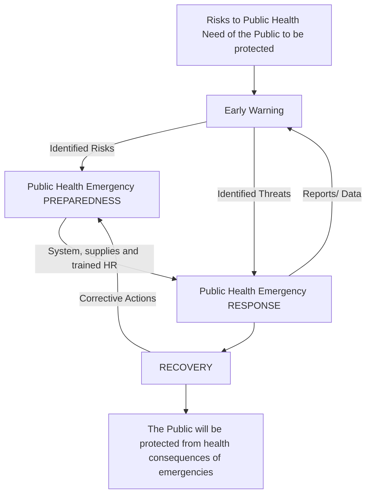

*Figure 1-1 Pillars of Public Health Emergency Management System*

9

## **Purpose of the Guideline**

The main aim of this guideline is to provide a clear guidance on the proper implementation of public health emergency management activities throughout country. It has been produced as a general guide to assist all health professionals, stakeholders and development partners, who take part in public health emergency management to implement it in a standardized way throughout the country. It also helps cross-border communicable disease control other public health emergency response implemented according to IHR principles.

## **Scope and Applicability of the Guideline**

The activities in the PHEM guideline are to be implemented nationwide with the involvement of all relevant stakeholders. As the name implies, PHEM deals with the management of all public health emergency issues, including disease outbreaks, nutritional emergencies and health consequences of natural and human made disasters. Topics that will be covered in this guideline include PHEM coordination, early warning, surveillance, preparedness, response, recovery, and resilience as well as cross-border communicable disease control and regulations. Hence this guideline addresses all public health emergencies related issues and shall be implemented at all levels throughout the country. The information and activities in this guideline are intended for use by health managers and health staff at all levels of the health system (federal, regional, zonal, woreda and health facilities) and to other sectors and development partners who directly and indirectly support the PHEM system. These include:

* Public health /Health management teams
* PHEM Staffs
* Surveillance Officers/Focal Points
* Health Care Workers
* Experts / professionals who engaged in PHEM related activities
* Experts at community health system structure (including HEWs)
* Stakeholders involved in cross-border communicable disease control and other public health emergencies

It is planned to update the guideline continuously based on changes in disease patterns and new issues that will emerge during the implementation phase. Hence, it is a live document that will be updated regularly.

10

## 02/ PHEM COORDINATION AND COLLABORATION

### **Definitions**

**Coordination:** It is a systematic way of bringing all stakeholders at any level of the country's health system structure including cross country border links to function together to achieve the intended objectives of PHEM. Coordination will be better managed if a committee or task force comprising all the relevant stakeholders is established. Instead of creating new committee for emergency coordination, it would be helpful working within established structures and systems such as Public Health Emergency Management Task Force, TWGs, RRTs, etc.

The Taskforces or TWGs should, as much as possible, be led by the corresponding administrative authority at different levels and should include representatives from relevant institutions and sectors such as water, agriculture, health facilities, universities, and partners to ensure comprehensive coordination for PHEM functions. In case of cross-border communicable disease control and other public health emergency measures, the extent of coordination and collaboration may extend beyond the country. This includes coordination and collaboration with neighboring country where there is a shared open border, and other distant countries that could be involved through international traveler’s destination.

**Governance:** Governance in the context of this guideline refer to structures and processes that are designed to ensure accountability, transparency, responsiveness, rule of law, stability, equity and inclusiveness, empowerment, and broad-based participation in the process of managing public health emergencies.

### **General Principles**

* **Leadership:** The leadership function is responsible for overall management of the PHEM response, including supervision of Team Leads. Public health leaders work across sectors

11

to address the social, environmental, and economic determinants of health. Hence, strong leadership and management skills are needed by the national and sub national public health workforce of the future.

* **Partner Coordination:** Health partner coordination ensures that collective action results in appropriate coverage and quality of essential health services for the affected population, especially the most vulnerable. Different coordination models can be developed, depending on the MOH’s capacity, the operational context, and the constraints on principled humanitarian action. Examples include Health Sector Working Groups, outbreak coordination groups, activated Health Clusters, EMT Coordination Cells and informal bodies.

* **Information, Communication and Planning:** This function collects, analyses and disseminates information on health risks, needs, service coverage and gaps, and performance of the PHEM functions response. It uses information to develop and continually refine the functional plans.

* **Health Operation and Technical Experts:** PHEM works with the Ministry of Health and partners to ensure optimal coverage and quality of health services in response to emergencies. It does this by promoting the implementation of the most effective, context-specific public health interventions and clinical services by operational partners. This function provides up-to-date evidence-based field operations, policies and guidance, and technical expertise.

* **Technical Support for Logistics Management:** Health operations are informed by the best available technical expertise and guidance, and adhere to recognized standards and best practices. EPHI/PHEM often provides this technical expertise directly to the MOH, Regional Health Bureau and collaboratively works with partners and ensures an end-to-end, timely and efficient provision of consumables and equipment to support the emergency operations.

This includes selection, forecasting, procurement, transportation, customs clearance, storage and distribution of these material assets.

12

## **Multi-level PHEM Governance Structure**

Public health emergencies are inherently political and require substantially different governance approaches for the management of routine emergencies, extreme events, and disaster responses. National, city and regional health authority under the federal and regional government of Ethiopia shall be well positioned and can make an essential contribution to better and more flexible preparedness and responses to public health emergencies.

The provisional governance framework presented below focus on arrangements as part of the governing the public health emergency management process including preparedness, early warning, response, recovery and resilience. Since 2008, the public health emergency management governance framework in Ethiopia has organized in multilevel structure from national to district level (figure 2-1).

flow_chart: PHEM governance structure diagram

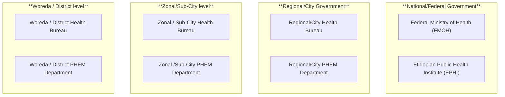

*Figure-2-1: PHEM governance structure*

### **PHEM Governance Frameworks at Federal level:**

* **Ministry of Health (MOH):** As stated on Proclamation No. 475/1995 of the Federal Democratic Republic of Ethiopia defines the Powers and Duties of the Executive Organs; The Ministry of health oversee the overall activities for the entire health system including Public health Emergencies at federal level. As one of the multiple agencies in the Ministry of health, EPHI has the mandate to govern the PHEM system a federal

13

level.

* **Ethiopian Public Health Institute (EPHI):** EPHI is an independent institution working closely with the Federal Ministry of Health. Based on the proclamation number 301/2013 of the Federal Democratic Republic of Ethiopia, EPHI mandated to lead and coordinate PHEM system at federal level. The Public Health Emergency Management center under EPHI has primarily mandated to coordinate the its key functions including disease surveillance, detection and monitoring; outbreak investigation and control, and IHR core capacity system improvement (including systems for detection, prevention, response capacity to public health emergencies) at national level.

EPHI/PHEM has organized multiple departments with multidisciplinary workforce composition focusing on the basic PHEM processes including preparedness, early warning, response, recovery and resilience to achieve the specific objectives under each pillars based on the feasibility and resource availability. The primary roles and responsibilities of EPHI/PHEM includes:

* Develop/adopt national legislations, policies and regulations related to public health emergencies
* Lead and coordinate the overall preparedness, early warning, response activities at national level
* Develop strategic documents, plans, manuals, guidelines, SOPs etc for effective implementation of PHEM system
* Lead and Facilitate IHR core capacity building activities towards a better capacity on prevention, detection and response of PHE.
* Declare pandemics and epidemics at national level
* Provide technical and financial support to regional to district level
* Work on workforce capacity building activities at national level
* A primary contact point for Information sharing and communication focal for the public related to PHE.
* Oversee effective implementation of the international health regulations

14

## **PHEM Governance Frameworks at Regional Government level**

* **Regional Health Bureau:** the health bureau at the regional and city administration level has the mandate to lead, coordinate and oversee the overall PHEM activities with the respective administrative level. This includes, allocation of resources, identification of priority disease conditions, adoption of rules and regulations, system improvement capacity building activities towards effective management of public health emergencies.

* **Regional /City PHEM Department:** the regional/city level PHEM section organized by the regional/city health bureau that coordinate the entire process of PHEM system at regional and city administrative level. The regional Health bureau public health emergency management section shall be organize multiple departments with multidisciplinary workforce composition focusing on the basic PHEM processes including preparedness, early warning, response, recovery and resilience to achieve the specific objectives under each pillars based on the feasibility and resource availability.

**Note:** The Zonal/Sub-City level and District/ Woreda level health bureau and PHEM sections have similar mandate as specified above with in their perspective administrative area.

### **PHEM at the Primary Health System (Hospitals, Health Facilities and Health Posts):**

The health system (hospitals, health facilities and health posts) has a key role the PHEM process primarily of disease surveillance and response activities. Each health facility might delegate a focal persons or PHEM team depending of the feasibility based on existing context. The following activities are expected to be covered at the primary health system:

* Compile and report immediately and weekly surveillance reports
* Validate and harmonize public health surveillance data through reviewing OPD and inpatient wards medical registration books
* Archive and document surveillance data
* Conduct regular active case search within health facilities and community level
* Analyze surveillance data and draw an epidemic curve to see if the epidemic

15

thresholds for specific diseases have been crossed in the catchment area.

* Ensure appropriate collection, storage and transportation of biological samples to appropriate referral laboratories
* Ensure availability of surveillance supplies and tools including reporting forms, guidelines, posters, case definitions, laboratory collection and transportation.
* Provide public health emergency information on morning section and other routine forums to hospital’s medical staffs
* Establish and ensure the functionality of PHEM Club
* Disseminate or share early warning and alert letter from health authority to all staffs of the hospitals,
* Advocate PHEM mandates and its legal frameworks to all staffs of the hospital including administrative staffs
* Provide pre-service PHEM training to students
* Conduct emergency response exercises for infectious diseases and mass causality management
* Continuously train and work closely with health facility staff to ensure standards of surveillance practice are followed and case definitions are known and used to monitor disease trends
* Collaborate with regional health bureau and zonal health department and provide training to hospitals within its catchment population
* Provide technical support on EPRP, VRAM, case management, emergency exercises to general and primary hospitals under its catchment area
* Conduct regular PHEM forum with general hospitals under its catchment area under regional or zonal leadership
* Ensure the availability and functionality of isolation room
* Ensure the appropriate implementation of infection prevention and control precautions
* Facilitate the development of facility based emergency response plans
* Collaborate with university staffs and conduct operational research on public health emergency management operations
* Conduct disease outbreak verification and investigation,
* Coordinate with regional health bureau, zonal health department, woreda health office and partners and establish emergency treatment center in the

16

health facility if it is applicable,

* Timely request medical supplies for case management, infection prevention, specimen collection from national and regional health bureaus
* Coordinate vaccination campaigns during outbreaks
* Facilitating the surge capacity for mass casualty care and outbreak response
* Mobilize psychiatrist from the hospital and support psychosocial response activities

## **PHEM Multi-Sectorial Coordination and Collaboration**

Considering the complex nature of public health emergency management framework, the entire process in prevention, detection and response of emergencies requires the engagement and effort of multiple governmental and non-governmental sectors. This National Coordination document outlines a multi-sectoral system for management of public health emergencies. The primary governmental sectors in this process includes; the Ministry of Health (multiple agencies like FDA, EPSA, EPHI etc), NDRMC, Ministry of Agriculture, Ministry of Environment and Climate Change, the National Security Agency, the Federal Police and other stakeholders. The possible coordination and collaboration platforms that shall be applied in the PHEM process might include the following:

* **National Coordination Task Force (NCTF):** is comprised of relevant organizations working in the prevention, deterrence and response to bio-threats. The NCTF is responsible for coordinating the overall bio-threat management activities at the national level. This taskforce is mandated to:
    - Coordinate, monitor and guide the overall activities of PHEM process throughout the nation
    - Provide high-level decision making for PHEM activities when needed
    - Coordinate response and recovery activities for the affected community(ies) during emergencies

* **Technical Working Group (TWG):** is comprised of technical personnel from member organizations working in the area of specific technical areas (specific emergency conditions. The TWG is responsible for the activities listed below.
    - Prepare contingency and harmonized plans for emergencies involving the use

17

of chemical, biological and radiological materials

* Monitor the capacity building activities of relevant organizations working to develop timely and effective responses to events involving chemical, radiological or biological materials
* Conduct regular assessments of preparedness activities performed by relevant organizations working with biological, chemical and radiological materials
* Prepare and disseminate early warnings related to bio-threat emergencies based on findings/information from public/animal/plant health and law information units
* Compile, analyze, produce and disseminate findings for relevant organizations and the NCTF
* Provide technical advice for the NCTF and high level decision makers

* **One Health Framework:** It is a platform for partnership in implementation of IDSR/PHEM. The Ministry of Health is closely working with other government sectors and partners to promote multi-sectoral responses to food safety hazards, risks from zoonosis, and other public health threats at the human-animal-ecosystem interface and provide guidance on how to reduce these risks through One Health approach.

* **Health Security Council:** A Nation with Secured council might be also a coordinating platform that oversee and give guidance for policy directions, strategic planning, follow-up of capacity building activities towards demonstrable capacity to prevent, detect and respond to public health emergencies.

The above coordination mechanism might be adopted in a similar manner at all levels of the health system, i.e. at the regional, zonal, woreda and lower structures also follow and adapt similar functional groups for the purpose of coordinating activities at their respective level. In addition to this, the National, Regional, Zonal, and Woreda PHEM structures should identify members of the RRT that is expected to take a timely preparedness and response action when an emergency occurs. Establishment of core PHEM coordination mechanism and formation of task forces during PHEIC and cross-border public health emergency event should be given a special attention due to the multiplicity of stake holders and actors at PoEs and beyond.

18

## 03/ PREPAREDNESS

### **Definition**

Preparedness is activities undertake before the occurrence of the emergency considering the existing hazard and expected risk getting the information from EWAR and surveillance finding making ready all needed man power, logistics and finance for averting and minimizing the consequence of the expected emergencies. It also works on system establishment and maintenance considering the current public health emergency situation at each level of the health structure. It involves a range of players and partners engaging in initiatives that promote health, prevent and control diseases and conditions and protect people from the consequences of health emergencies due to manmade and natural causes.

Therefore, preparedness is a responsibility shared by all levels of government, private sector, not-for-profit sector, institutes, and professionals’ associations. The preparedness activities need also consider on maintaining the routine health service activities. The way forward to implement sound preparedness measures is to accomplish first and foremost a paradigm shift from managing emergencies to managing risks. Hence, a big educational drive is needed to install the distinctive concepts of hazards, vulnerability, risks and the value of managing risks. High level advocacy and influential public champions are needed to promote risk reduction in their societies.

### **Purpose**

The aim of preparedness is to strengthen capacity in preventing, predicting, preparing, detecting, recognizing and responding to public health emergencies through conducting regular risk identification and analysis, establishing partnership and collaboration, enhancing community participation and implementing community-based interventions and strategic communication during the pre-emergency phase and ensuring their monitoring and evaluation.

The main objectives of health emergency preparedness include:

* Preventing avoidable crisis and catastrophes
* Reducing morbidity and mortality effects

19

* Ensuring availability of required resources
* Minimizing disruption to health services
* Maintaining business continuity as far as possible
* Reducing disruption to society as much as possible
* Reducing deleterious effect of the emergency on quality of life

## **Elements**

In the public health context, the preparedness sub process is comprised of the following broad activities:

flow_chart: PHEM Preparedness diagram

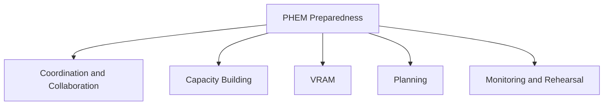

*Figure 3-1 Critical elements of PHE preparedness*

## **Activities and Tasks**

Preparedness activities and those tasks that should be done prior to the occurrence of emergency of public health concern. Development of plans, procedures, protocols, and systems; establishment of mutual aid agreements; provision of training; and the conduct of exercises are among other preparedness tasks. Preparedness also includes acquiring and/or prepositioning different kinds of resources which may include human and material resources.

The public health emergency preparedness capabilities include:

* Putting in place the necessary logistics and funding
* Building the essential systems specific to protection, prevention and response

20

* Equipping public health personnel and respondents with the necessary knowledge and tools
* Educating the public on related measures to be taken to prevent and control the event,
* System, infrastructure development and resilience activity based on the event condition
  Documenting finding and knowledge sharing for anticipation and responding further emergencies

## **Coordination and Collaboration**

A coordinated Public Health emergency management preparedness and response system is an essential condition for effective management of public health emergencies. Coordination will be better managed if a committee or task force of all the stakeholders and partners is established in advance. There is no need of creating committee for emergency preparedness. Instead it is advisable to work within established structures and systems such as task force, rapid response team, health committee etc.

In order to have effective preparedness and response activities, we need to have a system that will address possible collaborators and engage alarming situation for participation, management, legal binding and putting clear role and responsibilities.

Activities and steps required for effective coordination and collaboration include:

* Identification of all sectors, collaborators and partners, their areas of intervention and capacity for public health emergency management;
* Development of a list and keep a register of all institutions and organizations relevant to PHEM and update the list of institution, their focal persons, and experts biannually;
* Communication with all partners and establish a coordination/collaboration forum;
* Development of Term of Reference (TOR), Memorandum of Understanding (MOU) to guide the framework;
* Monitoring and evaluation, participation and implementation of public health emergency activities as per the TOR or MOU;
* Formation of a Rapid Response Team (RRT) to initiate activities at the time of response;
* Revision of membership, TOR or MOU and amend/update as per the findings of the review.

21

## **Assessments**

### **I-Baseline and Periodic Assessment**

The baseline and periodic assessment is an evaluation of health status of the community through systematic, comprehensive data collection and analysis to provide information and critical reference point on the current levels and perspective health status of the community e.g., current burden of disease, the patterns of health, illness, injury and the differences -if any- from community, regional and national trends.

* **Baseline Assessment:** it provides information on the situation to initiate a surveillance system for that specific disease and events. It provides a critical reference point for assessing changes and impact, as it establishes a basis for comparing the situation before and after an intervention, and for making inferences as to the effectiveness of the campaign. It is also a crucial informative campaign research, surveillance and planning, and in any monitoring and evaluation framework. The assessment needs to be conducted when there is occurrence of new public health problem, new diseases, diseases added to surveillance, etc. It should be conducted before the actual campaign intervention. The type of data and variables in the baseline assessment tools should be constructed to fit the disease of interest.

* **Periodic Assessment:** it is a screening tool used by PHEM Unit in collaboration with stakeholders and partners at each level to evaluate the health and nutrition situation, based on public health interest to evaluate the public health concerns and to know capacity and preparedness on readiness of the surveillance system. It can be conducted alone or can be combined with other public health readiness needs.

### **II-Vulnerability and Risk Assessment and Mapping (VRAM)**

It is the process of determining and ranking of the risk level of a frequently existing hazards. It need to consider many parameters that will aggravate or minimize the risk level of the hazard. Basically, during risk assessment we need to consider the existing hazard, vulnerable condition and existing capacity on preventing and responding the consequence of the predicted hazard. It is undertaken by organizing multi -disciplinary and multi sectoral team having the aim of getting pertinent information on the assessment parameters (Hazard, Vulnerable condition and existing capacity). The VRAM assessment

22

finding is basically used for planning purpose.

## **Definition of terms**

**Hazard:** Man-made or naturally occurring event or situation with the potential to cause physical or psychological harm (including loss of life) to members of a community, damage or loss to property, and/or disruption to the environment or to structures (economic, social, political) upon which a community’s way of life depends e.g., presence of outbreaks, flood, storm, chemical release.

**Threat:** The intent and capacity to cause loss of life or create adverse consequences to human welfare (including damage to property and the supply of essential services and commodities), the environment or security.

**Vulnerability:** The susceptibility of a community, service, or infrastructure to damage or harm by a realized hazard or threat.

**Risk:** The probability of harmful consequences or expected loss (of lives, people injured, economic activity disrupted or environmental damaged) resulting from interactions between natural or human induced hazards conditions. For example:

* Measles epidemic (hazard) in a community - The potential impact and risk will depend on vulnerability and Capacity based on the immunization level, nutrition status etc.
* Earthquake (hazard) - type of house (tent, poorly designed high-rise building etc.)
* Floods (hazard) - the lower in altitude and closer to a river, the more susceptible to flooding.

Risk is a function of many factors and not only exposure to hazard. Risk is defined as a product of the likelihood of the occurrence of a given hazard (epidemic disease, drought, flood, etc.) and the vulnerability to the impact. Improving coping capacity reduces the risk by reducing the vulnerability to the impact or by reducing the likelihood of the hazard.

**Vulnerability Assessment:** It is a continuing, dynamic process of assessing hazards and risks that threaten the population and the health system and determining what can be done about it. Vulnerability assessments also include a method of structured data collection geared towards understanding the levels of potential threats, population likely to be affected, coping capacity, relief needs and available resources to address them.

23

A vulnerability assessment provides:

* A means to inform decision-makers about the preparedness needs at different levels;
* A starting point to construct an overall plan that corresponds to the dimensions of identified risks. This can also help to measure the levels of preparedness or unpreparedness;
* A tool to initiate the public health emergency preparedness planning;
* The basis for monitoring trends of risks in emergency prone areas. In that sense, the initial effort of developing a data base through vulnerability assessments should become the basis for maintaining and updating an essential informational tool for development planning purposes.

## <u>**Planning for the Identified Risks and Hazards**</u>

Planning is the theme of the whole emergency preparedness exercise. Plans should be updated regularly especially following major incidents and mock exercises to include lessons learned. The plans should form the basis of estimation of required resources for predictable emergencies including training. It should be exercised periodically to ensure that partners are familiar with the plan and able to execute their assigned role. Thus, it is essential that plans reflect the preparedness cycle of planning, training, exercising, and incorporation of after-action reviews and lessons learned.

In addition to revising of existing plans, plans for hazards which are becoming increasingly important and may not have received due attention in the past such as chemical, biological, radiological, nuclear (CBRN) threats, non-communicable diseases need to be prepared. The purpose of planning at this stage is to have agreed upon, implementable and/or operable plans in place, for which commitment and resources are relatively assured. Readiness planning includes working out agreements between people and/or agencies as to who will provide services in an emergency to ensure an effective, coordinated response. The written plan is a product of the planning process and needs to be operationalized.

The activities and steps in the process of planning include:

* Identification and organization of preparedness planning team(s)/experts from different sectors including partners
* Coordination and integration of all response and recovery agencies/organizations in the

24

planning process

* Identification of needs required to respond to potential emergencies
* Discussion with partners to identify, endorse and agree on their roles and responsibilities
* Development of plans, to prevent, protect against, respond to, and recover from natural and man-made disasters
* Preparation of monitoring mechanisms/ tools to ensure preparedness plan is operationalized
* Ensuring the integration of the plan in the sector regular plan.

In line with the emergency preparedness and response planning, the service continuity plan must be considered and prepared during planning process either by dedicated team or emergency preparedness and response plan working team having the aim of continuous service delivery as routine during emergency. It should also be considered the infrastructural, human power, logistic and supply aspects.

## **Capacity Building**

### <u>**I- Work Force Development**</u>

Workforce capacity development is critical to developing a sustainable public health emergency management system over time. Recruiting and maintaining highly qualified health workforce with appropriate technical training, scientific skills and subject-matter expertise to prevent, prepare for, detect and respond to public health emergency events is the key elements of health emergency and disaster preparedness.

Workforce capacity building activities improve performance of the staffs according to specific, defined competencies related to planning, implementation, and monitoring of health emergency preparedness, response and recovery activities; and this in turn helps the country to achieve required core capacities to prevent, detect, and respond to public health emergency events and effective implementation of the International health regulation (IHR 2005).

The workforce capacity building objectives and activities should be informed by the findings from risk assessment and be focused on strengthening system and human resource for health needs particularly

25

to PHEM, such as health emergency leadership, surveillance, epidemiology, laboratory, case management, Infection Prevention and Control (IPC), communication, and health supply and logistics management. In the event of any health emergency response, there are a number of factors that need to be considered to ensure appropriate management of the public health workforce, while providing effective an response to the health emergency event and continuation of the essential health services. The health workforce capacity development objective addresses the training or capacity building needs; health workforce health and safety, and support program.

The following activities should be considered as part of a comprehensive workforce capacity building strategy for health emergency preparedness and response at all levels;

* Training needs assessment to inform capacity and skill gaps
* Preparing updated list of trained staff at all levels including health facilities on the following key areas;
    - Surveillance and epidemiology, Rapid response team (RRT) and Case management for priority risks; Laboratory testing for priority pathogens including zoonosis in humans; and Infection prevention and control (IPC) and WASH in health facilities; etc.
* Identifying and addressing gaps in the existing training as revision of curriculums of health emergency workforce training programs
* Working with public health training institutions to support institutionalization of IDSR and health emergency leadership trainings
* Planning and implementation of intermediate and/or advanced FETP and other trainings based on need, identified gaps and health sector strategic objectives. This includes Intermediate level FETP, Advanced FETP specialty tracks (laboratory, veterinary) and public health emergency leadership (PHEL)
* Implementing short-term in-services trainings programs to address the immediate priorities in preparedness and response capacities at all levels such as
    - Incident management system (IMS)
    - Basic PHEM training for health facilities levels
    - Event-based surveillance (EBS) focused on enhancing existing community based-surveillance system

26

* Emergency Medical Team (EMT) training including basic trauma and life support, and pre-hospital care for clinicians, nurses, first aid personnel
* Infection prevention and control (IPC) trainings for PHEM officers, RRT, clinicians, and HF managers
* Event specific trainings for PHEM officers focused on skills development for risk assessment and investigation, surveillance, case management, isolation and quarantine protocols. For example, SARI or Influenza like illnesses (ILI), VHF and/or Yellow Fever, Vector borne diseases (malaria, arboviruses), MPDSR, AEFI, etc.
* Develop an integrated in-service PHEM training which includes IHR, IDSR and disaster management

The implementation of workforce capacity building strategies should be informed by demands and need assessment at sub national and lower levels of the health system and the existing community structures such as community networks, health development agents, health extension workers, and also take into consideration the health sector priorities and strategic objectives of strengthening primary health care to achieve universal health coverage and health security. Adequate attention and emphasis to strengthen preparedness and response capacity at sub-national levels particularly zonal woreda and health facility levels by implementing the following activities;

* Support zonal and Woredas to identify health workforce need by profession, quantity, specific skill or competencies based on local context or priority risks
* Strengthen zonal and woreda capacity to forecast and plan for human resource needs to respond to priority public health risks at local level
* Enhance support for health facilities to improve the skill and competencies required to diagnose and treat emerging and re-emerging infections, etc.
* Strengthen collaboration between regional, zonal and woreda health leaders and local administration to mobilize resource for health workforce <u>capacity building.</u>

**IA-Surge Capacity:** Surge capacity is the ability to provide adequate healthcare during health

27

emergencies that may exceed the limits of normal health system capacity (staff, supplies, space and system) of affected country, region or community. The surge requirement may extend beyond direct healthcare to include such tasks as, surveillance and public health intelligence, epidemiological investigations, laboratory testing <u>and special intervention to protect medical providers and patients to</u> continue routine health services. Activities that may need additional support (surge capacity) during public health emergency response include:

* Case finding, monitoring, analysis of disease transmission, case or contact tracing
* Case and contact management (e.g., Isolation/Quarantine)
* Infection prevention and control (e.g., use of PPE, and environmental cleaning)
* Mass drug administration or mass vaccination
* Risk assessment (e.g., assessing needs and identifying exposures)
* Risk communication (e.g., developing key message for health workers, the public)
* Data and information management (e.g., maintaining data system/record entries)
* Laboratory (e.g., specimen collection, transport and processing)
* Managing reports or enquiries within health system, the public and media (e.g. hotlines, listening and responding to rumors)
* Supply chain and logistics (e.g., managing supplies, cold chain, stores using SOPs)
* Developing Standard Operating Procedures (SOPs), protocols, guidelines, etc.)

**Factors that determine surge capacity requirement:** The need for surge capacity is influenced by features of the health emergency event, available resources and support for the ministry of health or agency responsible to coordinate the response, the need for specific expertise and needs of the affected population. When public health demand increases or is likely to increase, workforce surge processes should be initiated as early as possible and decisions about surge requirements should be made by public health authorities at national or local level according to existing guideline. Surge staff is mobilized when the magnitude of the health emergency event exceeds available capacity of existing health workforce. Lessons from infectious diseases outbreaks in the past few years ranging from Ebola, cholera to the ongoing Covid-19 pandemic have challenged even well-established health systems.

To effectively respond to public health emergency events, it’s important that health system has

28

adequate workforce capacity (number and mix of skills) to trigger timely response. This requires adequate number of personnel trained and equipped with the necessary skills and expertise to meet rising demands of affected health system or population. To effectively prepare for and respond to potential public health risks, the PHEM structure at all levels should ensure the following on regular basis when planning for health emergencies:

* A good understanding of priority public health risks and knowledge of local population the priority public health hazards may affect
* The capacity of existing workforce in terms of skills and key expertise (surveillance, rapid response, case management, IPC, etc.) that could be quickly mobilized
* Availability of roster of trained staff based on local public health risks that could be called upon when required to respond to a public health event
* A plan for continuation of essential healthcare services including protocol to temporarily defer or relocated low priority services to alternate facilities
* Potential sources of surge workforce that may be available when additional health staff is required including the procedure for requisition and deployment in short time
* Training and logistics need for potential surge staff to quickly integrate into the system

**<u>Identifying, training and deployment of surge staff</u>:** Identifying and training of surge personnel with relevant skills is a key feature of public health emergency preparedness and will contribute to the efficiency of a surge response. Surge staff with various backgrounds may be engaged to provide diverse technical skills required during a surge response. Types of surge staff that contribute to health surge response include;

* Health professionals (e.g., physicians, nurses, laboratory technologist, pharmacy technicians, IPC specialists, health managers, epidemiologists, data managers, health educators or promoters, etc.)
* Non-health professionals (e.g., logistic and supply chain specialists, communications and media personnel, IT specialists, cold chain specialists, etc.)
* Administrative support personnel including human resources, business and finance managers, plan and budget experts, etc.

29

**IB-Volunteers Management:** A volunteer is an individual, institution, agency and others who render aid and service without pay or remuneration. Emergency volunteers may be recruited and deployed to the health facilities by an organization (affiliated), or may present themselves spontaneously (unaffiliated). Emergency volunteers may also be qualified healthcare professional (clinical) or without healthcare qualifications (non-clinical). Volunteer management, also known as volunteer engagement/coordination/administration, refers to “the systematic and logical process of working with and through volunteers to achieve an organization’s objectives”. Having a volunteer management program in place is the most straight-forward way to ensure effective volunteer management. Volunteer management generally follows the cycle illustrated in the figure below.

flow_chart: Volunteer Management Cycle diagram

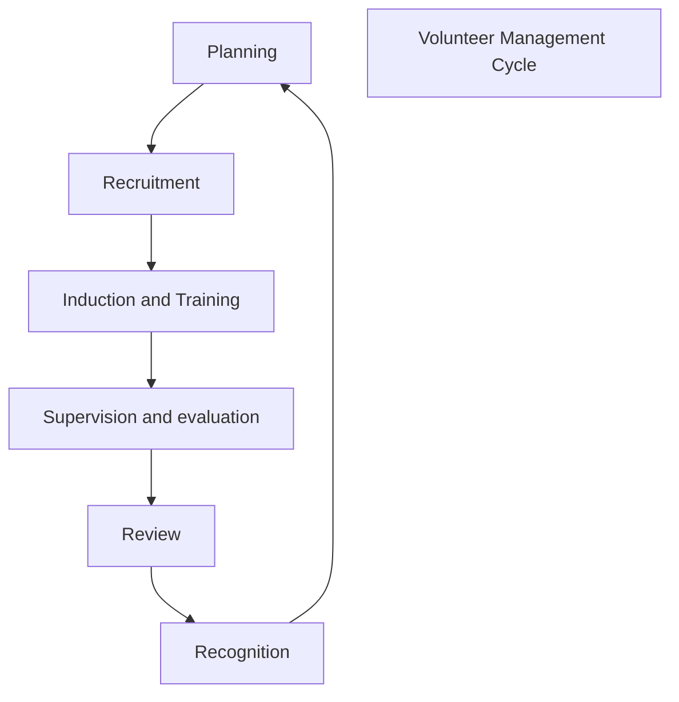

*Figure-4.1. Volunteer management cycle*

## **II- Logistics**

**IIA-Emergency Supply Chain Preparedness:** When it comes to emergency supply chain management, a little preparedness will go a long way. Investing relatively small amounts of time and resources up-front to reach a minimum level of preparedness can significantly improve outcomes for vulnerable populations when an epidemic occurs, minimizing the impact on people and infrastructure. Emergency supply chain preparedness is a critical element of country’s comprehensive emergency preparedness and response activities. The key emergency supply chain management and preparedness activities involve: identifying disease threats and needed commodities that should be

30

stocked in the emergency supply chain, as well as deciding whether to stockpile some of these commodities in advance, and planning storage, transport, and logistics in the event of an emergency. The major areas of ESC preparedness can be viewed as: people and processes, commodity planning, and logistics and transport. Under these categories there are key elements involved in building an in-country emergency supply chain preparedness capability. The journey of implementing capability will involve doing work in each of these components.

**Demand Forecasting:** Before procurement of Emergency products, understanding the demand MCMs by quantity forecasting is a critical step in the Emergency Supply Chain Management (ESCM) of PHEM. By determining how much of certain MCMs will be needed in an anticipated or actual crisis, EPHI/PHEM lays the groundwork by preparing a preparedness plan for an effective response and it reduces supply shortages in the event of an outbreak.

Source of data for quantification are: population at risk, attack rates, Past incidence numbers epidemiological behavior of pathogens, previous consumption, “belg and meher” survey figures, program data and analysis of triggers. Quantification activity is being done by different groups: Facility Based Teams, EPSA and PHEM- National level, Response and Rehabilitation Department- NDRM, Supply and logistics, operation in NGOs. Before proceeding to procurement there should be a quantified product list for an emergency case.

As part of the preparedness process, needs must be estimated based on different assumptions. The table below gives you a general approach on how to estimate the number of supplies needed according to the number of people in area at risk. Construct a simple excel spread sheet to calculate the supplies that are required for your level.

<table><tr><th>Level (e.g. Woreda) (A)</th><th>Population of the Locality (B)</th><th>Expected Number of Cholera Cases (C)</th><th>Number of People with Severe Dehydration (D)</th><th>ORS in Sachets (E)</th><th>Ringer's Lactate of 1000 ml bag</th><th>etc</th></tr>
<tr><td>xxx</td><td>000</td><td>(B) x attack rate</td><td>(C) x sever rate</td><td>(D) x 6.5</td><td>(D) x 6</td><td></td></tr>
<tr><td>yyy</td><td>0000</td><td>(B) x attack rate</td><td>(C) x sever rate</td><td>(D) x 6.5</td><td>(D) x 6</td><td></td></tr>
<tr><td>zzz</td><td>00000</td><td>(B) x attack rate</td><td>(C) x sever rate</td><td>(D) x 6.5</td><td>(D) x 6</td><td></td></tr>
<tr><td>....</td><td>....</td><td>....</td><td>...</td><td>....</td><td></td><td></td></tr>
<tr><td>TOTAL</td><td>Sum above</td><td>Sum above</td><td>Sum above</td><td>Sum above</td><td>Sum above</td><td></td></tr></table>

*Table-4-1: Sample 'excel' worksheet to estimate required supplies for management of cholera*

31

Instantly after an emergency event strikes, the institute conducts an initial assessment (usually within 2 days after occurrence). The expected quantity of supplies required to meet the needs of the specific emergency and the affected population is re-assessed, the stockpiles and stock of supplies available in the country (at EPHI, EPSA and partners’ warehouses), are evaluated. Additional essential commodities and required resources, which need to be procured from suppliers, are determined. As next step, this assessment is translated into supply requirements, and additional resource will be solicited if there is any gap.

**IIB-Emergency Supply Chain Coordination:** effective ESC coordination is helpful for proper utilization of resources in emergency situations. On the contrary, lack of coordination leads to confusion, ineffectiveness and wastage of resources. This has huge implication in the emergency supply chain management. This, in turn, weakens the impact of humanitarian assistance. It is important that governments together with all aid agencies engaged on disaster relief are clear on who does what, when and where.

The ESC preparedness journey will take several months of significant effort and capacity by a dedicated core team of people, with participation from a broader range of stakeholders, and then will be maintained on an ongoing basis. Understanding the roles played by different stakeholders ahead of time will enable the strongest response from Day 1 of an emergency, with clear, coordinated involvement from all stakeholders. PHEM’s logistics team will be in-charge of coordinating the overall emergency supply chain management operations of local and international players. Cognizant to this, the team will map the local and international players in a country’s emergency supply chain to understand their roles, responsibilities, and capacities in an emergency.

The mapping involves listing the names of relevant organizations and individuals, contact information, roles and responsibilities, and geographic location. It should also assess each partner’s material capacity, as well as technical expertise, across the following dimensions: personnel, stockpiled commodities, warehousing and storage space, cold chain capacity, transport and funds. The main government stakeholders working on public health emergency should be dedicated enough during preparedness phase as well as be responsive during the response.

* **Resource Mobilization and Mapping:** The integration of national disaster risk management, health system strengthening, IHR core capacity building and achieving Universal Health Coverage (UHC) at all levels of government is only possible through the engagement of

32

different sector offices and strong collaboration in resource mobilization efforts. The active engagement of humanitarian and development partners, private sectors and communities at large are critical in resource mobilization through existing coordination forums at all levels. The existing preparedness, coordination and planning forums in the humanitarian and development forums play a vital role in engaging all actors in for resource mobilization. PHEM should coordinate resource mapping and mobilization for emergency situations.

* **Local Capacity with respect to Emergency Supplies:** Local production of health products is of an essential piece of the supply chain management. As demand for products increases, countries with limited resources are often unable to avail products needed to mount effective responses to public health emergencies. These countries are overly reliant on international supply chains for these products, which can lead to challenges when global demand rises, and supply is getting limited. Encouraging local manufacturing capability across the developing world will not only support the immediate response to specific pandemic but it also creates more resilient health systems and supply chains going forward. In mobilizing resources, it is important to consider the local capacities as one of the strategies to produce emergency supplies

**IIIC-Emergency Procurement Management:** EPHI/PHEM or through its procuring agent must rapidly procure additional goods and services to enable an effective response. The public health and medical resources needed during an emergency are frequently different in character and quantity than those used daily to address routine circumstances. The institute or its procuring agent should have a comprehensive list of potential sources for all essential commodities. First-line suppliers should be pre-identified, vetted, and contracted ahead of time to limit lead times. Suppliers should also be diversified to limit risks such as long production lead times or local factory shutdowns due to the spread of infection.

## **Monitoring and Rehearsal/Simulation**

**Monitoring:** This activity focuses on monitoring the implementation of identified activities indicated in the sub-processes and reporting the status to respective stakeholders based on the frequency set in the PHEM core process design. Validation and revision of operational and epidemic preparedness and response plan (EPRP) through exercises, training, and real-world events, and the use of after-action reports also contribute to evidence-based assessment of functional capacities and opportunities. Findings from these experiences guide the refinement of the successive plans that will be used at

33

different phases.

Conduct performance review every year (Use appropriate methods such as workshop, review meetings, questionnaire etc.). Document findings and lessons learnt and share with all stakeholders. Monitoring indicators found in this guideline are expected to be used as a starting point to conduct monitoring of programs at all levels. Therefore, the indicator should be refined and qualified according to the contexts in which preparedness activities are to be carried out.

**Simulation:** Simulations are conducted in order to test preparedness in the absence of an event suitable for an after-action review, to check or validate response capacity, and monitor for improvement in identified areas. Such exercises are structured whereby the items at all levels test efficiency and reliability of preparedness activities in an ideal setting. These exercises is a focused practice activities that places participants in a simulated situation and requires them to function in the capacity that would be expected of them in a real event. It can involve all partners that are expected to take part in each type of emergency management and contribute to the planning process. Conducting such an exercise helps to evaluate a system’s ability to execute the plan. It allows the system to identify and correct problems in the plan prior to a real event.

Below are major activities that should be under taken to conduct a rehearsal/simulation under ideal settings:

* **Establish ideal contexts to simulate exercise:** First, set objectives and methodologies for the risk assessment exercise. Always begin by defining the scope of the risk management activity in the context of its roles and responsibilities. Also define the physical, social, environmental and statutory environment within which the simulated risk might exist. Doing so will help you to exercise your simulation in a real-world setting. The simulation should consider all the stakeholders relevant to the risk’s management. Identify a setting where you will evaluate your preparedness, considering the worst-case scenario for the selected risk. e.g., take a known flood prone area to simulate your preparedness in related to malaria epidemic response.

* **Choose an appropriate mechanism:** It is possible to conduct simulation in different ways, including face to face, online, etc. You will need to choose a mechanism which is appropriate for your purpose. There are many different types of exercises. Depending on time, funding,

34

resources and what you would like to evaluate you can choose the type of exercise that is most appropriate. Exercises may be discussion-based in order to familiarize participants with or refine current plans, policies, agreements, and procedure. They may also be operations-based to validate plans, policies, agreements, and procedures; clarify roles and responsibilities; and identify gaps in an operational environment.

* **Orientation Seminar:** An overview or introduction designed to familiarize participants with roles, plans, procedures or equipment.

* **Discussion-Based Exercises**
    - **Tabletop exercises (TTX):** A tabletop exercise is a facilitated discussion of an emergency situation, generally in an informal, low-stress environment. It is designed to elicit constructive discussion between participants; to identify and resolve problems; and to refine existing operational plans.

* **Operations-Based Exercises**
    - **Drills (DR):** A drill is a coordinated, supervised exercise activity, normally used to test or train a single specific operation or function in a repeated fashion. A drill aims to practice and perfect one small part of a response plan, and should be as realistic as possible, employing any equipment or apparatus necessary for that part.
    - **Functional exercises (FX):** A functional exercise is a fully simulated interactive exercise that tests the capability of an organization to respond to a simulated event. The exercise tests multiple functions of the organization’s operational plan. It is a coordinated response to a situation in a time pressured, realistic situation. A functional exercise focuses on the coordination, integration, and interaction of an organization’s policies, procedures, roles and responsibilities.
    - **Full-scale exercises (FSX):** A full-scale exercise simulates a real event as closely as possible and is designed to evaluate the operational capability of emergency management systems in a highly stressful environment, simulating actual response conditions. This includes the mobilization and movement of emergency personnel, equipment and resources. Ideally, the full-scale exercise should test and evaluate most

35

functions of the emergency management plan or operational plan. It involves multiple agencies and participants physically deployed in a field location.

* **Identify and orient the team:** Communicate with all relevant stakeholders regarding the purpose of the simulation exercise. This is a stage where you invite partners that would be involved in a real event to participate in the simulation exercise. It is important always to brief participants on the purpose of the exercise so that everyone will be aware of its role as well as their individual and collective responsibilities in action.

* **Conduct exercise:** Remember to notify your staff if the simulation is in house and to notify public if the simulation is in real situation.

* **Identify strengths and limitations:** The overall purpose of the rehearsal exercise is to identify strengths and weaknesses in systems and capacities prior to an event. The process must identify strengths and weaknesses in relation to:
    - Coordination and collaboration that is expected to be in place
    - Vulnerability assessment and risk mapping outcomes used in the decision-making process,
    - Quality of the planning process and preparedness inclusive of response details,
    - Capacity building measures taken prior to an event

* **Review and update the plan:** Once the simulation exercise is over, record outcomes and findings in a written format that captures the main recommendations. Review and update plans and implement activities according to experience with a focus on coordination and communication between the national and sub national levels of government and sectors. Recommendations should be specific, feasible, time-bound, measurable and adequately translated into an action plan. Ensure that the updated plan is circulated to all members who participated in the planning and rehearsal exercise.

36

## 04/ **EARLY WARNING AND DETECTION**

### **Early Warning System**

**▶ Definition:** Early warning systems are in most instances, timely surveillance systems that collect information on epidemic-prone diseases in order to trigger prompt public health interventions. However, these systems rarely apply statistical methods to detect changes in trends of health and health determinants. The current surveillance system incorporates climate data, geographical and other relevant environmental data with the purpose of surveillance and early warning system for health.

Early warning is the identification of a public health threat by closely and frequently monitoring identified indicators and predicting the risk it poses on the health of the public and the health system. Early warning systems are designed to alert the population and relevant authorities in advance about possible adverse conditions that could lead to a public health emergency and to implement effective measures to prevent, mitigate, respond and recover effectively with reduced adverse health outcomes.

The traditional framework of early warning systems is composed of three phases: monitoring of precursors/signals, forecasting of a probable event, and the notification of a warning or an alert should an event of catastrophic proportions take place.

Early warning and risk communication starts by identifying cases and / or events at health facilities, Port of Entries (POEs) and community level and ends by sharing data and information for all relevant stakeholders in real-time. It also uses IHR notifications on events happening in other countries with possibility of expansion. The early warning and communication system for public health risks in Ethiopia is undertaken by the Public Health Emergency Management system at all levels.

37

**▶ Purpose:** The purpose of early warning is to enable the provision of timely and effective information to the public and to responders, through identified institutions that allow preparing for effective response or taking action to avoid or reduce risk.

## **▶ Major Activities**

* Data collection-public health and related data
* Data cleaning and analysis
* Interpretation of analysis result
* Public health risk assessment
* Evaluate potential for epidemic transmission
* Identify Public Health emergency epidemic-prone areas and populations at risk
* Forecasting/predicting of PHE risks
* Prediction of possible health outcomes
* communication message development with suggested possible interventions
* Selection of communication medias
* Dissemination and communication of PH risks
* Evaluation of early warning system and message utilization
* amendment of communication approaches
* Sentinel surveillance focused on early warning purpose

**▶ Indicators:** Public health early warning indicators are conditions which, when they occur or change, signal an increase in the risk of occurrence of a particular threat to public health. These indicators are regularly monitored to identify situations for which a public health action may be needed.

Major indicators of early warning include:

* An increase in the number of cases beyond expected /occurrence of outbreaks,
* Unexplained morbidity and mortality in human and animal
* An increase occurrence of malnutrition cases (SAM,MAM, GAM)
* Evidence of increase in zoonotic disease in animal and human
* Evidence of increase in vector abundance of specific diseases

38

* Environmental changes such as air pollution, water quality changes, contamination
* Occurrence of natural disasters such as drought, fire, flood, earthquake, severe weather (meteorological information/prediction)
* Agricultural events such as reduced harvest, occurrence of pests or diseases
* Refugees, internally displaced people, disruption of health services and infrastructure
* Important industrial accidents; chemical spills and possible biological attack
* Risky personal behaviors / lifestyles exposing to non-communicable diseases
* Occurrence of PHEs of international concern in other countries
* Occurrence of PHEs at cross border areas

## **Prediction / Forecasting**

It is determining what is going to happen in the future by analyzing what happened in the past and what is going on now. Health forecasting is predicting health situations or disease episodes and forewarning future events. It is also a form of preventive medicine or preventive care that engages public health planning and is aimed at facilitating health care service provision in populations. Health forecasting involves a degree of uncertainty, as it is virtually impossible to have a perfect (i.e. 100 % error free) prediction.

The main activity for predicting/forecasting possible public health risks, emergencies and events includes:

* Data collection from health and other sectoral data
* Data cleaning
* Identify predisposing factors/variables for the occurrence of PHEs
* Identification of the type of data
* Selection of the type of model to build
* Estimate the parameters
* Develop tools for model estimation
* Validate the tool
* Forecast/predict PHEs occurrence by using the newly reported data
* Develop risk mapping by using the tool

39

* Estimate the possible effect of forecasted/predicted PHEs

A PHE early warning system uses a community and event-based surveillance, indicator-based surveillance and sentinel surveillance system (as depicted in Figure 4-1) to monitor threats, risks, signals and priority diseases and/or conditions. As a basic principle of public health intelligence, all components are given equal attention since a signal leading to a public health alert can originate from any one of the surveillance systems.

flow_chart: Early Warning System components diagram

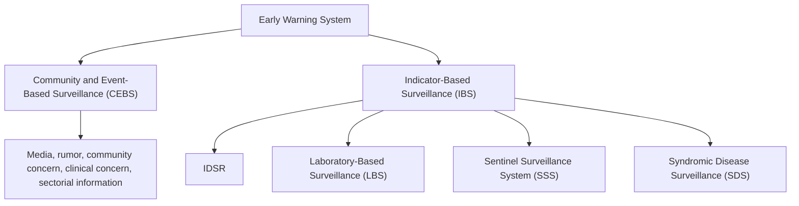

*Figure 4 - 1 Components of early warning system*

## **Public Health Surveillance System**

**▶ Definition:** Public Health Surveillance is an ongoing, systematic collection, organization, analysis, interpretation and dissemination of information, in order that action may be taken. It is the use of data to monitor health problems to facilitate their prevention and control. Surveillance is also defined as “Information for Action”.

A functional disease and event surveillance system is essential for defining public health problems and taking action. Proper understanding and use of the public health surveillance

40

system helps health workers at each structural level to set priorities, plan interventions, mobilize and allocate resources, detect epidemics early, initiate prompt response to epidemics, and evaluate and monitor health interventions. It also helps to assess long term disease and event/condition trends and patterns.

## **Objectives:**

* To early detect epidemics (outbreaks) so that they can be controlled in a timely manner
* To monitor trends in endemic / priority non-communicable disease in order to inform policy decisions for changing trends
* To evaluate an intervention so that effective and efficient policies are identified and supported
* To monitor progress towards a control, elimination and eradication programs so that achievements against targets are measured
* To monitor programme performance with a view to enhancing it
* To predict/forecast public health emergencies occurrence and plan health services to prevent, mitigate, respond/control and recover effectively
* To estimate future PHEs impact and develop health services according to predicted needs
* To predict and prevent entry/exit and spread of infectious disease from neighboring countries and international travelers and conveyances

## **Process:** A signal is data and/or information considered by the Early Warning and Response (EWAR) system as representing a potential acute risk to public health. Signals may consist of reports of cases or deaths (individual or aggregated), potential exposure of human beings to biological, chemical or radiological and nuclear hazards, or occurrence of natural or man-made disasters. Signals can be detected through any potential source (health or non-health, informal or official) including the media. Raw data and information (i.e., untreated and unverified) are first detected and triaged in order to retain only the one pertinent to early detection purposes i.e. the signals. Once identified signals must be verified. When it has been verified, a signal becomes an “event”.

41

A verified disease outbreak or a health threat meets one of the following criteria:

* Need to be one of the following: SARS, polio (wild-type), smallpox, or a new subtype of influenza?
* Presents a serious threat to public health?
* Unusual or an unexpected event?
* Poses a significant risk for international spread that potentially requires international intervention?
* Potentially causes restrictions of trade or travel?
* Has direct/indirect contribution for the occurrence of PHEs
* An indication for the future occurrence public health risks
* Poses risk of spread beyond border?

flow_chart: Process of IDSR and EBS

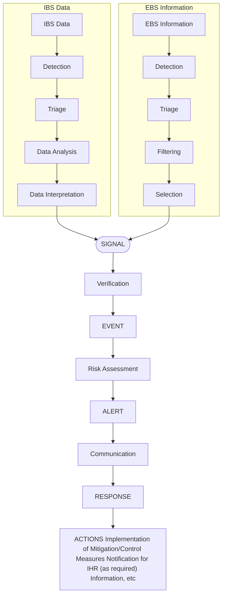

*Figure 4 - 2 Process of IDSR and EBS*

42

## **Community and Event-Based Surveillance (CEBS)**

Community and Event Based Surveillance system (CEBS) could function during pre-emergency, emergency, and post-emergency periods. During the pre-emergency period, it provides transfer of early warning messages and alerts about the incoming/forecasted threat by considering signal data on hand. CEBS during an emergency period can actively detect and notify cases and deaths and engage in response activities. CEBS at the post-emergency period can monitor the progress towards emergency control.

CEBS provides a reliable and immediate communication structure to alert bordering areas by giving voice to the existing local knowledge to identify and notify public health emergencies and other risks as early as possible. Active community participation/engagement in a reliable response network is key features of an effective CEBS system.

* **Event-Based Surveillance (EBS):** It is an ongoing active process in detecting, collecting (mainly unstructured ad hoc information), interpreting, notifying, responding to and monitoring public health emergencies and events at each structural level of the health system. This system complements the Indicator Based Surveillance (IBS) system, relatively well functional at health facility level, by capturing signals and unusual occurrence of PH risks. Information is initially captured as an alert, considered by the early warning and response system as representing a potential acute risk (such as an outbreak) to human health. The event-based surveillance system is very sensitive, and information received through it should be synchronized with IBS and rapidly assessed for the risk the event poses to public health and responded to appropriately

EBS is:

* Designed for early warning and rapid response
* A systematic monitoring of events, event assessment and verification, and data dissemination
* The collection and collation of information that is processed in real time
* A reporting system without designated timeline or predefined structure

43

* **Community-Based Surveillance (CBS):** it is an ongoing active community participation in the process of detecting, collecting, interpreting, notifying/reporting, responding to and monitoring public health emergencies, events and public health related risks in the community. The scope of CBS starts from systematic and on-going detection of PH risks/ early warning signals, collection, notification, verification, response and recovery as necessary.

CBS (CBS) widens the surveillance network to reach communities and enable to capture public health related events that are not captured by the routine IBS system. So as to strengthen the indicator-based public health surveillance system, engagement and empowerment of community members in public health surveillance and response activities is crucial. Simplified/syndrome are used to facilitate rapid detection of priority diseases, events/conditions and other public health hazards in the community.

Generally, Community-Based Surveillance (CBS) is expected to timely capture PH early warning signals happening in the community such as unusual and unknown occurrence of diseases or/and conditions, cluster of cases and/or death of humans and animals that may indicate public health hazards and rumors of unexplained death of humans and animals. It also enables capturing misperceptions and misinformation related to public health threats circulated within the community.

CBS has several advantages over case-based surveillance, because case-based surveillance has at least the following limitations:

* Produces credible information but reporting is often delayed
* Is designed for known diseases and diseases are often not reported until the etiology is known; Is not well-established in all countries
* Is limited to the health sector, whereas media and other types of open-source reports often originate from highly-motivated entities, such as journalists, which can promptly provide information to open sources

**Sources of CEBS Data:** include existing channels of established formal and routine reporting systems, and informal open channels, media scanning such as ProMed, blogs, social media, radio, and television, health workers and community notification, private sectors and non-governmental

44

organizations. Sources of information that can be used for the early warning function go far beyond traditional disease-based surveillance (including laboratory confirmation) and syndromic surveillance. They encompass environmental/ecological surveillance and health-related behavioral information. It also enables to capture and correct public health related misinformation circulated on social media.

CBS systems collect various types of information from different sources such as community members, public and private institutions, traditional healers, local associations and organizations depending on the local context across the country. The different formal and informal sources of information can provide timely information on health events/conditions such as cluster of cases, disease outbreak, unexpected or unusual illnesses and deaths, rumors, new occurrences and any changes of risk factors for human health.

Critical Information Requirements (CIRs) for CEBS and CBS includes:

* Personal information (age and gender)
* Date of onset of the event
* location of event occurrence
* Major and common symptoms identified
* Any known/suspected predisposing factors
* Source of information etc

## **CEBS Implementation Mechanisms**

### **National Level:**

* CEBS implementation through hotlines and media scanning particularly at PHEOC is the major function of PHEOC during the watch and alert phase of PHEOC activation to monitor public health risks. The data collected through the PHEOC (hotline and media scanning) need to be communicated to the right department to be used for early warning purposes and for archival. MoH, EPHI and National level health partners are responsible for the coordination and implementation of CEBS system at lower levels (community to regional level). The National Public Health Emergency Management is the principal owner of CEBS and responsible for designing the general CEBS strategic partners at each level that support CEBS planning, implementation, monitoring and evaluation at

45

their respective working level.

## **Regional Level:**

* Regional Health Bureau PHEM / Regional Public Health Institutes and regional level health partners are responsible for planning, implementing, monitoring and evaluating CEBS status in the Region. They also ensure smooth implementation of CEBS through hotlines and media scanning particularly at PHEOC and supervises implementation of CEBS at lower levels (zonal to community level). RHBs can make necessary adaptations of CEBS to suit the existing contexts in their respective regions.

## **Zonal Level:**

* Zonal Health Department, Zonal Steering Committee and zonal health partners are responsible to support, monitor and evaluate the status of CEBS implementation. They ensure CEBS implementation using hotlines/landlines and media scanning and supervises the implementation at health facility and community levels.

## **Woreda Level:**

* The Woreda PHEM, Woreda Health Office head, Woreda RRT and Woreda Women Affairs Office are the primary focal points for the planning, implementation, monitoring and coordinating CEBS related activities. Moreover, the administration and working structures should be involved in the process of implementing and monitoring CEBS system implementation. Woreda Health Office ensures CEBS implementation using hotlines/landlines and media scanning and supervises the implementation at health centers, health posts and community levels.

## **Health Center Level:**

* The HC surveillance focal, RRT, HEW supervisor, local and international NGOs and other health partners should implement/provide support for CEBS system implementation. The HC is responsible for overall planning, implementation,

46

monitoring and evaluation of CEBS in the catchment area. HC managers ensures CEBS implementation in the HC and community level with the active engagement of the community dwellers and supervises the implementation at community level.

## **Health Post/ Kebele Level:**

* HEWs, Kebele administrators, local and international NGOs and other health partners working at community level are the actors of CEBS at kebele level in detecting and notifying public health risks and participating in other CEBS activities. The HEWs are the technical coordinator of CEBS system implementation. The HEWs should document and report community notifications to the catchment health center on an immediate and/or weekly basis.

## **Community Level:**

* CEBS focal persons implement CEBS at community level, detects and notifies public health related alerts and events to the nearest health facilities including health post. Women Development Army/Health Development Army networks are the bases for CEBS implementation and civil societies (Edir, Equb etc.) can also play an important role in detecting public health risks and notify to CEBS focal or nearby health departments.

## **Port Of Entry (POE):**

* Passengers provide evidence of any health and related events/rumors they have seen during their voyage to PoEs
* Travel for unexplained and unknown medical condition is traced by interview or legal document review
* Any finding suspected to be risk for public health are captured by inspection on the passengers baggage, cargo, containers, conveyances, goods, postal parcels, mortum and Aircraft General Declaration.
* The community living at the national borders have to detect and notify any public health risks happening at the bordering areas of both neighboring countries to the nearest PoE site, CEBS focal or health departments.

47

## **Indicator-Based Surveillance (IBS)**

Indicator-based surveillance refers to structured data collected through routine integrated disease surveillance, nutritional and laboratory surveillance. It is the systematic (regular) identification, collection, monitoring, analysis and interpretation of structured data, such as indicators produced by a number of well identified, mostly health-based, from formal sources.

* **Facility-Based Surveillance (FBS):** All reporting units (e.g., health facilities) are required to report on a weekly basis to the next level based on the categories of the diseases, conditions and events. Additionally, they are also required to report immediately, any epidemic prone disease to the next level.

* **Sentinel Surveillance System (SSS):** A given number of health facilities or reporting sites designated as sentinel sites for early warning and reporting of priority events such as pandemic or epidemic events and other events of public health importance. Sentinel sites are usually designated because they are representative of an area or are in an area of likely risk for a disease or condition of concern.

* **Disease-Specific (Vertical) Surveillance:** surveillance that involves activities aimed at targeted health data for a specific disease for vertical surveillance. Examples include Tuberculosis, and HIV surveillance systems.

* **Case-Based Surveillance:** For diseases that are targeted for elimination or eradication or during confirmed outbreaks, every individual case identified is reported immediately, using a case-based form to the next level.

* **Syndromic Surveillance:** an active or passive system that uses Standard Case Definitions based entirely on clinical features without any laboratory diagnosis.

## **Integrated Disease Surveillance and Response (IDSR)**

IDSR is a form of Indicator-Based Surveillance system in which the various surveillance activities become integrated into one system within the broader national health system. It is an approach for improving public health surveillance and response for priority diseases, conditions and events at community, health facility, district and national level. It emphasizes all functions of surveillance activities

48

to be carried out using similar structures, processes and personnel. It is also a strategy for coordinating and integrating surveillance activities by focusing on preparedness and response functions of the disease surveillance system at all levels.

IDSR promotes rational and efficient use of resources by integrating and streamlining common surveillance activities and functions. In the strategy, scarce resources are combined to collect information from a single focal point at each level. The IDSR strategy makes surveillance and laboratory data more usable, help public health managers and decision-makers improve detection and response to the leading causes of illness, death and disability.

## **Priority Diseases and Conditions for Surveillance**

It is clear that surveillance could not be carried out for all diseases and conditions. Therefore, priority should be given to those diseases that are of interest at national and international levels. In Ethiopia 36 diseases (22 immediately and 14 weekly) are selected to be included into the routine surveillance system.

These diseases and conditions are selected based on one or more of the following criteria:

* Diseases/conditions which have high epidemic potential (anthrax, avian human influenza, cholera, measles, meningococcal meningitis, pandemic influenza, smallpox, severe acute respiratory syndrome (SARS), viral hemorrhagic fever (VHF), and yellow fever), chikungunya , COVID-19, Severe pneumonia in children under 5 years age, TB, Monkey pox, Rift Valley Fever
* Diseases/conditions required internationally under IHR2005 (smallpox, poliomyelitis due to wild-type poliovirus, human influenza caused by a new subtype, SARS).
* Diseases targeted for eradication or elimination (poliomyelitis due to wild-type poliovirus, dracunculiasis, neonatal tetanus (NNT) and Obstetric Fistula.
* Diseases/conditions that have available effective control and prevention measures for addressing the public health problem they pose.
* Diseases/conditions which have a significant public health importance (rabies, dysentery, malaria, relapsing fever, and severe acute malnutrition, moderate acute malnutrition, maternal death, perinatal deaths, adverse events following immunization, Diarrhea with dehydration in children less than 5 years of age, Acute jaundice

49

syndrome within 14 days of illness, scabies, new HIV cases, new diabetes cases, new hypertension cases, tuberculosis, severe pneumonia in children under 5 years age, Obstetric Fistula, Brucellosis

If the health system face newly emerged public health problem which is considered to be included in the routine surveillance system, the following steps should be followed before decision for inclusion;

1. Collect detail information about the existed health problem (research as necessary).
2. Analyze the collected data in relation to the disease prioritization criteria listed above.
3. Develop case definition with thresholds.
4. Technical experts will sent request of considering for routine surveillance to the institute/EPHI leaderships.
5. The leadership will review the request and attached evidence to be discussed at MOH.
6. The MOH will present the request to the council/House of people representative.
7. The council will conduct detail review and discussion on the issue and request additional clarification/evidence as needed.
8. The council will approve or reject the request.

Regions will also follow the same steps to consider new public health problems for surveillance at their level. Furthermore, it is required to report the following emergency illnesses or health conditions that are of concern to the public which need early intervention/response.

* Clusters of respiratory illness (including upper or lower respiratory tract infections, difficulty breathing and Adult Respiratory Distress Syndrome),
* Clusters of gastrointestinal illness (including vomiting, diarrhea, abdominal pain, or any other gastrointestinal distress),
* Cluster influenza-like constitutional symptoms and signs,
* Clusters neurologic symptoms or signs indicating the possibility of meningitis, encephalitis, or unexplained acute encephalopathy or delirium,
* Cluster of rash illness,
* Hemorrhagic illness,
* Botulism-like syndrome,
* Cluster of sepsis or unexplained shock, or an unexpected increase

50

* Cluster of febrile illness (with fever, chills or rigors), or an unexpected increase
* Non-traumatic coma or unexplained sudden death,
* Any unexplained and/or unknown occurrence of public health situation

**Note:** Region specific disease or events that have public health importance which warrant surveillance can be added to their surveillance system.

51

## Priority reportable diseases under surveillance are classified as immediately and weekly reportable diseases as shown in table below

<table><tr><th colspan="2">Immediately</th><th colspan="2">Weekly</th></tr>
<tr><td>1.</td><td>Anthrax</td><td>23.</td><td>Malaria</td></tr>
<tr><td>2.</td><td>Measles</td><td>24.</td><td>Diarrhea with dehydration in children less than 5 years of age</td></tr>
<tr><td>3.</td><td>Human influenza caused by new subtype</td><td>25.</td><td>Acute Jaundice Syndrome within 14 days of illness</td></tr>
<tr><td>4.</td><td>Adverse Events Following Immunization (AEFI)</td><td>26.</td><td>Severe Pneumonia in children under 5 years age</td></tr>
<tr><td>5.</td><td>Neonatals / Non-Neonatal Tetanus</td><td>27.</td><td>Dysentery</td></tr>
<tr><td>6.</td><td>Rabies</td><td>28.</td><td>Relapsing Fever</td></tr>
<tr><td>7.</td><td>Smallpox</td><td>29.</td><td>Meningitis</td></tr>
<tr><td>8.</td><td>Severe Acute Respiratory Syndrome (SARS)</td><td>30.</td><td>Severe Acute Malnutrition (SAM)</td></tr>
<tr><td>9.</td><td>Yellow Fever</td><td>31.</td><td>Scabies</td></tr>
<tr><td>10.</td><td>Poliomyelitis (Acute Flaccid Paralysis)</td><td>32.</td><td>New HIV cases</td></tr>
<tr><td>11.</td><td>Chikungunya</td><td>33.</td><td>Hypertension new cases</td></tr>
<tr><td>12.</td><td>Cholera</td><td></td><td></td></tr>
<tr><td>13.</td><td>Dracunculiasis (Guinea Worm)</td><td>34.</td><td>Diabetes new cases</td></tr>
<tr><td>14.</td><td>Dengue Fever</td><td>35.</td><td>Tuberculosis</td></tr>
<tr><td>15.</td><td>COVID-19/SARS COV-2</td><td>36.</td><td>Moderate Acute Malnutrition (MAM) in U5C and PLW</td></tr>
<tr><td>16.</td><td>Monkey pox virus</td><td></td><td></td></tr>
<tr><td>17.</td><td>Bruellosis</td><td></td><td></td></tr>
<tr><td>18.</td><td>Rift Valley Fever</td><td></td><td></td></tr>
<tr><td>19.</td><td>Viral Hemorrhagic Fever (VHF)</td><td></td><td></td></tr>
<tr><td>20.</td><td>Maternal death</td><td></td><td></td></tr>
<tr><td>21.</td><td>Perinatal death</td><td></td><td></td></tr>
<tr><td>22.</td><td>Obstetric Fistula</td><td></td><td></td></tr></table>

*Table 4- 1: List of proposed reportable diseases, conditions and events in Ethiopia*

52

## **Sentinel Surveillance System (SSS)**

Sentinel surveillance system is a facility – based surveillance mechanism for selected disease/conditions. It provides quality and specific data from the selected sentinel sites including case based epidemiological information and also specimens for laboratory testing. An alternative to population-based surveillance, sentinel surveillance involves collecting data from a sample of reporting sites (sometimes called sentinel sites). Sentinel surveillance is not intended to serve as the sole method for providing early warning of an unusual event. A sentinel surveillance system should, therefore, be complemented by a more sensitive community and event-based surveillance system covering all hazard/risk aspects of public health. The detection, reporting and investigation of such unusual events are described in the IDSR guidelines which incorporate IHR.

Currently Ethiopia is being implementing the sentinel surveillance system for selected disease conditions, including:

* Severe Acute Respiratory Syndrome (SARI) and Influenza Like Illness (ILI) sentinel surveillance
* Climate sensitive diseases surveillance
* AFI (Acute Febrile Illness) and others
* Arboviral diseases sentinel surveillance

Based on the importance and impact of the disease condition as well as the necessity of sentinel surveillance, other events/disease conditions might be included in the sentinel surveillance system as required.

## **Syndromic Surveillance (SS)**

Relatively new surveillance method that uses clinical information about disease signs and symptoms, before diagnosis is made, often uses reports, electronic, or other forms of data from health facilities/hospital emergency rooms.

Disease conditions manifesting common clinical signs can be detected under this surveillance system and the data collection is based on prodrome resembling signs for common disease conditions. It also helps to early detect disease conditions at community and health facility level such as influenza like illness, Acute Febrile illness, Acute Flaccid Paralysis, rash, chemical emergencies, poisoning and others. Currently, Ethiopia is implementing syndromic surveillance for Acute Flaccid Paralysis, Rashes

53

with fever, acute febrile illness and the like.

The syndromic surveillance collects data of the identified syndromes from the health facilities, emergency department or any designated sites and oversees the manifestation of syndromes received from other sites. The health facilities will send data to the PHEM office or health department for aberration/abnormality detection and analyses. Signals requiring further diagnosis, analysis and interpretation will be identified for epidemiological investigation.

## **Non-Communicable Disease Surveillance (NCDS)**

Non-communicable diseases are major contributors to the burden of disease worldwide. While mortality from these diseases is generally on the decline, population ageing means that the number of people they affect is increasing and further strategies are needed for their prevention and control. In Ethiopia the burden of non-communicable diseases like heart disease, kidney failure, chronic obstructive pulmonary disease (COPD), cancer and mental illness is increasing and the data on the actual impact of these disease conditions is limited. The implementation of non-communicable disease surveillance is aiming to identify the magnitude by addressing it in the surveillance system that will help in policy making, to identify appropriate prevention and control measures and strategies.

### Possible sources of data:

* Incidence is collected through population-based disease registries
* Health facility-based registries where feasible
* Routinely collected health and administrative data systems (HMIS)
* Periodic Survey methodology representative of the national or sub-national level might be used for estimation of the prevalence.

## **Chemical, Biological and Radio nuclear (CBRN) Surveillance**

Chemical, Biological and Radio nuclear hazards/agents include: toxic chemicals that can cause poisoning, biological agents causing infection or disease; and radioactive materials with the potential to affect human health. CBRN incidents can be caused by the accidental or deliberate release, dissemination, or impacts of CBRN agents. The aim of CBRN surveillance and response system is:

* To early detect CBRN incident so as to provide prompt response.
* To generate information’s about the incident extent / burden/ trends for programmatic and policy level decisions and early prediction and preparedness

54

activities at all health system levels.

It employs both Indicator-based Surveillance (IBS) and Event-Based Surveillance (EBS) approaches. IBS consists facility-based surveillance, environmental surveillance and periodic population-based survey. Number of chemical poisoned cases and deaths would be reported through a weekly IBS report while ten or more similar chemical poised cases of the same exposure need to be reported immediately and Case-Based Format (CBF) would also be filled.

## **Laboratory-Based Surveillance (LBS)**

Laboratory-based surveillance is the key part of the overall surveillance as the detection and control of outbreaks requires rapid identification of the pathogens and their source of infection. Starting from the national level to the health post level, suspected outbreaks should be confirmed by laboratory investigation. Objectives of laboratory-based surveillance include:

* To strengthen the existing laboratory-based surveillance
* To determine the baseline and monitor the circulating pathogenic agents
* To detect emerging pathogen strains
* To detect impending outbreaks and outbreaks of infectious disease

## **Case Detection/Identification and Notification**

Case detection can be done at health service delivery units by health professionals or from community level by Health Extension Workers or any community members. For detection of cases at health facility and community level, case definitions will be used to detect priority PH events at both systems.

**Case Definitions:** It is a set of criteria used to decide if a person has a particular disease, or if the case can be considered for reporting and investigation.

* **Standard Case Definition:** It is a case definition that is agreed upon to be used by everyone within the country. It can be classified as confirmed, probable, and possible or suspected. A standard case definition of suspected and confirmed cases of the reportable diseases and conditions is indicated in Annex-5. These definitions must be used at all levels including the community, health professionals working at health posts, health centers, hospitals, health offices at different levels, private health facilities, other government health facilities and

55

NGO clinics.

**▶ Community Case Definition:** It is a case definition of disease and conditions adapted to suit health extension workers (HEWs) working at a health post level. The community case definitions were modified for simplicity and ease of understanding by HEWs. A list of 14-22 diseases and conditions are identified to have community case definitions. A more simplified, symptomatic and loose case definition is used by the community members to detect any public health risks/conditions happening within the community (Annex-7).

## **Surveillance Data Reporting and Periodicity**

Ethiopia is at the stage of piloting a new electronic reporting system for Integrated Disease Surveillance (IDS) and Health Management Information System (HMIS). This system uses software that will be installed on computers at different levels, the lowest being at health center level. Following the BPR process, it is envisaged that woredas will be utilizing information technology opportunities to send and share their reports electronically. The health sector will maximally use the existing and ongoing woredas connectivity that is going on nationwide for this purpose. However, until these mechanisms are in place, woredas are expected to send their reports with the available paper-based reporting system. The identified 36 diseases and conditions are classified into two reporting periods (immediately, weekly) depending on their epidemic potential, acute severity, diseases targeted for elimination and eradication. (Table 4-1)

**Immediate Reporting:** For the immediately reportable diseases, a single suspected case is considered as a suspected outbreak. Therefore, suspected outbreak of these diseases should be notified from level to level within 30 minutes of identification as follows:

* From community or HP or HC to woredas health office within 30 minutes,
* From woreda health office to zone/region within another 30 minutes,
* From zone to regional office within another 30 minutes,
* From region health bureau to federal level within another 30 minutes,
* MOH to WHO within 24 hours of detection.

## **Report Case-Based Information to the Next level**

56

If an immediately reportable disease, condition or other public health event is suspected:

* Make the initial report by the fastest means possible (telephone, text message, facsimile, e-mail, radiophone). The health facility should contact the district health authority immediately and provide information about the patient.
* Follow up the initial verbal report with a written report of the case-based report form. A sample case-based reporting form for recording case-based information is found in Annex-10. If a computer or other electronic device is available for surveillance or case management, complete and submit the form electronically to the next level.
* If a laboratory specimen is requested at this time, make sure that the patient's identifying information matches the information on the case-based reporting form. A sample laboratory form is included in Annex-11.
* Disease-specific case-based reporting forms for particular diseases of concern (cholera, VHF, maternal death, perinatal death and MDR/XDR TB) are found in the respective disease specific guidelines. These forms may be used to begin gathering initial information for the case investigation.
* If a potential Public Health Event of International Concern (PHEIC) is suspected (as defined in the IHR 2005 guidelines), notify the National IHR Focal Point using the fastest means of communication.
* For events and diseases with epidemic potential detected at Points of Entry, report immediately to the next higher level. Provide a copy of the report to the national (or central level) for the National IHR Focal Point to assess using the decision algorithm. Include yellow fever vaccination for those cases originating from endemic or risk areas.
* After immediately notifying the next level about instances of immediately reportable diseases, conditions or events, collect and report weekly summary information for the priority diseases, conditions and events.
* If no cases of an immediately reportable disease have been diagnosed during the week, record a zero (0) on the reporting form for that disease. If the space is left blank, the staff that receives the report will not be able to develop information from a blank space.

**Weekly Reporting:** Reporting of the total number of cases and deaths seen within a week (Monday to

57

Sunday) and should be reported to the next level as follows:

* HFs report data from Monday to Sunday to woreda every Monday till midday;
* Woredas report to zone/region every Tuesday till midday;
* Zone (if applicable) report to region every Wednesday till midday;
* Region report to EHNRI /PHEM every Thursday;
* EPHI /PHEM report to stakeholders every Friday.

Reporting can be done verbally or by telephone, printed report/paper based, radiophone or using electronic methods such as email, fax, mobile short message service (SMS) based on the real situation on the ground.

## **Reporting Tools and Period of Reporting**

Reporting of prioritized diseases and conditions should be done by using their own appropriate reporting formats. The reporting procedures might vary from reporting in the normal situations. This includes utilization of different disease/event specific reporting formats, change in reporting frequencies and maintaining daily zero report, which is not routinely practiced. Different reporting tools/formats are developed to facilitate and guide the reporting of prioritized diseases and conditions to be utilized at different levels of the health system. The table below shows the list of different reporting formats with their application level and periodicity of reporting.

58

**
<table>
  <thead>
    <tr>
      <th>Level</th>
      <th>Formats to be used</th>
      <th>Periodicity</th>
    </tr>
  </thead>
  <tbody>
    <tr>
      <td rowspan="6"><u>Health Post</u></td>
      <td>Weekly reporting format for HEW</td>
      <td>Weekly</td>
    </tr>
    <tr>
      <td>AFP case investigation format</td>
      <td>Immediately</td>
    </tr>
    <tr>
      <td>Case-based reporting format</td>
      <td>Immediately</td>
    </tr>
    <tr>
      <td>Line list</td>
      <td>Daily</td>
    </tr>
    <tr>
      <td>Rumor log book for suspected epidemics</td>
      <td>weekly</td>
    </tr>
    <tr>
      <td>Modified IDS Case-based Reporting Format–NNT</td>
      <td>Immediately</td>
    </tr>
    <tr>
      <td rowspan="9">Health Center /
Hospital</td>
      <td>Case-Based Reporting format</td>
      <td>Immediately</td>
    </tr>
    <tr>
      <td>Case Investigation format</td>
      <td>Immediately</td>
    </tr>
    <tr>
      <td>Modified IDS Case-based Reporting Format–NNT</td>
      <td>Immediately</td>
    </tr>
    <tr>
      <td>Guinea worm case-based reporting format</td>
      <td>Immediately</td>
    </tr>
    <tr>
      <td>Influenza case-based reporting format</td>
      <td>Immediately</td>
    </tr>
    <tr>
      <td>Rumor log book for suspected epidemics</td>
      <td>Immediately</td>
    </tr>
    <tr>
      <td>Arboviral diseases case-based reporting format</td>
      <td>Immediately</td>
    </tr>
    <tr>
      <td>Weekly reporting form</td>
      <td>Weekly</td>
    </tr>
    <tr>
      <td>Line list</td>
      <td>Daily</td>
    </tr>
    <tr>
      <td rowspan="3">Woreda Health
Office</td>
      <td>Daily epidemic reporting format for Woreda</td>
      <td>Daily</td>
    </tr>
    <tr>
      <td>Weekly reporting format</td>
      <td>Weekly</td>
    </tr>
    <tr>
      <td>Rumor log book for suspected epidemics</td>
      <td>Immediately</td>
    </tr>
    <tr>
      <td rowspan="4">Zone/Region
Health
Bureau</td>
      <td>Daily epidemic reporting format for region</td>
      <td>Weekly</td>
    </tr>
    <tr>
      <td>Line list for guinea worm</td>
      <td>Immediately</td>
    </tr>
    <tr>
      <td>Line list</td>
      <td>daily</td>
    </tr>
    <tr>
      <td>Rumor log book for suspected epidemics</td>
      <td>Immediately</td>
    </tr>
  </tbody>
</table>
**

### *Table 4-2: List of formats to be used and the periodicity of reporting in different levels*

<table>
  <thead>
    <tr>
      <th>Level</th>
      <th>Formats to be used</th>
      <th>Periodicity</th>
    </tr>
  </thead>
  <tbody>
    <tr>
      <td rowspan="6"><u>Health Post</u></td>
      <td>Weekly reporting format for HEW</td>
      <td>Weekly</td>
    </tr>
    <tr>
      <td>AFP case investigation format</td>
      <td>Immediately</td>
    </tr>
    <tr>
      <td>Case-based reporting format</td>
      <td>Immediately</td>
    </tr>
    <tr>
      <td>Line list</td>
      <td>Daily</td>
    </tr>
    <tr>
      <td>Rumor log book for suspected epidemics</td>
      <td>weekly</td>
    </tr>
    <tr>
      <td>Modified IDS Case-based Reporting Format–NNT</td>
      <td>Immediately</td>
    </tr>
    <tr>
      <td rowspan="9">Health Center /
Hospital</td>
      <td>Case-Based Reporting format</td>
      <td>Immediately</td>
    </tr>
    <tr>
      <td>Case Investigation format</td>
      <td>Immediately</td>
    </tr>
    <tr>
      <td>Modified IDS Case-based Reporting Format–NNT</td>
      <td>Immediately</td>
    </tr>
    <tr>
      <td>Guinea worm case-based reporting format</td>
      <td>Immediately</td>
    </tr>
    <tr>
      <td>Influenza case-based reporting format</td>
      <td>Immediately</td>
    </tr>
    <tr>
      <td>Rumor log book for suspected epidemics</td>
      <td>Immediately</td>
    </tr>
    <tr>
      <td>Arboviral diseases case-based reporting format</td>
      <td>Immediately</td>
    </tr>
    <tr>
      <td>Weekly reporting form</td>
      <td>Weekly</td>
    </tr>
    <tr>
      <td>Line list</td>
      <td>Daily</td>
    </tr>
    <tr>
      <td rowspan="3">Woreda Health
Office</td>
      <td>Daily epidemic reporting format for Woreda</td>
      <td>Daily</td>
    </tr>
    <tr>
      <td>Weekly reporting format</td>
      <td>Weekly</td>
    </tr>
    <tr>
      <td>Rumor log book for suspected epidemics</td>
      <td>Immediately</td>
    </tr>
    <tr>
      <td rowspan="4">Zone/Region
Health
Bureau</td>
      <td>Daily epidemic reporting format for region</td>
      <td>Weekly</td>
    </tr>
    <tr>
      <td>Line list for guinea worm</td>
      <td>Immediately</td>
    </tr>
    <tr>
      <td>Line list</td>
      <td>daily</td>
    </tr>
    <tr>
      <td>Rumor log book for suspected epidemics</td>
      <td>Immediately</td>
    </tr>
  </tbody>
</table>

flow_chart: health system surveillance data and information flow diagram

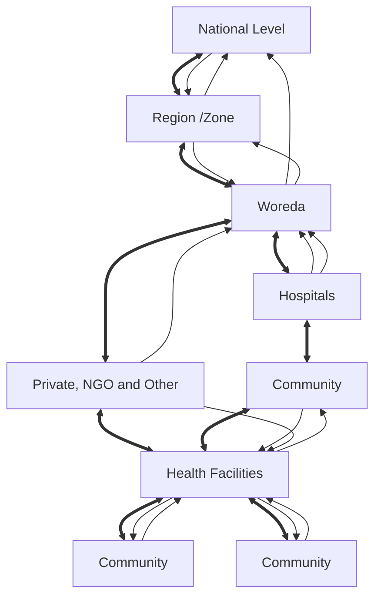

**Legend**
* **Upward transmission of reports, data and information**
* **Feedback and Information Sharing**

### *Figure 4-3: Formal and informal flow of surveillance data and information and feedback throughout the health system*

59

## **Surveillance Data Analysis and Interpretation**

Surveillance data analysis and interpretation is a crucial part that guides responses to public health emergencies. Data analysis and interpretation should be done daily and weekly at each level where data are collected (starting from health facility level to national level). The analysis provides key information for taking prompt public health actions.

Data analysis provides the following important outcomes:

* Frequency count by reporting units help in identifying outbreaks or potential outbreaks.
* Analysis of routine data provides information for predicting changes of disease rates over time and enables appropriate action.
* Disease rates change over time. Some of these changes occur regularly and can be predicted such as an increase of malaria cases following the rainy season. Analysis and use of the trends in summary data over time provides information for improving prevention activities.
* Identifies problems in the health system; so that gaps can be effectively implemented. For example, an outbreak of malaria should alert the public health manager about the possibility of poor vector control, migration of infected people, etc. in that area.
* During an outbreak, analysis of the data identifies the most appropriate and timely control measures. Analysis in terms of person, time, and place will be help focus the intervention.
* During an acute epidemic of a disease or condition the information that is generated from data analysis leads to the identification of the most appropriate and timely control actions. The actions are taken immediately to limit the epidemic and prevent further cases from occurring.

The major steps in data analysis are: creating database or filed paper data, data cleaning and data analyzing and interpretation (information generation).

* **Create an electronic database or file paper data:** The reports that are being received daily and weekly have to be entered on daily basis into an electronic

60

database or kept on file using a paper format at each level of the health system. In order to avoid loss of electronically saved data always make a backup and save it on different computer or save it on a server.

* **Data Cleaning:** before starting analysis check if the data is complete. If reports are missing or part of the data is incomplete, try to get the data before starting analysis.

* **Data Analysis:** Simple data analysis is done to find information related to person, place, and time. The minimum data analysis practice that has to be generated includes: Trends over time (line graph, bar graph or histogram), Geographic distribution of the disease or the outbreak (dot map), Frequency of cases, deaths (table), Case Fatality Rate (CFR), and Attack rate (AR). All the analysis can be disaggregated by age, sex, place, at-risk groups, etc. File or store the information generated through data analysis in an “analysis book”. Additionally, some of the graphs, tables and maps can be posted on the wall. Update the graphs tables and maps every week.

## **Analyze data by time**

Time includes variables such as day, week, month, and year. The purpose of “time” analysis is to detect changes in the number of cases and deaths over time. It also helps to compare the current disease trend with previous trends. It enables you to see if thresholds are reached or not. Data about time is usually shown on a graph. Graphs are made with bars (a bar graph) or lines (a line graph) to measure the number of cases over time. The number or rate of cases or deaths is placed on the vertical or y-axis. The time period being evaluated is placed along the horizontal or x-axis.

Example: The line graph below shows the trend of meningococcal meningitis cases in a village of population of 27,000. Here the time period is a week. The trend of the disease over weeks is increasing. Also it indicates that the alert threshold is crossed at week 5.

61

### Number of Cases by Number of Weeks with Alert Threshold Line at 9

<table><tr><th>Number of Weeks</th><th>Number of Cases</th><th>Notes</th></tr>
<tr><th>1</th><td>4</td><td></td></tr>
<tr><th>2</th><td>4</td><td></td></tr>
<tr><th>3</th><td>3</td><td></td></tr>
<tr><th>4</th><td>4</td><td></td></tr>
<tr><th>5</th><td>5</td><td></td></tr>
<tr><th>6</th><td>7</td><td></td></tr>
<tr><th>7</th><td>8</td><td></td></tr>
<tr><th>8</th><td>10</td><td></td></tr>
<tr><th>9</th><td>9</td><td>Alert Threshold Line</td></tr>
<tr><th>10</th><td>8</td><td></td></tr>
<tr><th>11</th><td>6</td><td></td></tr>
<tr><th>12</th><td>6</td><td></td></tr></table>

*Figure 4-4 Trend of meningococcal meningitis analyzed by week*

## **Analyze data by Place**

Analyzing data according to place gives information about where a disease is occurring such as woreda, Kebele, town, etc. Establishing and regularly updating a spot map of cases for selected diseases can give ideas as to where, how, and why the disease is spreading. An analysis of place provides information on:

* Clusters of cases occurring in a particular area,
* Spot locations of cases and identify populations at highest risk for transmission of the disease,
* Travel patterns that relate to the method of transmission for this disease,
* Common sources of infection for the cases,
* The population distribution and population density of the area,
* The variety of populations in an area (farming area, high-density urban area, refugee settlement, and so on),
* Environmental factors such as rivers, lakes, pumps, and so on,
* Show distances between health units and villages (by travel time or distance in kilometers).

Use manual methods or geographic information system (GIS) software to create a

62

map to use as part of routine analysis of surveillance of disease. On a map of the area where cases occurred, mark the following:

* Roads, water sources, location of specific communities and other factors related to the transmission risk for the disease or condition under investigation. For example, a map for neonatal tetanus includes locations of traditional birth attendants and health facilities where mothers deliver infants.
* Location of the patients’ residences or most relevant geographical characteristic for this disease or condition (For example, by village, neighborhood, work camp, or refugee settlement. When mapping young patients during a meningitis outbreak remember to locate the school that the patients attend.) Other locations appropriate to the disease or condition being investigated.

## **Analyze data by Person**

Analysis by person includes the variables such as age, sex, ethnicity and other occupational risk factors such health workers, food handlers, miners, etc. A simple count of cases does not provide all of the information needed to understand the impact of a disease on the community, health facility, or woreda, but simple percentages and rates are useful for comparing information reported. Make a distribution of the cases by each of the person variables in the reporting formats.

For example, compare the total number and proportion of suspected and confirmed cases of measles by: Age group, Sex, Occupation, and Urban versus rural residence, Vaccination status, Risk factors, Outcomes and Final classification.

For each priority disease or condition under surveillance, use a table to analyze characteristics of the patients who are becoming ill. For surveillance and monitoring, use a table to show the number of cases and deaths from a given disease that occurred in a given place and time. To make a table:

* Decide what information you want to show on the table. For example, consider analysis of measles cases and deaths by age group,

63

* Decide how many columns and rows you will need. Add an extra row at the bottom and an extra column at the right to show totals if needed.
* Label all the rows and columns.
* Record the total number of cases or deaths or both as needed.

*Table 4-3 Measles cases and deaths in Kebele X in 2009, aggregated by age*


<table>
  <thead>
    <tr>
      <th>Age group</th>
      <th>Number of reported
cases</th>
      <th>Number of deaths</th>
      <th>% of reported cases</th>
    </tr>
  </thead>
  <tbody>
    <tr>
      <td>0 - 4 years</td>
      <td>40</td>
      <td>4</td>
      <td>40/50*100 = 80%</td>
    </tr>
    <tr>
      <td>5-14 years</td>
      <td>9</td>
      <td>1</td>
      <td>9/50*100 = 18%</td>
    </tr>
    <tr>
      <td>15-30 years</td>
      <td>0</td>
      <td>0</td>
      <td>0/50*100 = 0%</td>
    </tr>
    <tr>
      <td>31 years and older</td>
      <td>1</td>
      <td>0</td>
      <td>1/50*100 = 2%</td>
    </tr>
    <tr>
      <td>Total</td>
      <td>50</td>
      <td>5</td>
      <td>50/50*100 = 100%</td>
    </tr>
  </tbody>
</table>


To calculate the percentage of cases occurring within a given age group from the example given above;

* Identify the number of cases reported within each age group from the data for which time or person characteristics are known. (For example, there are 40 cases in children 0 - 4 years age group)
* Divide the number of cases within each age group by the total number of reported cases. (For example, for children age 0 - 4 years age group, divide 40 by 50 which is equal to 0.8.)
* Multiply the answer with 100 to calculate the percentage. (0.8 x 100 = 80 %)
* Therefore, we can see that 80% of the measles cases occurred in children in the 0 – 4 years age group.

## **Case Fatality Rate (CFR):** The case fatality rate helps to

* Indicate whether an outbreak is identified timely,
* Indicate whether the case-management is performed properly,
* Identify the level of response to treatment (virulent, new or drug-resistant pathogen),
* Indicate poor quality of care or no medical care,

64

* Compare the quality of case management between different catchment areas, cities, and woredas.

Public health programs can reduce the case fatality rate by ensuring that cases are timely detected and good quality case management takes place. Some disease control recommendations for specific diseases include reducing the case fatality rate as a target for measuring whether the epidemic response has been effective.

To calculate CFR, use the following formula:

$$CFR = \frac{*Number of deaths from a specific disease*}{*Total number of cases from the same specific disease*} \times 100$$

From Table 4-4, the overall CFR can be calculated by dividing the total number of deaths by the total number of reported cases. Thus, the total number of reported cases is 50 and the number of total deaths is 5. So 5 divided by 50 and multiplied by 100 bring the CFR to 10%. Therefore, 10% of the total cases died due to measles from the outbreak data. It should be noted that the total number of reported cases also includes those cases which have died as well. In a similar manner, age-group specific CFR can also be calculated.

### *Table 4-4 Case fatality rate of measles outbreak in Kebele X in 2009*

<table><tr><th>Age group</th><th># of reported cases</th><th># of deaths</th><th>CFR</th></tr>
<tr><td>0-4 years</td><td>40</td><td>4</td><td>4/40*100 = 10%</td></tr>
<tr><td>5-14 years</td><td>9</td><td>1</td><td>1/9*100 = 11%</td></tr>
<tr><td>15-30 years</td><td>0</td><td>0</td><td>0/0*100 = -</td></tr>
<tr><td>31 years and older</td><td>1</td><td>0</td><td>4/40*100 = 0%</td></tr>
<tr><td>Total</td><td>50</td><td>5</td><td>5/50*100 = 10%</td></tr></table>

**Attack Rate (AR):** Calculate AR on weekly basis during an epidemic. Calculating AR helps to:

* Calculate the resources needed to respond to the epidemics,

65

* Evaluate if the threshold is reached,
* To know the speed of dissemination of the disease

AR is a variant of an incidence rate, applied to a narrowly defined population observed for a limited period of time, such as during an epidemic.

$$Attach Rate = \frac{Number\ of\ new\ cases\ during\ a\ specific\ period}{Number\ of\ susceptible\ persons} \times 100$$

For example, from the Table 4-4 the number of new measles cases reported during the year 2009 is 50. If we consider the total at risk population of kebele X is 4500, then the AR is 50 divided by 4500, multiplied by 100 which is 1.1%. Therefore, out of the total measles-susceptible population, 1.1% acquired the infection.

Compare the current situation with previous week/months/quarter, seasons and years:

* Observe the trends on the line graphs and look to see whether the number of cases and deaths for the given disease is stable, decreasing or increasing.
* If case fatality rates have been calculated, is the rate the same, higher, or lower than it was in the previous months.
* Determine if thresholds for action have been reached or crossed.

## **Action and Alert Thresholds**

Thresholds are markers that indicate when something should happen or change. They help surveillance and program managers answer the question, “When will you take action, and what will that action be?”

Thresholds are based on information from two different sources:

* A local situation analysis for the specific disease or condition describing who is at risk for the disease, what are the risks, when is action needed to prevent a wider epidemic, and where do the diseases usually occur (example – a specific Kebele level malaria epidemic threshold should be determined based on the 5 years’ average data);
* International recommendations from technical and disease control program experts.

66

Two types of thresholds, alert threshold and action threshold, are recommended for diseases under surveillance (Table 4-5).

**Alert threshold:** suggests to health staff that further investigation is needed and preparedness activities should be initiated. Health staffs respond to an alert threshold by:

* Reporting the suspected problem to the next level,
* Reviewing data from the past,
* Requesting laboratory confirmation,
* Being more alert to new data and the resulting trends in the disease or condition,
* Investigating the case or condition,
* Prepositioning of drugs and supplies,
* Mobilization of the needed resources,
* Alerting the appropriate disease-specific program manager and woreda epidemic response team to a potential problem.

**Action threshold:** triggers a definite response. It marks that the findings from either the routine surveillance or special investigation signal the need for action beyond confirming or clarifying the problem. Possible actions include, communicating laboratory confirmation results to concerned health centers, implementing an emergency response such as immunization, community awareness campaign, or improved infection control practices in the health care setting etc.

### *Table 4-5 Alert and action thresholds for diseases under surveillance*

<table><tr><th>Name of the Diseases</th><th>Alert Threshold</th><th>Action Threshold</th><th>Acceptable Case Fatality Rate (CFR)</th></tr>
<tr><td>Anthrax</td><td>A Single Suspected Case</td><td>A Single Confirmed Case</td><td>Cutaneous Anthrax &#x3C; 1%<br />(CDC)<br /><br />25 - 75% for Gastrointestinal Anthrax<br /><br />Inhalation Anthrax has a Fatality Rate that is 80% or higher.</td></tr>
<tr><td>Measles</td><td>A Single Suspected Case</td><td>5 Suspected Cases<br /><br />OR<br /><br />3 Confirmed Cases in a</td><td>3% of Measles Cases</td></tr></table>

67

<table><tr><th></th><th></th><th>specified area within 1 month</th><th></th></tr>
<tr><td>Human Influenza caused by new subtype</td><td>1.65 Standard Deviations above the Mean for each week</td><td>Single Confirmed Influenza New sub type</td><td></td></tr>
<tr><td>Adverse Events Following Immunization (AEFI)</td><td>A Single Suspected Case</td><td>A Single Confirmed Case</td><td></td></tr>
<tr><td>Neonatal/Non-Neonatal Tetanus (NNT)</td><td>A Single Suspected Case</td><td>A Single Confirmed Case*</td><td>&#x3C; 15% of NNT Cases</td></tr>
<tr><td>Rabies</td><td>A Single Exposure***</td><td>A Single Suspected OR Confirmed Case</td><td>Almost all Symptomatic Cases</td></tr>
<tr><td>Smallpox (Variola)</td><td>A Single Suspected Case</td><td>A Single Confirmed Case</td><td>20% – 30% cases</td></tr>
<tr><td>Severe Acute Respiratory Syndrome (SARS)</td><td></td><td>A Single Confirmed Case</td><td>&#x3C; 7.2 %</td></tr>
<tr><td>Yellow Fever</td><td>A Single Suspected Case</td><td>A Single Confirmed Case</td><td></td></tr>
<tr><td>Poliomyelitis (Acute Flaccid Paralysis/AFP)</td><td>A Single Suspected Case</td><td>A Single Confirmed Case</td><td>&#x3C; 5% of Paralytic Polio Cases</td></tr>
<tr><td>Chikungunya</td><td>A Single Suspected Case</td><td>A Single Confirmed Case</td><td>&#x3C; 0.1%</td></tr>
<tr><td>Cholera</td><td>A Single Suspected Case</td><td>A Single Confirmed Case</td><td>&#x3C; 1%</td></tr>
<tr><td>Dracunculiasis (Guinea Worm)</td><td>A Single Suspected Case</td><td>A Single Confirmed Case</td><td></td></tr>
<tr><td>Dengue Fever</td><td>A Single Suspected Case</td><td>A Single Confirmed Case</td><td>&#x3C; 1%</td></tr>
<tr><td>COVID-19</td><td>A Single Suspected Case</td><td>A Single Confirmed SARS COV-2 Case</td><td></td></tr>
<tr><td>Malaria</td><td>Higher than the median weekly value (Calculated from the five previous years’ data)<br /><br />OR<br /><br />Unusual increase in the number of cases or deaths as compared to the same period in previous non-epidemic year</td><td>Higher than the third-quartile (second highest number from the five previous years’ data for that week);<br /><br />OR<br /><br />Higher than the previous year’s number of cases in that week multiplied by two.</td><td>&#x3C; 0.45 %</td></tr></table>

68

<table><tr><td>Diarrhea with dehydration in children less than 5 years of age</td><td>Increasing number of cases or deaths over a period of time</td><td>If the number of cases or deaths increase to two times the number usually seen in a similar period in the past</td><td>&#x3C; 8%</td></tr>
<tr><td>Acute Jaundice Syndrome within 14 days of illness</td><td>Cluster of Suspected Cases</td><td>≥ 5 confirmed cases reported within 1-4 weeks period</td><td></td></tr>
<tr><td>Severe Pneumonia in children under 5 years age</td><td>Increase number of cases or death over a period of time</td><td>Higher than the third-quartile (second highest number from the five previous years’ data for that week);<br /><br />OR<br /><br />Higher than the previous year’s number of cases in that week multiplied by two</td><td></td></tr>
<tr><td>Viral Hemorrhagic Fever (VHF)-( Ebola-Marburg, CCHF, RVF, Lassa, DHF, and Yellow Fever)</td><td>A Single Suspected Case</td><td>A Single Confirmed Case</td><td></td></tr>
<tr><td>Dysentery</td><td>5 or more cases in one location in one day<br /><br />OR<br /><br />Double the weekly average number of cases</td><td>5 or more Confirmed cases<br /><br />OR<br /><br />Double the weekly average number of Confirmed cases</td><td>&#x3C; 15 %</td></tr>
<tr><td>Relapsing Fever (RF)</td><td>Unusual increase of the cases<br /><br />OR<br /><br />Doubling of cases on subsequent weeks</td><td>Unusual increase of the cases<br /><br />OR<br /><br />Doubling of cases on subsequent weeks</td><td>2-5%</td></tr>
<tr><td>Meningitis</td><td><u>If Population &#x3C; 30,000:</u><br /><br />Two cases in a week<br /><br />OR<br /><br />Doubling of cases over 3-week period,<br /><br /><u>If Population > 30,000:</u><br /><br />AR ≥5/100,000 population per week</td><td><u>If Population &#x3C; 30,000:</u><br /><br />Five cases in a week<br /><br />OR<br /><br />Doubling of cases over 3-week period,<br /><br /><u>If Population > 30,000:</u><br /><br />AR ≥ 15/100,000 population per week</td><td>5-20%</td></tr>
<tr><td>Scabies</td><td>If the Incidence of confirmed scabies cases are:</td><td>If the incidence of confirmed scabies cases are:</td><td></td></tr></table>

69

<table><tr><td></td><td>5-10% in the community<br /><br />OR<br /><br />2-4% among school age children in schools</td><td>>=10% in the community<br /><br />OR<br /><br />>=5% among school age children.</td><td></td></tr>
<tr><td>New HIV cases</td><td></td><td>The number of New HIV diagnoses in the most recent quarter falls >2SD above the mean number of new HIV diagnoses in the previous three quarters<br /><br />And / OR<br /><br />The number of recent HIV infection in the most recent month falls >2SD above the mean number of recent HIV infection in the previous 3 months</td><td></td></tr>
<tr><td>Hypertension New Cases</td><td></td><td></td><td></td></tr>
<tr><td>Diabetes New Cases</td><td></td><td></td><td></td></tr>
<tr><td>Tuberculosis (TB)</td><td>Increasing number of cases or deaths over a period of time</td><td>Number of cases or deaths which is two times higher than the number seen in the same period in the past</td><td></td></tr>
<tr><td>Maternal death</td><td>A Single death</td><td>A Single death</td><td>MMR=&#x3C;100 per 100,000 livebirths</td></tr>
<tr><td>Perinatal death</td><td>A Single death</td><td>A Single death</td><td>&#x3C; 12/1000 livebirth</td></tr>
<tr><td>Moderate Acute Malnutrition (MAM)</td><td>GAM prevalence /proxy among 6-59 months children ≥ 10 – 14%<br /><br />OR</td><td>GAM prevalence/proxy among 6-59 months children ≥ 15%<br /><br />OR</td><td>U5MR &#x3C; 1/10,000 /day<br /><br />OR</td></tr>
<tr><td>Sever Acute Malnutrition (SAM)</td><td>GAM prevalence/proxy among 6-59 months children ≥ 5 - 9% with Aggravating factors</td><td>GAM prevalence/proxy among 6-59 months children ≥ 10-14% with aggravating f actors</td><td>CMR &#x3C; 0.5/10,000 general population/day</td></tr>
<tr><td>Monkey Pox</td><td><strong>Single suspected</strong></td><td><strong>Single confirmed case</strong></td><td></td></tr>
<tr><td>Rift Valley fever</td><td><strong>Single suspected</strong></td><td><strong>Single confirmed case</strong></td><td></td></tr>
<tr><td>Obstetric Fistula</td><td></td><td><strong>Single confirmed case</strong></td><td></td></tr></table>

The activities associated with alert and action thresholds differ. Basic activities, as suggested by the IDSR Technical Manual of 2009 are provided in Annex-6.

70

## **Action Thresholds during Humanitarian Disasters**

Most epidemic thresholds have been developed for stable populations, because these thresholds require longitudinal data over a period of years. There are few data on the use of these epidemic thresholds in emergency situations with recently displaced populations. Nevertheless, the establishment of a surveillance system early in an emergency situation will ensure that baseline data on diseases with epidemic potential are available.

This will allow an assessment of whether an increase in numbers of cases or deaths requires action or not. At the onset of health activities, the health coordination team should set a threshold for each disease of epidemic potential above which an emergency response must be initiated. Table 4-6 gives action thresholds for selected diseases and events in a humanitarian setting.

*Table 4-6 Epidemic thresholds for selected diseases in humanitarian settings (EWARS Threshold in Humanitarian settings*

<table><tr><th>Name of the Diseases</th><th>Alert Threshold</th><th>Action Threshold</th><th>Acceptable Case Fatality Rate (CFR)</th></tr>
<tr><td>Measles</td><td>Double the average of the last 3 weeks</td><td>Defined at country level</td><td></td></tr>
<tr><td>Human Influenza caused by new subtype</td><td></td><td></td><td></td></tr>
<tr><td>Severe Acute Respiratory Syndrome (SARS)</td><td></td><td></td><td></td></tr>
<tr><td>Yellow Fever</td><td>1 Case</td><td>1 Case</td><td></td></tr>
<tr><td>Poliomyelitis (Acute Flaccid Paralysis/AFP)</td><td>1 Case</td><td></td><td></td></tr>
<tr><td>Chikungunya</td><td></td><td></td><td></td></tr>
<tr><td>Cholera</td><td>2 cases with acute watery diarrhoea and severe dehydration in people age 2 or above, or dying from acute watery diarrhoea in the same area within one week of each other<br />1 death from severe acute watery diarrhoea in a person age 5 or above<br />1 case of acute watery diarrhoea, testing positive for cholera by rapid diagnostic tests in an area</td><td>1 Confirmed Case</td><td>&#x3C; 1%</td></tr>
<tr><td>Dengue Fever</td><td></td><td></td><td>&#x3C; 1%</td></tr></table>

71

<table><tr><td>Malaria</td><td>Twice the average number of cases seen in the previous 3 weeks</td><td>Decided at country level depending on context</td><td></td></tr>
<tr><td>Diarrhea with dehydration in children less than 5 years of age</td><td></td><td></td><td></td></tr>
<tr><td>Acute Jaundice Syndrome within 14 days of illness</td><td>≥ 5 cases in 1 location in 1 week</td><td></td><td>Hepatitis E &#x3C; 4% in general population, 10–50% in pregnant women in third trimester</td></tr>
<tr><td>Severe Pneumonia in children under 5 years age</td><td></td><td></td><td></td></tr>
<tr><td>Viral Hemorrhagic Fever (VHF)-( Ebola-Marburg, CCHF, RVF, Lassa, DHF, and Yellow Fever)</td><td>1 case</td><td>1 case</td><td></td></tr>
<tr><td>Dysentery</td><td>≥ 5 cases in 1 location in 1 week</td><td></td><td></td></tr>
<tr><td>Meningitis</td><td>1 case in a crowded camp setting<br />OR<br />≤ 30,000: 2 cases per week in the same community<br />OR<br />Population ≥30,000: 5 cases per week in the same community<br />OR<br />3 cases in a week (in a population of 30,000–100,000)</td><td>5 cases in a week (in a population of &#x3C;30,000)<br /><br />OR<br /><br />10 cases per 100,000 people in a week (in a population of 30,000–100,000)<br /><br />OR<br /><br />2 confirmed cases in one week in a camp</td><td>&#x3C; 15%</td></tr></table>

## **Summarize the analysis results**

Consider the analysis results with the following factors in mind:

* Trends for inpatient cases describe the most severe cases of a particular disease; this is because generally only severe cases are hospitalized. Deaths are most likely to be detected for cases that are hospitalized.
* Increases and decreases may be due to factors other than a true increase or decrease in the number of cases and deaths being observed. For example, large population movements or changes in health services can affect disease pattern.

72

* If no decrease is occurring while undertaking appropriate health intervention, the number of cases is remaining the same or increasing, consider whether any of the following factors are affecting reporting:
    - Has there been a change in the number of HFs reporting information?
    - Has there been any change in the case definition that is being used to report the disease or condition?
    - Is the increase or decrease a seasonal variation?
    - Are there community outreach or health education activities that would result in more people seeking care?
    - Has there been a recent immigration or emigration to the area or increase in refugee populations?
    - Has there been any change in the quality of services being offered at the facility? For example, lines/waiting times are shorter, health staffs are more helpful, drugs are available, and clinic fees are changed.

### *Table 4-7 Summary of types of analysis, objectives, tools, and methods*

<table><tr><th>Type of analysis</th><th>Objective</th><th>Tools</th><th>Method</th></tr>
<tr><td><strong>Time</strong></td><td>• Detect abrupt or long-term changes in disease or unusual event occurrence, how many occurred, and the period of time from exposure to onset of symptoms.</td><td>• Record summary totals in a table or on a line graph or histogram.</td><td>• Compare the number of case reports received for the current period with the number received in a previous period (weeks, months, seasons or years)</td></tr></table>

73

<table><tr><td><strong>Place</strong></td><td>• Determine where cases are occurring (for example, to identify high risk area or locations of populations at risk for the disease)</td><td>• Plot cases on a spot map of the Woreda or area affected during an outbreak.</td><td>• Plot cases on a map and look for clusters or relationships between the location of the cases and the health event being investigated.</td></tr>
<tr><td><strong>Person</strong></td><td>• Describe reasons for changes in disease occurrence, how it occurred, who is at greatest risk for the disease, and potential risk factors</td><td>• Extract specific data about the population affected and summarize in a table.</td><td>• Depending on the disease, characterize cases according to the data reported for case-based surveillance such as age, sex, place of work, immunization status, school attendance, and other known risk factors for the diseases.</td></tr></table>

## **Data Quality: Completeness and Timeliness**

For routine weekly surveillance data calculate the completeness of the reports. All woredas and levels above should calculate the completeness of the reports received on weekly basis. A report is said to be complete if all the reporting units within its catchment area have submitted the reports on time. E.g. if 9 out of 10 health facilities have submitted, then the report is said to be incomplete (or 90% complete).

$$Completeness = \frac{the\ number\ of\ health\ facilities\ which\ reported\ in\ that\ week}{total\ number\ of\ health\ facilities\ expected\ to\ report} \times 100$$

Note that “the number of health facilities that are expected to report” for a particular level (e.g. for a woreda) is the sum of all government hospitals, health centers, health posts, other health facilities such as NGO health facilities, and other government health facilities.

A report (from a reporting unit) is said to be on time, if it reaches the designated level within the prescribed time period. If it reaches later, then the report is considered to be late. The timeliness of a reporting unit can be calculated by assessing how many

74

of its expected reports have come on time.

## **Communication of Surveillance Information**

The main objective of outbreak communication is to communicate with the public in ways that build, maintain or restore trust, and encourage participation in the early warning activities. Mechanisms of accountability, involvement, and transparency are important to establish and maintain trust. Elements of communication include risk communication, alert/ warning and provision of feedback.

**Provide feed-back:** Often, health facilities or woredas/zones health offices reliably report surveillance data to the next level as required. If the facility does not receive information back about how the data were used or what the data meant, health staff may think that their reporting is not important. As a result, future reporting may not be as reliable because health staff will not know if the information they sent to other levels was useful or necessary. They will have a good understanding of the health situation at their own level, but they will not know or understand the situation at a woreda/zone/regional, or national level.

When the woreda receive data, they should respond to the health facilities that reported it. And all the levels have to give feedback to the level that sends those reports. The purpose of the feedback is to reinforce efforts of the health staff to participate in the surveillance system. Another purpose is to raise awareness about certain diseases and any achievements of disease control and prevention activities in the area. Feedback may be written, such as a weekly or monthly newsletter, or it may be given orally, for example, during a monthly staff meeting, reaching them electronically or written reports.

## **Risk Communication and Information Sharing**

The primary purpose of data sharing is to advance public health by permitting analyses that allow for the fullest possible understanding of health challenges, to help develop new solutions, and to ensure that decisions are based on the best available evidence.

75

## Data sharing benefits:

* To make better decisions about public health and resource allocation
* To eliminate errors in data, and to support the correct interpretation of data, including by repeated independent validation
* Advance scientific understanding by allowing for analysis and hypothesis testing by multiple groups of researchers
* Maximize transparency and accountability in tracking progress of health programmes and in the conduct and funding of scientific investigations
* Provide for better-informed activities to establish health guidelines, norms and standards
* Promote more complete and reliable systematic reviews and meta-analyses
* Lead to more comprehensive estimates of morbidity and mortality, more comprehensive estimates of the effect of exposures and health interventions, and improved systems.
* Build trust among institutions that contribute and use data

To avoid adverse consequences, the process of data sharing should:

* Should follow data sharing policy and guidelines of EPHI
* Safeguard the security of sensitive data, which may influence e.g. travel and trade
* Safeguard the privacy and anonymity of individuals.

**Risk Communication:** refers to activities for sharing information and ideas about risks and actions to deal with real and potential dangers that could lead to an indiscriminate demand that is impossible to meet. Effective communication and warnings have to be short, concise, understandable, and actionable, answering the questions of "what?", "where?", "when?", "why?", and "how to respond?". The use of plain language in simple, short sentences or phrases enhances the user's understanding of the warning.

Effective warnings should also include detailed information about the threat with recognizable or localized geographical references. Therefore, proper communications

76

keep the public informed to calm fear and to encourage cooperation with the epidemic response. Develop community education messages to provide the community with information about recognizing the illness, how to prevent transmission and when to seek treatment. Begin communication activities with the community as soon as an epidemic or public health problem is identified.

* Decide what to communicate by referring to disease specific recommendations. Make sure to include:
    - The standard case definition of the disease,
    - When to report and where to report,
    - Signs and symptoms of the disease,
    - How to treat the disease at home, if home treatment is recommended
    - Prevention measures that are feasible and that have a high likelihood of preventing disease transmission,
    - When to come to the health facility for evaluation and treatment,

* Decide how to state the message. Make sure that the messages:
    - Use local terminology
    - Are culturally sensitive
    - Are clear and concise
    - Address beliefs about the disease

* Use appropriate communication methods that are present in the woreda/region
    - Radio
    - Television
    - Newspapers
    - Meetings with health personnel, community, religious and political leaders
    - Posters
    - Flyers
    - Presentations at markets, health centers, schools, women’s and other community groups, service organizations, religious centers
    - Meetings with health personnel, community, religious and political leaders
    - Other (stickers, banners, brochures, etc.)

77

* Give health education messages to community groups and service organizations and ask that they disseminate them during their meetings.

On a regular basis, meet with the community spokesperson to give:

* Frequent, up-to-date information on the epidemic and response,
* Clear and simple health messages that the media should use without editing,
* Clear instructions to communicate to the media only the information and health education messages from the PHEM guideline.

78

## 05/ RESPONSE

### **Definition**

The involvement of the entire health system and the broadest possible intersectoral and inter-institutional collaboration by developing policies and plans, and executing activities that reduce the public health impact of emergencies and disasters.

### **Purpose**

Public health emergency response to disease outbreaks, disasters, displacements, and other public health issues which requires the integration and effective application of skills of multidisciplinary experts and logistics. There must be a series of measures that are operating at the same time, each to a high level of efficiency. This requires keeping clear objectives in mind and the efficient application of resources.

A well-designed and sensitive early warning and detection system coming from both formal and informal sources, within and outside of the health sector signals and alerts to respond rapidly to emergency health threats. The efficient collection of pertinent information informs and guides the public health response to all acute public health events including: unknown, unusual or unexpected diseases or disease patterns of all origins of biological, chemical, radiological or nuclear as well as hazards that could potentially pose a risk to human health.

It is therefore important to strengthen the public health emergency operations centers as part of a comprehensive response program by implementing a common organizational model or Incident Management System or frameworks to all levels of emergency management responsibility within a jurisdiction, from national government to front-line emergency response services to routine emergency disaster management activities, epidemic and non-epidemic public health emergencies particularly at woreda and community levels.

79

## **Nature of Public Health Emergencies**

Some public health emergencies or outbreaks occur suddenly while others occur gradually giving you time to think. The size of the public health emergency can be small or large. Principal activities that are required during each phase of a public health emergency response are indicated below.

*Table 5-1 Response activities to be carried out at different levels according to the different phases of the emergency*

<table><tr><th><strong>Sudden Onset Crisis</strong></th><th><strong>Slow Onset Crisis</strong></th></tr>
<tr><td><strong>Phase I:</strong> First 24-72 hours<br />• Activation of the EOC at Federal/Regional level<br />• Notification of activation of EOC<br />• Activation of the contingency plan and /or EPRP<br />• Preliminary enquiries and consolidation of information<br />• PHEM TF meetings – Federal/Regional</td><td><strong>Phase I:</strong> First 1-2 weeks<br />• Preliminary working scenarios (anticipated health needs and risks)<br />• Inventory of “ Who-Where-When-What’ (the 4Ws) and gap analysis<br />• Preparation and dissemination of PHEMTTF minutes and reports<br />• Conduct of regular task force meeting, planning<br />• Collection of baseline information<br />• Planning the initial rapid assessment<br />• Intensify the surveillance system</td></tr>
<tr><td><strong>Phase II:</strong> First 4-10 days<br />• Health Resource Availability and Mapping System (HeRAMS)<br />• Conduct the initial rapid assessment<br />• Intensify the surveillance system<br />• Establish disease surveillance at the temporary site (if there is any)<br />• Review and distribution of standards and protocols</td><td><strong>Phase II:</strong> First month<br />• Regular health coordination meeting – Federal/Regional<br />• Update working scenarios, resource inventory and gap analysis<br />• Review/update health sector plan<br />• Review/update the sectoral humanitarian requirement Preparation and distribution of regular bulletin /feedback</td></tr>
<tr><td><strong>Phase III:</strong> 4-6 weeks (disaster) to up to 3 months (conflict)<br />• Operating based on the HeRAMS information<br />• Fully operational Early Warning and Response System (EWARS) and regular exchange of surveillance data and response operations<br />• Continuation of regular meeting<br />• Finalization of the response strategy<br />• Planning scenarios (identified health problems and risks)</td><td><strong>Phase III:</strong> 2-3 months<br />• Communicate objectives, strategies and action plan with all concerned<br />• Implementation of response strategies and monitoring<br />• Preparation/update of multi-sectoral response appeal<br />• Resource mobilization<br />• Frequent updating of resource inventory and gap analysis<br />• Establishment of technical working groups as</td></tr></table>

80

<table><tr><td></td><td>/when needed<br />• Organization and conduct of integrated training as/when needed<br />• Coordination of logistic support<br />• Monitoring implementation of PHE response strategies and the plan and task force activities</td></tr>
<tr><td><strong>Phase IV:</strong> Continuing humanitarian response and progressive recovery<br />• Continuation of regular coordination meeting (e.g. bi weekly)<br />• Periodic updating of planning scenario and HeRAMS<br />• Establishment and /or suspension of technical working groups<br />• Maintenance of enhanced surveillance<br />• Real time or interim/mid-term evaluation of the sector response status<br />• Comprehensive assessment as needed<br />• Updating of strategic plan with increasing focus on recovery Contingency planning for possible changes in the situation</td><td><strong>Phase IV:</strong> Continuing humanitarian response and progressive recovery<br />• Periodic updating of planning scenario and HeRAMS<br />• Establishment and /or suspension of technical working groups<br />• Maintenance of enhanced surveillance<br />• Real time or interim/mid-term evaluation of the sector response status<br />• Comprehensive assessment as needed<br />• Updating of strategic plan with increasing focus on recovery Contingency planning for possible changes in the situation</td></tr>
<tr><td><strong>Phase out:</strong><br />• Phase out plan for emergency programs as recovery activities increase<br />• Final evaluation and lessons learned exercise<br />• Deactivation of the PHEOC</td><td><strong>Phase out:</strong><br />• Phase out plan for emergency programs as recovery activities increase<br />• Final evaluation and lessons learned exercise<br />• Deactivation of the PHEOC</td></tr></table>

**Legal Considerations:** All outbreak investigation and response activities needs to be guide by the rules and regulations of the country. Emergency laws that place limitations on individual freedoms must:

* Respond to a pressing public or social need;
* Pursue a legitimate aim;
* Be proportionate to the legitimate aim; and
* Be no more restrictive than required to achieve the purpose sought by restricting the right.

81

## **Outbreak Management**

### **Receiving of Alerts and Declaring an Outbreak/Event**

The Early Warning System of Public Health Emergency Management Centers would be the primary sources of information for front-line responders and/or health authorities regarding public health threats, emergency events/incidents that may require emergency notification of all or parts of the concerned bodies or the public.

Upon receipt of an alert, rumor, or detection of a deviation the disease or condition from the expected trend while performing weekly surveillance data analysis, communicate the respective level immediately for verification. For some communicable diseases, a single suspect case is the trigger for taking action, reporting the case to a higher level, and conducting an investigation. For other diseases, the trigger is when a case threshold is reached. Rapid response limits the number of cases and geographical spread, shortens the duration of the public health emergency, and reduces fatalities. These benefits not only help save resources that would be necessary to tackle public health emergencies, but also reduce the associated morbidity and mortality.

The ministry of health and Ethiopian public health institute will have the leading role at the national level and the Regional health bureau and Regional public health institutes will have the leading role at the regional level; the Zonal and Woreda health offices will also have the leading role in emergency notification, declaration and taking appropriate response measures related to any public health events or outbreaks. The Ministry of Health/EPHI/ also has the primary responsibility to advocate on the centrality of health in emergency disaster risk management (EDRM) across all hazards – natural, technological, societal, and biological.

PHEM unit at each level of the health system will generally have the responsibility to convene key partners and stakeholders within Ministry (WASH, medical service directorate, emergency and critical care directorate etc) or outside of the Ministry such as, concerned private and government sectors (security, agriculture, education, transportation sectors etc) to ensure their appropriate contributions to public health emergency management, including the development of essential response capacities.

82

## **Outbreak Investigation**

**Definition:** An outbreak investigation is a method for identifying and evaluating people/animal/environment which have been exposed to an infectious disease or affected by an unusual health event.

**Purpose:** The investigation provides relevant information for taking immediate action and improving long-term disease prevention activities. It also helps to establish the existence of an outbreak by collecting specimen and relevant information. In addition, it identify source of infection or cause, transmission pattern and appropriate response activities to control the epidemic.

**Timing:** Upon receipt of an outbreak/emergency alert, a systematic joint multidisciplinary outbreak/emergency investigation will be undertaken to verify the occurrence of a public health events/ disease outbreak and to scientifically identify the source, transmission mechanism and contributory factors, as a basis for outbreak/emergency response.

Woredas should aim to investigate suspected epidemics within 3 hours of notification.

It is expected to conduct an investigation when: a report of a suspected epidemic of an immediately notifiable disease is received, an unusual increase is seen in the number of deaths during routine analysis of data, alert or action thresholds have been reached for specific priority diseases, communities report rumors of deaths or a large number of cases that are not being seen at a health facility, a cluster of deaths occurs for which the cause is not explained or is unusual (for example, an adult death due to bloody diarrhea).

**Steps:** In investigating an outbreak both speed of the investigation and getting the right answer are essential. To satisfy both requirements follow the following 10 steps:

### **I-Prepare for Field Work:**

* If epidemic preparedness activities have taken place in the woreda or health facility, staff who might be able to take part in the investigation should already be identified and trained. This team is termed as the Rapid Response Team.

83

**Rapid Response Team (RRT):** It should ideally involve the following experts but might be expanded depending on the disease suspected and the control measures required. The RRT should include: An epidemiologist; Clinician; Laboratory technician; Environmental health specialist; Public health officer; a representative of the local health authority; and more professionals based on the type of the PHE. Prior to deployment, all members of the RRT should be briefed on the situation, the roles and responsibilities they are expected to play, means, time, and frequency of communication etc. One member of the team should be assigned as the team

* Identify and assign the roles and responsibilities of other sectors and partners in the investigation.
* Reactivate the epidemic response committee or technical working group.
* Arrange a meeting as soon as an epidemic is suspected or recognized. Then meet as often as needed to plan, implement, monitor and report on the epidemic response.
* Conduct Rapid Need Assessment
* Review information already known about the suspected illness, including its transmission method and risk factors.
* Use this information to define the geographic boundaries and target population for conducting the investigation.
* Begin the investigation in the most affected places.
* Avail relevant resources that are required during the field activity such as: case based formats, line list, outbreak reporting formats, guideline, Supplies for collecting lab specimens, personal protective equipment (PEE), laptop, wireless network and mobile phone).

*Table 5 - 2 Principal steps in organizing and undertaking a rapid needs assessment*

<table><tr><th>Steps</th><th>Activities</th></tr>
<tr><td>Initial decision</td><td>Agreement among health related agencies and the government that an<br />assessment is needed</td></tr>
<tr><td>Planning the<br />Assessment</td><td>Half day planning meeting and follow up work by individuals and sub groups to:<br />• Compile available (secondary) data and agree on a working scenario,</td></tr></table>

84

<table><tr><td>Day 1</td><td>• Agree on objectives, scope of work and timeframe(dates) for the assessment and its relationship to other assessment activities,<br />• Agree on information requirements, data collection methods, and criteria for deciding where to go (site selection procedures) and with whom to talk,<br />• Design a rapid assessment tool, interview guides, identify any additional questions/observation that need to be added,<br />• Identify personnel for field work,<br />• Prepare maps, supplies, equipment and background information kits for field teams,<br />• Assemble and train field team,<br />• Arrange transport and communication for the field team,<br />• Inform key persons (Council, MoH and partners) in areas to be visited,<br />• Plan (arrange for) the processing and analysis of data during and after the field work.</td></tr>
<tr><td>Field Work 5-6 Days</td><td>• Visits by teams to purposely-selected areas /sites.<br />• Interview and collect data from officials and other key informants at administrative and health facility levels.<br />• Interview community groups and households.</td></tr>
<tr><td>Analysis and Reporting 3-4 days</td><td>• Processing and analysis of data (primary and secondary data). Identification of priority problems, needs, risks and gaps.<br />• Analysis of possible strategies and development of recommendations. Preparation of the report.<br />• Dissemination of the report.</td></tr></table>

## **II-Establish the Existence of an Outbreak:** In order to establish the existence of an outbreak:

* Review trends in cases and deaths due to the disease over the last 1-5 years (if available);
* Determine a baseline number to describe the current extent of the disease in the catchment area;
* Know the epidemic threshold for that particular disease;
* Compare the reported case versus the baseline and the threshold per month or week under that particular catchment area;
* Take into account factors influencing disease occurrences such as seasonal

85

variations in some of the diseases such as malaria and meningitis;

* Based on the finding, decide whether the outbreak exists or not.

## **III-Verify the Diagnosis:** Diagnosis must be confirmed either on a clinical basis by senior clinical workers or by laboratory tests, in which case specimens must be sent to a laboratory for testing.

The goals in verifying the diagnosis are: Ensure that the problem has been properly diagnosed and rule out laboratory error as the basis for the increase in diagnosed cases.

When verifying the existence of an outbreak early in the investigation, you must also

* Identify as accurately as possible the specific nature of the disease.
* Examine patients at the health facility and review records to confirm that the signs and symptoms meet the standard case definitions.
* Review laboratory results for the people who are affected. If you are at all uncertain about the laboratory findings, you should have a laboratory technician review the techniques being used. Collect samples to isolate the organism or identify the evidence for infection.

An assessment of current clinical and epidemiological information is the starting point for dealing with the problem of an outbreak of unknown origin. The historical knowledge of regional endemic and epidemic diseases, as well as their seasonality, further defines the possible causes. Since a variety of infectious agents can cause a similar clinical picture, the initial steps of the outbreak investigation (case definitions, questionnaires, etc.) should generally elaborate on known syndromes.

One or more specimen types may be required to define the cause of the outbreak. Laboratory confirmation of initial cases is necessary for most diseases when an outbreak is suspected. Specimens obtained in the acute phase of the disease, preferably before administration of antimicrobial drugs, are more likely to yield laboratory identification of the cause.

During the outbreak investigation, the information contained in the case investigation and laboratory request forms is collected along with the specimen. Assign each patient a unique

86

identification number. It is the link between the laboratory results on the line listing form, the specimens, and the patient, which guides further investigation and response to the outbreak. This unique identification number should be present and used as a common reference together with the patient’s name on all specimens, epidemiological databases, and forms for case investigation or laboratory request.

## **IV-Define and Identify Additional Cases:** Once the initial cases have been confirmed and treatment has begun, actively search for additional cases. Your next task as an investigator is to

* Establish a case definition, or a standard set of criteria for deciding whether, in this investigation, a person should be classified as having the disease or health condition under investigation.
* Search for additional suspected cases and deaths in the registers in the health facilities where cases have been reported,.
* Look for other patients who may have presented with the same or similar signs and symptoms as the disease or condition being investigated.
* Search for suspected cases and deaths from neighboring health facilities.
* Search for suspected cases, deaths and contacts in the community by identifying areas of likely risk where the patients have lived, worked, or travelled.
* Talk to other informants in the community such as health extension workers, pharmacists, school teachers, veterinarians, farmers and community leaders etc.
* Collect information that will help to describe the magnitude and geographic extent of the outbreak.
* Refer newly identified cases to an appropriate health facility for treatment.
* Record information about additional cases on a case-based reporting forms for at least the first five patients.
* Record information on a case-based form for all those patients from which laboratory specimens will be taken.
* Record any additional cases on a line list when more than five to ten cases have been identified, the required number of laboratory specimens have been collected,
* Use the line list as a laboratory transmittal form if 10 or more cases need laboratory

87

specimens collected on the same day and specimens will be transported to the lab in a batch.

## **V-Analyze Data Collected in terms of Time, Person and Place:** the methods for analyzing outbreak data are similar to the analysis of routine surveillance data. Once you have collected some data, you can begin to characterize an outbreak by time, place, and person. Characterizing an outbreak by these variables is called descriptive epidemiology. In fact, you should perform this step throughout the course of an outbreak.

During an epidemic, these data will need to be updated frequently (often daily) to see if the information being received changes the ideas regarding the causes of the outbreak.

* **Analyze Data by Time:** Prepare a histogram using data from the case-based reporting forms and line lists. Plot each case on the histogram according to the date of onset. As the histogram develops, it will illustrate an epidemic curve. Draw the epidemic curve for each of the localities separately. For example, decide if the curve should describe the entire woreda or the health facility catchment area where the case occurred.

* **Determining incubation period and period of exposure:** In common source outbreaks involving diseases with known incubation periods, epidemic curves can help determine the probable period of exposure. This can be done by looking up the average incubation period for the organism and counting back from the peak (median) case the amount of time of the average incubation period.

The purpose for highlighting date of onset of the first (or index) case, Date the first case was seen at the health facility, When the health facility notified the woreda/zone, When the woreda/zone began the case investigation, A concrete response began and When the woreda/zone notified the regional/national level etc with arrows is to evaluate whether detection, investigation, and response to the epidemic was timely.

88

## **Epidemic Curve**

It can provide information on the following characteristics of an outbreak:

* Pattern of the spread of the disease;
* Magnitude;
* The trend of the disease over time;
* Exposure period and/or the disease incubation period.
* The overall shape of the epidemic curve can reveal the type (pattern) of outbreak which are: Common source, point source and propagated.

***Common Source Outbreak:*** It is one in which people are exposed continuously or intermittently to a common harmful source. The period of exposure may be brief or long. A continuous exposure will often cause cases to rise gradually (and possibly to plateau, rather than peak). An intermittent exposure in a common source outbreak often results in an epidemic curve with irregular peaks that reflect the timing and extent of the exposure).

***Point Source Outbreak:*** It is a common source outbreak in which the exposure period is relatively brief, and all cases occur within one incubation period. It has a sharp upward slope and a gradual downward slope typically describes a point source outbreak.

***Propagated Outbreak:*** It is one that is spread from person to person. Because of this, propagated epidemics can last longer than common source epidemics, and may lead to multiple waves of infection if secondary and tertiary cases occur. The classic propagated epidemic curve has a series of progressively taller peaks, each an incubation period apart, but in reality the epidemic curve may look somewhat different.

* **Analyze Data by Person:** Review the case-based forms and line lists and compare the variables for each person suspected or confirmed with the disease or condition. For example, depending on the factors that must be considered in planning a specific response, compare the total number and proportion of the suspected and confirmed cases according to Age or date of birth, sex, occupation, residence, immunization status, inpatient and outpatient status, risk factors, outcome of the episode such as whether the patient survived, died or the status is not known, and Laboratory results, final classification of the cases and other variables relevant to the disease (for example death by age group). Please see the disease specific guidelines for recommendations about the essential variables to compare for each disease.

89

* **Analyze Data by Place:** Construct a spot map by using the place of residence on the case reporting forms or line lists. Then see what the map look like and this will helps to describe the geographic extent of the problem, Identify and describe any clusters or patterns of transmission or exposure, depending on the organism that has contributed to this epidemic, specify the proximity of the cases to likely sources of infection, calculating place/location specific attack rates in addition to examining the number of cases in each locality allows comparison on the rate of transmission in different population sizes

**VI-Develop a Hypothesis:** At this point in an investigation, after you have interviewed some affected people, spoken with other health officials in the community, and characterized the outbreak by time, place, and person, your hypothesis will be sharpened and more accurately focused. The hypothesis should address the source of the agent, the exposures that caused the disease, etc. For example, when there is measles outbreak, the first hypothesis could be failure of vaccination or vaccine failure. While developing hypotheses consider what you know about the suspected disease outbreak and look at the issues such as: What is the agent’s usual reservoir? How is it usually transmitted? What vectors are commonly implicated? What are the known risk factors?

Descriptive epidemiology often provides some hypotheses. If the epidemic curve points to a narrow period of exposure, ask what events occurred around that time. If people living in a particular area have the highest attack rates, or if some groups with particular age, sex, or other personal characteristics are at greatest risk, ask why. Such questions about the data should lead to a hypothesis that can be tested.

**VII-Evaluate Hypotheses:** There are two approaches you can use, depending on the nature of your data: Comparison of the hypotheses with the established facts and analytic epidemiology, which allows you to test your hypotheses. Use the first method when your evidence is so strong that the hypothesis does not need to be tested. Use the second method when the cause is less clear. With this method, you test your hypothesis by using a comparison group to quantify relationships between various exposures and the disease.

90

There are two types of analytic studies: cohort studies and case-control studies. Cohort studies compare groups of people who have been exposed to suspected risk factors with groups who have not been exposed. Case-control studies compare people with a disease (case-patients) with a group of people without the disease (controls). The nature of the outbreak determines which of these studies you will use.

## **VIII-Refine Hypotheses and Carry out Additional Studies:** When analytic epidemiological studies in steps above do not confirm your hypotheses, you need to reconsider your hypotheses and look for new vehicles or modes of transmission. This is the time to meet with cases to look for common links and to visit their homes to look at the products on their shelves. Even when your analytic study identifies an association between an exposure and a disease, you often will need to refine your hypotheses. Sometimes you will need to obtain more specific exposure histories or a more specific control group.

When an outbreak occurs, whether it is routine or unusual, you should consider what questions remain unanswered about the disease and what kind of study you might use in the particular setting to answer some of these questions. The circumstances may allow you to learn more about the disease, its modes of transmission, the characteristics of the agent, and host factors. While epidemiology can implicate vehicles and guide appropriate public health action, laboratory evidence can confirm the findings. Environmental studies often help explain why an outbreak occurred and may be very important in some settings.

## **IX. Implement Control and Prevention Measures:** Implementation of control and prevention measures should be started as soon as possible. Take steps to support improved clinical practices in the district. Review the recommendations for treating cases of different diseases during an outbreak.

The data gathered in the course of these investigations should reveal why the outbreak occurred and the mechanisms by which it spread. This in turn, together with what is known about the epidemiology and biology of the organism involved, will make it possible to define the measures needed to control the outbreak and prevent further problems.

91

In addition, grading of the public health emergency with the scale, complexity, urgency, capacity, and reputational risk of the public health emergency helps to determine the level of operational response required by the local/regional/national PHEM.

* **Ungraded:** PHE or event that is being monitored by EPHI and/or regional health bureau but that does not require an EPHI response (It can be handled at local level by zonal and woreda PHEM).

* **Grade-I:** Limited national/EPHI response/involvement but the regional health bureau engagement is required. Regional health bureau has to reorganize staff and functions, but has most of the capacity to provide the support required by the event. In this case, EPHI may deploy a team of experts for minimal support.

* **Grade-II:** Moderate national level response required. Local and regional health bureau requires external inputs to organize the response and probably one or more external Incident Management Team staff.

* **Grade-III:** Major/maximal national level response required due to higher extent of the PHE or event with higher scale, complexity and urgency affecting wider area involving more than one regional state and population. When the external support required is such that it mobilizes national PHEM/MOH organizational wide assets.

## **Mobilize Public Health Emergency Rapid Response Team (RRT)**

A Public Health Emergency Rapid Response Team (PHERRT) is a technical, multidisciplinary team that is readily available for quick mobilization and deployment in case of emergencies to effectively investigate and respond to emergencies and public health events that present significant harm to humans, animals and environment irrespective of origin or source. PHERRT should be established at the district, regional and national levels. The PHERRT would have already been identified during preparedness activities. Mobilize the teams and make sure that their membership reflects the technical needs of the

92

response. Neighboring districts, zones or regions should be informed about the public health events and coordinate response efforts with them for intended outcomes.

## Roles and responsibilities of the national, regional and district PHERRT

* Investigate rumors and reported outbreaks, verify diagnosis and other public health emergencies including laboratory testing;
* Collect additional samples from new patients and old ones if necessary (human, animals, food, and water);
* Conduct follow-up by visiting and interviewing exposed individuals, establish a case definition and work with community to find additional cases;
* Assist in laying out mechanisms for implementing infection prevention and control measures;
* Assist in generating a line list of cases and conduct a descriptive analysis of data (person, place and time) to generate hypothesis, including planning for a further analytical study;
* Propose appropriate strategies and control measures including risk communications activities;
* Establish an appropriate and coordinated risk communication system through a trained spokesperson;
* Coordinate rapid response actions with national and local authorities, partners and other agencies;
* Initiate implementation of the proposed control measures including capacity-building;
* Conduct ongoing monitoring/evaluation of the effectiveness of control measures through continuous epidemiological analysis of the event;
* Conduct risk assessments to determine if the outbreak is a potential public health emergency international concern (PHEIC);
* Prepare detailed investigation reports to share with PHEMC committee;
* Contribute to ongoing preparedness assessments and final

93

evaluation of any outbreak response;

* Meet daily during outbreaks and quarterly when there is no outbreak;
* Participate in Simulation Exercises.

## **Select and Implement Appropriate Public Health Response Activities**

Implementing a response means executing the operational steps so that the actions are carried out as planned. The data gathered in the course of the investigations should reveal why the outbreak occurred and the mechanisms by which it spread. This in turn, together with what is known about the epidemiology and biology of the organism involved, will make it possible to define the measures needed to control the outbreak and prevent further problems.

Review investigation results and data analysis interpretation provided by Public Health Emergency Rapid Response Team (PHERRT) to select appropriate response activities that would contain the confirmed outbreak or public health event. Depending on the outbreak or event, the success of the response depends on activation of the IMS and implementation of intervention strategies such as:

* Overall coordination;
* Case management as well as infection, prevention and control (IPC);
* Logistics and supply chain management;
* Laboratory or diagnostic surveillance and epidemiology;
* Social mobilization and risk communication;
* Reactive vaccination;
* Water, sanitation and hygiene (WASH);
* Vector control.

The selected activities for responding to outbreaks or public health events include the following:

* **Build the capacity of response staff:** Provide relevant capacity-building

94

opportunities for response staff on the outbreak or event case definition, case management procedures, reporting process and required data elements. It is essential that members of the PHERRT are aware of and have access to any indicated personal protection equipment and IPC practices relevant for the disease targeted by the response. If there are immunization requirements for responding to the particular disease or condition, ensure that members of PHERRT are protected with the required vaccines.

* **Enhance surveillance during the response:** During a response to an outbreak, health staff at all health facilities must be vigilant in surveillance of the disease, condition or events, by liaising with the community health worker or any person identified as a community focal person. During response, it is important also to work closely with neighboring districts to ensure that the outbreak does not spill to another district. It is important to share information and also plan for joint surveillance and response activities. Initiate the establishment of the cross-border disease surveillance and response committees to provide a platform for sharing surveillance data, epidemiological and related information during the outbreak.

* **Engage the community during the response:** Effective risk communication is an essential element of managing public health events. It is a crosscutting activity that can impact other technical areas of the response such as WASH, vaccination, community surveillance, etc. It is also essential to create trust between first responders and the community. When the public is at risk of a real or potential health threat, treatment options may be limited, direct interventions may take time to organize, and resources may be few. Communicating advice and guidance, therefore, may be the most important public health tool in managing a risk.

* **Inform and educate the community:** Keep the public informed to calm their fears and encourage cooperation with the response efforts. Develop community education messages with information about recognizing the illness, how to prevent transmission and when to seek treatment. Begin communication activities with the community as soon as an epidemic or public health problem is identified.

95

Identify community groups or local NGO or outreach teams that can help gather information and amplify the messages. Ensure consistency in content of messaging between all messengers (community leaders, health care personnel, religious leaders, etc.). Collaborate with the national immunization and disease prevention control (IVD) program managers/directors to conduct a mass vaccination campaign, if indicated.

* **Conduct a mass vaccination campaign:** Develop or update a micro-plan for the mass vaccination campaign as soon as possible. Speed is essential in an emergency vaccination because time is needed to obtain and distribute vaccines. Determine the target population for the activity based on the case and outbreak investigation results (see the IVD program guidelines for specific recommendations about delivery of the indicated vaccines).

* **Ensure Appropriate and Adequate Logistics and Supplies:** A dedicated logistic team is needed during an outbreak response. Throughout the outbreak, monitor the effectiveness of the logistics system and delivery of essential supplies and materials. Carry out logistical planning to make sure transport is used in the most efficient ways. Monitor the reliability of communication between teams during the outbreak and if additional equipment is needed (e.g., additional airtime top-up for mobile phones), take action to provide teams what they need to carry out the response actions.

* **Monitoring the management of the outbreak or event:** The monitoring results are important for they will be included in the response report submitted to the supervisory levels and to community leaders and needed for future advocacy. For example, make sure there is ongoing monitoring of: disease trends to assess the effectiveness of the response measures, the scope of the epidemic and risk factors; the effectiveness of the response: case fatality rate, incidence; implementation of the response: program coverage, meetings of the epidemic management committee, etc.; availability and use of adequate resources, supplies and equipment; community acceptability of response efforts; regular reporting on stocks of supplies provided during emergencies.

96

* **Improve access to clean and safe water:** Make sure the community has an adequate supply of clean and safe water for drinking and other uses. The daily water needs per person during non-outbreak situations are presented below. Water needs are much higher during an outbreak situation, especially outbreaks of diarrheal diseases. As indicated by the outbreak or event, take action to reduce exposure to hazards or factors contributing to the outbreak or event. This may involve chemical, physical or biological agents. Technical requirements for reducing exposure will be determined according to national policy and through collaboration with those who have experience in these areas.

* **Ensure safe and dignified burial and handling of dead bodies:** Dead body management is crucial in combating the spread of infectious diseases both in case detection and surveillance as well as in the management of potentially infectious material. VHF, cholera and unexplained deaths in suspicious circumstances are situations that require the careful handling of bodies. It is also essential to ensure the safe and dignified disposal of bodies by trained personnel, given the infectious nature of epidemic-prone diseases. The disinfection or decontamination of homes and hospital wards (where people have died of an infectious disease) should be implemented. Safe burials can be conducted in the community at approved burial sites at the discretion of the families.

* **Strengthen case management and infection prevention and control measures:** During a response to an outbreak, encourage health staff at all health facilities to be vigilant in surveillance of the disease or condition. Make sure that health staff: Search for additional persons who have the specific disease and refer them to a health facility or treatment center for treatment or quarantine the household and manage the patient, Update line lists and monitor the effectiveness of the epidemic or response activity, Monitor the effectiveness of the outbreak response activity and report daily the surveillance data.

**Prevention of Exposure:** the source of infection is reduced to prevent the disease spreading to other members of the community. Depending on the disease, this may involve

97

prompt diagnosis and treatment of cases using standard protocols (e.g. cholera), isolation and barrier nursing of cases (e.g. viral hemorrhagic fevers), health education, and improvements in environmental and personal hygiene (e.g. cholera, typhoid fever and shigellosis), control of the animal vector or reservoir (e.g. malaria, and yellow fever) and proper disposal of sharp instruments (e.g., hepatitis B).

**Prevention of Infection:** susceptible groups are protected by vaccination (e.g. meningitis, yellow fever and measles), safe water, adequate shelter and good sanitation.

**Prevention of Disease:** high-risk groups are offered chemoprophylaxis (e.g. malaria prophylaxis may be suggested for pregnant women in outbreaks) and better nutrition).

**Prevention of Death:** through prompt diagnosis and management of cases, effective health care services (e.g. acute respiratory infections, malaria, bacterial dysentery, cholera, measles, and meningitis).

**Patient Isolation:** The degree of isolation required depends on the infectiousness of the disease. Strict barrier isolation is rarely recommended in health facilities, except for outbreaks of highly infectious diseases such as viral hemorrhagic fevers. The isolation room must be in a building separate from other patient areas and access must be strictly limited.

Good ventilation with screened doors is ideal, but fans should be avoided as they raise dust and droplets and can spread aerosols. Biohazard warning notices must be placed at the entrances to patients’ rooms. Patients must remain isolated until they have fully recovered.

During outbreaks, isolation of patients or of those suspected of having the disease can reinforce stigmatization and hostile behavior of the public toward ill persons. The establishment of isolation rules in a community or in a health facility is not a decision to be taken lightly, and should always be accompanied by careful information and education of all members of the involved community. Every isolated patient should be allowed to be attended by at least one family member.

98

### *Table 5-3 General precautions to be taken for isolation of cases in outbreaks(Annex)*

<table><tr><th>Isolation measure</th><th>Contagiousness of cases</th><th>Route of transmission</th><th>Type of protective measure</th><th>Diseases</th></tr>
<tr><td>Standard precautions</td><td>Moderate</td><td>Direct or indirect contact with feces, urine, blood, body fluids and contaminated articles</td><td>Hand-washing, safe disposal of contaminated articles</td><td>Most infectious diseases except those mentioned below</td></tr>
<tr><td>Enteric isolation</td><td>High</td><td>Direct contact with patients and with feces and oral secretions</td><td>Contact precautions</td><td>Cholera, shigellosis, typhoid fever, Gastroenteritis, caused by rotavirus, E. coli, hepatitis A</td></tr>
<tr><td>Respiratory isolation</td><td>High</td><td>Direct contact with patients or oral secretions and droplets</td><td>Separate room, masks, contact precautions</td><td>Meningococcal meningitis, diphtheria, measles</td></tr>
<tr><td>Strict isolation</td><td>Very High</td><td>Airborne, Direct contact with infected bloods, secretions, organs or semen</td><td>Separate room, Biohazard notification</td><td>Viral hemorrhagic fevers</td></tr></table>

## **Regular Response Situation Update**

Situation update is produced and distributed on a regular basis, daily to weekly, depending on the public health emergency events. An email distribution list, decided by the IM, will be formed containing all response members. The update should be disseminated to response members, relevant private and government sectors, and partners. This communication usually takes two forms: an oral briefing for local health authorities and a written report. Select appropriate communication methods that are present in your area such as: Radio, Television, Newspapers, Meetings with health personnel, community, religious and political leaders, Posters, brochures, leaflets, stickers, banners, and presentations at markets, health centers, schools, women’s & other community groups, service organizations and religious centers.

Select and use a community liaison officer or health staff to serve as spokesperson to the media. As soon as the epidemic has been recognized release information to the media only through the spokesperson to make sure that the community receives clear and consistent information.

99

### **Document the response**

During and at the end of an outbreak, the district health management team should:

* Collect all the documents including minutes of any meeting, activity or process; epidemic reports; evaluation reports; and other relevant documents;
* Prepare a coversheet listing of all the above documents;
* Document lessons learnt and recommended improvements and accordingly update the country EPR plan, event/disease-specific plan and other relevant SOPs and tools, where appropriate (After-Action Review). This will become an essential source of data for evaluating the response.

## **Response Coordination for Public Health Emergencies**

Emergency response activities could be initiated with or without the activation of the EOC incident management system. Depending on the emergency response mechanisms this could be:

### **Emergency Response without EOC Activation**

This section provides guidance and information on response activities that should be initiated regularly without the activation of public health emergency incident management systems. When a public health event or condition is detected, an investigation should be conducted to determine its cause. The results of the investigation are expected to guide the emergency response actions. Regardless of the specific recommended response, the federal, or regional or district’s role in selecting and implementing a recommended response is essential for safeguarding the health and well-being of communities at the respective levels.

Once an epidemic threshold is reached at woreda level, the head of the woreda PHEM unit should notify the zonal PHEM team/ regional PHEM and subsequently the national level PHEM. Depending on the event, at the national level PHEM, and the IHR national focal point(NFP) will assess whether the event is a potential public health event of international concern (PHEIC) using the International Health Regulations (IHR) decision instrument. The NFP will liaise with the director general within the Ministry of Health, to notify the WHO IHR AFRO Office.

100

## **Emergency response with EOC Activation**

* **Concepts of EOC:** Public Health Operations Center (PHEOC) is a physical or virtual space that public health emergency management personnel assemble, coordinate operational information and resources, strategically manage public health events and emergencies. The primary objectives of the PHEOC at national, regional and district levels are improving continuity, collection, organization, analysis, presentation and utilization of data and information, communication and coordination with internal and external response partners, preparation of public communications to support community awareness, outreach and social mobilization, identification, prioritization, acquisition, deployment and tracking of resources such as human, material and financial to support all PHEOC functions, mobilization of resources, monitoring financial commitments and providing administrative services. A PHEOC will bring together multi-disciplinary and multi-sectoral experts to coordinate responses to PHEs in a structured manner using the IMS, which is a standard and proven response management system.

* **Activation Levels of EOC:** Activation of the EOC enhances EPHI/MOH ability to provide immediate response in the event of a public health emergency. An activated EOC supports rapid response through various activities, including not limited: mobilization of staff and resources, organizations of response actions and centralized location of technical expertise and subject matter experts for decision making and the drafting of plans. The EOC may be activated for an event anywhere within the district, region or the nation. Whenever any of the public health emergency response activation criteria are met, the PHEOC Manager informs all key stakeholders and partners within 1 hour through a phone call followed by email or other available communication tools. EOC activation levels are designated based upon a level of effort, and not strictly by the total number of personnel involved in the response. There are three activation modes.

    - **Watch Mode:** The watch mode corresponds to the normal day to day activities. The watch staff constantly monitors and triage information on

101

public events by facilitating the collection, organization, analysis, dissemination and archiving of information. The PHEOC is constantly in watch mode throughout the different modes of operation. The responsibilities of watch staff include, but not limited to: Rumor collection, communication and/or verification; Media (social media, TV news, newspaper, radio and etc.) and web scanning; Screening routine public health surveillance data for unusual occurrence; Preparing and sharing of weekly summary report; Preparing and sharing of SPOTRep and SITREP; Compilation and documentation of events and the intervention activities; Ensure that the PHEOC has supplies and are functional; Familiarity with the responding agency’s culture or system; Authority to administer finance and mobilize resources.

* **Alert Mode:** This is the early standby phase of activation when an emergency has occurred or is imminent. The PHEOC conducts intensive monitoring of an incident or event in preparation for a potential PHEOC activation. Besides the watch mode activities, the alert mode activities include, but not limited to: Intensified monitoring or enhanced surveillance; Intensified communication with the relevant stakeholders; Ensure a preliminary assessment conducted for PHEOC activation; Initiation of preparation for deployment of resources; Identification of experts to staff the IMS positions and More staff could be mobilized from the other units. Official letters signed by the DG or delegate shall be sent to all stakeholders and external partners to notify them about the possible PHEOC activation. Pre-activation notification will be sent for the identified IM, section chiefs and general staffs from the available roster through phone calls / SMS and email to fill the IMS functions (Pre-activation notification template).

* **Response Mode:** The response mode is the phase after the PHEOC activation notification sent. In the initial phase of PHEOC activation, the PHEOC manager or the PHEM lead will temporarily assume the IM position. In the meantime, the public health institute top leadership shall

102

assign the IM from a relevant government office within 48 hours of activation in consultation with respective agencies or sectors. S/he will have all the staff available during the alert mode phase and additional surge staff shall be mobilized to assist existing from other directorates of EPHI, FMoH, organizations, external partners and others staff depending on the level of the activation, type and scale of the incident.

## **Incident Command System**

It is normally structured to facilitate activities in five major functional areas: command, operations, planning, logistics, and finance and administration. The Incident Management System (IMS) is expected to be a scalable, flexible system for organizing emergency response functions and resources characterized by principles. An effective IMS hinges on the integration and coordination of staff, systems and infrastructure, which is typically managed from an EOC.

flow_chart: Organogram for Incident Management System (IMS)

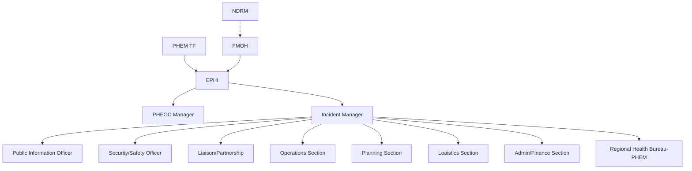

*Figure 5-1: Organogram for Incident Management System (IMS), Ethiopian Public Health Institute*

103

**Deactivation of EOC:** EOC deactivation is a process that begins while the EOC is activated and requires the attention of EOC staff during the response phase of a public health emergency. The objective of an EOC is reaching deactivation, because it indicates that the public health threat has been stabilized. When the response is declared over or incident is stabilized, the PHEOC will be deactivated and return to normal or routine operation. *(refer for the National Public Health EOC guideline)*

*Table 5 - 4 PHEOC steady state and activation guide*


<table>
  <thead>
    <tr>
      <th>Level</th>
      <th>Conditions</th>
      <th>PHEOC Duties</th>
      <th>Activation</th>
      <th>Staffing</th>
    </tr>
    <tr>
      <th>Steady-state
(Green)</th>
      <th>1.None</th>
      <th>1. Maintenance
2. Routine surveillance</th>
      <th>1. None</th>
      <th>1.PHEOC Manager
2.. Watch Staff</th>
    </tr>
    <tr>
      <th>Alert mode
(Blue)</th>
      <th>1. If a reportable disease
threshold is reached as
defined by the PHEM
manuals</th>
      <th>1.Heightened surveillance
2.Alert Regional Health Bureaus</th>
      <th>1. None</th>
      <th>1.Steady-state
staffing
2.Early warning and
response staff</th>
    </tr>
  </thead>
  <tbody>
    <tr>
      <td>Level 3
(Yellow)</td>
      <td>1. One or more activation
criteria has been met, but
the overall threat is
limited in scale or
geographic scope</td>
      <td>1. National leadership for incident
(IM)
2.Centralized information
management
3.Unified response strategy</td>
      <td>1.Lowest
level</td>
      <td>1.Incident Manager
2.Minimal IMS Staff
3.Subject matter
expert as needed</td>
    </tr>
    <tr>
      <td>Level 2
(Orange)</td>
      <td>1. The capacity of the
local response has been
overwhelmed
2.The incident affects
multiple regions
3.The incident has the
potential to rapidly
deteriorate</td>
      <td>1.Ministry and Partner
coordination
2.Single point of communication
and coordination for messaging
3. Single entry and exit point for
activities</td>
      <td>1.Requires
significant
staff</td>
      <td>1. Level 3 Staff
2. Additional IMS staff
3.Ministry and
Partner involvement</td>
    </tr>
    <tr>
      <td>Level 1
(Red)</td>
      <td>1. The conditions of a
PHEIC have been met
2. The incident is
expected to expand in
scale, scope, or cost
3.Level 1 is deemed
necessary by leadership</td>
      <td>1. All PHEOC response duties</td>
      <td>1. Large
scale
response</td>
      <td>1. Full staffing of
EOC[AB(1]</td>
    </tr>
  </tbody>
</table>

104

## **Response to other Public Health Emergencies**

Public health emergencies arising from mass causalities, flooding, landslides, in the immediate aftermath of drought, population displacement due to conflicts, biological, chemical, radiological etc… are considered in this document as other public health emergencies. In general this emergencies/disasters have a secondary health impact to the community and environment. The health sector also has a critical role in preventing and minimizing the health consequences of emergencies due to natural, manmade, technological, and societal hazardous.It can only fulfil these responsibilities in close collaboration with at risk communities and other sectors including Water, Peace, Education, etc. Foster strong partnership for effective coordination and at all levels of response with NGOs, local administration and community leaders, and private sector. They interfere with health service delivery through damage and destruction of health facilities, interruption of health programs, loss of health staff, and overburdening of clinical services.

Sectors institutions at federal, regional and woreda levels are playing a leading role with respect to hazards and related disasters relevant to their respective sectors in providing and coordinating response operations. So, the Ministry of Health shall act as a lead institution with respect to food shortage induced malnutrition affecting children and mothers and other human epidemics associated with disasters. Maintaining essential health services, prevention and control of disease outbreaks, investigation of outbreaks, risk communication and community engagement, essential drugs and supplies availability and monitoring and evaluation mechanisms are crucial components of public health disasters’ responses. This types of emergencies could be managed by activating emergency operation centers in ad hoc bases at the emergency sites.

### **Essential Intervention in Humanitarian Settings**

* **Essential Health Services:** is a key component of response to humanitarian affected communities. Based on the context, essential health services need to be availed, maintained or scale up. In IDP sites where no health facility is available, essential health services should be provided using outreach services, mobile services, and setting up temporary clinics based on the context.

105

* **Prevention and Control of Disease Outbreaks:** In humanitarian settings is also the other key area of response. Displacement increased vulnerability to various disease transmissions as result of overcrowding, low hygiene and sanitation conditions, access to health services can be constrained, etc. As result, communities affected by PHEs are prone to different disease outbreaks such as cholera, other diarrheal diseases, measles, and malaria outbreaks. Hence, the response included provision of measles vaccination campaign to children, distribution of Long-lasting insecticide treated nets (LLINs) in malaria risk areas, scale up hygiene and sanitation activities to prevent cholera and diarrheal diseases. Disease surveillance and effective reporting are required for early detection and contained disease outbreaks in PHEs settings.

* **Risk communication and community engagement (RCCE):** Aimed to reach risk and affected communities on messages on the prevention and control of outbreaks and use of essential health services in PHE affected communities. RCCE activities used various platforms to reach to large affected communities using effective strategies including community platforms, schools, religious, media, etc.

* **Drugs and supplies:** need to be provided and continuously replenished during the response period. The drugs and supplies list is long and the following kits are key parts of the list: emergency drug kits (EDKs), trauma kits, reproductive health kits, long lasting insecticide treated nets (LLINs), Cholera treatment Center (CTC) kits, nutrition supplies, vaccines, cold chain supplies and equipment, personal protective equipment (PPE).

* **Monitoring of the PHE response:** It is an integral part of the response at various levels using key indicators listed in the response plan. The performance of each pillar of PHE response need to be closely monitored and adjustment is made accordingly. Under other health emergencies, response to population displacement due to various reasons will be dealt. The main causes of population displacement in Ethiopia are due to conflict, floods, drought and land

106

slide. As any health emergencies, coordination of the response including activation of Emergency operation centers (EOCs) at various levels are crucial.

## **Inter-Action Review (IAR)**

An interaction review allows relevant national and sub-national (regional, zonal, woreda) stakeholders to evaluate an ongoing emergency response. An IAR goal is to reflect on ongoing response activities to identify gaps, best practices, and lessons learned and recommend corrective actions to improve and strengthen the continued response. It also helps is to quickly identify readily implementable actions to immediate and pressing issues that will improve the current response. The followings are steps to conduct IAR:

* **Planning and Structuring:** The first step in planning an IAR is to identify the scope; the scope should be determined by the government agency or leadership requesting the IAR.
* **Identify Participants:** To maximize IAR's value, The WHO recommends including no more than 10-20 participants. However, the number of participants can vary depending on the scope.
* **Timeframe:** An IAR can be conducted at any time at the national and sub-national level when the country or institution identifies the need to evaluate the ongoing response
* **Format:** The IAR may last a few hours to a few days depending on the review's scope. Providing a safe space where participants can be open and express themselves freely without judgment is essential. An IAR involves conduct a desk review of the existing documents.
* **Documenting:** The note-takers sole responsibility is to summarize, and document discussions and critical action points identified during the IAR conversations.
* **Following Up:** A small team should be created at the end of the IAR to track implementation and monitor the completion of activities proposed.

107

## **After-Action Review (AAR)**

An after action review (AAR) is a qualitative review of actions taken in response to an event of public health concern. An AAR is a means of identifying and documenting best practices and challenges demonstrated by the response to the event. The AAR is one component of the International Health Regulations (IHR) (2005) Monitoring and Evaluation Framework. After action review (AAR) of the emergency response should be conducted within two weeks after the deactivation of the PHEOC. A hot wash debrief may be a useful adjunct to a more formal evaluation. This can be built into the end of mission debrief of the response to EPHI and FMoH.

## **Cross-Border Public Health Emergency Response**

Ethiopia has a common porous border with frequent trans-border migration of population with six countries namely Kenya, Somalia, Sudan, S/Sudan, Djibouti and Eritrea. Population movement has increased dramatically in recent years because of trade and commerce, employment opportunities, political conflict situations, livestock grazing, pilgrimage, migration of labor forces for development projects and agriculture. Health services in the border districts are poor and inadequate especially in peripheral areas. The paradigm of cross-border control of priority communicable diseases needs an integrated and coordinated approach.

### **Cross-Border Specific Response Activities**

* **Laboratory Setup and Services:** Every PoE must be linked to a laboratory with a minimum capacity to conduct tests of major outbreak-prone diseases. Such laboratories can be designated from existing government or private laboratories, or newly established for this purpose. Requirements of the laboratory may vary for different disease conditions under surveillance at the PoE and this shall be decided by EPHI. Standards of the laboratory should be subject to national legal or policy requirements, as well as any national laboratory quality-assurance system.

108

* **Cross-border Infection Prevention and Control:** Infection prevention and control (IPC) measures in public health and health-care settings are of central importance to the safety of patients, health-care workers and the environment, and to the management of communicable disease threats to the local and global community.

* **Case Management at the border crossing:** A targeted health response at borders as an immediate ad-hoc emergency measure and eventually as part of a well-planned integrated health and border management system is essential to eliminating cross-border transmission. A full consideration of the mobility patterns, therefore, offers opportunity for more comprehensive and effective communicable diseases case management and border health interventions. There shall be a designated treatment facility for disease conditions identified at the PoE.

* **Screening, Quarantine and Isolation of Cases at PoEs:** every PoE shall have a designated screening sites and quarantine center for suspected travelers and goods. Such facilities can be on-site for a short-time quarantine. However, a long-term quarantine requires fulfilling complex needs including security, accommodation, food, and hygiene, and needs specifically designated places and hence be located away from PoEs. A PoE may provide short-term isolation while the ill traveler is awaiting transport to the designated medical facility.

* **Joint Outbreak investigations:** conducting a public health cross-border joint outbreak investigation is no simple endeavor. Add the complexities of legal and cultural differences, and arguably one of the biggest challenges facing regional corporations today. An outbreak investigation involves several overlapping epidemiologic, case, and contact investigation. In fact, it requires a combination of diplomacy, logical thinking, problem-solving ability, quantitative skill, epidemiologic know-how, and judgment. Recommended steps of outbreak investigations should be considered for a better results.

* **Dead Body Document Requirement:** The documentary requirements must be confirmed with both the country of departure and of destination prior to

109

arrangement of transport with aircraft operator or ground-crossings and be submitted to the freight forwarder / aircraft or ground crossing operator for arrangement of transport. Transportation of dead bodies via air and ground crossings should be governed by national and international guidelines.

## **Transition from Response to Recovery**

Recovery actions should be initiated as quickly as possible, generally after life safety issues have been addressed, as the sooner a community focuses efforts on the increased likelihood of enabling recovery. Therefore, recovery actions shall be conducted concurrent to response activities. Due to the overlap of response and recovery actions, the transition from response to recovery is not definitive, but can be measured by the following transition conditions: Integrated leadership, collaboration, and coordination established and situational and impact assessments conducted; Risk to life-safety is reduced and life-saving activities, such as search and rescue, are nearing completion; Emergency Support Services are established (physical, mental, and spiritual health, shelter, food and water); Initial assessment of damage complete for cultural land use and critical infrastructure including roads, railways, airports, ports, buildings and systems; Services restored to essential critical infrastructure; Establishment of national and sub-national staging areas, if required, with movement of relief supplies, response personnel and other critical resources and goods into the impacted area, including those of spiritual, cultural, and environmental importance/significance; Surge capacity of additional human and other culturally appropriate resources deployed/employed to assist the local, regional and national levels of response

110

## <u>06/ RECOVERY</u>

### **Definition**

Recovery can be defined as the process of rebuilding, restoring, and rehabilitating the community following an emergency, but it is more than simply the replacement of what has been destroyed and the rehabilitation of those affected. It is a complex social and developmental process rather than just a remedial process. The way recovery processes are undertaken is critical to their success. Recovery is best achieved when the affected community can be able to exercise a high degree of self-determination.

### **Purpose**

The goal of recovery is to ensure the economic sustainability of a community and the long term physical and mental well-being of its citizens, to rebuild and repair the physical infrastructure, and to implement mitigation activities to reduce the impact of future disasters. The regional and local health departments have a key role to play in all these response and recovery activities.

Disasters can have a profound impact on the livelihoods and health of affected populations. Restoring lifesaving services and assisting communities to cope with former and new health threats is a necessity to mitigate the impacts. It can be difficult to distinguish between response and recovery activities. While they can be similar, the intent of the two is different. Public health emergency/disaster response is focused on the immediate need to protect human life and the physical infrastructure from the immediate effects of the disaster. Recovery on the other hand, is broader in scope.

Recovery in the health sector represents opportunities to catalyze action on health policy strengthen the capacity of countries and communities to manage risks of future events. As recovery is community-led, policy implementation at the local level will be the responsibility of the community. Recovery should be a deliberate, planned process that allows the community to define its own goals for recovery and assist on that. In fact, the challenge is to find the right balance in restoring the system to its previous level and how much better it needs to be rebuilt. This will depend on the status of development of a country and what a country can afford to sustain. First, it is better that the reconstruction addresses key issues currently

111

faced by the health sector and provide better health service like accessibility to the poor and other vulnerable population sub-groups. Second, the future health system should be designed to be prepared for and responsive to all major hazards in the future. Third, the existing health system in the affected areas may need to be streamlined to meet the changed needs because of different population profiles and epidemiology.

## **Principles of Recovery and Reconstruction**

Recovery is most effective where recovery management arrangements provide a comprehensive and integrated framework for managing all potential emergencies and where assistance measures are provided in a timely, fair, and equitable manner and are sufficiently flexible to respond to a diversity of community needs. Recovery is most effective when it leverages partnerships; therefore, national, regional and districts are encouraged to work together whenever possible.

This is especially effective where smaller communities lack overall staffing capacity, or the impacts are spread across a wider area and it would be more effective for one community recovery manager to build a plan for the collective recovery effort.

The following lists are the key recovery principles

* **Equity:** Expansion of service to underserved areas, the poor and vulnerable population;
* **Effectiveness:** Increasing the access to and the quality of key services;
* **Appropriateness:** Adoption of new service delivery models to respond to new health needs if the previous system was outdated;
* **Efficiency:** Greater overall efficiency with savings used to finance some of these measures.

For the purpose of PHEM, the goal of recovery is to implement short- and mid-term recovery processes after a major public health incident. This will include identifying the extent of damage caused by an incident, conducting thorough post-event assessments and determining and providing the support needed for recovery and restoration activities to minimize future loss from a similar event.

112

## **Stages of Recovery**

Recovery consists of short-, medium-, and long-term stages and the promotion of disaster risk reduction to minimize future damage to the community and environment. It includes measures such as the return of evacuees, provision of psychosocial support, resumption of impacted businesses and services, provision of financial assistance, and the generation of economic impact assessments and recovery strategies, infrastructure repairs and environmental rehabilitation. When moving through the three stages mentioned above, the affected community should be assisted to set appropriate priorities for its recovery, articulate the roles and responsibilities of all involved, set realistic milestones to gauge progress; and ensure the effective transfer of knowledge, expertise, services, and support. The extent of the recovery process, and the type and level of national and regional activation, is based on the complexity and scope of the event. Smaller recovery events that are localized in nature can be managed by the community and are monitored at the regional level.

When an event escalates and it is determined that national coordination is required, national resource mobilization may be applied through the activation of one or more recovery sectors. When resources are exceeded at the regional level or the emergency event is such that it spans multiple regions and requires significant coordination and it is determined that additional support is needed, the nation will establish appropriate levels of support through existing mechanisms, including the Emergency Management.

*Table 6-1 Stages of Recovery*

<table><tr><th>Stage of Recovery</th><th>Features</th></tr>
<tr><td rowspan="5">Short-term (e.g.,<br />days to weeks after<br />the emergency<br />/disaster)</td><td>• Begins simultaneously with the onset of response activities.</td></tr>
<tr><td>• Ensures basic human needs are met and key support services are provided.</td></tr>
<tr><td>• Informed by a Post Disaster Needs Assessment, work begins on planning objectives.</td></tr>
<tr><td>• Restoring basic functions of society depends on how quickly recovery activities and plans are<br />initiated.</td></tr>
<tr><td>• Some people and groups will focus on response activities while others transition to restoration<br />and recovery activities. (The duration and timing of the overlap depends on the type and severity<br />of the damage incurred.)</td></tr></table>

113

<table><tr><td>Medium-term (e.g., weeks to months)</td><td>• Involves completing emergency response activities and transitioning to activities geared specifically to recovery. There is greater involvement of NGOs, insurers, financial institutions, and volunteer groups.<br />• Is informed by iterative post-disaster needs assessments.<br />• Focuses on movement of goods and services, infrastructure repairs, resuming business and economic functions, cultural and spiritual reconnection to the environment, social health and wellness, and environmental rehabilitation.</td></tr>
<tr><td>Long-term (e.g., months to years)</td><td>• Involves sustained efforts to adapt to the changed conditions, which may include replacement, rebuilding, or improvement. Financial, environmental issues, and elements of cultural significance are addressed, and efforts made to rehabilitate or improve the livelihood of disaster-affected communities.<br />• Focuses on risk reduction through changes in building codes and land-use designations (transitioning to mitigation), permanent housing and facilities, business resumption, and long-term mental health and social support services to individuals.<br />•The objective is to use the recovery, rehabilitation and reconstruction phases to increase community resilience through the integration of practical disaster risk reduction measures in the restoration of physical and societal systems.</td></tr></table>

## **Recovery Processes**

After an emergency or a disaster, the impact of damage that occurred on the health of the population and the system that serves them needs to be objectively assessed to clearly identify the gaps and to design the appropriate strategy for the specific context. Hence, a major activity during the recovery process is an effective Post Emergency/Event Assessment (PEA) to guide the implementation of recovery activities. Hence, the next pages are dedicated to see how best to conduct this assessment and benefit from this process.

**▶ Recovery Need Assessment (Post Emergency Assessment):** After an emergency or a disaster, the impact of damage that occurred on the health of the population and the system that serves them needs to be objectively assessed to clearly identify the gaps and to design the appropriate strategy for the specific context. Hence, one of a major activity during the recovery process is an effective Post Emergency/Event Assessment (PEA) to guide the implementation of recovery activities.

114

The elements within each building block to be taken into account during the assessment include the following examples:

* **Service delivery:** availability and accessibility of essential services, damage to infrastructure (pre-hospital units, mobile clinics etc.); package of services; organization and management; safety and quality.
* **Leadership and governance:** health sector policies; harmonization and alignment; oversight and regulation; governance capacity; and coordination mechanisms.
* **Health workforce:** national workforce policies and plans; human resource norms, standards and data; (remaining) numbers and types of health workers, distribution and competencies of health workers; supervision mechanisms; effects on and capacities of training institutions.
* **Information:** facility and population based information and surveillance systems; analyses capacity for decision making.
* **Medical products, vaccines and technologies:** access to essential medical products, vaccines and technologies with assured quality, safety, and efficacy, norms, standards, and policies; procurement and supply chains; quality; drug donations; health transport and logistics, warehouses, cold chain.

The assessment required to estimate damage and losses is integrated in this matrix, as the assessment of infrastructure needs to be analyzed together with their functionality to provide services, the health system functions required to support such services, and the impact the disaster had on the health of communities.

* **Pre-crisis baseline:** health status and pre-existing health risks, pre-existing policies, performance and challenges in the health system (including preparedness strategies and plans, disaster risk management program in the health system)
* **Impact of the disaster:** Impact on the BOD, health infrastructure and on health system functions. Impact averted by preventive and mitigation efforts, capacity of the health system to respond.
* **Response:** includes humanitarian interventions to address changes in the BOD, (re)-establish lifesaving services, and restore the functioning of the health system (where the costs for these interventions are borne by the Ministry of Health, they are included in the estimation of losses).

115

The health sector PEA is led and coordinated by the health sector itself, from Ministry of Health/Ethiopian Public Health Institute to the woreda health offices depending on the degree of the emergency, in collaboration with its partners and other sectors. It also needs to be linked with humanitarian coordination mechanisms as well as with pre-existing sector wide coordination and (multi-sectoral) development partners.

The health sector PEA identifies the relevant issues that need to be assessed in the context of the six health system building blocks by giving emphasis on: changes in the epidemiology of the burden of disease (BOD), damage and loss, and the performance of the main health programs. To gather situational understanding and determine what resources and support a community requires to advance recovery, post-disaster needs assessments (PDNA) must be conducted by the responsible organ (MOH, EPHI).

Conducting PDNA enables us to inform and determine priorities, funding mechanisms, and recovery coordination for all relevant sectors at national, regional, and local levels. PDNAs may be conducted by the functional incident management unit in the Emergency Operations Centre or a separately established recovery team, if applicable. The communities may elect to deploy local focal representatives or a local team to assist with the PDNA conducting expertise team, to help connect communities with resources available, and to provide additional guidance to ensure there is no delay in initiating recovery actions. The national or regional recovery teams will then work with the local focal representatives or a local team and provide coordinated high-level support throughout the process of recovery.

## **Managing the PEA process and its outputs:**

The health sector PEA is led by the Ministry of Health structure in collaboration with other relevant sectors, and the overarching national governmental body managing disasters such as the Ministry of Agriculture. This ensures alignment of the recovery framework to the national health development plan. Clear roles and responsibilities should be developed and assigned to different departments, and various levels. It is important to include the health development partners in the PEA process, such as WHO, UNICEF, donors, NGOs, community-based organizations, civil society, professional associations, and the private sector.

116

* **Staffing requirements and logistics for PEA health team:** The PEA health team will be led by the focal points as appointed by the government. Sectoral experts will be asked to assist. In general, the team needs to have at least one health system expert, and one health economist, an additional epidemiologist is required. Transport for the assessment team is required to meet stakeholders and to conduct site visits for direct observation and consultation with affected communities, representative of the health authorities in the affected area and managers of affected health facilities.

* **Data collection process, assessment tools, methods and indicators:** The data collection strategy and information requirements for the health sector recovery should be seen as a process and placed in the cycle of PHEM. This means that assessments and information required for (early) recovery build on data that is collected before the disaster happened, from routine IDS, HMIS and other reports, including from disaster preparedness, as pre-disaster baseline, and rapid assessments in the early humanitarian phase. It should then become a monitoring system of the health system performance.

* **Capacity assessment: Assessing capacities in the health sector is essential for two reasons:** The first is to understand the ability of the national health system to manage the recovery process. This includes assessing the financial management and procurement aspects of health system as these are necessary for effective management of the response. Assessing the adequacy of the financial management system is required to make choices on managing the resources being made available, and to judge the absorption capacity for recovery funding. The second reason is to identify technical support needs for planning effective capacity strengthening interventions, as required for medium- and long-term recovery.

## **Links to other sectors and cross cutting issues**

Inter-sectoral discussions should take place prior to the design phase of any assessment or more generally any data collection or analysis exercise to agree on standards which will provide a solid basis for data comparability and therefore cross-sectoral analysis. Several other sectors are considered as

117

determinants of health such as environmental health (including hygiene, water and sanitation), nutrition and food security, shelter and education.

## **Recovery Plan**

The PDNA will inform the development of a recovery plan. A recovery plan is developed in consultation and active involvement of local authorities and the target community, and must integrate into the overall recovery and rehabilitation plan, outlines recovery needs, and describes the actions envisaged in the plan to take in delivering recovery services to the affected communities, infrastructures and the health system, including funding required and timeframes for implementation. The regional and local authorities can assist with identifying programs available for communities to implement the post emergency recovery plan; however, the community needs to be involved to define how the implementation of the recovery plan looks like and should ultimately share responsibilities for the implementation.

* **Prioritization of Recovery Actions:** The post Disaster Need Assessment (PDNA) and recovery plan will assist the responsible authorities and partners to allocate recovery resources, including human and financial, by identifying priority recovery needs and recovery objectives. Prioritization across the four sectors: People and Communities, Economy, Environment, and Infrastructure – ensures equitable and need-based recovery across affected communities, systems, functions, services and promotes gender-sensitive and pro-vulnerable recovery agendas.

Primary consideration for recovery priorities emphasize protection and promotion of the health and well-being of affected citizens, including but not limited to restoration of health services; provision of mental health and wellness supports; and temporary lodging. These should be activities that lessen humanitarian impacts as soon as possible. The next phase of prioritization is identifying medium to long-term recovery needs and the generation of sustainable and resilient livelihoods. Prioritization is based on the scope and scale of recovery needs and availability of resources by sector.

* **Measuring Recovery Progress:** Measuring progress of disaster recovery is critical from all partners involved, including all levels of government, communities, non-government organizations, private sector and other partners. Recovery strategies and

118

key indicators of how progress will be measured need to be identified through qualitative and quantitative metrics. These metrics for measuring progress need to be directly linked to the Post-Disaster Needs Assessment (PDNA). The following are factors that should be considered for measuring progress:

(i) Leverage available pre-disaster data to ensure a reliable baseline level for progress to be measured against. This data should include indicators related directly to each of the four sectors: People and Communities, Economy, Environment, and Infrastructure;

(ii) Ongoing monitoring of both implementation and activities to ensure there is a holistic approach to recovery. Activity-monitoring should support results-monitoring to create a complete overview of progress made. Results-monitoring refers to measuring the progress against direct objectives and priorities, whereas activities-monitoring should be done by individual recovery partners measuring their respective sectors and programs. The results of activity monitoring will be consolidated by the lead coordinating entity;

(iii) Ensure that milestones and expectations are achievable and realistic for communities to achieve with the resources available;

(iv) Metrics for measuring progress of recovery activities must be developed through consultation with community members (representatives) and recovery partners. These metrics need to also take into consideration the vulnerabilities within the community and apply an intersectional lens;

(v) Ensure the metrics developed to measure the progress of recovery are utilized to make early adjustments to activities.

## **Recovery Core Capabilities**

* **Natural and Cultural Resources:** The Natural and Cultural Resources (NCR) core capability integrates the expertise and resources of all individuals; local, regional/metropolitan, state, tribal, territorial, insular area, and Federal governments; other natural and cultural resource stakeholders such as nongovernmental, nonprofit,

119

and voluntary organizations; and private sector entities to preserve, protect, and restore the affected community’s natural and cultural resources and historic properties in a way that is inclusive, sustainable, and resilient.

* **Health and Social Services:** Timely restoration of health systems (i.e., hospitals, and social services is critical to a community’s recovery and requires a unified effort from all partners and stakeholders in the affected region. These partners and stakeholders include government agencies; aging, disability, nonprofit, voluntary, faith-based, and community organizations; for-profit businesses; service providers; and individuals and families accessing services. By working together in an inclusive planning process, recovery stakeholders can identify pre-disaster deficits, assess incident-related impacts, target appropriate resources for pre-and post-disaster activities, and develop strategies to promote the health and wellbeing of affected individuals and communities to foster community resilience. The Health and Social Services core capability includes anticipated incident impacts to health care services, social services, behavioral health services, and environmental and public health, as well as food and medical supply safety, children in disasters, and long-term health issues specific to responders. Identify affected populations, groups and key partners in recovery, complete an assessment of community health and social service needs.

* **Economic Recovery:** The Economic Recovery core capability integrates the expertise and resources of agencies and organizations, both governmental and private sector, to facilitate the pre- and post-disaster efforts of individuals; local, regional/metropolitan, state, tribal, territorial, insular area and Federal governments; and the private sector to sustain and/or rebuild businesses and employment and to develop economic opportunities that result in inclusive, economically viable communities.

* **Infrastructure System:** The Infrastructure Systems core capability integrates the efforts of the owners and operators of public and private infrastructure. It is the extension of steady state operations and maintenance that, in some situations, defines new construction and system upgrade projects. The goal of the recovery process is to match the post-disaster infrastructure to the community’s projected demand on its built and virtual environment. Infrastructure Systems core capability partners promote

120

planning through their networks. Communities that engage in highly inclusive, public private planning efforts are generally able to function better before, during, and after an incident. Additionally, mitigation efforts help to minimize disaster consequences and put structures in position to recover more effectively.

## **Funding**

The funding for recovery will be informed by the Post-Disaster Needs Assessment (PDNA) and the community recovery plan. The recovery manager will work with other responsible stakeholders and ministry representatives as required, to inform and validate short, medium, and long- term community needs as identified through the PDNAs and community recovery plan. Needs articulated must be reasonable in terms of proposed expenditure and level of support. If additional funding is required, the ministry recovery sector leads can identify options and provide recommendations to the recovery team. For medium to long-term recovery actions, the community recovery plan will include a reporting requirement. Within the community recovery plan the community will describe the planned recovery actions and will propose how they will be funded. Regular reporting to the higher authority on the status of implementation of the actions, funds allocated, will be required.

## **Escalation and Decision Making**

Escalation of recovery coordination from the district level to the regional level or to national level are determined based on scope and scale of the event. The following considerations support and guide the decision to escalate the level of support: capacity at the local level is exceeded or is expected to be exceeded; when the geographical area of an event spreads beyond one local authority or region; where the scale of an event is deemed catastrophic and the event has caused significant impacts to a community. Following the escalation of recovery activities from the community level to the regional or national level considerations must be made, when possible, to ensure that coordination is maintained at the local level. Regional and national level activities will support recovery activities at the local level, rather than replace them. In respect to specific recovery activities, escalation to the regional or national level may occur without overall recovery coordinating being escalated to the higher level. In doing so, local authorities and communities can maintain autonomy of their recovery activities.

121

## 07/**CROSS-BORDER PHE PREPAREDNESS & RESPONSE**

### **Introduction**

Globalization and resultant human mobility has increased in recent years. Human mobility is a complex and dynamic phenomenon that has been attributed to amplify the spread of communicable diseases and the impact of public health events. The 2014-2016 Ebola Virus Disease (EVD) outbreak in West Africa, the 2016-2017 Zika Virus and the current COVID-19 pandemics have demonstrated the contribution of human mobility in increased public health risk and in turn intensified the need for enhancing the global health security.

The International Health Regulations 2005 (IHR-2005) aimed to prevent, protect against, control and provide a public health response to the international spread of disease in a way that are commensurate with and restricted to public health risks, and avoid unnecessary interference with international trade and traffic, provides a framework for countries to build capacities to prevent, detect, and respond to public health emergencies.

The IHR-2005 defines a point of entry (PoE) as "a passage for international entry or exit of travelers, baggage, cargo, containers, conveyances, goods, postal parcels, and human remains/ash as well as agencies and areas providing services to them on entry or exit." There are three types of PoEs: an international airport, ports, and ground crossings, which are further classified as designated and non-designated. Ethiopia shares a large border size with Eritrea, South Sudan, Kenya, Sudan, Djibouti, Somalia and Somali land.

Besides, Bole international airport, the hub for more than 127 destinations, is the passage for millions of passengers and cargo a year. In the presence of such intense and complex traffic of passengers and cargo across PoEs, the task of safeguarding the public health safety become undoubtedly demanding, requiring coordinated efforts of various sectors present at the PoEs.

122

During all annual state parties’ self-assessment and report (SPAR) and joint external evaluation (JEE) conducted before 2021, Ethiopia has been scoring sub optimal on the IHR recommended capacity for public health emergency response at PoEs. Recently Ethiopia has recognized the demand for strengthened Public health emergency response capacities and has made clear its strong political will both to promote global health security and meet obligations under IHR. For instance, the ministry of health (MoH) has launched a multi-sectoral five-year costed national action plan for health security (NAPHS, 2019-2023) and enacted proclamation No.1112/2019 to undertake the regulatory activities related to communicable disease at PoEs

## **PHE Preparedness at Port of Entry (PoE)**

Member countries must comply with the legal requirements set out for designated POE by IHR 2005 which states that each country should ensure the core capacity requirements (at all times & for responding to events that may constitute the public health emergency of international concern (PHEIC)) for designated POE are in place by June 2012, in principle.

**Public Health Emergency Response Contingency Plan (PHERCP):** IHR 2005 compliance requires a public health emergency response contingency plan be developed and maintained in designated POE to respond for events that may constitute a PHEIC. PHERCP is a multi-agency coordination plan to prevent the introduction, transmission, or spread of communicable disease. Effective use of a PHERCP facilitate a coordinated and timely response to a PHE at a PoE, mitigating the threat of global disease spread by international travelers. The plan should be developed in accordance with proclamation number 1112/2019, 72(2), IHR 2005 and other involved stakeholders legal background. It is intended not to look at only communicable or epidemic prone diseases but to address all unusual health events or public health emergencies.

All the relevant stakeholders such as Ethiopian Civil Aviation Authority (ECAA), Federal Police at PoE, Air Traffic Control (ATC), National Intelligence and Security Service (NISS), Aviation Security, Immigration Nationality and Vital Events Agency (INVEA), Ethiopian Custom Commissions, Ethiopian Pharmaceuticals Supply Agency (EPSA), Ethiopian Food and Drug Administration (EFDA), Ministry of Foreign Affairs (MoFA), Ethiopian Airline Groups etc. should be part and parcel of the PHERCP development as both PoE health team and stakeholders play their critical roles and responsibilities in implementing the PHERCP when a PHE occurs.

123

* **Laboratory Facility:** the laboratory's requirements may vary for different disease conditions at the PoE. Each PoE must be linked to a laboratory (government or private) with a minimum capacity to conduct lab tests for <u>outbreak-prone diseases.</u> The laboratory standards should be subject to national legal, policy, and lab quality-assurance requirements.

* **Isolation Facility:** there should be a separate center to isolate suspected cases onsite at the PoE or nearby health facilities usually for short period of time till the case transferred to a designated treatment facility/center. Isolation shall take place on board, in a cabin, ashore, in a healthcare facility or other institution including at home as appropriate.

* **Quarantine Facility:** there should be a designated quarantine center at the PoE (usually for short period of time) or nearby (a long-term quarantine requires fulfilling complex needs, including security, accommodation, food, hygiene etc.) where passenger suspected of exposure to the public health threat separated from the public for the period of time required to ensure that there is no risk of transmission.

* **Mapping and Establishing Referral Linkage:** establishing a referral system ensures suspected cases/passengers to get access for laboratory test, health care services as well as follow-up visits. Referral linkage can be done within the country or to the neighboring countries as per the agreement among the neighboring countries.

* **Finance/Fund:** the plan for responding to the public health threat at PoE should be included in the broader national emergency preparedness and response plan. Apart from this regular domestic and contingent fund must be allocated to properly respond to public health threat if happened at PoEs.

* **Logistic and Supplies:** ensuring availability of medical supplies and logistics must not be the task performed merely during public health emergency, it must be accustomed that the needed logistic and supplies are identified and gaps are filled timely. Emergency Preparedness includes stockpiling of necessary medical and non-medical supplies.

* **Human Resource and Working Documents for PoE:** as part of preparedness measures to any public health threat, identifying the need for surge capacity and designing strategy for

124

later mobilization during response is of paramount importance. One of the strategies to put in place ready for deployable surge capacity is rostering the needed qualification in sufficient number, providing necessary training/ pre-deployment orientation, developing and distributing necessary documents for the responders etc.

* **Simulation Exercise (SIMEX):** the SIMEX enable PoE health team and stakeholders to practice their roles and functions and can help to develop, assess and test functional capabilities of emergency systems, procedures and mechanisms to respond public health emergencies, identify gaps and enhance preparedness capacity for response before an actual emergency occurs. Based on the available resources and objectives to be achieved, table top, drill, functional, and field /full scale exercise can be done.

## **Public Health Surveillance at PoES**

Implementing public health surveillance at PoE is different from community setting and requires different approach

* Collecting public health surveillance data is not a major concern or viewed as a priority by key stakeholders at PoE (e.g. customs, immigration officials, conveyance operators service providers, veterinary and quarantine authorities).
* The lack of medical personnel in the majority of the conveyances or at PoE is a challenge for efficient public health surveillance and should be compensated by effective mechanisms for intersectoral communication, coordination and information-sharing.
* The IHR require surveillance with an “all-hazard approach” including biological, chemical, and radiological hazards. In PoE and conveyances, this relates to the passage of travelers including passengers and crews, animals, plants, and goods of diverse origin.
* Events can be detected before, during or after travel or when travelers left the conveyance. Therefore, investigation and public health measure activities takes place retrospectively.
* The approach to surveillance is often focused on detecting and reacting rapidly to individual events, and usually does not include on-going systematic data collection for analyzing and calculating epidemiological indicators

**IHR Principle of Surveillance at PoE:** the principle of the establishing surveillance at PoEs is to

125

prevent, protect against, control and provide a public health response to the international spread of disease in ways that are commensurate with and restricted to public health risks, and which avoid unnecessary interference with international traffic and trade.

## **Objectives of Surveillance at PoEs:** main objectives include

* To detect, investigate and control public health risks and events of all origins rapidly
* To assist PoE Health team and other sectors in adopting preventive measures, investigation, management and follow up of events;
* To prevent and/or manage the importation and exportation of travel related health hazards (including diseases and their agents) in a country;
* To prevent international spread of vector borne diseases by controlling vectors

Hence, PoE health team should promptly receive all pertinent information generated elsewhere that may contribute to their public health surveillance objectives.

## **Source of Information for Surveillance at PoEs:**

* Passengers travel itinerary, destination, health documents, non-invasive medical examination, travelers’ health declaration form (THDF)
* Inspection of baggage, cargo, containers, conveyances, goods, postal parcels etc
* Health Part of the Aircraft General Declaration form
* Any information relating to health conditions on board during an international voyage

## **Application of Surveillance for Event Detection:** early detection of events allows for timely implementation of public health measures, response, containment, and prevention of further potential exposure.

## **Risk Assessment:** once public health event was detected, verification of the event by collecting accurate information (usually from other travelers, conveyance operators, other medical service centers at port etc.) is important and part of the standard preliminary response of the PoE health team and other stakeholders. Preliminary risk assessment information (type of event, level of severity, trend, hazard level etc.) should be reported to the national PHEM/EOC and other stakeholders as necessary by the PoE health team before full assessment of the event takes place.

126

flow_chart: Information flow diagram from PoE health team to EPHI

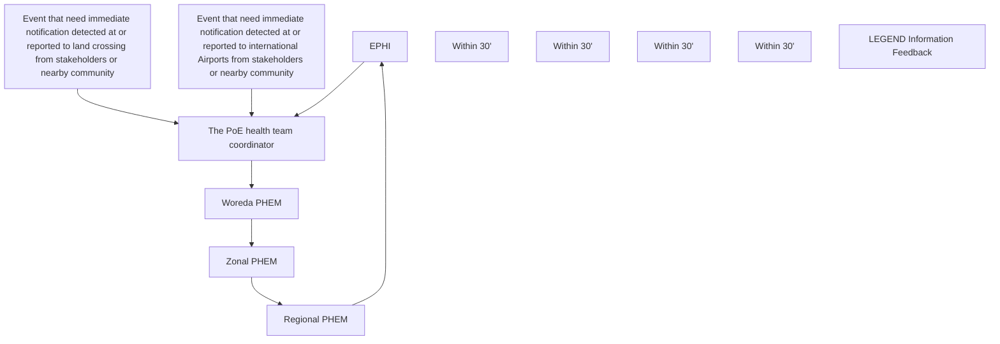

*Figure-7-1: Information flow from the PoE to the EPHI and vice versa*

**Data utilization:** the relevant traveler’s information should be registered on standardized disease specific format, THDF at PoE or while on travel. These information usually be entered, in to the electronics database, analyzed at PoE by the health team and will be sent to national PHEM/ EOC.

## **Cross-Border PHE Response**

**Collaboration and Coordination:** the major regional economic blocs of the Intergovernmental Authority on Development (IGAD), the Common Market for Eastern and Southern Africa (COMESA), the East African Community (EAC) with legally binding protocols that include free trade and the movement of people across international borders, are expanding rapidly. Casual and unofficial cross-border movement of communities including pastoralists living along national borders in search of services and other social events are common.

Cognizant of such situations, cross-border collaboration, development of bilateral and multilateral joint plans of action and the establishment of an effective mechanism to enable respective national health authorities and PHEMs to communicate directly, during health emergencies are crucial first steps for the

127

implementation of cross-border prevention and control/response activities. MoU among the parties should take place to make the joint execution and evaluation of response activities (joint planning, surveillance, joint outbreak investigations, communication, SIMEX, update relevant regulations, update about referral linkages etc.) effective. The diverse nature of border health management also needs collaboration and coordination with stakeholders in the country such as Regional Health Bureaus and bordering districts, (INVEA), Custom Commission, (NIC), Federal Police, All Airlines Operators, Ethiopian Airports, Ethiopian Civil Aviation Authority and Ethiopian Railway Corporation, National Defense etc. The national IHR focal point also plays crucial role in realizing collaboration to the neighboring countries.

## **Specific Public Health Emergency Response Activities at PoE**

* **Laboratory Setup and Services:** Ensure designated PoEs are linked to laboratories (government/private) with a minimum capacity to conduct tests of major outbreak-prone diseases that can spread through cross border movements. Preferably the testing sites will be at PoE level so that issue related to transport, safe package etc. will be minimized. Tests that require sophisticated laboratory and special conditions for specimen handling should be done at laboratories with proven capacity.

* **Case Management at PoE:** health response at borders as an immediate ad hoc emergency measure and eventually as part of a well-planned integrated health and border management system is essential to mitigate cross-border transmission as well as treat cases who need immediate health care. There should be a designated temporary treatment/isolation facility (TIF) to treat suspected cases detected at PoE for short period of time before they transferred to a designated treatment center for further management and laboratory test. Strict IPC (standard or transmission based), proper waste disposal (considering all types of wastes) should be applied during treating and transferring of the suspect.

* **Screening, Quarantine and Isolation of Cases at PoEs:** every designated PoE shall have a screening sites and quarantine center for suspected travelers and goods. Such facilities can be on-site for a short-time quarantine but exposed individuals/objects that needs longer time for quarantine should be transferred to designate quarantine facility away from PoE.

128

* **Provision of Vaccine:** countries are required to provide vaccine to major outbreak prone diseases at designated PoEs.

* **Human remain and Ash Management:** An incoming and outgoing human remains should be regulated to ensure that it is free of infectious diseases that may pose public health risk during transport, at PoEs and at its destination. Although most organisms in the human remains are unlikely to infect healthy persons, some infectious agents may be transmitted when persons come into contact with blood, body fluids, or tissues of the human remains of persons with infectious diseases requiring implementation of ‘standard precautions’ handling it. When handling human remain,
    - Privacy and confidentiality regarding information of human remain should be ensured
    - IPC measures should be followed based on the risk human remain pose to the public
    - Make sure the human remain covered well as per recommendation
    - Ensure required mandatory (death certificate, embalming certificate, certificate showing non-infectious/non-contagious human remain) and supporting (passport/lese-pasee, transport bill) documents are available.

## **Public Health Measures**

* **Conveyances and Cargo:** According to the Proclamation No. 1112/2019 article 72, conveyances considered to have a public health risk/ had travel history to the affected areas shall be inspected on arrival or departure by PoE health team. During inspection of baggages, containers, conveyances, facilities and goods or postal parcels etc., have risk of public health threat to the public, health measures (disinfection, decontamination, disinfection, deratings, isolation/quarantine, destruction/removal etc.) should be implemented based on the available SOPs.

* **Animals:** More than 75% of emerging diseases like SARS CoV-1, MERS CoV, Ebola, Avian Influenza etc. originate from animals (particularly wildlife).Because of wild meat consumption and transporting live animals (dogs, cats, reptiles, rodents, non-human primates, horses, poultry, captive birds, bovines, porcine, ovine, caprine etc.) by conveyance, infected animals can travel across different country and continent with in few hours or days posing public and global health security threats. In such case of cross border

129

zoonotic diseases, the public health measures with respect to animal will be implemented per the advice (collaboration) provided by the group of experts to be assembled from the MoA and human health under the umbrella of one health steering committee (OHSC).

130

## <u>08/ **RESILIENCE**</u>

### **Definition**

**Resilience:** The unified definition of resilience by the UN is “the ability of individuals, households, communities, cities, institutions, systems and societies to prevent, resist, absorb, adapt, respond and recover positively, efficiently and effectively when faced with a wide range of risks, while maintaining an acceptable level of functioning and without compromising long-term prospects for sustainable development, peace and security, human rights and well-being for all” (United Nations Chief Executive Board, 2017).

**Health System Resilience (HSR):** Health system resilience is defined “as the capacity of health actors, institutions, and populations to prepare for and effectively respond to crises; maintain core functions when a crisis hits; and, informed by lessons learned during the crisis, reorganize if conditions require it”. Health systems are resilient if they protect human life and produce good health outcomes for all during a crisis and in its aftermath.

The ongoing and recurrently occurring epidemics and public health emergencies in Ethiopia has demonstrated the critical importance of resilient health systems in safeguarding the national health security.

It’s well-recognized that during the public health emergencies like COVID-19 pandemics and other disasters, health system remains severely overwhelmed by the combination of a large surge of patients seeking care and for other routine healthcare needs and reported lack of sufficient space, supplies and staff to treat patients.

Therefore, improving resilience within health systems can build on pre-existing strengths to enhance the readiness of health system actors to respond to crises, while also maintaining core functions. Resilient health systems are important for supporting response efforts during an infectious disease outbreak or natural hazard, and help ensure the continued delivery of routine services needed by the community in nonemergency periods.

131

Building Health System/ Service Resilience aims to:

* Enable health workers, heath facilities and health organizations to better withstand and recover from a disruptive acute PHE more quickly and effectively;
* Reduce the impact of chronic stresses on the health system, such as PHEs, economic stressors, and improving the ability to maintain essential functions during these shocks;
* Improve the public’s trust in the health system and therefore better utilization of health services which improve population health outcomes
* Avert the high socio-economic cost of responding to PHEs and other shocks with poor preparedness and lack of resilience capacities
* Encourage investments in the health system by producing positive and sustainable results from previous investments thereby increasing the likelihood of continuity during disturbances

## **Linkages-HSR, Universal Health Coverage and Health Security**

Universal health coverage means that all people are able to receive needed health services of sufficient quality to be effective, without fear that the use of those services would expose the user to financial hardship. Universal health coverage comprises a set of objectives i.e. equity in service use, quality, and financial protection towards which all countries strive to achieve.

Building resilient health systems, that can withstand shocks and sustain provision of regular health services, is significantly escalate the efforts towards achieving universal health coverage. In turn, achieving universal health coverage is a requirement to ensure health security of the community, as health security and universal health coverage are considered as a two side of one coin.

132

flow_chart: conceptual diagram of health system resilience and security

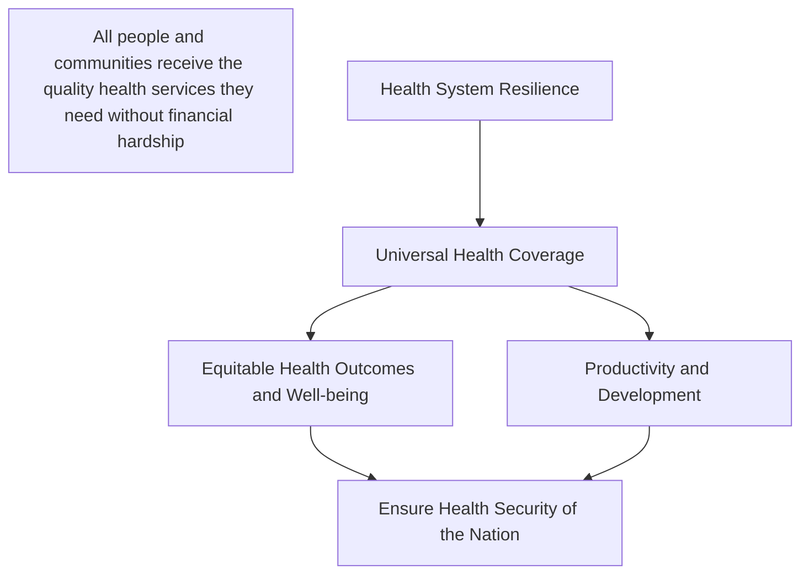

*Figure 8-1:Inter-linkage between health system resilience, universal health coverage and health security*

## **HSR Attributes and Capacities**

Resilient health systems have been characterized in one framework as having five key features: knowledge of available resources and emerging challenges, versatility to act against a broad range of challenges, ability to contain health crises and avoid damaging reverberations in other parts of the health system, capacity to form a multi-sectoral response that integrates a range of actors and institutions and flexible processes that allow for adaptation during crises. These health system resilience attributes and capacities can be built in pre-emergency phase (before crisis hits) during emergency phase (during response to the crisis) and post emergency phase (after the crisis ended).

133

## **Health system resilience attributes**

* **Awareness:** knowing the health system capacity as well as health risks (assets and weakness of the system). Detects health threats before they strike.
* **Diverse:** this attribute is described by effectively respond to a range of health needs. Delivers range of services with universal health coverage.
* **Self-regulation:** the health system should be able to predict the potential health threats, maintain essential functions or services and leverage the outside capacity. Prevents health disruptions from turning into disasters.
* **Integration:** the health sectors should work in coordination with non-health actors as well as by engaging the community. Within the health sector also, there should be a coordination mechanism. Rapidly deploys resources from beyond the health system.
* **Adaptive:** this attribute described by shifting resources depending on the need, promote rapid local decision making and rebounds from shocks stronger than before.

## **Health system resilience capacities**

An alternative framework for resilience focuses on three aspects: absorptive, adaptive and transformative capacities. These relate to the protection of service delivery during crises, the ability of the system to manage health crises using fewer resources and its ability to introduce realistic reforms in response to the changing environment.

* **Adapt and coping capacity:** the capacity of the health system actors to deliver the same level of healthcare services with fewer and/or different resources, which requires making organizational adaptations.
* **Absorptive capacity:** the capacity of a health system to continue to deliver the same level (quantity, quality and equity) of basic healthcare services and protection to populations despite the shock using the same level of resources and capacities.
* **Transformative capacity:** the ability of health system actors to transform the functions and structure of the health system to respond to a changing environment.

134

flow_chart: Health system resilience attributes and capacity across emergency phases

```mermaid
flowchart TD
    subgraph Phases
        direction LR
        P1[Pre-emergency (prevention, Preparedness, readiness)]
        P2[During Emergency (response)]
        P3[Post-Emergency (recovery, transformation)]
    end
    subgraph When
        W1[When? (Not always separate phases)]
    end
    subgraph What
        W2[What to do? Ensure health system capacity to;]
        A1[Know its risk profile, vulnerabilities and abilities (Awareness)]
        A2[Mobilize resources & coordinate support (Mobilization)]
        A3[Provide the range of services needed (Diversity)]
        A4[Make informed decisions in response to threats (Self-regulation)]
        A5[Identify and apply lessons from emergencies (Transformation)]
        B[Integrate actions between health system and health security for public health]
    end
    subgraph Why
        W3[Why? In order to;]
        C1[Forecast, prevent and prepare]
        C2[Absorb, adapt and respond Maintain quality routine/essential health services]
        C3[Learn, recover and improve]
    end
    P1 <--> P2
    P2 <--> P3
    A1 --> A2
    A2 --> A3
    A3 --> A4
    A4 --> A5
    A1 & A2 & A3 & A4 --> B
    B --> A5
    C1 --> C2
    C2 --> C3
```

*Figure 8-2 Health system resilience attributes and capacity across emergency phases*

## **Pre-Emergency Health System Resilience**

Health system resilience in pre-emergency phase focuses on building capacities of the system to forecast the potential risks, knowing health system capacities, mitigating the potential impact and preparing to the potential health system shocks.

### **Capacity to forecast and mitigate public health risks**

Forecasting the potential public health risks is one of the key resilience health system capacity in pre-emergency phase. Once the public health risks are identified, the next step, in parallel with preparedness planning, should be mitigating the potential impacts of public health emergencies. Public health emergency mitigation includes avoid or reduce avoidable risks by reducing/avoiding hazards or vulnerability (risk aversion/prevention/primary mitigation) and reduce the severity of the human and property damage caused by the disaster (secondary mitigation).

135

The public health emergency mitigation process includes the following activities:

* Identify and estimate the magnitude of vulnerability
* Identify and engage all stakeholders relevant to the public health emergency mitigation process
* Developing and designing mitigation strategies specific to the identified risk/risks by considering all hazard approach principle
* Include disaster mitigation measures in health sector policy and in the planning and development of new facilities.
* Ensure that disaster mitigation measures are taken into account in a facility’s maintenance plans, structural modifications, and functional aspects
* Inform, sensitize, and train those personnel who are involved in planning, administration and operation of disaster mitigation

## **Emergency preparedness and health service continuity planning**

The emergency preparedness plan is a scenario-based planning to response to potential emergencies while health service continuity planning is a process of planning with the main purpose of maintaining continuity of essential health services and protecting lives and health of the affected population. It is important for public and private health services providers to ensure continued health service delivery during public health emergencies or shocks to the health system. The operationalizability of both preparedness and health service continuity plans need to be tested with simulation exercises, this could be discussion based or operation-based exercise. Continuity of essential health services during PHEs is vital to global, regional, national and local health security as well as to ensure Universal Health Coverage (UHC). Health service continuity planning should be framed in all hazard approach. This plan could be part of emergency preparedness and response plan or a separate plan.

The following steps are recommended for health service continuity planning using the all-hazard planning approach.

* Form a collaborative planning team;
* Conduct risk assessment and prioritize risks;
* Determine overall objectives and operational priorities;

136

* Conduct capacity assessment;
* Develop service continuity plan;
* Test (exercise) and update the plan;
* Implement the plan and monitor the implementation;
* Post event or post-exercise review and improvement of the plan

## **Health System Resilience during Emergency**

Building health system resilience is an ongoing process, however the resilience capacity of the health system is tested during health crises. During public health emergencies, in parallel with responding to the ongoing health event, essential health services and essential public health function have been given due attention. The Ethiopian Public Health Institute and Ministry of Health at national level and their counter parts at sub national level, in collaboration with relevant stakeholders, are responsible to ensure the continuity of essential health service and essential public health functions during emergency response.

### **Maintaining Essential Service during Emergency Response**

Public health emergency responses require additional resources which can compromise the routine health service delivery. But there are health services by any means should be available, these are essential health services. Hence, maintaining he pre-determined minimum standard health services during emergency response is one of the key features of health system resilience. The major components of the essential health services of Ethiopia are organized into the following nine components:

1) Reproductive, maternal, neonatal, child and adolescent health services
2) Major communicable diseases
3) NCDs
4) Surgical care
5) Emergency and critical care
6) NTDs
7) Hygiene and environmental health services
8) Health education and behavior change communication services
9) Multi-sectoral interventions

137

## **Health Service Quality during Emergency Response**

Public health emergencies have direct and indirect negative effects on quality of health care at all levels of service delivery. All domains of quality must be factored into all interventions and actions to management the emergency i.e. people-centeredness, safety, efficiency, integrated care, effectiveness, timeliness and equity.

* **People Centered**: Providing care that considers the preferences and aspirations of individual service users and the culture of their community.
* **Safety**: Delivering health care that minimizes risks and harm to service users, avoiding preventable injuries and reducing medical errors.
* **Efficiency**: Delivering health care in a manner that maximizes resource use and avoids waste.
* **Integrated Care**: Providing care that is coordinated across levels and providers and makes available the full range of health services throughout the life course.
* **Effectiveness**: Providing services based on scientific knowledge and evidence-based guidelines.
* **Timeliness**: Reducing delays in providing and receiving health care.
* **Equity**: Delivering health care that does not differ in quality according to personal characteristics such as gender, race, ethnicity, geographical location or socioeconomic status.

## **Maintaining Essential Public Health Function**

Essential public health functions are indispensable set of actions, under the primary responsibility of the state, that are fundamental for achieving the goal of public health which is to improve, promote, protect, and restore the health of the population through collective action. The essential public health functions should be maintained during health emergency responses.

These are;

1) Surveillance of population health and well-being
2) Preparedness and public health response to disease outbreaks, natural disasters and other Emergencies

138

3) Health protection, including management of environmental, food, toxicological and occupational safety
4) Health promotion and disease prevention through population-based interventions, including action to address social determinants and health inequity
5) Effective health governance, public health legislation, financing and institutional support
6) Sufficient and competent workforce for effective public health delivery
7) Communication and social mobilization for health
8) Public health research to inform and influence policy and practice

## **Post Emergency Health System Resilience**

Emergencies often have a direct impact on the health systems and public health systems of an affected region or country, particularly in resource-constrained areas. The effects of an emergency on the performance and capacity of these systems depend upon a variety of interrelated factors, which include the pre-disaster status of the systems, the type of emergency, the effectiveness of the response, and the initiation of recovery activities.

### **Humanitarian Development Nexus**

Humanitarian development nexus is an approach of addressing needs and reducing risks and vulnerabilities through the combined effort of both humanitarian and development communities and other actors as appropriate. Within the mandate and humanitarian imperative to save lives, humanitarian responses can and need to consider the longer-term consequences of their actions, and how interventions interface with and can contribute to building resilience during the crisis and longer-term recovery and development whenever the environment stabilizes. During post emergency recovery, optimizing the quality and coverage of health services provided to affected populations collectively by all health actors using all available resources, while laying the foundation for health system resilience is a key consideration. Therefore, the humanitarian and the development actors should involve in the following process jointly;

* **Preparedness:** It is important to development actors to invest on risk reduction, preparedness and contingency plans, and scaling up treatment capacity for response.
* **Joint Assessment:** A main first step in this process is to jointly conduct a structured

139

health system assessment with the objective of identifying common challenges to humanitarian and development activities and bottlenecks, and proposing recommendations to address those jointly. The assessment could be conducted by a small team of humanitarian development nexus experts, with combined knowledge of humanitarian and development processes and structures.

* **Joint Planning:** Based on the findings and recommendations, government, humanitarian and development partners will jointly develop and commit to a humanitarian development nexus roadmap consisting of prioritized and costed actions with predictable funding. This roadmap will inform the development of the multiyear humanitarian response plan, the national health strategic plan, the health sector humanitarian operational plan and the national and subnational annual health operational plans. These plans will define the roles and responsibilities of each actor.

* **Coordinated Implementation:** Government and humanitarian and development partners will implement the activities defined under responsibilities in a coordinated way. They will use different partner coordination mechanisms, such as the health security council and the health cluster. A special humanitarian development nexus coordination structure or processes will also be established.

* **Joint Monitoring and Evaluation:** In accordance with the monitoring and evaluation frameworks, government, humanitarian and development partners will jointly monitor and evaluate progress and performance of their humanitarian and development activities, as well as indicators specific to the humanitarian development nexus. In doing so, the existing public health emergency management coordination and collaboration platforms as well global humanitarian response and development program coordination platforms would be utilized.

## **Learning from Emergency Experiences to Build Health System Resilience**

To learn from the experience of the past public health emergency, the after and/or inter action reviews should be conducted. The after and/or inter action review can be conducted at national, regional, zonal or woreda levels and even at health facility level depending on the extent and type of the event. The after and/or inter action review of the usual public health emergencies involving small geographic area can be conducted at local level. However, the after and/or inter action review for new public health

140

emergencies or for public health emergencies involving a wider geographic area can be conducted at regional or national level. An after/inter action review is a qualitative review of actions taken in response to an event of public health concern. It is a means of identifying and documenting best practices and challenges demonstrated by the response to the event. After action review (AAR) conducted after the response efforts are completed and the emergency is declared over, ideally within three months after the emergency is declared over.

An AAR/IAR seeks to identify:

* Actions that need to be implemented immediately, to ensure better preparation for the next event;
* A medium- and long-term actions needed to strengthen and institutionalize the necessary capabilities of the public health system.

The AAR/IAR process involves three phases i.e. pre-AAR, during AAR and post AAR.

<table><tr><th colspan="2"><strong>Pre-AAR</strong></th><th><strong>During AAR</strong></th><th colspan="2"><strong>Post-AAR</strong></th></tr>
<tr><th>1-DESIGN</th><th>2-PREPARE</th><th>3-CONDUCT</th><th>4-RESULTS</th><th>5-FOLLOW-UP</th></tr>
<tr><td>1. Designing an AAR<br />2. Select an appropriate AAR format<br />3. Build an AAR team<br />4. Develop a budget<br />5. Develop a checklist and agenda<br />6. Summarize in a concept note<br />7. Inform key stakeholders and facilitators<br />8. Select a venue</td><td>1. Collect and review relevant background information<br />2. Refine the trigger questions<br />3. Identify and brief facilitators/interviewers<br />4. Setting up an AAR</td><td>1. Conduct the analytical part of an AAR<br /><br />a. Identification of capacities<br />b. Timeline of key milestones<br />c. Identification of strengthens, challenges and new capacities developed<br />d. Evaluation of IHR (2005) core capacities performance<br /><br />2. Build consensus among participants<br />3. Close an AAR and conduct participant AAR evaluation</td><td>1. Conduct AAR debriefing<br /><br />a. AAR team debriefing<br />b. Senior management debriefing<br />c. AARs as an opportunity for advocacy, resource mobilization and strategic partnership<br /><br />2. AAR final report</td><td>1. Documenting progress: post-AAR follow-up<br />2. Lessons learned database</td></tr>
<tr><td colspan="2"><strong>3-4 Weeks before AAR</strong></td><td><strong>1-3 days: AAR Setup</strong><br /><strong>1-3 days: Conduct AAR ( The Interview format may vary)</strong></td><td><strong>Immediately and over the next 2 weeks</strong></td><td><strong>Continuous and as needed</strong></td></tr></table>

141

*Figure 8-1 Steps of after/inter action review process*

Depending on the location and number of participants, cultural context, the complexity of the health event, and the resources available to conduct the review, the format/method on the review should be determined. The following are formats/methods of an AAR

* **Debrief:** This format is the simplest type. It is a facilitator-led discussion held over less than half a day, involving a small group and a plenary review of a limited number of functions.
* **Working Group:** This is an interactive, structured methodology based on group exercises, plenary discussions and interactive facilitation techniques. It blends group work (in groups of 6–12 people) and plenary sessions. Each working group corresponds to a particular pillar of the response (for example, surveillance, case management).
* **Key Informant Interview (KII):** It consists of a longer, more in-depth review of an event. It includes research into background materials, such as peer-reviewed literature, media reports and grey literature. The research is followed by semi structured interviews and short focus group discussions in which key informants are encouraged to provide honest feedback on their experiences. Feedback can also be gathered through surveys sent to those involved in the response.
* **Mixed:** This approach blends the formats of debrief, working group and key informant interview AARs. This approach can be used to review the response to emergencies for which it might not be possible to bring responders together for a working group format.

## **Post-emergency Health System Transformation**

The impact of public health emergencies is quantified with human lives and suffering, the psychosocial impact, and the economic slowdown constitute strong reasons to translate experiences into actionable lessons, not simply to prevent similar future crises, but rather to improve the whole spectrum of population health and the health system. In addition to restoring the health system functions to its pre-emergency/disaster level, emphasis should be given to transform the health system in a better way. So that, the health system can absorb or adapt to similar or other public health emergencies in the future.

142

The focus areas in transforming the health system are;

* The health system infrastructure
* The health information management system
* Health service delivery modalities
* Health workforce management and capacity building
* Community level mitigation strategies
* Restructuring or reforming the coordination platforms or the health system as a whole
* Revision or development of health emergency related policies, guidelines and strategies

## **Health System Resilience Framework**

The interconnected health system building blocks are important starting points for building the overall resilience of the health system to public health emergencies and strengthen existing health system capacities. Therefore, to build a resilient health system, it requires continuous improvement and sustainable capacity of the health system capacity to adopt and absorb health system shocks and to transform after crisis.

* **Continuous System Improvement:** continuous improvement is a systematic, sustainable approach to enhancing the health system capacity. Building a continuous improvement culture is not a turnaround project or a quick fix but a journey that never really ends, requiring commitment, investment and persistence. The improvement could be based on the lesson learned from previous health emergencies or crises.

* **Sustainable System Capacity:** health system is continuously challenging by natural and manmade disasters, disease outbreaks and population dynamics. Therefore, sustaining the health system capacities during and after health emergencies or crises is the core of a health system resilience.

143

flow_chart: Health system resilience building blocks and continuous improvement

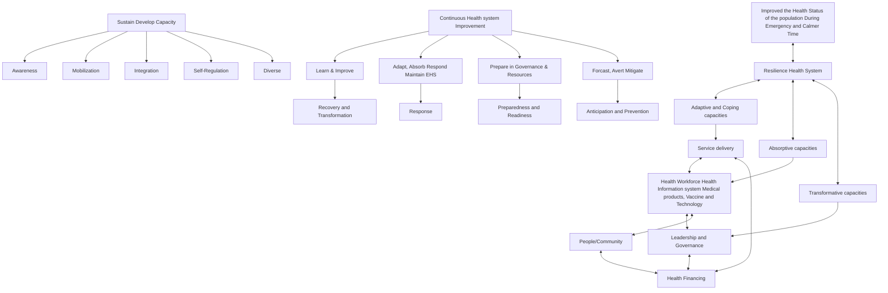

A comprehensive approach of system thinking and significant transformation of the prevailing policy, practice and culture to promote and protect community health from risk vulnerabilities. The essence of change from

* Event based to Risk based
* Reactive to Proactive
* Single hazard to All hazard
* Hazard focus to vulnerability and capacity focus
* Single agency to whole of society
* Separate responsibility to shared responsibilities of systems

*Figure 8-4 Health system resilience building blocks and their connection with the public health emergency management system to build a resilient health system through continuous improvement and sustainable development*

144

## 09/ **MONITORING AND EVALUATION**

### **Definition**

**Monitoring:** It is a continuous internal process for making sure that the activities under the programme /project as Public Health Emergency Management are on track. Monitoring of project activities, use of resources, results achieved and institutional systems (staffing, policies, etc.) should be done on a regular basis.

**Evaluation:** It is a systematic way of collecting, analyzing and using information to answer basic questions about a project/programme. It assesses whether the objectives set are achieved or not. It can be internal, external or involving many key stakeholders. It can be done by–Process evaluation: assess whether an intervention/model was implemented as planned, whether the target population was reached, and what were the major challenges and successful strategies used or by-Outcome evaluation: determine whether and to what extent the expected changes occurred and whether these changes can be attributed to the programme activities.

Thus, Monitoring and evaluation is usually carried out using a selected and agreed up on indicators; it can also measure progress toward implementing an overall program target. Measuring the level of preparedness of the PHEM system at different levels is critical to know the capacity of the program to handle outbreaks/events and any other emergencies in an effective manner.

### **Purpose**

Monitoring and Evaluation is the important component of PHEM. It is carried out at each level starting from preparedness to recovery from incidents. Thus, it would have benefits of:

* Ensuring intense demand for data by decision makers at National and Sub-National levels, partners and stakeholders across all levels
* Providing guidance about: minimum and optional data to collect and

145

measure the performance of key components of PHEM activities and to take corrective action when needed

* Indicating the use of information systems to collect, store, analyze and disseminate any relevant information.

## **Monitoring and Evaluation Framework**

The Monitoring and Evaluation logic model was adapted from the third Strategic Planning Management (SPM-III) documents considering the four major pillars of PHEM. In this framework, the early warning and communication, preparedness and response activities are taken as processes and the outputs of the performances would be the results under recovery and resilience. The outcomes would be improved health services and systems and decreased morbidity and mortality and the impact will be improved health security in the country (Figure-).

flow_chart: Monitoring and Evaluation Logical Framework of PHEM

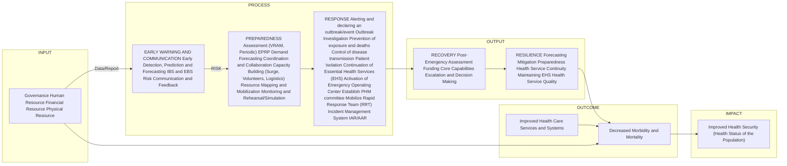

*Figure-9-1: Monitoring and Evaluation Logical Framework of PHEM*

Important process, output, outcome and impact indicators were selected to measure performances of the core activities of PHEM. The primary data sources in measuring the indicators include: Routine monitoring through administrative systems comprise any data generated by facilities or providers through periodic reports, logistics management information systems; Periodic surveys as either directed at households or facilities and providers, evaluating aspects of service delivery; and Surveillance systems (IBS and EBS).

146

## **Preparedness**

Preparation for responding outbreaks has several activities that can be implemented across all levels of the health system. Among the many preparedness activities, the M and E team measures progresses of the below listed core activities to track their successful implementation and achievements.

* Capacities in conducting various forms of assessments (VRAM, Periodic Surveys)
* Presence of an epidemic preparedness and response plan (EPRP) and demand forecasting
* Availability of emergency stocks of drugs, vaccines and supplies during the last 12 months
* Availability of funds for outbreak response
* Presence of a well-equipped, trained woreda/zonal /regional and national rapid response team to conduct an outbreak investigation
* Epidemic management committee
* Presence of a functional PHEM task force at all level
* Availability of trained/oriented health staffs (surge capacity, volunteers) for the response
* Availability of redundant and uninterrupted communication facility
* Existence of strong coordination and collaboration
* Monitoring and rehearsal/simulation

## **Early Warning and Communication**

Most activities of early warning and communication are directly linked with surveillance system by which many forms of data are collected from different data sources for possible actions. In one way or another, the activities of this section are linked with monitoring and evaluation. Thus, the M and E team should measure the existence of strong surveillance and risk communication system on the ground in order to ensure:

* Capacities in conducting assessments (VRAM, Periodic Surveys)
* Capacities in early detection, prediction and forecasting of risks
* Existence of strong surveillance system (IBS and CEBS)
* Fast Risk Communication mechanisms and feedback provision systems

147

Timeliness and completeness of reports are critical dimensions towards detecting a risk and conducting a prompt and effective response. When reports are late, or are not submitted, the aggregated information for a specific area will not be accurate as a result outbreaks can go undetected and other opportunities to respond to public health problems will be missed.

## **Response**

Up-to-date information is needed on a continuous basis throughout the emergency to inform decisions on response actions, monitor the effects of health interventions and enable adjustments to be made when necessary, and to support resource mobilization efforts.

The following are some of the elements to be monitored:

* Disease trends in order to assess the effectiveness of the response measures, the extension of the outbreak and risk factors
* Resources assessment of the rational utilization, adequacy and sufficiency and determination of additional needs
* Performances of alerting and declaring of an event/outbreak
* Quality of the Outbreak Investigation processes
* Prevention and Control mechanisms of exposures, transmissions, and deaths Activation of Emergency Operating Centers
* Practices of preparing quarantine and isolation sites and proper use of the sites
* Effectiveness of the response: case fatality rate, incidence rate
* Implementation status of the identified intervention activities
* Continuation of Essential Health Services and response to other PHE
* Establishing PHM Committee, Mobilization of RRT and Incident Management System
* Inter-Action Review (IAR)/AAR
* Drugs and Supply

## **Recovery**

In the recovery phase, overall of core capacities of the health system and affected communities and areas would be measured together with the assessing funding and other resources availability for decision making and escalation.

148

## **Resilience**

Monitoring the level of responses given to recover rehabilitate the community affected by major public health emergency will give as the level of completeness of our overall response activities. The following key areas would be assessed

* Pre-emergency: forecasting and mitigation, preparedness and Health Service continuity
* During emergency: maintaining EHS and Public health services, Health service quality
* Post-Emergency: Humanitarian-Development Nexus, Learning

149

## 10/ **REFERENCES**

1. EHNRI (2012).Public Health Emergency Management Guideline, Addis Ababa, Ethiopia
2. MOH (2021).National Technical Guidelines for Integrated Disease Surveillance and Response (IDSR), Third Edition, Uganda.
3. WHO Africa (2019).Technical Guidelines for Integrated Disease Surveillance and Response in the African Region, Third Edition, Booklet Six, Section-11.
4. FMHACA (2016).Guidelines for Surveillance and Response to Adverse Events Following Immunization (AEFI), Second Edition, Addis Ababa, Ethiopia.
5. WHO (2021).Defeating Meningitis by 2030-A Global Road Map.
6. ACU (2017). Early Warning Alert and Response Network (EWARN)-A Field Manual, Second Edition; Roles and Responsibilities for Surveillance and Response Teams in Syria.
7. FMOH (2015).Interim-Guideline for Multisectoral Scabies Outbreak Emergency Response, Ethiopia.
8. FMOH and EPHI (2021).Technical Guide for All-Cause Mortality Surveillance System in Ethiopia.
9. FMOH (2019).National Technical Guidelines for Integrated Disease Surveillance and Response, 3<sup>rd</sup> Edition, Abuja, Nigeria.
10. WHO (2012). Outbreak Surveillance and Response in Humanitarian Emergencies-Guideline for EWARN Implementation.
11. Sphere (2018). The Sphere Handbook-Humanitarian Charter and Minimum Standards in Humanitarian Response.
12. FMOH (2019). National Action Plan for Health Security (NAPHS)-2019-2023, Addis Ababa, Ethiopia.
13. EPHI (2021). Strategic Planning and Management (SPM-III)-2020/21-2029/30, Addis Ababa, Ethiopia.
14. EPHI (2020).A Strategic Framework for Health System Resilience (HSR), Addis Ababa, Ethiopia.

150

## **ANNEXES**

**Annex-1:** Key stakeholders in public health emergency management coordination framework

flow_chart: stakeholder relationship diagram

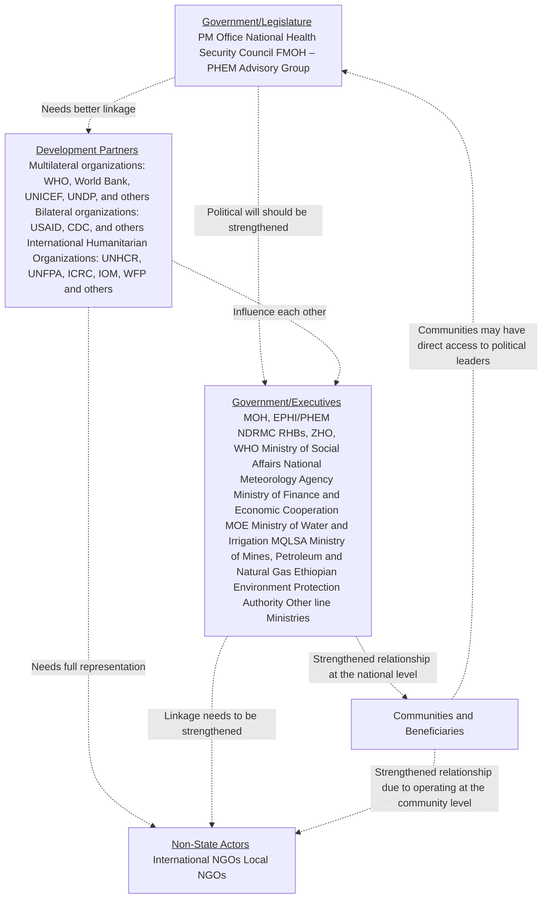

151

## **Annex-2:** Key Components of Workforce Capacity Building

The following activities should be considered as part of a comprehensive workforce capacity building strategy for health emergency preparedness and response at all levels;

a. Training needs assessment to inform capacity and skill gaps
b. Preparing updated list of trained staff at all levels including health facilities on the following key areas;
    - Surveillance and epidemiology, Rapid response team (RRT) and Case management for priority risks; Laboratory testing for priority pathogens including zoonosis in humans; and Infection prevention and control (IPC) and WASH in health facilities; etc.
c. Identifying and addressing gaps in the existing training as revision of curriculums of health emergency workforce training programs
d. Working with public health training institutions to support institutionalization of IDSR and health emergency leadership trainings
e. Planning and implementation of intermediate and/or advanced FETP and other trainings based on need, identified gaps and health sector strategic objectives. This includes Intermediate level FETP, Advanced FETP specialty tracks (laboratory, veterinary) and Public health emergency leadership (PHEL)
f. Implementing short term in-services trainings programs to address the immediate priorities in preparedness and response capacities at all levels such as
    - Incident management system (IMS)
    - Basic PHEM training for health facilities levels
    - Event-based surveillance (EBS) focused on enhancing existing community based-surveillance system
    - Emergency Medical Team (EMT) training including basic trauma and life support, and pre-hospital care for clinicians, nurses, first aid personnel
    - Infection prevention and control (IPC) trainings for PHEM officers, RRT, clinicians, and HF managers
    - Event specific trainings for PHEM officers focused on skills development for risk assessment and investigation, surveillance, case management, isolation and quarantine protocols. For example
        - SARI or Influenza like illnesses (ILI), VHF and/or Yellow Fever, Vector borne diseases (malaria, arboviruses), MPDSR, AEFI, etc.
    - Develop an integrated in-service PHEM training which includes IHR, IDSR and disaster management
g. Focusing capacity strengthening at sub-national levels

The implementation of workforce capacity building strategies should be informed by demands and need assessment at lower levels of the health system, and also take into consideration the health sector priorities and strategic objectives of strengthening primary health care to achieve universal health coverage and health security. Adequate attention and emphasis to strengthen preparedness and response capacity at sub-national levels particularly zonal woreda and health facility levels by implementing the following activities;

* Support zonal and Woredas to identify health workforce need by profession, quantity, specific skill or competencies based on local context or priority risks
* Strengthen zonal and woreda capacity to forecast and plan for human resource needs to respond to priority public health risks at local level
* Enhance support for health facilities to improve the skill and competencies required to diagnose and treat emerging and re-emerging infections, etc.
* Strengthen collaboration between regional, zonal and woreda health leaders and local administration to mobilize resource for health workforce capacity building

152

## **Annex-3:** Summary of EBS-CBS Tasks and Information

<table><tr><th><strong>Sources</strong> <strong>of</strong> <strong>Information</strong></th><th><strong>Tasks</strong></th></tr>
<tr><td>• Community members<br />• Clan leaders<br />• Traditional healers<br />• Religious organizations<br />• Model families<br />• School principals<br />• Community associations (youth association, women associations etc.)<br />• Law enforcement personnel, Police and refugee camps<br />• Health extension workers<br />• Journalists, bloggers<br />• Internet and media sources (social medias, radio, TV, newspapers…)</td><td>The tasks for EBS and CBS are in line with IDSR core functions namely:<br />• Using lay simplified case definitions to identify priority diseases, events, conditions or other hazards in the community.<br />• Participating in verbal autopsies to determine causes of death.<br />• Sending notification, timely and regularly, to the nearest health facility of the occurrence of unexpected or unusual cases of disease or death in humans and animals for immediate verification and investigation according to the International Health Regulations (IHR) and in line with the IDSR strategy.<br />• Involving local leaders in describing disease events and trends in the community.<br />• Supporting health workers during case or outbreak investigation and contact tracing.<br />• Participating in risk mapping of potential hazards and in training including simulation exercises.<br />• Participating in response activities including home-based care, including sensitization of the community on the adoption of behaviour facilitating the containment of the outbreak.<br />• Using feedback from the CBS Coordinator to take action, including health education and coordination of community participation.<br />• Verifying if public health interventions took place as planned with the involvement the community.<br />• Having a forum for feedback to the community on outbreak/event assessment.</td></tr></table>

153

## **Annex-4:** EBS Information flow and response

flow_chart: EBS Information flow and response

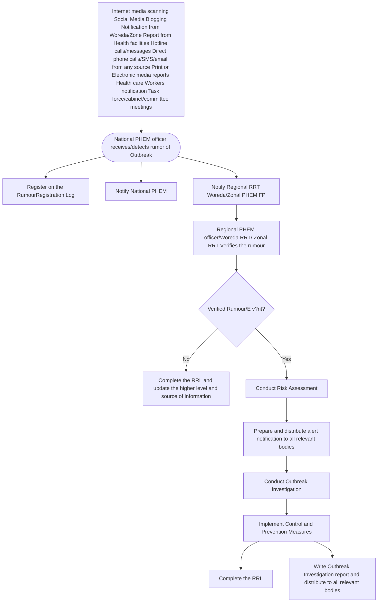

154

## **Annex-5:** Lists of Standard Case Definitions

<table><tr><th>Disease/Conditions</th><th>Suspected Case</th><th>Probable Case</th><th>Confirmed Case</th><th>Note</th></tr>
<tr><td>Anthrax</td><td>Any person with acute onset characterized by several clinical forms which are:<br /><br />1. <strong>Cutaneous form</strong>: Any person with skin lesion evolving over 1 to 6 days from a popular through a vesicular stage, to a depressed black eschar invariably accompanied by edema that may be mild to extensive.<br /><br />2. <strong>Gastro-intestinal</strong>: Any person with abdominal distress characterized by nausea, vomiting, anorexia and followed by fever<br /><br />3. <strong>Pulmonary (inhalation)</strong>: any person with brief prodromal resembling acute viral respiratory illness, followed by rapid onset of hypoxia, dyspnea and high temperature, with X-ray evidence of mediastina widening<br /><br />4. <strong>Meningeal</strong>: Any person with acute onset of high fever possibly with convulsions, loss of consciousness, meningeal signs and symptoms; commonly noted in all systemic infections, but may present without any other clinical symptoms of anthrax AND has an epidemiological link to confirmed or suspected animal cases or contaminated animal products</td><td></td><td>A confirmed case of anthrax in a human can be defined as a clinically compatible case of cutaneous, inhalational or gastrointestinal illness that is laboratory-confirmed by:<br /><br />1. isolation of B. anthracis from an affected tissue or site; or<br /><br />2. Other laboratory evidence of B. anthracis infection based on at least two supportive laboratory tests.<br /><br /><strong>Note</strong>: It may not be possible to demonstrate B. anthracis in clinical specimens if the patient has been treated with antimicrobial agents</td><td></td></tr>
<tr><td>Measles</td><td>Any person with fever and maculopapular (non-vesicular) generalized rash and cough, coryza or conjunctivitis (red eyes) or any person in whom a</td><td></td><td>A suspected case with laboratory confirmation (positive IgM antibody) or epidemiological link to confirmed cases in an outbreak.</td><td></td></tr></table>

155

<table><tr><td></td><td>clinician suspects measles.</td><td></td><td></td><td></td></tr>
<tr><td>Chikungunya</td><td>Any person with acute onset of fever >38.5°C and severe arthralgia/arthritis not explained by other medical conditions.</td><td></td><td>A suspected case with laboratory confirmation.</td><td></td></tr>
<tr><td>Adverse Events Following Immunization (AEFI)</td><td>Any untoward medical occurrence which follows immunization and which does not necessarily have a causal relationship with the usage of the vaccine. The adverse event may be any unfavorable or unintended sign, abnormal laboratory finding, symptom or disease.</td><td></td><td></td><td></td></tr>
<tr><td>Human Influenza caused by a new subtype</td><td>Any person presenting unexplained acute lower respiratory illness with fever (>38 °C) and cough, shortness of breath OR difficulty breathing AND one or more of the following exposures within the 7 days prior to symptom onset:<br /><br />(a) Close contact (within 1 meter) with a person (for example, caring for, speaking with, or touching) who is a suspected, probable, or confirmed H5N1 case;<br /><br />(b) Exposure (for example, handling, slaughtering, de-feathering, butchering, preparation for consumption) to poultry or wild birds or their remains or to environments contaminated by their faeces in an area where H5N1 infections in animals or humans have been suspected or confirmed in the last month;<br /><br />(c) Consumption of raw or undercooked poultry products in an area where H5N1 infections in</td><td>A suspected case with <strong>either</strong>:<br />• positive laboratory confirmation of influenza A virus infection but insufficient laboratory evidence for subtype<br />• A person dying of an unexplained acute respiratory illness who is considered to be epidemiologically linked to a probable or confirmed case of non-seasonal influenza in a human.</td><td>A person meeting the criteria for a suspected case AND positive laboratory results from a laboratory whose H5N1 test results are accepted by WHO as confirmatory.</td><td>• <em>For infections with other non-seasonal influenza viruses, case definitions must be adapted to the situation.</em><br />• <em>Include IHR case definition for reporting of human infection with a novel influenza virus</em><br />• <em>Where one case has been confirmed, set start date at least 28 days (2 maximum incubation periods) prior to onset of first confirmed case</em><br />• <em>Whose non-seasonal influenza virus test results are accepted by WHO as confirmatory.</em><br />• <em>An infection is considered recent if it has been confirmed by positive results from polymerase chain reaction (PCR), virus isolation, or paired acute and convalescent serologic tests. An antibody titre in a single serum is often not enough to confirm a recent infection, and should be assessed by</em></td></tr></table>

156

<table><tr><td></td><td>animals or humans<br />have been suspected or confirmed in the last month;<br /><br />(d) Close contact with a confirmed H5N1 infected animal<br />other than poultry or wild birds;<br /><br />(e) Handling samples (animal or human) suspected of<br />containing H5N1 virus in a laboratory or other setting.</td><td></td><td></td><td><em>reference to valid WHO case definitions for human infections with specific influenza A subtypes.</em></td></tr>
<tr><td>Neonatal Tetanus/Non-Neonatal Tetanus (NNT)</td><td><strong>Neonatal Tetanus:</strong> Any newborn with a normal ability to suck and cry during the first two days of life, and who, between the 3rd and 28th day of age, cannot suck normally, and becomes stiff or has convulsions or both.<br /><br /><strong>Non-Neonatal Tetanus:</strong> Any person > 28 days of age with acute onset of one of the following: lockjaw, sustained spasm of the facial muscles, or generalized muscle spasms.</td><td></td><td>No laboratory confirmation recommended.</td><td></td></tr>
<tr><td>Maternal Deaths</td><td>Death of a woman of reproductive age (between 15-49 years of age) plus at least one of the following<br />screen<br />• Died while pregnant OR<br />• Died within 42 days of termination of pregnancy OR<br />• Missed her menses before she died</td><td></td><td>The death of a woman while pregnant or within 42 days of the end of pregnancy (irrespective of duration and site of pregnancy), from any cause related to or aggravated by the pregnancy or its management but not from accidental or incidental causes</td><td></td></tr></table>

157

<table><tr><td>Rabies</td><td>A person with one or more of the following:<br />headache, neck pain, nausea, fever, fear of water (hydrophobia), pharyngeal spasms, aerophobia, anxiety, agitation, abnormal tingling sensations or pain at the wound site, when contact with a rabid animal is suspected.</td><td></td><td>A suspected case confirmed by lab.</td><td></td></tr>
<tr><td>Smallpox</td><td>An illness with acute onset of fever >38 0 C followed by a rash characterized by vesicles or firm pustules in the same stage of development without other apparent cause.</td><td></td><td>A suspected case with laboratory confirmed</td><td></td></tr>
<tr><td>SARS</td><td>An individual with:<br /><br />1. A history of fever, or documented fever ≥ 38 °C <strong>AND</strong><br /><br />2. One or more symptoms of lower respiratory tract illness (cough, difficulty breathing, shortness of breath) <strong>AND</strong><br /><br />3. Radiographic evidence of lung infiltrates consistent with pneumonia or ARDS or autopsy findings consistent with the pathology of pneumonia or ARDS without an identifiable cause <strong>AND</strong><br /><br />4. No alternative diagnosis can fully explain the illness.</td><td></td><td>An individual who tests positive for SARS-CoV infection by the WHO recommended testing procedures.</td><td></td></tr></table>

158

<table><tr><td>Yellow fever</td><td>A person with acute onset of fever followed by jaundice within two weeks of onset of first symptoms. Hemorrhagic manifestations and renal failure may occur.</td><td></td><td>A suspected case with laboratory confirmation (positive IgM antibody or viral isolation) or epidemiologic link to confirmed cases or epidemics.</td><td></td></tr>
<tr><td>Poliomyelitis (Acute flaccid paralysis)</td><td>Any child under 15 years of age with acute flaccid paralysis or any person with paralytic illness at any age in whom the clinician suspects poliomyelitis.</td><td></td><td>A suspected case with virus isolation in stool.</td><td></td></tr>
<tr><td>Perinatal deaths</td><td><strong>Probable perinatal death:</strong> “The birth of a dead fetus or death of a new-born”<br /><br /><strong>Suspected perinatal death:</strong> “Probable perinatal death” plus the following”  ) Birth after 7 months of pregnancy and  ) New-born dead at the time of birth OR  ) Death within 28 days of delivery — Seven months of pregnancy is to be determined by:<br /> ) Maternal report or Anyone who knows her duration of pregnancy or  ) GA of 28 weeks or 196 days starting from the first date of the last normal menstrual period (LNMP)</td><td>The birth of a dead fetus or death of a new-born</td><td><strong>A perinatal death</strong> is defined as the death of a baby of at least 28 weeks of gestation and/or 1,000 g in weight and early neonatal death (the first seven days after birth)<br /><br /><strong>A stillbirth</strong> is defined as any death of a baby before birth and with no signs of life at birth of at least 1 000 g birth weight and/or at least 28 weeks gestation and 35 cm long.<br /><br /><strong>Early neonatal death</strong> is defined as any death of a live newborn occurring before the first seven complete days of life. Day 1 is clinically considered the first day of life.</td><td></td></tr>
<tr><td>Cholera</td><td>In areas where a cholera outbreak has not been declared: Any patient aged two years and older presenting acute watery diarrhoea and severe dehydration or dying from acute watery diarrhoea. In areas where a cholera outbreak is declared: any person presenting or dying from acute watery diarrhoea.</td><td></td><td>A suspected case with Vibrio cholerae O1 or O139 confirmed by culture or PCR polymerase chain reaction and, in countries where cholera is not present or has been eliminated, the Vibrio cholerae O1 or O139 strain is demonstrated to be toxigenic</td><td></td></tr></table>

159

<table><tr><td>Dracunculiasis<br />(Guinea Worm)</td><td><strong>Rumors:</strong> Information about the occurrence of Guinea worm disease (Dracunculiasis) from any source.<br /><br />A person presenting a skin lesion with itching or blister living in an endemic area or risk areas for Guinea worm, with the emergence of a worm.</td><td></td><td>A case of guinea-worm disease is a person exhibiting a skin lesion with emergence of a Guinea worm, and in which the worm is confirmed in laboratory tests to be D. medinensis. That person is counted as a case only once during the calendar year, that is, when the first worm emerges from that person. All worm specimens should be obtained from each case patient for laboratory confirmation and sent to the United States Centers for Disease Control and Prevention (CDC). All cases should be monitored at least twice per month during the remainder of the calendar year for prompt detection of possible emergence of additional guinea worms</td><td></td></tr>
<tr><td>Dengue Fever</td><td><strong>Dengue Fever:</strong> Any person with acute febrile illness of 2-7 days duration with 2 or more of the following: headache, retro-orbital pain, myalgia, arthralgia, rash, haemorrhagic manifestations, leucopenia.<br />.</td><td></td><td><strong>Dengue Fever Confirmed Case:</strong> A suspected case with laboratory confirmation (positive IgM antibody, fourfold or greater increase in IgG antibody titers in paired (acute and convalescent) serum specimens, positive PCR or Isolation of the dengue virus using cell culture).<br /><br /><strong>Dengue Haemorrhagic Fever:</strong> A probable or confirmed case of dengue with bleeding tendencies as evidenced by one or more of the following: positive tourniquet test; petechiae, ecchymoses or purpura; bleeding: mucosa, gastrointestinal tract, injection sites or other; haematemesis or melaena; and thrombocytopenia (100 000 cells or less per mm3) and evidence of plasma leakage due to increased vascular permeability, manifested by</td><td></td></tr></table>

160

<table><tr><td></td><td></td><td></td><td>one or more of the following: 20% rise in average haematocrit for age and sex, 20% drop in haematocrit following volume replacement therapy compared to baseline, signs of plasma leakage (pleural effusion, ascites, hypo-proteinaemia)<br /><br /><strong>Dengue Shock Syndrome:</strong> All the above criteria, plus evidence of circulatory failure manifested by rapid and weak pulse, and narrow pulse pressure (≤ 20 mm Hg) or hypotension for age, cold, clammy skin and altered mental status.</td><td></td></tr>
<tr><td>Severe Pneumonia in Children under 5 years of age</td><td><strong>Clinical case definition (IMCI) for pneumonia</strong><br /><br />A child presenting cough or difficult breathing and:<br /><br />(a) 50 or more breaths per minute for infant age 2 months up to 1 year<br />(b) 40 or more breaths per minute for young child 1 year up to 5 years.<br /><br /><strong>Clinical case definition (IMCI) for severe pneumonia:</strong><br /><br />A child presenting cough or difficult breathing and any general danger sign, or chest in-drawing or stridor in a calm child. General danger signs for children 2 months to 5 years are: unable to drink or breast feed, vomits everything, convulsions, lethargy, or unconsciousness.</td><td></td><td>Radiographic or laboratory confirmation of pneumonia may not be feasible in most districts.</td><td>A young infant age 0 up to 2 months with cough and fast breathing is classified in IMCI as “serious bacterial infection” and is referred for further evaluation</td></tr></table>

161

<table><tr><td>Diarrhoea with Dehydration in Children less than five years of age</td><td>Passage of three or more loose or watery stools in the past 24 hours with or without dehydration and:<br /><br /><strong>Some Dehydration:</strong> two or more of the following signs: restlessness, irritability; sunken eyes; thirsty; skin pinch goes back slowly, or<br /><br /><strong>Severe Dehydration:</strong> two or more of the following signs: lethargy or unconsciousness; sunken eyes; not able to drink or drinking poorly; skin pinch goes back very slowly.</td><td></td><td>Suspected case confirmed with stool culture for a known enteric pathogen.</td><td></td></tr>
<tr><td>New HIV Case</td><td>A positive ELISA for confirming HIV and a rapid test for confirming the positive results are sufficient for an epidemiologic case definition for HIV Infection.</td><td></td><td></td><td></td></tr>
<tr><td>Tuberculosis</td><td>Any person with a cough of 3 weeks or more.</td><td></td><td><strong>Smear-Positive Pulmonary TB:</strong><br /><br />(a) a suspected patient with at least 2 sputum specimens positive for acid-fast bacilli (AFB), or<br />(b) one sputum specimen positive for AFB by microscopy and radiographic abnormalities consistent with active PTB as determined by the treating medical officer, or<br />(c) one positive sputum smear by microscopy and one sputum specimen positive on culture for AFB.<br /><br /><strong>Smear-Negative Pulmonary TB:</strong> a patient who fulfils all the following criteria:<br /><br />(a) two sets taken at least 2 weeks apart of at least two sputum specimens negative</td><td></td></tr></table>

162

<table><tr><td></td><td></td><td></td><td>for AFB on microscopy, radiographic abnormalities consistent with PTB and a lack of clinical response despite one week of a broad spectrum antibiotic, a decision by a physician to treat with a full course of anti-TB chemotherapy, or<br /><br />(b) a patient who fulfils all the following criteria: severely ill, at least two sputum specimens negative for AFB by microscopy, radiographic abnormalities consistent with extensive pulmonary TB (interstitial and miliary), a decision by a physician to treat with a full course of anti-TB chemotherapy, or<br /><br />(c) a patient whose initial sputum smears were negative, who had sputum sent for culture initially, and whose subsequent sputum culture result is positive.</td><td></td></tr>
<tr><td>Diabetes New cases</td><td>Any person presenting the following symptoms:<br />(a) Increased thirst<br />(b) Increased hunger<br />(c) Frequent urination</td><td></td><td>Any person with a fasting 6.1 mmol/L (110 mg/dl) Or venous plasma glucose measurement of ≥ 7 mmol/L (126 mg/dl) or capillary glucose ≥ 6.1 mmol/L (110 mg/dl) OR Any person with a non-fasting glucose ≥ 11.1 mmol/L (200mg/dl) Or venous plasma glucose measurement of ≥ 11.1mmol/L (200 mg/dl</td><td></td></tr>
<tr><td>Hypertension New cases</td><td><strong>Suspected new case at first visit:</strong><br /><br />Any individual presenting with a resting blood pressure measurement (based on the average of 3 readings) at or above 140 mm Hg for systolic pressure, or greater than or equal to 90 mm Hg for diastolic pressure.</td><td></td><td>Any individual presenting on at least two occasions with a resting blood pressure measurement (based on the average of 3 readings) at or above 140 mm Hg for systolic pressure, or greater than or equal to 90 mm Hg for diastolic pressure.</td><td></td></tr></table>

163

<table><tr><td>Acute Jaundice Syndrome or Acute Hepatitis (Within 14 days)</td><td>Any person above age of one month with discrete onset of an acute illness with signs and symptoms of:<br /><br />(a) Acute infectious illness such as fever, malaise, fatigue),<br /><br />AND<br /><br />(b) Liver damage such as anorexia, nausea, jaundice, dark colored urine, right upper quadrant tenderness of the abdomen,<br /><br />AND/OR<br /><br />(c) Raised liver enzyme, alanine aminotransferase (ALT), levels more than ten times the upper limit of normal</td><td></td><td>1. <strong>Hepatitis A</strong>: positive for antibodies to hepatitis A virus (anti-HAV), immunoglobulin (IgM), or an epidemiological link with confirmed case(s).<br /><br />2. <strong>Hepatitis B</strong>: positive for antibodies to hepatitis B virus core antigen (antiHBcAg)-IgM.<br /><br />3. <strong>Hepatitis E</strong>: positive for antibodies to hepatitis E virus (anti-HEV) IgM, or an epidemiological link with a confirmed case(s)<br /><br />4. <strong>Hepatitis C</strong>: positive for hepatitis C virus antibodies (anti-HCV); or HCV RNA in the absence of anti-HCV; or positive for anti-HCV and negative for anti-HAV IgM, anti-HBc IgM and anti-HEV IgM;</td><td></td></tr>
<tr><td>Malaria</td><td>Uncomplicated malaria: Any person living in area at risk of malaria with fever or history of fever within 24 hours; without signs of severe disease (vital organ dysfunction) is diagnosed clinically as malaria.<br /><br />OR<br /><br />Severe malaria: Any patient living in area at risk of malaria hospitalized with severe febrile disease with accompanying vital organ dysfunction diagnosed clinically</td><td></td><td>Uncomplicated malaria: Any person with fever or history of fever within 24 hours; and with laboratory confirmation of diagnosis by malaria blood film or other diagnostic test for malaria parasites.<br /><br />OR<br /><br />Severe malaria: Any patient hospitalized with P. falciparum asexual parasitemia as confirmed by laboratory tests with accompanying symptoms and signs of severe disease (vital organ dysfunction) diagnosed through laboratory.</td><td>WHO presently recommends that all malaria cases should be confirmed by RDT or microscopy</td></tr>
<tr><td>Viral Hemorrhagic Fever (VHF)</td><td>Acute onset of fever of less than 3 weeks duration in a severely ill patient/ or a dead person AND any 2 of the following; haemorrhagic or purpuric rash; epistaxis (nose bleed); haematemesis (blood in vomit); haemoptysis (blood in sputum); blood in</td><td>A suspected case with epidemiologic link to confirmed cases or outbreak, but laboratory specimens are not available or awaited.</td><td>A suspected case with laboratory confirmation.</td><td><em><em>During an outbreak, case definitions may be changed to correspond to the local event. It is important to note that during outbreaks, most cases might not show haemorrhagic manifestation, a proper history taking is crucial</em></em></td></tr></table>

164

<table><tr><td></td><td>stool; other haemorrhagic symptoms and no known predisposing factors for haemorrhagic manifestations OR clinical suspicion of any of the viral diseases.</td><td></td><td></td><td></td></tr>
<tr><td>Dysentery</td><td>A person with diarrhea with visible blood in stool.</td><td></td><td>Suspected case with stool culture positive for <em>Shigella dysenteriae</em> 1</td><td></td></tr>
<tr><td>Meningitis*</td><td>Any person with sudden onset of fever (>38.50 C rectal or 380 C axillary) and one of the following signs: neck stiffness, altered consciousness or other meningeal sign.</td><td></td><td>A suspected case confirmed by isolation of N. meningitis from Cerebrospinal fluid or blood</td><td></td></tr>
<tr><td>Relapsing fever</td><td>Any person presented with an abrupt onset of rigors with fever, usually remittent, headache, arthralgia and myalgia, dry cough, epistaxis.</td><td></td><td>A suspected case with demonstration of <em>Borrelia</em> in peripheral blood film</td><td></td></tr>
<tr><td>Severe Acute Malnutrition (SAM)</td><td>Children age from 6 months to 5 years with MUAC less than 11.5 cm and/or children with bilateral edema regardless of their MUAC.<br /><br />Children with MUAC less than 11.5 cm and/or children with bilateral edema regardless of their MUAC.</td><td></td><td></td><td></td></tr>
<tr><td>Moderate Acute Malnutrition (MAM)</td><td><strong>Low Birth Weight Neonates:</strong> Any new born with a birth weight less than 2500 grams (or 5.5 lbs)<br /><br /><strong>Malnutrition in children:</strong><br />(a) Children under five who are underweight (indicator: weight for age&#x3C;-2 Z Score)<br />(b) Children 6 to 59 months with MUAC (high risk of mortality)<br />(c) Bilateral pitting Oedema</td><td></td><td></td><td></td></tr></table>

165

<table><tr><td></td><td><strong>Malnutrition pregnant women:</strong><br /><br />Pregnant women giving birth to low birth weight babies (birth weight &#x3C; 2.5 Kg) (poor nutritional and health status of the women, can predict which population groups may benefit from improved antenatal care of women and neonatal care for infants).</td><td></td><td></td><td></td></tr>
<tr><td>SARS-CoV-2 (COVID-19)</td><td>A person who meets the clinical criteria:<br /><br /><strong>Clinical criteria:</strong><br /><br />1. Acute onset of fever AND cough;<br /><br />OR<br /><br />2. Acute onset of ANY THREE OR MORE of the following signs or symptoms: fever, cough, general weakness/fatigue, headache, myalgia, sore throat, coryza, dyspnoea, anorexia/nausea/vomiting, diarrhoea, altered mental status.<br /><br />OR<br /><br />3. A patient with severe acute respiratory illness (SARI: acute respiratory infection with history of fever or measured fever of ≥ 38 °C; and cough; with onset within the last 14 days; and who requires hospitalization</td><td>A. A patient who meets clinical criteria above AND is a contact of a probable or confirmed case, or linked to a COVID-19 cluster<br /><br />OR<br /><br />B. A suspect case (described above) with chest imaging showing findings suggestive of COVID-19 disease<br /><br />OR<br /><br />C. A person with recent onset of loss of smell or loss of taste in the absence of any other identified cause<br /><br />OR<br /><br />D. Death, not otherwise explained, in a person with respiratory distress preceding death AND who was a contact of a probable or confirmed case or linked to a COVID-19 cluster</td><td>A person with laboratory confirmation of COVID-19 infection, irrespective of clinical signs and symptoms.</td></tr>
<tr><td>Scabies</td><td></td><td></td><td></td><td></td></tr>
<tr><td>All-cause mortality</td><td>Case definition to be used at community level for all-cause mortality is: -</td><td></td><td>Case definition to be used at facility level for all-cause mortality is: -</td><td></td></tr></table>

166

<table><tr><td></td><td>“All deaths occurred in the community irrespective of cause, age and sex and that death should occur outside of health facility or in arrival from home to health facility.”</td><td></td><td>“The death of any person died on arrival, deaths occurring between arrival and admission and died after admission to the health facility for treatment of any illness or accident and dies within or without treatment.”<br /><br />OR<br /><br />“All death respective of cause, age and sex that occur on arrival, between arrival and admission and died after admission”</td><td></td></tr>
<tr><td>Obstetric Fistula</td><td>Community case definition plus at least one of the following:<br />• Duration of labor for more than 24 hours<br />• Delivered at home<br />• Index delivery is still borne<br />• Primi-para</td><td></td><td>Suspected case definition plus at least one of the following:<br />• The fistula felt with digital vaginal examination<br />• The fistula is visualized with speculum examination of the vagina<br />• Dye test is positive</td><td></td></tr>
<tr><td><strong>Rift Valley Fever</strong></td><td>A person presenting with fever and either myalgia, arthralgia, or headache OR a person presenting with unexplained encephalitis, hemorrhage, hepatitis, ocular pathology (retinitis), or renal failure with or without fever and has been in the last 6 days in an area where RVF is known to occur or has been reported.</td><td>A suspected case with a history of close contact with an RVF affected ruminants (Cow, goat and sheep) during the previous 6 days.</td><td>A suspected or probable case with laboratory confirmation either by ELISA showing the presence of anti-RVFV IgM or by RT-PCR.</td><td></td></tr>
<tr><td><strong>Brucellosis</strong></td><td>An acute or insidious onset of fever and one or more of the following:</td><td>Suspected case with one of the following<br />• Epidemiologically linked to a confirmed human</td><td>Suspected case with definitive laboratory evidence of Brucella infection</td><td></td></tr></table>

167

<table><tr><td></td><td>night sweats, arthralgia, headache, fatigue, anorexia, myalgia, weight loss, <u>arthritis/spondylitis, meningitis,</u> <u>or focal organ</u> <u>involvement</u> <u>(endocarditis,</u> orchitis/epididymitis, hepatomegaly, splenomegaly).</td><td>or animal brucellosis case<br />• Presumptive laboratory evidence, but without definitive laboratory evidence, of Brucella infection</td><td></td><td></td></tr>
<tr><td><strong>Monkey Pox</strong></td><td>A person of any age with an unexplained acute rash and one or more of the following signs or symptoms<br />• Headache<br />• Acute onset of fever (>38.5°C)<br />• Lymphadenopathy (swollen lymph nodes)<br />• Myalgia (muscle pain/body aches)<br />• Back pain<br />• Asthenia (profound weakness)<br /><br />AND<br />the rash not explained by other diagnosis</td><td>A person meeting the case definition for a suspected case and one or more of the following:<br />• Has an epidemiological link confirmed case of monkey pox in the 21 days before symptom onset<br />• Reported travel history to a monkey pox endemic country in the 21 days before symptom onset<br />• Has had multiple or anonymous sexual partners in the 21</td><td>A suspected or probable case with laboratory confirmed for monkey pox virus</td><td></td></tr></table>

168

<table><tr><td></td><td></td><td>days before symptom<br />onset<br />• Has a positive result<br />of an <em>orthopoxvirus</em><br />serological assay, in<br />the absence of<br />smallpox vaccination<br />or other known<br />exposure to<br /><em>orthopoxviruses</em></td><td></td><td></td></tr></table>

## **Annex-6:** Activities against thresholds for each diseases or conditions

<table><tr><th>Name of the Diseases</th><th>Respond to Alert Threshold</th><th>Respond to Action Threshold</th></tr>
<tr><td>Anthrax</td><td>• Report case-based information immediately to the appropriate levels (public health sector and animal health sector)<br />• Use standard barrier precautions for all forms. Use protective equipment and clothing (gloves, gowns, face shields), and respiratory protection if there is a risk of aerosols, disinfection and dressing any cuts and abrasion before putting on protective clothing.<br />• Perform environmental cleaning (disinfection) with hypochlorite.<br />• Treat and manage the patient with supportive care and using antibiotics such as Penicillin V, procaine penicillin (uncomplicated cases), or penicillin G (severe cases)<br />• Collect specimen safely to confirm the case.<br />• Conduct joint (public health and animal health sectors) investigation of cases/deaths<br />• Vaccination is required for animals when exported/imported</td><td>• Standard infection control precautions are sufficient and should be used when managing the patients<br />• Particular attention should be paid to body fluid spills which should be managed by the usual methods for cleaning and decontamination of anybody fluid spills. This should be done promptly and thoroughly, because organisms which remain on surfaces may form spores which are infectious<br />• As is usual practice, personal protective equipment should be used in situations where there is potential for splashes and inoculation injuries. Any incidents should be reported immediately<br />• Mobilize the community for early detection and care.<br />• Proper burial or cremation (if practiced) of dead bodies (humans and animals)<br />• Conduct community education about the confirmed case, how the disease is transmitted,</td></tr></table>

169

<table><tr><td></td><td>● In humans, selective preventive vaccination may be considered in case of occupational exposure. It’s important to take thorough history to determine if there is occupational exposure, as unnecessary administration of antibiotics might led to antimicrobial resistance (AMR)</td><td>and how to use infection control in the home care setting.<br />● Conduct active searches for additional cases that may not come to the health care setting (older women or small children, for example) and provide information about prevention in the home and when to seek care.<br />● Request additional help from national levels as needed.</td></tr>
<tr><td>Measles</td><td>● Report suspected case to the next level.<br />● Collect blood sample for confirming the outbreak.<br />● Treat cases with oral rehydration, vitamin A, and antibiotics for prevention of bacterial super-infection. Use airborne isolation precautions where feasible.<br />● Investigate the case or outbreak to identify causes for outbreak.</td><td>● Improve routine vaccine coverage through the EPI, and lead supplemental vaccination activities in areas of low vaccine coverage.<br />● Mobilize the community early to enable rapid case detection and treatment.<br />● Provide Vitamin A:<br />● Dose 1: immediately, Dose 2: next day</td></tr>
<tr><td>Human Influenza caused by new subtype</td><td><strong><em>Triggers for investigation</em></strong><br /><br />Examples of triggers include:<br />● respiratory disease in humans that is associated with recent exposure to animals;<br />● clusters<sup>1</sup> of severe acute respiratory infection<sup>2</sup> (SARI) or pneumonia in families, workplaces or social networks;<br />● SARI occurring in a health-care worker who cares for patients with respiratory diseases;<br />● SARI or pneumonia in travellers from countries or areas affected by emerging acute respiratory infections;<br />● SARI occurring in a laboratory worker or researcher handling novel influenza and other emerging respiratory pathogens;<br />● number of respiratory disease hospitalizations or deaths greater than expected;<br />● laboratory detection of human infection with a non-seasonal influenza virus or a novel respiratory pathogen;<br />● abrupt, unexplained changes in the trends of respiratory disease occurrence or clinical outcomes observed in routine surveillance activities; and<br />● unusually high levels of sales of pharmaceuticals used for respiratory illness that cannot be explained by known or expected disease trends.</td><td>● Manage the sick<br />● Prevent further transmission<br />● Infection prevention and control<br />● Communicate the risk<br />● Monitor the event and the response: An event is deemed to be contained if active surveillance in the at-risk population has not yielded new cases during twice the presumed incubation period for that disease<br /><br />Refer for more details to WHO <em>protocol to investigate non-seasonal influenza and other emerging acute respiratory diseases, 2018</em><br /><u><em>https://www.who.int/influenza/resources/publications/outbreak_investigation_protocol/en/</em></u></td></tr></table>

170

<sup>1</sup> A "*cluster*" is defined as two or more people with onset of symptoms within the same 14-day period and who are associated with a specific setting, such as a classroom, workplace, household, extended family, hospital, other residential institution, military barracks or recreational camp.

<sup>2</sup>SARI is an acute respiratory infection with history of fever or measured fever of ≥38 C° and cough, with onset within the past 10 days, that requires hospitalization

## ***Key steps for an investigation: Influenza caused by a new subtype***

* Prepare for the investigation
    - Assemble a multidisciplinary investigation team
    - Inform relevant authorities
    - Gather information and supplies
* Investigate initial cases reported
* Protect the investigators
* Develop case definitions
* Find additional cases
    - Identify and monitor contacts of cases
    - Active case finding
* Enhance surveillance
* Collect specimens
* Undertake animal health and environmental investigations
* Manage and analyse the data (time, place, person)
* Some public health questions that may require complementary studies to be implemented
* Implement response and control measures
    - Manage the sick
    - Prevent further transmission
    - Infection prevention and control
    - Communicate the risk
    - Monitor the event and the response
* Report and notify
    - Report results of the investigation
    - Notify to local, subnational and national

171

<table><tr><th></th><th>public health authorities.</th><th></th></tr>
<tr><td>Adverse Events Following Immunization (AEFI)</td><td><strong>Respond to Minor AEFI</strong><br /><br />• Treat the patient<br />• Communicate with the parents and community that AEFI can occur with any vaccine<br />• Respond to rumours or public enquiries<br />• Complete case reporting form (for notified cases)</td><td><strong>Respond to Serious AEFI</strong><br /><br />An AEFI is considered serious if it: results in death, is life-threatening, requires in-patient hospitalization or prolongation of existing hospitalization, results in persistent or significant disability/incapacity, is a congenital anomaly/birth defect, or requires intervention to prevent permanent impairment or damage.<br />• Treat the patient<br />• Communicate with the parents and community that AEFI can occur with any vaccine<br />• Respond to rumours or public enquiries<br />• Complete reporting form and send it immediately to initiate investigation<br />If a product- or immunization error-related problem is identified take remedial action to avoid another AEFI occurring from the same cause</td></tr>
<tr><td>Neonatal/Non-Neonatal Tetanus (NNT)</td><td>• Report case-based information immediately to the next level.<br />• Conduct an investigation to determine the risk for transmission<br />• Treat and manage the case according to national recommendations, usually with supportive care and, if feasible, in intensive care. No routine isolation precautions are needed.</td><td>• Immunize the mother and other pregnant women in the same locality as the case with at least 2 doses of tetanus toxoid.<br />• Conduct a supplemental immunization activity for women of childbearing age in the locality.<br />• Improve routine vaccine coverage through EPI and maternal immunization program activities.<br />• Educate birth attendants and women of childbearing age on the need for clean cord cutting and care. Increase the number of trained birth attendants.</td></tr>
<tr><td>Smallpox (Variola)</td><td>• Report case-based information immediately to the appropriate levels.<br />• Ensure patient is isolated and personnel attending have been vaccinated with smallpox vaccine.<br />• Implement airborne infection control precautions.<br />• Treat and manage the patient with supportive care. (Antiviral agent for treatment of smallpox, tecovirimat, was approved in July 2018)<br />• Collect and transfer specimen (prefer swab of rash) under strict safety conditions to confirm the case.<br />• Implement contact tracing and contact management.</td><td>• Maintain strict infection control measures practices throughout the duration of the outbreak.<br />• Mobilize the community for early detection and care.<br />• Conduct community education about the confirmed case, how the disease is transmitted, and how to implement infection control in the home care setting and during funerals.<br />• Conduct active searches for additional cases.<br />• Request additional help from national and international levels.<br />• Establish isolation ward to handle additional cases that may be admitted to the health facility.</td></tr></table>

172

<table><tr><td></td><td>• Conduct active surveillance to identify additional cases.<br />• Notify WHO</td><td></td></tr>
<tr><td>Poliomyelitis (Acute Flaccid Paralysis/AFP)</td><td>• Report the suspected case immediately according to the national polio eradication program guidelines.<br />• Conduct a case-based investigation. Include a vaccination history for the patient.<br />• Collect two stool specimens. Collect the first one when the case is investigated. Collect the second one from the same patient 24 to 48 hours later. See laboratory guidelines for information on how to prepare, store and transport the specimen.<br />• Obtain virological data from reference laboratory to confirm wild-type poliomyelitis or vaccine-associated paralytic poliomyelitis (VAPP).</td><td>• If wild polio virus is isolated from stool specimen, refer to national polio eradication program guidelines for recommended response actions. The national level will decide which actions to take. They may include the following:<br />• Specify reasons for non-vaccination of each unvaccinated case and address the identified deficiencies.<br />• Immediately conduct “mopping-up” vaccination campaign around the vicinity of the case.<br />• Conduct surveys to identify areas of low OPV coverage during routine EPI activities, and improve routine vaccine coverage of OPV and other EPI antigens.<br />• Lead house-to-house vaccination in supplemental vaccination campaigns during National Immunization Days (NIDs) or Sub-National Immunization Days (SNIDs). Focus supplemental vaccination activities in areas of low vaccine coverage during EPI.</td></tr>
<tr><td>Chikungunya</td><td>• Report case-based information immediately to the next level<br />• Collect specimens for confirming the cases<br />• Conduct an investigation to determine the risk factors for transmission<br />• Manage and treat the cases using acetaminophen or paracetamol to relieve fever and non-steroidal anti-inflammatory agents</td><td>• Symptomatic treatment for mitigating pain and fever using non-steroidal anti-inflammatory drugs along with rest usually suffices. Persistent joint pain may require analgesic and long-term anti-inflammatory therapy.<br />• Prevention is entirely dependent upon taking steps to avoid mosquito bites and elimination of mosquito breeding sites.<br /><br />To avoid mosquito bites:<br />• Wear full sleeve clothes and long dresses to cover the limbs<br />• Use mosquito repellents<br />• Use mosquito nets – to protect babies, old people and others, who may rest during the day. The effectiveness of such nets can be improved by treating them with permethrin (pyrethroid insecticide). Curtains (cloth or bamboo) can also be treated with insecticide and hung at windows or doorways, to repel or kill mosquitoes<br /><br />Mosquitoes become infected when they bite people who are infected with Chikungunya. Mosquito nets and mosquito coils and repellents will help prevent mosquitoes from biting people.</td></tr>
<tr><td>Cholera</td><td>• Report case-based information immediately.</td><td>• Establish treatment centre in locality where cases occur. Treat cases onsite rather than</td></tr></table>

173

<table><tr><td></td><td>● Manage and treat the case according to national guidelines.<br />● Enhance strict hand-washing and isolation procedures.<br />● Conduct case-based investigation to identify similar cases not previously reported.<br />● Obtain stool specimen from 5 patients within 5 days of onset of acute watery diarrhoea, and before antibiotic treatment is started. See laboratory guidelines for information on how to prepare, store and transport the specimens.</td><td>asking patients to go to standing treatment centres elsewhere.<br />● Initiate a line listing of suspected and confirmed cases and ensure laboratory results are linked with cases<br />● Strengthen case management including treatment.<br />● Mobilize community early to enable rapid case detection and treatment. Survey the availability of clean drinking water.<br />● Work with community leaders to limit the number of funerals or other large gatherings for ceremonies or other reasons, especially during an epidemic. If seen mandatory, establish bylaws<br />● Reduce sporadic and outbreak-related cases through continuous access to safe water. Promote safe preparation of food (especially seafood, fruits, and vegetables).<br />● Promote safe disposal of human waste.<br />● Ensure adequate collaboration with various sectors including water and sanitation to ensure appropriate interventions are addressed<br />● Cholera vaccine is available; but its utilization must be accompanied with strategies to improve water and sanitation.</td></tr>
<tr><td>Dracunculiasis (Guinea Worm)</td><td>As a disease targeted for eradication, every rumour or suspected case of Guinea worm disease is an emergency.<br /><br />● Follow up and investigate any rumour of dracunculiasis (within 24 hours of notification), using the national programme guidelines and WHO recommended forms, in order to determine whether or not there is a suspected case requiring further follow-up, monitoring and specimen collection for laboratory investigation.<br /><br /><strong>If a single case is suspected:</strong><br />● Report the case according to national program guidelines for eradication of Dracunculiasis.<br />● Treat the wound (if any) to decrease disability associated with painful leg lesions.<br />● Collect and preserve specimen of any emerged worm in <u>70% alcohol</u>, according to WHO /National guidelines for specimen handling, and send to WHO Country Office for onward transmission to WHO Collaborating Centre at CDC, for laboratory analysis<br />● Conduct case investigation to confirm risk factors and assess the source and burden</td><td></td></tr></table>

174

<table><tr><td></td><td>of infection.<br />• Improve access to safe water according to national guidelines.</td><td></td></tr>
<tr><td>Dengue Fever</td><td>• Report case-based information immediately to the next level.<br />• Conduct active search for additional cases<br />• Collect specimens for confirming the cases</td><td>• Report case-based information immediately to the next level and initiate a line list/register of suspected cases<br />• Conduct active search for additional cases<br />• Collect specimens for confirming the cases and ensure results are linked with cases<br />• Survey the community to determine the abundance of vector mosquitoes, identify the most productive larval habitats, promote and implement plans for their elimination, management or treatment with appropriate larvicides.<br />• Educate the public and promote behaviors to remove, destroy or manage mosquito vector larval habitats.<br />• Manage and provide supportive treatment to dengue fever cases. Implement standard infection control precautions. Prevent access of mosquitoes to patients by using mosquito bed nets.</td></tr>
<tr><td>Malaria</td><td>• Report suspected epidemic to the next level,<br />• Treat with appropriate anti-malarial drugs according to national treatment guidelines<br />• Investigate the cause for the increase in cases<br />• Make sure cases in children age 2 months up to 5 years are managed according to IMCI guidelines.<br />• Conduct community education for prompt detection of cases and access to health facilities.</td><td>• Evaluate and improve, as needed, prevention strategies, such as use of insecticide treated nets (ITNs) and indoor residential spraying (IRS) for all at risk of malaria.<br />• Ensure appropriate case management<br />• Ensure adequate supplies and drugs are available in the health facilities</td></tr>
<tr><td>Diarrhea with dehydration in children less than 5 years of age</td><td>• Report the problem to the next level.<br />• Investigate the cause for the increased number of cases or deaths and identify the problem.<br />• Make sure that cases are managed according to IMCI guidelines.<br />• Encourage home-based therapy with oral rehydration.</td><td>• Assess health worker practice of IMCI guidelines for managing cases and improve performance for classifying diarrhea with dehydration in children less than 5 years of age.<br />• Teach mothers about home treatment with oral rehydration.<br />• Conduct community education about boiling and chlorinating water, and safe water storage and preparation of foods.</td></tr>
<tr><td>Acute Jaundice Syndrome within 14</td><td>• Report case-based information to the appropriate levels (see annexes for case-based reporting form).<br />• Collect specimens and send to laboratory to identify the aetiology of the illness</td><td>• Determine mode of transmission<br />• Identify population exposed to risk of infection<br />• Eliminate common source(s) of infection</td></tr></table>

175

<table><tr><td>days of illness</td><td>● As necessary, treat and manage acute viral hepatitis patient(s) with supportive care.</td><td>● Implement appropriate prevention and control interventions<br />● Patients with chronic viral hepatitis should be referred to tertiary or specialist centres; designated treatment centres for treatment, care and follow-up.</td></tr>
<tr><td>Severe Pneumonia in children under 5 years age</td><td>● Report the problem to the next level.<br />● Investigate the cause for the increase and identify the problem.<br />● Make sure that cases are managed according to IMCI guidelines.<br />● Treat cases appropriately with recommended antimicrobial drugs</td><td>● Assess health worker practices of IMCI guidelines for assessing, classifying and treating children with pneumonia and severe pneumonia.<br />● Identify high risk populations through analysis of person, place and time.<br />● Conduct community education about when to seek care for pneumonia.</td></tr>
<tr><td>Viral Hemorrhagic Fever (VHF)-( Ebola-Marburg, CCHF, RVF, Lassa, DHF, and Yellow Fever)</td><td>● Report case-based information immediately to the appropriate levels.<br />● Suspected cases should be isolated from other patients/people and strict infection prevention procedures should be implemented. Standard precautions should be enhanced throughout the health care setting and in communities.<br />● Treat and manage the patient with supportive care.<br />● Collect the appropriate specimen while observing strict infection prevention and control procedures to confirm the case.<br />● Complete a laboratory request form, use triple packaging of the specimens (see detailed SOP for triple packaging) and mark well the containers to warn of a potential laboratory biosafety risk<br />● Conduct case-contact tracing and follow-up and active case search for additional cases (See detailed SOP for contact tracing and follow up).<br />● Begin or enhance death reporting and surveillance; as well as screening procedures for fever and VHD related symptoms</td><td>● Maintain strict viral haemorrhagic disease (VHD) infection prevention and control (IPC) practices* throughout the outbreak.<br />● Mobilize the community for early detection and care and conduct community education about how the disease is transmitted and how to implement IPC in the home care setting and during funerals and burials. Consider social distancing strategies.<br />● Conduct case-contact follow-up and active searches for additional cases that may not come to the health care setting.<br />● Request additional help from other levels as needed.<br />● Establish an isolation ward or treatment centre to handle additional cases that may come to the health centre and ensure strict IPC measures to avoid transmission in health care settings.<br />● Suspected cases should be isolated and treated for more common conditions with similar symptoms, which might include malaria, typhoid, louse borne typhus, relapsing fever or leptospirosis. Ensure a barrier is instituted between suspected and confirmed cases.<br />● Provide psychosocial support for the family, community and staff.<br />● Consider quarantine for high risk contacts with home support during the incubation period and ensure daily follow up of their movements.<br />● There are promising vaccine candidates under development for some VHDs that might be useful to be used in the event of outbreak in a ring vaccination approach and for health care workers.<br />● Treat conservatively the symptoms which might be presented; severe cases require intensive support care; if dehydrated ensure fluid replacement with fluids that contain electrolytes.<br />● A range of potential treatment options including blood products, immune therapies, and drug therapies are currently being evaluated.</td></tr></table>

176

<table><tr><td>Dysentery</td><td>• Report the increase to the next level of the health system.<br />• Treat the suspected cases with oral rehydration and antibiotics based on recent susceptibility results, if available.<br />• Obtain stool or rectal swab specimen for confirming the SD1 outbreak.<br />• Investigate the case to determine risk factors contributing to transmission.</td><td>• Search for additional cases in locality of confirmed cases. Initiate a line list/register of cases<br />• Strengthen case management and treatment.<br />• Collect appropriate samples and link results with cases<br />• Mobilize community to enable rapid case detection and treatment.<br />• Identify high risk populations using person, place, and time data.<br />• Reduce sporadic and outbreak-related cases by promoting hand-washing with soap or ash and water after defecating and before handling food.<br />• Ensure access to safe water supply and storage, and use of latrines and safe disposal of human waste.<br />• Ensure adequate collaboration with various sectors including water and sanitation to ensure appropriate interventions are addressed</td></tr>
<tr><td>Meningitis</td><td>• Inform next level of health system<br />• Record cases on a line listing form<br />• Investigate and laboratory confirm the cases<br />• Treat all suspected cases with appropriate antibiotics as recommended by National protocol.<br />• Intensify surveillance for additional cases in the area<br />• Prepare for eventual response</td><td>• Mass vaccination within 4 weeks of crossing the epidemic threshold***<br />• Mobilize community to permit early case detection, treatment, and improve vaccine coverage during mass vaccination campaigns for outbreak control.<br />• Continue data collection, transmission and analysis.<br />• Maintain regular collection of 5-10 CSF specimens per week throughout the epidemic season in all affected districts to detect possible serogroup shift. Distribute treatment to health centres<br />• Treat all cases with appropriate antibiotics as recommended by National protocol.<br /><br />***If a neighbouring area to a population targeted for vaccination is considered to be at risk (cases early in the dry season, no recent relevant vaccination campaign, high population density), it should be included in a vaccination programme.</td></tr>
<tr><td>New HIV cases</td><td></td><td>The number of New HIV diagnoses in the most recent quarter falls >2SD above the mean number of new HIV diagnoses in the previous three quarters<br /><br />And / OR<br /><br />The number of recent HIV infection in the most recent month falls >2SD above the mean number of recent HIV infection in the previous 3 months</td></tr>
<tr><td>Hypertension New Cases</td><td>• Health promotion for non-communicable diseases focusing on HBP should be established, including community-based education on behaviour change and</td><td></td></tr></table>

177

<table><tr><td></td><td>adoption of healthy lifestyles.<br />• Promote secondary prevention and treatment interventions at health facilities according to national guidelines.</td><td></td></tr>
<tr><td>Diabetes New Cases</td><td>District-level Prevention:<br />• Implement an integrated prevention and control programme for non-communicable diseases focusing on diabetes through community awareness and education activities conducted in accordance with national prevention and control programmes for non-communicable diseases. These activities would include multi-sectoral strategies and plans of action on diet, weight-reduction, and physical activity.<br />• Implement clinical preventive measures and treatment interventions using evidence-based guidelines (screening high-risk patients, for example).</td><td>• Treat confirmed cases according to the standardized case management guidelines (WHOPEN).</td></tr>
<tr><td>Tuberculosis (TB)</td><td>• Report observed trends to the next level, or according to national guidelines.<br />• Treat individual cases with direct observation (DOTS) including a treatment supporter.<br />• Where feasible, isolate persons using respiratory infection control practices, especially if multi-drug resistant TB is suspected.</td><td>• Assess health worker performance with detection and treatment of smear-positive PTB and improve practices as needed.<br />• Assess DOTS program and take action to make identified improvements.<br />• Conduct drug susceptibility tests to establish patterns of resistance.</td></tr>
<tr><td>Maternal death</td><td>• After determining that the death of a woman occurred during pregnancy or within 42 days of its termination, the initial notification of the suspected death should be done immediately (within 24 hours), by the fastest means possible<br />• Every maternal death is significant and this puts the alert threshold at ONE (1)<br />• The health facility should contact the district authority and provide information about the IDSR Case Alert form. Moreover, the health facility maternal death review committee is required to review the case within 7 days<br />• The initial notification should be followed by a written report using a maternal death review form; and this should be shared with the district/ regional MDR coordinator<br />• MDR should be anonymous and unlinked; and the reports should not be used for disciplinary of litigation</td><td></td></tr></table>

178

<table><tr><td>Perinatal death</td><td>● After determining that a perinatal death has occurred, the initial notification should be done immediately (within 24 hours), by the fastest means possible<br />● The health facility should contact the district authority and provide information about the IDSR Case Alert form. Moreover, the health facility or the district perinatal death review committee is required to review the case within seven (7) days<br />● PDR should be anonymous.<br />● It should be linked to the maternal condition where applicable<br />● The reports should not be used for disciplinary of litigation</td><td></td></tr></table>

179

## **Annex-7:** Examples of the key signs and symptoms of case definitions for the community level

<table><tr><th>Diseases or Conditions</th><th>Case Definitions Used at Community</th></tr>
<tr><td>Acute Flaccid Paralysis<br />(AFP)</td><td>Any child under 15 years old with a sudden onset of weakness and /or inability to use their<br />hand(s) and or leg(s)</td></tr>
<tr><td>Acute Watery Diarrhea</td><td>Any person with 3 or more loose stools within the last 24 hours</td></tr>
<tr><td>Acute Hemorrhagic fever<br />syndrome</td><td>Any person who has an unexplained illness with fever and bleeding or who died after an<br />unexplained severe illness with fever and bleeding</td></tr>
<tr><td>Adverse event following<br />immunization (AEFI)</td><td>Any unusual event that follows immunization</td></tr>
<tr><td>Cholera</td><td>Any person aged 2 or more years with lots of watery diarrhea</td></tr>
<tr><td>COVID-19</td><td>Any person with acute onset of fever and any one of the following, cough, runny nose, sore<br />throat, general malaise or body aches</td></tr>
<tr><td>Diarrhea in children less than<br />5 years of age</td><td>Any child who has three or more loose or watery stools in the past 24 hours with or without<br />dehydration</td></tr>
<tr><td>Diarrhea with blood<br />(Dysentery)</td><td>Any person with diarrhea, stomach pain and visible blood in the stool</td></tr>
<tr><td>Guinea Worm<br />(Dracunculiasis)</td><td>Any person presenting a skin wound living in an endemic area or risk areas of Guinea worm,<br />with a worm coming out</td></tr>
<tr><td>Hepatitis</td><td>Any person with fever and yellowing in the white part of the eyes</td></tr>
<tr><td>Animal bite (potential rabies)</td><td>Any person with a sense of apprehension, headache, fever, malaise and indefinite sensory<br />changes often referred to the site of a preceding animal bite. Excitability and hydrophobia are<br />frequent symptoms.</td></tr></table>

180

<table><tr><td>Malaria</td><td>[If in an endemic country]:Any person with fever or a history of fever in the previous 24 hours and or the presence of pallor (whiteness) of the palms in young children<br />[If in a non-endemic country]: Any person who has been exposed to mosquito bite and a history of fever or fever in the previous three days</td></tr>
<tr><td>Measles</td><td>Any person with fever and rash</td></tr>
<tr><td>Meningitis</td><td>Any person with fever and neck stiffness</td></tr>
<tr><td>Maternal death</td><td>The death of a woman of reproductive age group (between age of 15 to 49)</td></tr>
<tr><td>Neonatal death</td><td>Any death of a live newborn occurring before the first 28 complete days of life</td></tr>
<tr><td>Pneumonia</td><td>Any child less than 5 years of age with cough and fast breathing or difficulty in breathing.</td></tr>
<tr><td>Tuberculosis</td><td>Any person with cough for 3 weeks or more</td></tr>
<tr><td>Viral haemorrhagic fever</td><td>Any person who has fever and two or more other symptoms (headache, vomiting, yellow eyes, running stomach, weak in the body) or who died after serious sickness with fever or bleeding</td></tr>
<tr><td>Yellow fever</td><td>Any person who has fever and two or more other symptoms (headache, vomiting, running stomach, weak in the body, yellow eyes) or who died after serious sickness with fever or bleeding</td></tr>
<tr><td>Obstetric Fistula</td><td>“When a woman leaks urine and/or stool and/or flatus any time after delivery”</td></tr>
<tr><td>Unusual health events</td><td>Two or more persons presenting similar severe illnesses in the same setting (for example, household, workplace, school, street) within one week.<br />Two or more persons dying in the same community within one week.<br />Increase in number of animal sicknesses and/or deaths, including poultry, within one week<br /><br />Any human illness or death after exposure to animals and animal products, including poultry (for example, eating, physical handling.<br /><br />Any person who has been bitten, scratched, or whose wound has been licked by a dog, or other animal<br />Two or more persons that pass watery stools and/or vomiting after eating/drinking at a given setting (for example, wedding, funeral, festival, canteen, food sellers, etc)<br />Unexpected large numbers of children absent from school due to the same illness<br />✓ Any event in the community that causes public anxiety</td></tr></table>

181

## **Annex-8:** Reporting procedures and formats to be used for each disease conditions

<table><tr><th>Disease/Condition</th><th>Reporting Procedures and Formats to be used</th></tr>
<tr><td>Chikungunya</td><td>Report the first 10 suspected cases using Case-based Reporting Format (CRF). If more than 10 suspected cases seen during an outbreak use the PHEM line list to report Daily,<br /><br /><strong>Woredas:</strong> After 100 cases report the summary of the line list using the Daily Epidemic Reporting Format for Woreda (DERF-W). The line list should be filled for all cases and kept at health facility and woreda levels.<br /><br /><strong>Zones and Regions:</strong> use Daily Epidemic Reporting Format for Regions (DERF-R) to report the</td></tr>
<tr><td>Adverse Events Following Immunization (AEFI)</td><td>All Adverse events following immunization cases should be reported using the case based format</td></tr>
<tr><td>Human influenza caused by a new subtype</td><td>Report the first 10 suspected cases using the case-based format specific for the disease(Case Based Reporting Format – Influenza) If more than 10 suspected cases seen during the outbreak use the PHEM Line list to report daily;<br /><br /><strong>Woredas:</strong> After 100 cases report the summary of the line list using Daily Epidemic Reporting Format for Woreda (DERF-W). The line list should be filled for all cases and kept at health facility and woreda levels.<br /><br /><strong>Zones and Regions:</strong> use the Daily Epidemic Reporting Format for Regions (DERF-R) to report the summarized suspected outbreak.</td></tr>
<tr><td>Measles</td><td>Report the first 5 suspected cases using Case-based Reporting Format (CRF) If more than 5 suspected cases seen within one month use the PHEM Line list to report daily;<br /><br /><strong>Woredas:</strong> After 100 cases report the summary of the line list using Daily Epidemic Reporting Format for Woreda (DERF-W). The line list should be filled for all cases and kept at health facility and woreda levels.<br /><br /><strong>Zones and Regions:</strong> use the Daily Epidemic Reporting Format for Regions (DERF-R) to report the summarized suspected outbreak.</td></tr>
<tr><td>Neonatal Tetanus/Non-neonatal Tetanus</td><td>All suspected cases of NNT should be reported daily using the Case-based Reporting Format (CRF). Conduct a detailed investigation using Modified IDS Case-based Reporting Format–NNT</td></tr>
<tr><td>Maternal Deaths</td><td>All Maternal deaths should be reported using the Case-based Reporting Format (CRF).</td></tr>
<tr><td>Rabies</td><td>Report the first 5 suspected cases using the Case-based Reporting Format (CRF) If more than 5 suspected case seen within one month, use the PHEM Line list to report daily;<br /><br /><strong>Woredas:</strong> After 100 cases report the summary of the line list using Daily Epidemic Reporting Format for Woreda (DERF-W). The line list should be filled for all cases and kept at health facility and woreda levels.<br /><br /><strong>Zones and Regions:</strong> use the Daily Epidemic Reporting Format for Regions (DERF-R) to report the summarized suspected outbreak.</td></tr></table>

182

<table><tr><td>Smallpox</td><td>All suspected cases should be reported daily using the Case-based Reporting Format (CRF).</td></tr>
<tr><td>SARS</td><td>All suspected cases should be reported daily using the Case-based Reporting Format (CRF).</td></tr>
<tr><td>Yellow fever</td><td>All suspected cases should be reported daily using the Case-based Reporting Format (CRF).</td></tr>
<tr><td>Poliomyelitis (Acute<br />Flaccid Paralysis)</td><td>All suspected cases of AFP should be reported using the case based format specific for AFP(Case-based Reporting Format - Case Investigation Form –AFP)</td></tr>
<tr><td>Perinatal deaths</td><td>All Perinatal deaths should be reported using the Case-based Reporting Format (PDRF).</td></tr>
<tr><td>Anthrax</td><td>Report the first 10 suspected cases using Case-based Reporting Format (CRF) If more than 10 suspected case seen during the epidemics use PHEM Line list to report daily;<br /><br /><strong>Woredas:</strong> after 100 cases, report a summary of the line list using the Daily Epidemic Reporting Format for Woreda (DERF-W). The line list should be filled for all cases and kept at health facility and woreda levels.<br /><br /><strong>Zones and Regions:</strong> use the Daily Epidemic Reporting Format for Regions (DERF-R) to report the summarized suspected outbreak.</td></tr>
<tr><td>Cholera</td><td>Report the first 10 suspected cases using Case based Reporting Format (CRF)<br />If more than 10 suspected cases seen during the outbreak use the PHEM line list to report daily;</td></tr>
<tr><td>Dracunculiasis<br />(Guinea Worm)</td><td>All suspected cases of Dracunculiasis or Guinea Worm should be reported using case based format specific for the disease (Case Based Reporting Format – EDEP Guinea worm case investigation form (CIF)</td></tr>
<tr><td>Dengue Fever</td><td>Report the first 10 suspected cases using Case-based Reporting Format (CRF). If more than 10 suspected cases seen during an outbreak use the PHEM line list to report Daily,<br /><br /><strong>Woredas:</strong> After 100 cases report the summary of the line list using the Daily Epidemic Reporting Format for Woreda (DERF-W). The line list should be filled for all cases and kept at health facility and Woreda levels.<br /><br /><strong>Zones and Regions:</strong> use Daily Epidemic Reporting Format for Regions (DERF-R) to report the</td></tr>
<tr><td>Severe Pneumonia<br />in Children under 5</td><td>Report all confirmed or suspected cases of Pneumonia on a weekly basis. If the epidemic threshold is surpassed then start reporting on daily basis using the Daily Epidemic Reporting Format for Woreda (DERF-W) and Daily Epidemic Reporting Format for Regions (DERF-R).</td></tr>
<tr><td>Diarrhea with<br />dehydration in<br />children less than<br />five years of age</td><td>Diarrhea with dehydration cases should be reported of on a weekly basis. If the epidemic threshold is surpassed then start reporting on daily basis using the Daily Epidemic Reporting Format for Woreda (DERF-W) and Daily Epidemic Reporting Format for Regions (DERF-R).</td></tr></table>

183

<table><tr><td>New HIV Case</td><td>All New HIV cases should be reported of on a weekly basis. If the epidemic threshold is surpassed then start reporting on daily basis using the Daily Epidemic Reporting Format for Woreda (DERF-W) and Daily Epidemic Reporting Format for Regions (DERF-R).</td></tr>
<tr><td>Tuberculosis</td><td>All New Tuberculosis cases should be reported of on a weekly basis. If the epidemic threshold is surpassed then start reporting on daily basis using the Daily Epidemic Reporting Format for Woreda (DERF-W) and Daily Epidemic Reporting Format for Regions (DERF-R).</td></tr>
<tr><td>Diabetes New cases</td><td>All New Diabetic Cases should be reported of on a weekly basis. If the epidemic threshold is surpassed then start reporting on daily basis using the Daily Epidemic Reporting Format for Woreda (DERF-W) and Daily Epidemic Reporting Format for Regions (DERF-R).</td></tr>
<tr><td>Hypertension New cases</td><td>All newly diagnosed Hypertension cases should be reported off on a weekly basis. If the epidemic threshold is surpassed then start reporting on daily basis using the Daily Epidemic Reporting Format for Woreda (DERF-W) and Daily Epidemic Reporting Format for Regions (DERF-R).</td></tr>
<tr><td>Acute jaundice syndrome or Acute Hepatitis (within 14 days)</td><td>Acute jaundice syndrome or Acute Hepatitis (within 14 days) cases should be reported of on a weekly basis. If the epidemic threshold is surpassed then start reporting on daily basis using the Daily Epidemic Reporting Format for Woreda (DERF-W) and Daily Epidemic Reporting Format for Regions (DERF-R).</td></tr>
<tr><td>Malaria</td><td>Report all confirmed or suspected cases of malaria on a weekly basis. If the epidemic threshold is surpassed then start reporting on daily basis using the Daily Epidemic Reporting Format for Woreda (DERF-W) and Daily Epidemic Reporting Format for Regions (DERF-R).</td></tr>
<tr><td>Viral Hemorrhagic Fever (VHF)</td><td>All suspected cases should be reported daily using the Case-based Reporting Format (CRF).</td></tr>
<tr><td>Dysentery</td><td>Report these disease or conditions on a weekly basis</td></tr>
<tr><td>Meningitis*</td><td>Report the first 10 cases of suspected meningitis cases during the epidemic to determine the Nm sero group using the Case-based Reporting Format (CRF). Report all confirmed or suspected cases of meningitis on weekly basis. If epidemic threshold is surpassed then start reporting on daily basis using Daily Epidemic Reporting Format for Woreda (DERF-W) and Daily Epidemic Reporting Format for Regions (DERF-R)</td></tr>
<tr><td>Relapsing fever</td><td>Report all confirmed or suspected cases of relapsing fever on weekly basis. If an epidemic is declared then start reporting on daily basis using the Daily Epidemic Reporting Format for Woreda (DERF-W) and Daily Epidemic Reporting Format for Regions (DERF-R).</td></tr>
<tr><td>Severe Acute Malnutrition</td><td>Report all Severe Acute Malnutrition cases on weekly basis.</td></tr>
<tr><td>Malnutrition</td><td>Report all Severe Acute Malnutrition cases on weekly basis.</td></tr></table>

184

## **Annex-9a:** Weekly Report Form for Health Extension Workers (WRF_HEW)

<table><tr><td>Health Post Name</td><td></td><td>Woreda</td><td></td></tr>
<tr><td>Kebele</td><td></td><td>Zone</td><td></td></tr>
<tr><td colspan="3">Start of week from Monday // to Sunday //<br />(day)(month)(Year) in Gregorian Calendar (day) (month) (year)</td><td>WHO EPI-Week</td><td></td></tr></table>

**1. Record below the total number of cases for each disease/condition for the current week.**

<table>
  <thead>
    <tr>
      <th colspan="2">Indicator</th>
      <th>Total Cases</th>
      <th>Death?
(Should we
collect)</th>
    </tr>
    <tr>
      <th colspan="2">Total malaria suspected fever cases</th>
      <th></th>
      <th></th>
    </tr>
  </thead>
  <tbody>
    <tr>
      <td colspan="2">Total malaria suspected cases tested by RDT</td>
      <td></td>
      <td></td>
    </tr>
    <tr>
      <td colspan="2">Total malaria positive by RDT</td>
      <td></td>
      <td></td>
    </tr>
    <tr>
      <td rowspan="2">Number of fever cases positive for malaria parasites (by RDT)</td>
      <td>P. falciparum</td>
      <td></td>
      <td></td>
    </tr>
    <tr>
      <td>Other (P.vivax)</td>
      <td></td>
      <td></td>
    </tr>
    <tr>
      <td colspan="2">Total meningitis suspected cases</td>
      <td></td>
      <td></td>
    </tr>
    <tr>
      <td colspan="2">Bloody Diarrhea</td>
      <td></td>
      <td></td>
    </tr>
    <tr>
      <td colspan="2">Acute febrile illness (other than malaria and meningitis)</td>
      <td></td>
      <td></td>
    </tr>
    <tr>
      <td colspan="2">Severe Acute Malnutrition (MUAC &#x3C; 11.5cm and/or Bilateral Edema in under 5 years children (new cases
only))</td>
      <td></td>
      <td></td>
    </tr>
    <tr>
      <td colspan="2">Moderate Acute Malnutrition: Under-5 Children</td>
      <td></td>
      <td></td>
    </tr>
    <tr>
      <td colspan="2">Moderate Acute Malnutrition: PLW</td>
      <td></td>
      <td></td>
    </tr>
    <tr>
      <td colspan="2">Acute Jaundice Syndrome within 14 days of illness</td>
      <td></td>
      <td></td>
    </tr>
    <tr>
      <td colspan="2">Scabies</td>
      <td></td>
      <td></td>
    </tr>
    <tr>
      <td colspan="2">Hypertension new cases</td>
      <td></td>
      <td></td>
    </tr>
    <tr>
      <td colspan="2">Diabetes new cases (Report this only if the HP has Fasting Blood Sugar (FBS) Investigation)</td>
      <td></td>
      <td></td>
    </tr>
  </tbody>
</table>

RDT = Rapid Diagnostic Test; MUAC = mid upper arm circumference

**2. Summary for Immediately Notifiable Diseases/Conditions:**

<table>
    <tr>
      <td>DISEASE/CONDITIONS</td>
      <td>Case</td>
      <td>Death</td>
    </tr>
    <tr>
      <td>Acute Flaccid Paralysis</td>
      <td></td>
      <td></td>
    </tr>
    <tr>
      <td>Anthrax</td>
      <td></td>
      <td></td>
    </tr>
    <tr>
      <td>Acute Watery Diarrhea</td>
      <td></td>
      <td></td>
    </tr>
    <tr>
      <td>Rabies exposure</td>
      <td></td>
      <td></td>
    </tr>
    <tr>
      <td>Fever + Rash</td>
      <td></td>
      <td></td>
    </tr>
    <tr>
      <td>Neonatal Tetanus</td>
      <td></td>
      <td></td>
    </tr>
    <tr>
      <td>Influenza Like Illnesses</td>
      <td></td>
      <td></td>
    </tr>
    <tr>
      <td>Adverse events following immunization (AEFI)</td>
      <td></td>
      <td></td>
    </tr>
    <tr>
      <td>Viral Hemorrhagic Diseases</td>
      <td></td>
      <td></td>
    </tr>
    <tr>
      <td>Guinea worm</td>
      <td></td>
      <td></td>
    </tr>
</table>

185

<table><tr><td>Maternal death</td><td></td><td></td></tr>
<tr><td>Perinatal death</td><td></td><td></td></tr>
<tr><td>Monkeypox virus</td><td></td><td></td></tr>
<tr><td>Obstetric fistula</td><td></td><td></td></tr>
<tr><td>Brucellosis</td><td></td><td></td></tr></table>

C = case; D = death

### 3. Any events notification from community members

<table><tr><th>Indicator</th><th>Number</th></tr>
<tr><td>Total number of notifications from community</td><td></td></tr>
<tr><td>Total number of notifications fulfilling case<br />definition utilized by HEWs</td><td></td></tr>
<tr><td>Total number of notifications done within 30<br />minutes of detection</td><td></td></tr></table>

**Look at the trends, abnormal increase in cases, improving trends? Actions taken and Recommendations:**


**Date sent by Health Post:**
**Date received at health center/PHCU:**

**Sent by:**
**Received by:**

**Tele:**
**Tel:**

186

## **Annex-9b:** Weekly Disease Reporting Form (Outpatient and Inpatient Cases and Deaths) for HCs, Hospitals, WoHOs, ZHDs and RHBs (WRF)

<table><tr><td>Health Facility Name and Type</td><td></td><td>Woreda</td><td colspan="2"></td></tr>
<tr><td>Zone</td><td></td><td>Region</td><td colspan="2"></td></tr>
<tr><td colspan="3">Start of week from Monday <u>___</u>/<u>___</u>/<u>___</u> to Sunday<u>___</u>/<u>___</u>/<u>___</u><br />(day)(month)(Year in Gregorian Calendar)(day) (month)</td><td>WHO EPI-<br />Week</td><td><u>---------</u></td></tr></table>

1. Record below the total number of cases and deaths for each disease/condition for the current week

<table>
    <tr>
      <td colspan="2" rowspan="2">Indicator</td>
      <td>Out - Patient</td>
      <td colspan="2">In - Patient</td>
    </tr>
    <tr>
      <td>Cases</td>
      <td>Cases</td>
      <td>Deaths</td>
    </tr>
    <tr>
      <td colspan="2">Total malaria cases</td>
      <td></td>
      <td></td>
      <td></td>
    </tr>
    <tr>
      <td colspan="2">Total malaria suspected fever cases tested by RDT or Microscopy</td>
      <td></td>
      <td></td>
      <td></td>
    </tr>
    <tr>
      <td rowspan="2">Number of cases positive for malaria parasites (either by RDT or Microscopy)</td>
      <td>P. falciparum</td>
      <td></td>
      <td></td>
      <td></td>
    </tr>
    <tr>
      <td>P. vivax</td>
      <td></td>
      <td></td>
      <td></td>
    </tr>
    <tr>
      <td colspan="2">Meningitis</td>
      <td></td>
      <td></td>
      <td></td>
    </tr>
    <tr>
      <td colspan="2">Dysentery</td>
      <td></td>
      <td></td>
      <td></td>
    </tr>
    <tr>
      <td colspan="2">Scabies</td>
      <td></td>
      <td></td>
      <td></td>
    </tr>
    <tr>
      <td colspan="2">Relapsing fever</td>
      <td></td>
      <td></td>
      <td></td>
    </tr>
    <tr>
      <td colspan="2">Severe Acute Malnutrition /MUAC &#x3C; 11.5cm and/or Bilateral Edema in under 5 years children (new
cases only)</td>
      <td></td>
      <td></td>
      <td></td>
    </tr>
    <tr>
      <td colspan="2">Moderate Acute Malnutrition: U5C</td>
      <td></td>
      <td></td>
      <td></td>
    </tr>
    <tr>
      <td colspan="2">Moderate Acute Malnutrition: PLW</td>
      <td></td>
      <td></td>
      <td></td>
    </tr>
    <tr>
      <td colspan="2">Diarrhea with dehydration in children less than 5 years of age</td>
      <td></td>
      <td></td>
      <td></td>
    </tr>
    <tr>
      <td colspan="2">Acute jaundice syndrome within 14 days of illness</td>
      <td></td>
      <td></td>
      <td></td>
    </tr>
    <tr>
      <td colspan="2">Severe pneumonia in children under 5 years age</td>
      <td></td>
      <td></td>
      <td></td>
    </tr>
    <tr>
      <td colspan="2">Diabetic Mellitus new cases</td>
      <td></td>
      <td></td>
      <td></td>
    </tr>
    <tr>
      <td colspan="2">HIV new cases</td>
      <td></td>
      <td></td>
      <td></td>
    </tr>
    <tr>
      <td colspan="2">Tuberculosis new cases</td>
      <td></td>
      <td></td>
      <td></td>
    </tr>
    <tr>
      <td colspan="2">Hypertension new cases</td>
      <td></td>
      <td></td>
      <td></td>
    </tr>
</table>

RDT = Rapid Diagnostic Test; MUAC = mid upper arm circumference; PLW = Pregnant and lactating woman ; U5C = Under 5 years child

187

2. **Summary for Immediately Notifiable Disease / Conditions:** (Total cases and deaths reported on case-based forms or line lists during the reporting week)

<table>
    <tr>
      <td rowspan="2">Indicator</td>
      <td>Out - Patient</td>
      <td colspan="2">In - Patient</td>
    </tr>
    <tr>
      <td>Cases</td>
      <td>Cases</td>
      <td>Deaths</td>
    </tr>
    <tr>
      <td>AFP/Polio</td>
      <td></td>
      <td></td>
      <td></td>
    </tr>
    <tr>
      <td>Anthrax</td>
      <td></td>
      <td></td>
      <td></td>
    </tr>
    <tr>
      <td>Cholera</td>
      <td></td>
      <td></td>
      <td></td>
    </tr>
    <tr>
      <td>Dracunculiasis (Guinea worm)</td>
      <td></td>
      <td></td>
      <td></td>
    </tr>
    <tr>
      <td>Chikungunya</td>
      <td></td>
      <td></td>
      <td></td>
    </tr>
    <tr>
      <td>Adverse events following immunization (AEFI)</td>
      <td></td>
      <td></td>
      <td></td>
    </tr>
    <tr>
      <td>Measles</td>
      <td></td>
      <td></td>
      <td></td>
    </tr>
    <tr>
      <td>Neonatal Tetanus</td>
      <td></td>
      <td></td>
      <td></td>
    </tr>
    <tr>
      <td>Human influenza caused by new subtype</td>
      <td></td>
      <td></td>
      <td></td>
    </tr>
    <tr>
      <td>Suspected rabies exposure</td>
      <td></td>
      <td></td>
      <td></td>
    </tr>
    <tr>
      <td>(Human) Rabies</td>
      <td></td>
      <td></td>
      <td></td>
    </tr>
    <tr>
      <td>Dengue fever</td>
      <td></td>
      <td></td>
      <td></td>
    </tr>
    <tr>
      <td>SARS</td>
      <td></td>
      <td></td>
      <td></td>
    </tr>
    <tr>
      <td>Small pox</td>
      <td></td>
      <td></td>
      <td></td>
    </tr>
    <tr>
      <td>Viral hemorrhagic fever</td>
      <td></td>
      <td></td>
      <td></td>
    </tr>
    <tr>
      <td>Yellow fever</td>
      <td></td>
      <td></td>
      <td></td>
    </tr>
    <tr>
      <td>COVID-19</td>
      <td></td>
      <td></td>
      <td></td>
    </tr>
    <tr>
      <td>Monkeypox virus</td>
      <td></td>
      <td></td>
      <td></td>
    </tr>
    <tr>
      <td>Rift Valley Fever</td>
      <td></td>
      <td></td>
      <td></td>
    </tr>
    <tr>
      <td>Brucellosis</td>
      <td></td>
      <td></td>
      <td></td>
    </tr>
    <tr>
      <td>Maternal death</td>
      <td></td>
      <td></td>
      <td></td>
    </tr>
    <tr>
      <td>Perinatal death</td>
      <td></td>
      <td></td>
      <td></td>
    </tr>
    <tr>
      <td>Obstetric fistula</td>
      <td></td>
      <td></td>
      <td></td>
    </tr>
    <tr>
      <td>Other (specify)_____________</td>
      <td></td>
      <td></td>
      <td></td>
    </tr>
</table>

RDT = Rapid Diagnostic Test; MUAC = mid upper arm circumference; PLW = Pregnant and lactating woman ; U5C = Under 5 years child

188

3. Report timeliness and completeness (to be filled only by Woreda Health Office and Zone/Regional Health Bureaus/regional public health institutes)

<table>
    <tr>
      <td rowspan="2">Indicator</td>
      <td colspan="3">Government</td>
      <td rowspan="2">NGO
Health
Facility</td>
      <td rowspan="2">Private
Health
Facility</td>
      <td rowspan="2">Others</td>
    </tr>
    <tr>
      <td>Health
Post</td>
      <td>Health
Center</td>
      <td>Hospital (Primary/
Secondary/Tertiary)</td>
    </tr>
    <tr>
      <td>Number of sites that are supposed to report weekly</td>
      <td></td>
      <td></td>
      <td></td>
      <td></td>
      <td></td>
      <td></td>
    </tr>
    <tr>
      <td>Number of sites that reported on time</td>
      <td></td>
      <td></td>
      <td></td>
      <td></td>
      <td></td>
      <td></td>
    </tr>
</table>

4. Any events notification from community members

<table><tr><th>Indicator</th><th>Number</th></tr>
<tr><td>Total number of notifications from community</td><td></td></tr>
<tr><td>Total number of notifications fulfilling case definition utilized by HEWs</td><td></td></tr>
<tr><td>Total number of notifications done within 30 minutes of detection</td><td></td></tr></table>

Look at the trends, abnormal increase in cases, deaths, or case fatality ratios? Improving trends? Actions taken and Recommendations:

<hr/>

<hr/>

<hr/>

**Date sent by HF/Woreda/Zone/Region:**
**Date received at Woreda/Zone/Region:**

**Sent by:**
**Received by:**

189

190

## **Annex-10:** Case-based Reporting Format (CRF)

<table><tr><td colspan="4">Reporting Health Facility:</td><td colspan="6">Reporting Woreda: Zone  REGION:</td></tr>
<tr><td><strong>Disease type</strong><br />(put tick mark)</td><td>Anthrax</td><td>Cholera</td><td>Measles</td><td>Meningitis</td><td>Neonatal Tetanus</td><td>Yellow Fever</td><td>Dengue Fever</td><td>Chikungunya</td><td>Others/Specify</td></tr>
<tr><td colspan="10"><strong>Name of Patient:</strong> </td></tr>
<tr><td><strong>Date of Birth (DOB):</strong> / / (Day/Month/Year)</td><td colspan="4"><strong>Age (If DOB unknown):</strong> </td><td colspan="5">Month (if &#x3C;12)</td></tr>
<tr><td><strong>Sex:</strong> </td><td colspan="9">Write M for Male F for Female</td></tr>
<tr><td colspan="2"><strong>Patient’s Address:</strong> </td><td colspan="3"><strong>Kebele:</strong> </td><td colspan="5"><strong>House number:</strong> </td></tr>
<tr><td colspan="4"><strong>Woreda:</strong> </td><td><strong>Zone:</strong> </td><td colspan="5"><strong>Region:</strong> </td></tr>
<tr><td rowspan="2"><strong>Locating Information</strong></td><td>Location when symptom started</td><td colspan="3"></td><td colspan="2">Current location</td><td colspan="3"></td></tr>
<tr><td colspan="9">If applicable or If the patient is neonate or child, please write full name of mother and father of the patient</td></tr>
<tr><td><strong>Date seen at Health Facility:</strong> / /</td><td colspan="5"><strong>Date Health Facility notified</strong><br /><strong>Woreda/zone:</strong> / /</td><td colspan="4"><strong>Date of Onset:</strong> / /</td></tr>
<tr><td rowspan="2"><strong>Number of vaccine/TT doses received:</strong> </td><td colspan="9"><strong>For cases of NNT* , Measles, Yellow Fever, and Meningitis (For NNT, Measles, Yellow Fever – refer immunization card &#x26; for Meningitis - ask history)</strong><br /><strong><em>*For NNT cases please complete the additional case investigation form</em></strong></td></tr>
<tr><td colspan="9"><strong>(NNT, Measles, cholera Yellow Fever and Meningitis only)</strong></td></tr>
<tr><td><strong>Date of last vaccination:</strong> </td><td colspan="9">1=YES 2= NO</td></tr>
<tr><td><strong>Associated with epidemics?</strong></td><td colspan="9">1=Inpatient 2=outpatient</td></tr>
<tr><td><strong>In/Out Patient</strong></td><td colspan="5">1=Inpatient</td><td colspan="4">2=outpatient</td></tr>
<tr><td><strong>Treatment given</strong></td><td colspan="5">1=YES (specify)</td><td colspan="4">2= NO</td></tr>
<tr><td><strong>Outcome of the patient at the time of report</strong></td><td colspan="5">1=Alive</td><td colspan="2">2=Dead</td><td colspan="2">3=Unknown</td></tr></table>

191

**Fill only if specimen is collected and sent to Lab**

<table><tr><td><strong>Date of specimen collection:</strong> / /</td><td><strong>Date of specimen sent to lab:</strong> / /</td></tr>
<tr><td><strong>Type of specimen:</strong> (put tick mark ☑ )</td><td>Stool</td><td>Blood</td><td>Serum</td><td>CSF</td><td>Throat swab</td><td>Other/specify</td></tr></table>

**Date form sent to Woreda:** / / (Day/Month/Year - EC)

**Name and signature of the person completing the form:**
**Tel:**

**For official Use only**

<table><tr><td><strong>ID Number</strong></td><td colspan="5">Date form received at National/Regional level: <strong> /  / </strong> (Day/Month/Year - EC)</td></tr>
<tr><td><strong>Final Classification of case</strong></td><td>1=Confirmed</td><td>2=Probable</td><td>3=Discarded</td><td colspan="2">4=Suspect</td></tr>
<tr><td><strong>Final Classification for Measles</strong></td><td>1= Laboratory Confirmed</td><td>2= Confirmed by<br />Epidemiological linkage</td><td>3=Clinical Compatible</td><td>4=Discard</td><td>5=Suspect</td></tr></table>

**\*Not essential**

**Name and signature of the official:**
**Date (EC):**

192

## **Annex-11:** Case-based Laboratory Reporting Format (CLRF)

<table>
    <tr>
      <td colspan="8">Complete the following information and send a copy of this form to the corresponding Surveillance team</td>
    </tr>
    <tr>
      <td colspan="8">ID Number:</td>
    </tr>
    <tr>
      <td colspan="8">Date of specimen received://Receiving laboratory:</td>
    </tr>
    <tr>
      <td colspan="2">Type of specimen:</td>
      <td>Stool</td>
      <td>Blood</td>
      <td>Serum</td>
      <td>CSF</td>
      <td>Throat swab</td>
      <td>Other/specify</td>
    </tr>
    <tr>
      <td colspan="3">Specimen Condition:</td>
      <td colspan="2">Adequate</td>
      <td colspan="3">Not adequate</td>
    </tr>
    <tr>
      <td colspan="3">Disease / Condition:</td>
      <td colspan="5"></td>
    </tr>
    <tr>
      <td colspan="3">Result:</td>
      <td colspan="2">+ = Positive</td>
      <td colspan="2">- = Negative</td>
      <td>P = pending</td>
    </tr>
    <tr>
      <td colspan="3">Cholera direct exam, Culture; RDT, specify the method used:</td>
      <td colspan="2"></td>
      <td colspan="2"></td>
      <td></td>
    </tr>
    <tr>
      <td colspan="2" rowspan="3">Meningitis: N meningitides</td>
      <td>Culture</td>
      <td colspan="2"></td>
      <td colspan="2"></td>
      <td></td>
    </tr>
    <tr>
      <td>Latex</td>
      <td colspan="2"></td>
      <td colspan="2"></td>
      <td></td>
    </tr>
    <tr>
      <td>Gram stain</td>
      <td colspan="2"></td>
      <td colspan="2"></td>
      <td></td>
    </tr>
    <tr>
      <td colspan="2" rowspan="3">Meningitis: S. pneumoniae</td>
      <td>Culture</td>
      <td colspan="2"></td>
      <td colspan="2"></td>
      <td></td>
    </tr>
    <tr>
      <td>Latex</td>
      <td colspan="2"></td>
      <td colspan="2"></td>
      <td></td>
    </tr>
    <tr>
      <td>Gram stain</td>
      <td colspan="2"></td>
      <td colspan="2"></td>
      <td></td>
    </tr>
    <tr>
      <td colspan="2" rowspan="3">Meningitis: H. influenzae</td>
      <td>Culture</td>
      <td colspan="2"></td>
      <td colspan="2"></td>
      <td></td>
    </tr>
    <tr>
      <td>Latex</td>
      <td colspan="2"></td>
      <td colspan="2"></td>
      <td></td>
    </tr>
    <tr>
      <td>Gram stain</td>
      <td colspan="2"></td>
      <td colspan="2"></td>
      <td></td>
    </tr>
    <tr>
      <td colspan="2" rowspan="3">Typhoid Fever</td>
      <td>Widal (“O” > 1:160)</td>
      <td colspan="2"></td>
      <td colspan="2"></td>
      <td></td>
    </tr>
    <tr>
      <td>Blood culture</td>
      <td colspan="2"></td>
      <td colspan="2"></td>
      <td></td>
    </tr>
    <tr>
      <td>Stool culture</td>
      <td colspan="2"></td>
      <td colspan="2"></td>
      <td></td>
    </tr>
    <tr>
      <td colspan="2">Anthrax</td>
      <td>Gram stain or culture</td>
      <td colspan="2"></td>
      <td colspan="2"></td>
      <td></td>
    </tr>
    <tr>
      <td colspan="3">Epidemic Typhus: Serum test(OX19)</td>
      <td colspan="2"></td>
      <td colspan="2"></td>
      <td></td>
    </tr>
    <tr>
      <td colspan="3">Result:</td>
      <td>+ = Positive</td>
      <td>- = Negative</td>
      <td colspan="2">I=Indeterminate</td>
      <td>P=Pending</td>
    </tr>
    <tr>
      <td rowspan="5">Viral Detection</td>
      <td colspan="2">Yellow fever (IgM)</td>
      <td></td>
      <td></td>
      <td colspan="2"></td>
      <td></td>
    </tr>
    <tr>
      <td colspan="2">Measles (IgM)</td>
      <td></td>
      <td></td>
      <td colspan="2"></td>
      <td></td>
    </tr>
    <tr>
      <td colspan="2">Rubella (IgM)</td>
      <td></td>
      <td></td>
      <td colspan="2"></td>
      <td></td>
    </tr>
    <tr>
      <td colspan="2">VHF (Ebola, lassa fever, Marburg,
CCHF, RFV etc ) (IgM)</td>
      <td></td>
      <td></td>
      <td colspan="2"></td>
      <td></td>
    </tr>
    <tr>
      <td colspan="2">Small pox (virus isolation)</td>
      <td></td>
      <td></td>
      <td colspan="2"></td>
      <td></td>
    </tr>
</table>

193

<table>
    <tr>
      <td rowspan="3"></td>
      <td>Dengue fever(RT-PCR)</td>
      <td></td>
      <td></td>
      <td></td>
      <td></td>
    </tr>
    <tr>
      <td>Chikungunya(RT-PCR)</td>
      <td></td>
      <td></td>
      <td></td>
      <td></td>
    </tr>
    <tr>
      <td>Others</td>
      <td></td>
      <td></td>
      <td></td>
      <td></td>
    </tr>
    <tr>
      <td>Other lab test (specify)</td>
      <td colspan="5">Results:</td>
    </tr>
    <tr>
      <td colspan="3">Date lab results sent to corresponding surveillance team:</td>
      <td colspan="3">//</td>
    </tr>
    <tr>
      <td colspan="3">Name of lab sending results:</td>
      <td colspan="3"></td>
    </tr>
    <tr>
      <td colspan="3">Name of lab technician sending the results:</td>
      <td colspan="3">Signature:</td>
    </tr>
</table>

**Feedback:** To be filled by result receiving entity

<table><tr><td>Date woreda/zone receive lab results://</td><td>Woreda/zone:</td></tr>
<tr><td colspan="2">Date lab results sent to health facility by woreda/zone://</td></tr>
<tr><td colspan="2">Date lab results received at the health facility://</td></tr></table>

194

## **Annex-12:** Rumor log book to register community notifications for health post level only

Record verbal/phone call, in person, written/SMS, social media and other source notifications of any public health risk rumors

**Region**  **Zone**  **Woreda**  **Health center**  **Health post**

<table><tr><th>Serial number</th><th>Date of Registration</th><th>Date condition began/onset</th><th>Date condition was seen by notifying person</th><th>Time of condition seen by the notifying person</th><th>Date of notification</th><th>Time of notification</th><th>Type of notified condition</th><th>Specific location/village of condition seen</th><th>Number of suspected cases notified</th><th>Date a condition was first seen at health facility</th><th>Tentative diagnosis given at health facility</th><th>Date the HEW verified the condition</th><th>Time of the HEW verified the condition</th><th>Date health facility was requested to investigate the condition by the HP</th><th>Date health facility investigated the condition</th><th>Result of investigation (verified, ruled out)</th><th>Date of intervention began by Health post</th><th>Date of intervention began by health center</th><th>Type of intervention begun by HP and HC</th><th>Comments/remark</th><th>Name and signature</th></tr></table>

195

## **Annex-13:** PHEM Structures with responsibilities across all levels

<table><tr><th>Level</th><th>Responsibility</th></tr>
<tr><td>National<br />PHEM</td><td>• Depending on the activation criteria the national EOC will be activated.<br />• Prepare a request for assignment of resources from the Emergency Fund at the EPHI and initiate steps for rapid replenishment by the MoH.<br />• Mobilize and deploy Rapid Response Teams.<br />• Call periodic (daily or weekly according to the type of emergency) coordination meetings with partners.<br />• Mobilize required resources for the response operation and ensure appropriate allocation and utilization of resources.<br />• Provide technical assistance to the affected population upon request of the Regional health bureau. Implement response operations at field level if the PHE:<br />• Involves more than one region<br />• is assessed to be highly infectious/communicable in nature with severe morbidity and mortality outcomes<br />• Prevention and control strategies are not being implemented properly.<br />• If the regional health bureau requests support<br />• Coordinate response operations with partners and other government sectors when and where applicable.<br />• Monitor the progression of the epidemic and the status of control activities and communicate findings to relevant stakeholders and partners.<br />• Maintain and disseminate, in cooperation with partners, a list or database of Who is doing What Where (3W) for the specific emergency.<br />• Request technical assistance internationally if the response requires their involvement.<br />• Determine when the health emergency phase is over and declare formally the emergency phase terminated and inform accordingly all partners.</td></tr>
<tr><td>Regional</td><td>• Organize and convene coordination meetings with all partners (Government, NGOs, UN agencies, Red Cross, etc.) either weekly or daily according to the nature of the emergency.<br />• Activate Regional EOC in full form.<br />• Deploy the Regional RRT and conduct outbreak investigation/Rapid Assessment and launch Quick Response.<br />• Request Federal government assistance for the emergency response when additional resources may be useful or the risk is extending beyond the region.<br />• Collaborate with Federal level response operation team when/if the ongoing PHE requires or calls for the direct involvement of the Federal PHEM.<br />• Monitor and disseminate daily or weekly report with an updated number of affected, dead, missing, sick or displaced as well as the number of health installations damaged or destroyed when applicable. Share this information with central EOC and all partners locally.<br />• Organize frequent visits by technical experts, managers and decision makers to the affected areas. Coordinate the response activities of partners.<br />• Maintain a MoH presence in the field and especially in larger temporary settlements with displaced population or refugees.<br />• Keep national EOC informed of the situation and implement directives received from the DRMFSS or other cross-sectorial coordination authority.<br />• Ensure that the needs of vulnerable groups are well covered.<br />• Maintain and disseminate, in cooperation with partners, a list or database of Who is doing What Where (3W) at regional level for the specific emergency .Share this information widely.<br />• In consultation with the key partners, determine when the health emergency phase should be terminated and advice the Center accordingly</td></tr>
<tr><td>Zonal</td><td>• Organize coordination meetings with all partners (Government, NGOs, UN, Red Cross, etc.) either weekly or daily according to the nature of the emergency.<br />• Conduct Outbreak investigation/Rapid Assessment and launch Quick Response.<br />• Request or accept regional government assistance for the emergency response when additional resource is required.<br />• Monitor and disseminate daily or weekly report with an updated number of affected, dead, missing, sick or displaced as well as the number of health installations damaged or destroyed when applicable.<br />• Organize frequent visits by experts, managers and decision makers to the affected areas.</td></tr></table>

196

<table><tr><td></td><td>Coordinate the response activities of partners.<br />• Ensure that the needs of vulnerable groups are well covered.<br />• Monitor prevention and control activities and take corrective actions as per the findings.</td></tr>
<tr><td>Woreda</td><td>• Organize coordination meetings with all partners (Government, NGOs, UN, Red Cross, etc.) either weekly or daily according to the nature of the emergency.<br />• Deploy the woreda RRT and conduct outbreak investigation/Rapid Assessment and launch Quick Response.<br />• Monitor and communicate daily or weekly report to higher level as per agreed frequency and format with an updated number of affected, dead, missing, sick or displaced as well as the number of health installations damaged or destroyed when applicable.<br />• Organize frequent visits by experts, managers and decision makers to the affected areas. Monitor control and prevention activities and take corrective actions as per the findings. Coordinate the response activities with partners.<br />• Ensure that the needs of vulnerable groups are well covered.<br />• In consultation with the key partners, determine when the health emergency phase should be terminated and Inform the regional health bureau accordingly.</td></tr>
<tr><td>Health facilities</td><td>• Notify the public health emergency to WoHo.<br />• Deploy multidisciplinary team/ RRT/ and conduct outbreak investigation/Rapid Assessment and launch Quick Response<br />• Monitor and communicate daily or weekly report to woreda health office as per agreed frequency and format with an updated number of cases and deaths or events.</td></tr>
<tr><td>Health posts</td><td>• Notify the public health emergency to catchment facility<br />• Conduct rapid assessment, verify the situation and respond to PHE independently or as part of deployed team<br />• Monitor and communicate daily or weekly report as per agreed frequency and format</td></tr></table>

197

## **Annex-14:** List of details activities to be conducted during outbreaks /Events

<table><tr><th><strong>Selected Activities</strong></th><th><strong>Detailed Activities to be Conducted</strong></th></tr>
<tr><td>Strengthen case management and infection prevention and control (IPC) measures</td><td>(a)Train and equip health workers at the district level to implement these measures.<br />(b) Ensure that clinicians receive laboratory confirmation results where necessary.<br />(c) Ensure that health workers record all patients in a recognizable standardized register and a line list.<br />(d) Ask the officer-in-charge at each health facility to identify an area that can be used to accommodate a large number of patients during epidemics involving a large number of cases.<br />(e) Provide standard operating procedures (SOPs) that include IPC guidelines.<br />(f) Implement IPC and risk mitigation measures such as:<br />(i) establish triage and isolation wards for highly infectious diseases (Ebola, cholera, SARS, etc.). See Annex 6H for cholera treatment centre;<br />(ii) ensure that health staff have access to safety and personal protective equipment for any infectious diseases (especially for Ebola and SARS);<br />(iii) ensure that there are safe practices and protection of non-health workers (supporting staff, e.g. security, cleaners, administrative staff);<br />(iv) assess and assure WASH standards for health facilities;<br />(v) provide oversight about disposal of PPE and other contaminated supplies; and<br />(vi) Ensure appropriate biosafety and biosecurity for animals (farms, markets, etc.).<br />(g) Ensure that the necessary medicines and treatment supplies are available.<br />(h) Ensure that the proper treatment protocols are available.<br />(i) Review the standard operating procedures for the referral system;<br />(ii) Ensure that a proper discharge protocol of cases linked to social workers is available.</td></tr>
<tr><td>Build the capacity of response staff</td><td>(a) Give clear and concise directions to health workers and other staff participating in the response.<br />(b) Select topics for orientation or training. Emphasize case management and infection prevention and control for the specific disease according to disease-specific recommendations. Select other training topics depending on the risk of exposure to the specific public health hazard, for example:<br />(i) case management protocols for cases;<br />(ii) enhancing standard precautions (use of clean water, hand-washing and safe disposal of sharps);<br />(iii) barrier nursing and use of protective clothing;<br />(iv) isolation precautions;<br />(v) treatment protocols such as delivering oral rehydration salts (ORS) and using intravenous fluids;<br />(vi) disinfecting surfaces, clothing and equipment;<br />(vii) safe disposal of bodies and dignified burials;<br />(viii) safe disposal of animal carcasses;<br />(ix) others which may seem necessary and may include client-patient interactions and counseling skills, orientation on how health worker would interact with CBS focal persons etc.<br />(c) Conduct orientation and training<br />(i) Orient or reorient the district PHEMC, public health rapid response team and other health and non-health personnel on epidemic management based on the current epidemic.<br />(ii) In an urgent situation, there often is not time for formal training. Provide on-the job training as needed. Make sure there is an opportunity for the training physician or nursing staff to observe the trainees using the updated or new skill.<br />(iii) Monitor participant performance and review skills as needed.</td></tr></table>

198

<table><tr><td>Enhance surveillance during the response</td><td>(a) search for additional persons who have the specific disease and refer them to the health facility or treatment centres, or if necessary, quarantine the household and manage the patient, ensuring that they have access to consistent/adequate food, water, and non-food items (i.e. soap, chlorine, firewood, medicines, sanitary pads, etc.);<br />(b) ensure timely provision of laboratory information to the team;<br />(c) update the line list, make data analysis by time (epi curve), person (age and sex) and place (mapping of cases);<br />(d) ensure timely provision of laboratory information to the team;<br />(e) update the line list, make data analysis by time (epi curve), person (age and sex) and place (mapping of cases);<br />(f) monitor the effectiveness of the outbreak response activity;<br />(g) report daily at the beginning of the epidemic; once the epidemic progresses, the District PHEMC can decide on a different frequency of reporting;<br />(h) actively trace and follow up contacts as indicated (See Section 4 for how to do contact tracing);<br />(i) monitor the effectiveness of the outbreak response activity;<br />(j) report daily at the beginning of the epidemic; once the epidemic progresses, the district public health emergency preparedness and response (PHEPR) committee can decide on a different frequency of reporting;<br />(k) actively trace and follow up contacts as indicated (how to do contact tracing).</td></tr>
<tr><td>Enhance surveillance with neighboring border districts and establish committee</td><td>(a) Focal person responsible for IDSR;<br />(b) Focal person responsible for laboratory services;<br />(c) Medical officer of health;<br />(d) Focal person responsible for environmental health;<br />(e) Focal person responsible for clinical services; and<br />(f) Focal person responsible for animal (domestic and/or wildlife) health, local immigration officials and the local district commissioner.</td></tr>
<tr><td>Engage community during response</td><td>(a) Engage and inform community leaders with information on the situation and actions that can be taken to mitigate the situation.<br />(b) Provide first aid and call or send for medical help.<br />(c) Keep people away from a ‘risk’ area (potentially contaminated water source).<br />(d) Respectfully isolate anyone with a potentially infectious disease paying particular attention to cultural sensitivities.<br />(e) Quarantine for animals, market closures, etc.<br />(f) Provide community education including specific actions the community can take to protect themselves.<br />(g) Engage in IPC and hygiene promotion in coordination with any efforts at strengthening the availability of materials/infrastructure for IPC and hygiene.<br />(h) Identify local effective channels for delivery of the information to the community<br />(i) Organize door-to-door campaigns using trusted individuals to reach every household within the catchment area in order to curb the spread of the public health event and to encourage self-reporting, treatment and health-seeking behavior among people who have had contact with the public health event or are suspected to be public health event cases<br />(j) Engage community members as stakeholders and problem solvers, not merely beneficiaries</td></tr>
<tr><td>Inform and educate the community</td><td>(a) Decide what to communicate by referring to disease-specific recommendations<br />(i) signs and symptoms of the disease;<br />(ii) how to treat the disease at home, if home treatment is recommended and how to prepare disinfectant solutions;<br />(iii) prevention behaviors that are feasible and that have a high likelihood of preventing disease transmission;<br />(iv) when to come to the health facility for evaluation and treatment;<br />(v) Immunization recommendations, if any. At the same time, maintain active processes for collecting qualitative information needed to establish and address any circulating rumors.<br />(b) Decide how to state the message. Make sure that the messages:</td></tr></table>

199

(i) use local terminology;
(ii) are culturally sensitive and acceptable;
(iii) are clear and concise;
(iv) consider local traditions;
(v) address beliefs about the disease.

NB: Consider pre-testing the messages from similar settings before dissemination. Sample community education messages are found in Annex 6F at the end of this section.

(c) Select the appropriate communication methods available in your district. For example:
(i) mass media, (radio, television, newspapers);
(ii) meetings (health personnel, community, religious, opinion and political leaders);
(iii) educational and communication materials (posters, flyers);
(iv) multimedia presentations (e.g., films, video or narrated slide presentations) at the markets, health centres, schools, women’s and other community groups, service organizations, religious centres;
(v) social media (Facebook, Twitter, WhatsApp, etc.);
(vi) community drama groups/play groups;
(vii) public address system;
(viii) corporate/ institutional website;
(ix) e-mail/ SMS subscriptions.

(d) Give health education messages to community groups and service organizations and ask that they disseminate them during their meetings.

(e) Give health education messages to trusted and respected community leaders and ask them to transmit to the community.
(i) Designated person from the MoH should serve as spokesperson to the media. Tell the media the name of the spokesperson, and that all information about the outbreak will be provided by the spokesperson.
(ii) Release information to the media only through the spokesperson to make sure that the community receives clear and consistent information.

(f) On a regular basis, district and regional medical officers will meet with local leaders to give:
(i) frequent, up-to-date information on the outbreak and response;
(ii) clear and simple health messages for the media;
(iii) clear instructions to communicate to the media the information and health education messages from the PHEMC.

<hr/>

**Improve access to clean and safe water**

(a) piped chlorinated water;
(b) safe drinking water obtained through chlorination at point-of-use;
(c) water obtained from protected sources (such as wells closed with a cover, rainwater collected in a clean container);
(d) boiled water from any source.

If no local safe water sources are available during an emergency, water may need to be brought from outside. To ensure that families have safe and clean drinking water at home (even if the source is safe) do the following:
(a) Provide community education on how to keep home drinking water safe.
(b) Provide containers that prevent water contamination. For example, containers with narrow openings are ideal because users would not be able to contaminate the water by putting their hands into the container.
(c) Ensure that waste disposal sites, including for faeces, are located at least 30 metres away from water sources.

200

<table><tr><td>Ensure safe disposal of infectious waste</td><td>(a) Assign teams to inspect local areas for human and animal waste disposal. Safe practices include disposing of faeces in a latrine or burying them in the ground more than 10 meters from water supply.<br />(b) If unsafe practices are found such as open defecation, educate the community on safe disposal of such waste. Construct latrines appropriate for local conditions with the cooperation of the community.<br />(c) Conduct effective community education on sanitation practices.</td></tr>
<tr><td>Improve food-handling practices</td><td>(a) conduct community education on food hygiene practices for the general public and those in the food industry;<br />(b) visit restaurants, food vendors, food packaging factories and other venues to inspect food handling practices, focusing on safe practices such as proper hand-washing, cleanliness and adherence to national standards;<br />(c) close restaurants, vending areas or factories if inspection results show unsafe food handling practices;<br />(d) Strengthen national controls for food safety as necessary.</td></tr>
<tr><td>Reduce exposure to infectious or environmental hazards</td><td>(a) promote indoor residual spraying;<br />(b) conduct community education on the proper use of bed nets and the avoidance of dusk-todawn mosquito bites;<br />(c) promote the use of locally available ITNs and other insecticide-treated materials (bed nets, blankets, clothes, sheets, curtains, etc.);<br />(d) encourage environmental cleanliness (e.g., draining stagnant water, clearing bushes etc.).<br /><br />Encourage the prevention of diseases transmitted by rodents by helping people in your district reduce their exposure to these animals. For example, rodents can transmit the virus that causes Lassa fever or they may be infested with fleas that carry plague. Work with the vector control officer in your district to encourage the community to:<br />(a) avoid contact with rodents and their urine, droppings and other secretions;<br />(b) keep food and water in the home covered to prevent contamination by rodents;<br />(c) keep the home and cooking area clean and tidy to reduce the possibility of rodents nesting in the room;<br />(d) use chemicals (insecticides, rodenticides, larvicides etc.) and traps as appropriate based on environmental and entomological assessment;<br />(e) Educate the community on personal protection to reduce exposure.</td></tr></table>

201

## **Annex-15:** Recovery plan preparation steps

<table>
  <thead>
    <tr>
      <th></th>
      <th>Step</th>
      <th>Details</th>
    </tr>
  </thead>
  <tbody>
    <tr>
      <td>1</td>
      <td>Conduct a readiness
assessment</td>
      <td>A readiness assessment is used to determine whether the prerequisite resources, structures, and
capacity are in place to develop a monitoring and evaluation system.</td>
    </tr>
    <tr>
      <td>2</td>
      <td>Agree on outcomes to
monitor and evaluate</td>
      <td>Outcomes are the end results the implementing body is working towards and begin to frame what
successful recovery looks like. Outcomes should be developed in consultation with the community
representatives and ensure that there is a holistic approach taken.</td>
    </tr>
    <tr>
      <td>3</td>
      <td>Select key indicators to
monitor outcomes</td>
      <td>Indicators are the quantitative or qualitative variables that provide a simple and reliable means to
measure progress and help assess the performance of recovery programs or strategies against
the stated outcome.</td>
    </tr>
    <tr>
      <td>4</td>
      <td>Identify baseline data
on indicators</td>
      <td>The baseline data is the first measurement of an indicator. It sets the current condition against
which future change can be tracked.</td>
    </tr>
    <tr>
      <td>5</td>
      <td>Plan for improvements:
select results targets</td>
      <td>Baseline indicator level (baseline data) + desired level of improvement = target performance
(within a specific timeframe).</td>
    </tr>
    <tr>
      <td>6</td>
      <td>Monitor results</td>
      <td>There are two types of monitoring: results and implementation. Implementation monitoring
examines the activities and strategies used to achieve a given outcome. Results monitoring is the
continuous process of collecting information on the indicators selected. Program implementers
must develop systems to measure both the implementation and results.</td>
    </tr>
    <tr>
      <td>7</td>
      <td>Conduct evaluations</td>
      <td>Evaluation is the assessment of a planned, ongoing, or completed program to determine its
relevance, efficiency, effectiveness, impact, and sustainability. Quality evaluations have the
following characteristics: are impartial, relevant and understandable, meet technical standards,
involve all recovery partners, communicated and disseminated, and offer value for money.</td>
    </tr>
    <tr>
      <td>8</td>
      <td>Report findings</td>
      <td>The information collected is used as a management tool, and thus the information needs to be
reported to the relevant recovery partners to ensure that relevant decisions can be made in a
timely manner. It is important to understand the audience and choose a method that is effective to
report the findings collected.</td>
    </tr>
    <tr>
      <td>9</td>
      <td>Use findings</td>
      <td>Projects, programs, and policies may be enhanced or expanded based on the findings collected.
By using the findings reported, decision makers can make early adjustments to recovery strategies
to ensure effective and efficient implementation.</td>
    </tr>
    <tr>
      <td>10</td>
      <td>Sustain the monitoring
and evaluation system
within the organization</td>
      <td>Monitoring and evaluation systems should be regarded as a long-term effort, and not short-term
approaches. It is important to validate the system developed to ensure it is still effective and
providing value.</td>
    </tr>
  </tbody>
</table>

202

## **Annex-16:** Analytical matrix for the health sector PEA

<table>
  <thead>
    <tr>
      <th>Health programs and Health system functions</th>
      <th>challengesindicators
Pre-crisis Baseline</th>
      <th>Impact of the crisis, key challenges for early recovery</th>
      <th>Humanitarian response</th>
      <th>Response for recovery, Strategy for reconstruction</th>
      <th>for term
results medium
expected <sup>and</sup> <sub>short</sub>
<sub>and </sub>
Products recovery,</th>
      <th>Activities and resources for the short and medium term</th>
      <th>Key Indicators for monitoring</th>
    </tr>
  </thead>
  <tbody>
    <tr>
      <td>1a. Service delivery; health programs</td>
      <td></td>
      <td></td>
      <td></td>
      <td></td>
      <td></td>
      <td></td>
      <td></td>
    </tr>
    <tr>
      <td>1b. Service delivery; Organization and management of
services, including infrastructure, equipment, transport</td>
      <td></td>
      <td></td>
      <td></td>
      <td></td>
      <td></td>
      <td></td>
      <td></td>
    </tr>
    <tr>
      <td>2.Leadership and governance</td>
      <td></td>
      <td></td>
      <td></td>
      <td></td>
      <td></td>
      <td></td>
      <td></td>
    </tr>
    <tr>
      <td>3. Human resource for health</td>
      <td></td>
      <td></td>
      <td></td>
      <td></td>
      <td></td>
      <td></td>
      <td></td>
    </tr>
    <tr>
      <td>4. Health information system</td>
      <td></td>
      <td></td>
      <td></td>
      <td></td>
      <td></td>
      <td></td>
      <td></td>
    </tr>
    <tr>
      <td>5. Health financing</td>
      <td></td>
      <td></td>
      <td></td>
      <td></td>
      <td></td>
      <td></td>
      <td></td>
    </tr>
    <tr>
      <td>6. Medical products, vaccines and technology</td>
      <td></td>
      <td></td>
      <td></td>
      <td></td>
      <td></td>
      <td></td>
      <td></td>
    </tr>
  </tbody>
</table>

203

## **Annex-17:** Details Format for Assessment of Loss in the Health Sector

<table>
    <tr>
      <td rowspan="2">Loss per
component</td>
      <td colspan="19">Months after the disaster</td>
      <td colspan="2">Total</td>
    </tr>
    <tr>
      <td>1</td>
      <td>2</td>
      <td>3</td>
      <td>4</td>
      <td>5</td>
      <td>6</td>
      <td>7</td>
      <td>8</td>
      <td>9</td>
      <td>10</td>
      <td>11</td>
      <td>12</td>
      <td>13</td>
      <td>14</td>
      <td>15</td>
      <td>16</td>
      <td>17</td>
      <td>18</td>
      <td></td>
      <td></td>
      <td></td>
    </tr>
    <tr>
      <td>Duration of
recovery period,
months</td>
      <td></td>
      <td></td>
      <td></td>
      <td></td>
      <td></td>
      <td></td>
      <td></td>
      <td></td>
      <td></td>
      <td></td>
      <td></td>
      <td></td>
      <td></td>
      <td></td>
      <td></td>
      <td></td>
      <td></td>
      <td></td>
      <td colspan="2"></td>
      <td></td>
    </tr>
    <tr>
      <td colspan="22">A. Loss of revenues</td>
    </tr>
    <tr>
      <td>1. Pre-disaster
number of
patients</td>
      <td></td>
      <td></td>
      <td></td>
      <td></td>
      <td></td>
      <td></td>
      <td></td>
      <td></td>
      <td></td>
      <td></td>
      <td></td>
      <td></td>
      <td></td>
      <td></td>
      <td></td>
      <td></td>
      <td></td>
      <td></td>
      <td colspan="2"></td>
      <td></td>
    </tr>
    <tr>
      <td>2. Post- disaster
number of
patients</td>
      <td></td>
      <td></td>
      <td></td>
      <td></td>
      <td></td>
      <td></td>
      <td></td>
      <td></td>
      <td></td>
      <td></td>
      <td></td>
      <td></td>
      <td></td>
      <td></td>
      <td></td>
      <td></td>
      <td></td>
      <td></td>
      <td colspan="2"></td>
      <td></td>
    </tr>
    <tr>
      <td>3. Lower number
of patients, post
disaster (1 - 2)</td>
      <td></td>
      <td></td>
      <td></td>
      <td></td>
      <td></td>
      <td></td>
      <td></td>
      <td></td>
      <td></td>
      <td></td>
      <td></td>
      <td></td>
      <td></td>
      <td></td>
      <td></td>
      <td></td>
      <td></td>
      <td></td>
      <td colspan="2"></td>
      <td></td>
    </tr>
    <tr>
      <td>4. Average
revenue per
patient,
$/patient</td>
      <td></td>
      <td></td>
      <td></td>
      <td></td>
      <td></td>
      <td></td>
      <td></td>
      <td></td>
      <td></td>
      <td></td>
      <td></td>
      <td></td>
      <td></td>
      <td></td>
      <td></td>
      <td></td>
      <td></td>
      <td></td>
      <td colspan="2"></td>
      <td></td>
    </tr>
    <tr>
      <td>5. Loss of
revenue, $ (3 * 4)</td>
      <td></td>
      <td></td>
      <td></td>
      <td></td>
      <td></td>
      <td></td>
      <td></td>
      <td></td>
      <td></td>
      <td></td>
      <td></td>
      <td></td>
      <td></td>
      <td></td>
      <td></td>
      <td></td>
      <td></td>
      <td></td>
      <td colspan="2"></td>
      <td></td>
    </tr>
    <tr>
      <td colspan="22">B. Costs of increased services</td>
    </tr>
    <tr>
      <td>6. Increased cost
of medical
treatment of
injured during
emergency stage,
$*</td>
      <td></td>
      <td></td>
      <td></td>
      <td></td>
      <td></td>
      <td></td>
      <td></td>
      <td></td>
      <td></td>
      <td></td>
      <td></td>
      <td></td>
      <td></td>
      <td></td>
      <td></td>
      <td></td>
      <td></td>
      <td></td>
      <td colspan="2"></td>
      <td></td>
    </tr>
</table>

204

<table>
    <tr>
      <td>7.
Transportation
cost of injured to
available
facilities, $</td>
      <td></td>
      <td></td>
      <td></td>
      <td></td>
      <td></td>
      <td></td>
      <td></td>
      <td></td>
      <td></td>
      <td></td>
      <td></td>
      <td></td>
      <td></td>
      <td></td>
      <td></td>
      <td></td>
      <td></td>
      <td></td>
      <td></td>
      <td></td>
    </tr>
    <tr>
      <td>8. Increasd cost
of medical
treatment in
higher cost,
private facilities, $</td>
      <td></td>
      <td></td>
      <td></td>
      <td></td>
      <td></td>
      <td></td>
      <td></td>
      <td></td>
      <td></td>
      <td></td>
      <td></td>
      <td></td>
      <td></td>
      <td></td>
      <td></td>
      <td></td>
      <td></td>
      <td></td>
      <td></td>
      <td></td>
    </tr>
    <tr>
      <td>9. Increased cost
of disease
surveillance after
disaster,
$</td>
      <td></td>
      <td></td>
      <td></td>
      <td></td>
      <td></td>
      <td></td>
      <td></td>
      <td></td>
      <td></td>
      <td></td>
      <td></td>
      <td></td>
      <td></td>
      <td></td>
      <td></td>
      <td></td>
      <td></td>
      <td></td>
      <td></td>
      <td></td>
    </tr>
    <tr>
      <td>10. Increased
cost of disease</td>
      <td></td>
      <td></td>
      <td></td>
      <td></td>
      <td></td>
      <td></td>
      <td></td>
      <td></td>
      <td></td>
      <td></td>
      <td></td>
      <td></td>
      <td></td>
      <td></td>
      <td></td>
      <td></td>
      <td></td>
      <td></td>
      <td></td>
      <td></td>
    </tr>
</table>

205

## **Annex-18:** Details roles and responsibilities of different sectors

<table><tr><th><strong>Sectors</strong></th><th><strong>Responsibility</strong></th></tr>
<tr><td><strong>Federal PHEM</strong></td><td>• Remain vigilant about outbreak /possibility of any epidemics and take effective steps against them.<br />• Determine the need for recovery or rehabilitation (sanitation, temporary settlements, psychosocial assistance, reconstruction etc.)and disseminate those needs to partners.<br />• Send reports of health related activities in affected areas to the national level for future planning purposes.<br />• To account for expenditures and determine the cost of the emergency.<br />• Organize, when appropriate, a lessons learned workshop or meeting for improving future preparedness and response. Consider the convenience of including selected (most active) partners in this exercise.</td></tr>
<tr><td><strong>Regional</strong></td><td>• Organize initial and subsequent technical assessments of the emergency management processes and nature of relief required.<br />• Request national government assistance for early recovery when additional resources may be needed.<br />• Keep the Regional Emergency Management Committee and the national level informed of the situation.<br />• Ensure supply of nutritional treatment, safe drinking water, medical supplies and other emergency items to the affected population with special attention to those groups most vulnerable or with limited access to government services.<br />• Asses the need and make arrangement to provide psychosocial assistance as necessary. Visit, coordinate and document the implementation of various rehabilitation programs.<br />• Coordinate the activities of NGOs in recovery and rehabilitation programs</td></tr>
<tr><td><strong>Zonal</strong></td><td>• Organize initial and subsequent technical assessments of the emergency management processes and nature of relief required.<br />• Request regional government assistance for early recovery when additional resources may be needed.<br />• Ensure supply of nutritional treatment, safe drinking water, medical supplies and other emergency items to the affected population with special attention to those groups most vulnerable or with limited access to government services.<br />• Asses the need and make arrangement to provide psychosocial assistance as necessary. Visit, coordinate and document the implementation of various rehabilitation programs.<br />• Coordinate the activities of NGOs in recovery and rehabilitation programs.</td></tr></table>

206

<table><tr><td><strong>Woreda</strong></td><td>Organize initial and subsequent technical assessments of the emergency management processes and nature of relief required.<br />Request regional/zonal government assistance for early recovery when additional resources may be needed.<br />Ensure supply of nutritional treatment, safe drinking water, medical supplies and other emergency items to the affected population with special attention to those groups most vulnerable or with limited access to government services.<br />Asses the need and make arrangement to provide psychosocial assistance as necessary.<br />Visit, coordinate and document the implementation of various rehabilitation programs. Coordinate the activities of NGOs in recovery and rehabilitation programs</td></tr>
<tr><td><strong>Other government Sectors</strong></td><td>Share, aggregate, and integrate economic impact data to assess economic issues and identify potential inhibitors to fostering stabilization of the affected communities.<br />Implement economic recovery strategies that integrate the capabilities of the private sector, enable strong information sharing, and facilitate robust problem solving among economic recovery stakeholders.<br />Ensure the community recovery and mitigation plan(s) incorporate economic recovery and remove inhibitors to post-incident economic resilience, while maintaining the rights of all individuals.<br />Facilitate the restoration of and sustain essential services (public and private) to maintain community functionality.<br />Coordinate planning for infrastructure redevelopment at the regional, system-wide level.<br />Develop a plan with a specified timeline for developing, redeveloping, and enhancing community infrastructures to contribute to resilience, accessibility, and sustainability.<br />Provide systems that meet the community needs while minimizing service disruption during restoration within the specified timeline in the recovery plan.<br />Implement measures to protect and stabilize records and culturally significant documents, objects, and structures.<br />Mitigate the impacts to and stabilize the natural and cultural resources and conduct a preliminary assessment of the impacts that identifies protections that need to be in place during stabilization through recovery.<br />Complete an assessment of affected natural and cultural resources and develop a timeline that includes consideration of available human and budgetary resources for addressing these impacts in a sustainable and resilient manner.<br />Preserve natural and cultural resources as part of an overall community recovery that is achieved through the coordinated efforts of natural and cultural resource experts and the recovery team in accordance with the specified timeline in the recovery plan</td></tr>
<tr><td><strong>International Organizations and NGOs</strong></td><td>Assist the PHEM Center, when pertinent, in the economic valuation of the damages to the health sector.<br />Implement rehabilitation works as per the organization’s capacity and area of expertise. Mainstream risk considerations into all new development projects and activities.<br />Prepare reports on assessment of damage and actions taken, and make them available for general review and planning.<br />Provide periodic reports on execution of rehabilitation activities in the field</td></tr></table>

207

## **Annex-19:** Health system resilience matrix of health system building blocks and public health emergency management system

<table><tr><th rowspan="2">Domain</th><th colspan="3">Health Emergency Phase</th></tr>
<tr><th><strong>Pre-Emergency</strong></th><th><strong>During Emergency</strong></th><th><strong>Post-Emergency</strong></th></tr>
<tr><td><strong>Leadership and governance</strong></td><td>• Develop policies, legislations and strategies for integrating emergency response with development<br />• Prepare emergency preparedness plan<br />• Establish coordination platforms at all levels<br />• Conduct Simulation Exercises<br />• Design risk reduction strategies at all levels<br />• Conduct routine monitoring and evaluation</td><td>• Prepare detail emergency response plan<br />• Ensure functional multi-sectoral coordination and collaboration<br />• Establish emergency response coordination platform at all levels<br />○ Emergency Operation Center (EOC)<br />• Initiate cross-border coordination and collaboration<br />• Conduct supervision, monitoring, and evaluation of emergency health responses</td><td>• Establish platforms to bring humanitarian and developmental agencies together for recovery activities (humanitarian-development nexus)<br />• Conduct regular monitoring of recovery activities<br />• Develop a strategic plan for better recovery<br />○ Transformation</td></tr>
<tr><td><strong>Health Financing</strong></td><td>• Identify the source of a budget for emergency response<br />• Ensure availability of budget as per the emergency preparedness plan<br />• Establish an emergency pull fund for health emergency at all levels</td><td>• Financing protocol during emergency response<br />• Ensure availability of adequate fund for emergency responses<br />• Mobilize financial resources</td><td>• Mobilize allocated resources/funds for health system recovery<br />• Establish sustainable health financing systems<br />• Strengthen government financial management systems</td></tr>
<tr><td><strong>Health Information Management System</strong></td><td>• Conduct robust surveillance (electronic-based surveillance)<br />○ Integrated surveillance<br />○ Sentinel surveillance<br />○ Community-based surveillances<br />○ Event-based surveillance<br />• Predict Risks by conducting VRAM<br />• Identifying Index Case</td><td>• Develop emergency response/ad hoc surveillance protocol<br />• Run continuous data analysis and information generation<br />• Ensure functionality of regular risk and public communication platforms<br />• Conduct risk assessment and analysis<br />• Early warning of infectious disease outbreaks and health event risks</td><td>• Conduct post-disaster need assessment<br />• Identify and analyse losses due to the public health emergency<br />• Held regular public communication and community awareness<br />• Conduct health resource and service availability<br />○ HeRAMS</td></tr></table>

208

<table><tr><td><strong>Health Workforce</strong></td><td>• Provide training with follow-up supervision<br />• Establish a surge system at all levels and monitor activities of the teams<br />○ The Emergency Medical Team<br />○ Rapid Response Team<br />○ Surge team<br />• Facilitate volunteers’ participation</td><td>• Develop deployment protocol<br />• Provide refresher trainings depending on the type of emergency<br />• Ensure availability of a pull of additional health workforces<br />• Run regular monitoring and updating of health workforce database<br />• Engage volunteers in the response</td><td>• Assess the impact of a disaster on HRH<br />• Develop HRH emergency plans for scaling up capacity for new and/or increased health demands<br />• Establish a task-shifting system among the staff if needed</td></tr>
<tr><td><strong>Medical product, vaccine and technology</strong></td><td>• Ensure availability and accessibility of functional health infrastructure<br />• Ensure availability and efficient use of medicines, supplies and equipment and logistics<br />• Preposition of medicines, supplies and logistics and equipment for identified hazards<br />• Establish of a quality assurance system for essential medicines<br />• Establish supply chain systems</td><td>• Arrange emergency supply dispatching mechanism during the emergencies<br />• Track utilization of resources<br />• Manage emergency revolving stock<br />• Equip National and Sub-national EOCs<br />• Provide safety materials for health workers</td><td>• Strengthen supply chain management system<br />• Institutionalize of quality assurance mechanisms for medical products, vaccines, and equipment<br />• Standardization of medical equipment according to levels of care and strengthening maintenance functions and skills<br />• Recover/maintain the cold chain system</td></tr>
<tr><td><strong>Service delivery</strong></td><td>• Triage out-patients and in-patients routinely<br />• Ensure quality health services<br />• Ensure the functionality of referral pathways and processes<br />• Build a point of care and reference laboratory capacity for detection<br />• Develop health emergency contingency plan</td><td>• Maintain essential health service during emergency response<br />• Establish outbreak response centers<br />• Establish temporary isolation unit at each health facility including private facilities<br />• Build point of care laboratory diagnostic capacity<br />• Ensure functionality of case and laboratory specimen referral systems</td><td>• Ensure services such as mental health and psychosocial support and SGBV at health facilities<br />• Ensure functionality of health facilities/services at all health facilities<br />• Identify non-functional services and take corrective actions</td></tr>
<tr><td><strong>People/community</strong></td><td>• Engage community in surveillance, preparedness planning and risk prediction activities</td><td>• Engage the community in emergency response efforts as well as emergency planning</td><td>• Engage community in every step of the recovery process<br />○ Starting from recovery planning to the evaluation phase</td></tr></table>

209

## **Annex-20:** Identified PHEM Indicators categorized by its pillars


<table>
  <thead>
    <tr>
      <th colspan="2">Indicators</th>
      <th>Type of
Indicator</th>
      <th>Level</th>
      <th>Means of Verification</th>
      <th>Frequency</th>
    </tr>
  </thead>
  <tbody>
    <tr>
      <td colspan="6">GOAL: Build a Resilient Public Health Emergency Management system and capacity for Strong National Health Security</td>
    </tr>
    <tr>
      <td colspan="6">Sub-theme Component: EARLY WARNING AND COMMUNICATION</td>
    </tr>
    <tr>
      <td>1</td>
      <td>Availability of risk communication systems (yes/no)</td>
      <td>Outcome</td>
      <td>All levels</td>
      <td>Evaluation/Assessment</td>
      <td>Every 2
years</td>
    </tr>
    <tr>
      <td>2</td>
      <td>Proportion of laboratories regulated on handling and use of hazardous pathogen and toxin</td>
      <td>Output</td>
      <td>RHBs/National</td>
      <td>Progress Report (SS)</td>
      <td>Bi-annually</td>
    </tr>
    <tr>
      <td>3</td>
      <td>Availability of AMR surveillance system for testing the human animal environment interface
(ecosystem)-(Yes/No)</td>
      <td>Output</td>
      <td>National</td>
      <td>Progress Report</td>
      <td>Annually</td>
    </tr>
    <tr>
      <td>4</td>
      <td>Capacity of law enforcement sectors in early detection towards bio threats at national level (Yes/No)</td>
      <td>Outcome</td>
      <td>National</td>
      <td>Evaluation/Assessment</td>
      <td>Every 2
years</td>
    </tr>
    <tr>
      <td>5</td>
      <td>Number of epidemics detected at the national level that were missed by the districts</td>
      <td>Output</td>
      <td>National</td>
      <td>IBS, EBS (Rumors, hotlines), Outbreak
Investigation</td>
      <td>Immediately
, /Weekly</td>
    </tr>
    <tr>
      <td>6</td>
      <td>Proportion of disease patterns/events verified within 24 hours of notification (Denominator: total notified
diseases)</td>
      <td>Output</td>
      <td>All levels</td>
      <td>Log book,</td>
      <td>Quarterly</td>
    </tr>
    <tr>
      <td>7</td>
      <td>Proportion of disease patterns/events verified within 24 hours of all verified diseases (Denominator: total
verified diseases)</td>
      <td>Output</td>
      <td>All levels</td>
      <td>Log book,</td>
      <td>Quarterly</td>
    </tr>
    <tr>
      <td>8</td>
      <td>Proportion of suspected outbreaks of epidemic prone disease notified to next level within 30 minutes of
surpassing the alert / epidemic threshold</td>
      <td>Output</td>
      <td>All levels</td>
      <td>Log book</td>
      <td>Monthly</td>
    </tr>
    <tr>
      <td>9</td>
      <td>Proportion of weekly surveillance reports submitted by health facilities to the next level (completeness)</td>
      <td>Process</td>
      <td>All levels</td>
      <td>Weekly reports</td>
      <td>Weekly</td>
    </tr>
    <tr>
      <td>10</td>
      <td>Proportion of weekly surveillance reports submitted fto next level on time (timeliness)</td>
      <td>Process</td>
      <td>All levels</td>
      <td>Weekly reports</td>
      <td>Weekly</td>
    </tr>
    <tr>
      <td>11</td>
      <td>Proportion of suspected outbreaks of epidemic prone disease notified to the National level within 2
hours of surpassing the alert threshold</td>
      <td>Output</td>
      <td>National</td>
      <td>Log book</td>
      <td>Quarterly</td>
    </tr>
    <tr>
      <td>12</td>
      <td>Proportion of (woredas/zones) that maintain line graphs for selected priority diseases (malaria,
meningitis, Measles) for the past 3 months.</td>
      <td>Output</td>
      <td>Woredas/Zones</td>
      <td>SS reports</td>
      <td>Quarterly</td>
    </tr>
    <tr>
      <td>13</td>
      <td>Death rate for each disease /event</td>
      <td>Impact</td>
      <td>National</td>
      <td>IBS, Evaluation/Assessment</td>
      <td>Weekly,
Annually</td>
    </tr>
    <tr>
      <td>14</td>
      <td>Proportion of (woredas/zones/regions) preparing weekly epidemiologic bulletin/summarized surveillance
report</td>
      <td>Process</td>
      <td>All levels</td>
      <td>Weekly bulletin, SS report</td>
      <td>Quarterly</td>
    </tr>
    <tr>
      <td>15</td>
      <td>Proportion of laboratory investigated outbreaks/events that required laboratory tests</td>
      <td>Output</td>
      <td>RHB/National</td>
      <td>Laboratory reports, Outbreak
investigation reports</td>
      <td>Bi-annually</td>
    </tr>
    <tr>
      <td>16</td>
      <td>Proportion of confirmed outbreaks for which a nationally recommended public health response was
given</td>
      <td>Outcome</td>
      <td>WoHO/ZHB/RHB/
National</td>
      <td>Log of suspected outbreaks and
rumors, Outbreak investigation reports
Supervisory Reports</td>
      <td></td>
    </tr>
  </tbody>
</table>

[Table content placeholder]

210

<table>
    <tr>
      <td>17</td>
      <td>Proportion of regions that report laboratory data for diseases under surveillance</td>
      <td>Output</td>
      <td>RHB/National</td>
      <td>Laboratory reports</td>
      <td>Quarterly</td>
    </tr>
    <tr>
      <td>18</td>
      <td>Proportion of health facilities laboratories that received at least one supervisory visit with written
feedback</td>
      <td>Output</td>
      <td>RHBs/National</td>
      <td>SS Report</td>
      <td>Quarterly</td>
    </tr>
    <tr>
      <td colspan="6">Sub-theme Component: PREPAREDNESS</td>
    </tr>
    <tr>
      <td>1</td>
      <td>Available linkage between public health and security authorities including law enforcement, border
control, customs during a suspect or confirmed biological event (Yes/No)</td>
      <td>Outcome</td>
      <td>National</td>
      <td>Evaluation/Assessment</td>
      <td>Annually</td>
    </tr>
    <tr>
      <td>2</td>
      <td>Functionality of multisectoral coordinating mechanisms at each level (Yes/No)</td>
      <td>Outcome</td>
      <td>All levels</td>
      <td>SS, Evaluation/Assessment, Meeting
Minutes</td>
      <td>Annually</td>
    </tr>
    <tr>
      <td>3</td>
      <td>Functional system for sending and receiving Medical Counter Measures during a public health
emergency (Yes/No)</td>
      <td>Outcome</td>
      <td>National</td>
      <td>IAR/AAR Reports, Procurement and
Distribution reports</td>
      <td>Annually</td>
    </tr>
    <tr>
      <td>4</td>
      <td>Availability of coordination and collaboration system among sectors and stakeholders at all levels</td>
      <td>Output</td>
      <td>All levels</td>
      <td>SS reports, Evaluation/Assessment</td>
      <td>Annually</td>
    </tr>
    <tr>
      <td>5</td>
      <td>Existing of a system for sending and receiving trained health personnel during a public health
emergency (Yes/No)</td>
      <td>Output</td>
      <td>National</td>
      <td>Evaluation/Assessment</td>
      <td>Annually</td>
    </tr>
    <tr>
      <td>6</td>
      <td>Proportion of functional Public Health Emergency Operation Centers (PHEOCs) at Sub-National levels</td>
      <td>Output</td>
      <td>National</td>
      <td>SS Report, Evaluation/Assessment</td>
      <td>Quarterly,
Annually</td>
    </tr>
    <tr>
      <td>7</td>
      <td>Number of regions with designated preparedness or logistics officer</td>
      <td>Output</td>
      <td>RHBs</td>
      <td>SS Report</td>
      <td>Quarterly</td>
    </tr>
    <tr>
      <td>8</td>
      <td>Proportion of (Regions/Zones/Woredas) that have conducted VRAM</td>
      <td>Output</td>
      <td>WoHOs/ZHBs/RH
Bs</td>
      <td>SS Report, VRAM Report</td>
      <td>Annually</td>
    </tr>
    <tr>
      <td>9</td>
      <td>Proportion of (Regions/Zones and Woredas) with public health Emergency Preparedness and
Response Plan (EPRP).</td>
      <td>Output</td>
      <td>All Levels</td>
      <td>SS Report, EPRP</td>
      <td>Annually</td>
    </tr>
    <tr>
      <td>10</td>
      <td>Proportion of prepared with incorporation of continuity of routine health services in the event of public
health emergencies</td>
      <td>Output</td>
      <td>WoHOs/ZHBs/RH
Bs</td>
      <td>SS Report, EPRP</td>
      <td>Annually</td>
    </tr>
    <tr>
      <td>11</td>
      <td>Proportion of (Woredas/Zones/Regions/National) with allocated budget for emergency preparedness
and response</td>
      <td>Input</td>
      <td>WoHO/ZHD/RHB/
National</td>
      <td>Financial Report</td>
      <td>Annually</td>
    </tr>
    <tr>
      <td>12</td>
      <td>Proportion of public health emergency medical and supplies stores established at national and regional
levels.</td>
      <td>Output</td>
      <td>RHBs/National</td>
      <td>SS Report</td>
      <td>Quarterly</td>
    </tr>
    <tr>
      <td>13</td>
      <td>Proportion of health facilities with basic equipment and supplies during emergencies as per specified
National guideline</td>
      <td>Output</td>
      <td>HFs</td>
      <td>Evaluation/Assessment</td>
      <td>Annually</td>
    </tr>
    <tr>
      <td>14</td>
      <td>Amount of public health emergency relevant stocks (Drugs and Supplies) procured based on the EPRP</td>
      <td>Input</td>
      <td>National</td>
      <td>Procurement Reports</td>
      <td>Annually</td>
    </tr>
    <tr>
      <td>15</td>
      <td>Minimum amount (target: 3 months stocks) of prepositioned public health emergency-relevant stock
(medicines and supplies) identified for all levels of care</td>
      <td>Input</td>
      <td>All levels</td>
      <td>Distribution Reports, SS Report</td>
      <td>Annually,
Quarterly</td>
    </tr>
    <tr>
      <td>16</td>
      <td>Availability of functional and up to date roster of a readily available multidisciplinary RRT for emergency
response and surge capacity (Yes/No)</td>
      <td>Output</td>
      <td>All Levels</td>
      <td>SS Report, Rosters</td>
      <td>Bi-Annually</td>
    </tr>
    <tr>
      <td>17</td>
      <td>Proportion of woredas with trained front-line Field Epidemiology Training Program (FETP)</td>
      <td>Output</td>
      <td>WoHO</td>
      <td>Training Reports, SS Reports</td>
      <td>Quarterly</td>
    </tr>
    <tr>
      <td>18</td>
      <td>Proportion of health facilities with trained Basic Level PHEM Training</td>
      <td>Output</td>
      <td>HFs</td>
      <td>Training Reports, SS Reports</td>
      <td>Quarterly</td>
    </tr>
    <tr>
      <td>19</td>
      <td>Proportion of (Health Facilities/ Woredas/Zones/Regions) that participated in any Simulation Exercise</td>
      <td>Output</td>
      <td>All levels</td>
      <td>SimEx Report</td>
      <td>Annually</td>
    </tr>
</table>

icon: 211

<table>
    <tr>
      <td></td>
      <td>(SimEx)</td>
      <td></td>
      <td></td>
      <td></td>
      <td></td>
    </tr>
    <tr>
      <td>20</td>
      <td>Proportion of targeted health professionals who took need-based trainings excluding FETP, BLT, VRAM
and EPRP (Denominator: Plan)</td>
      <td>Output</td>
      <td>All Levela</td>
      <td>Training Reports</td>
      <td>Quarterly</td>
    </tr>
    <tr>
      <td>21</td>
      <td>Proportion of staffs trained in VRAM and EPRP at all levels</td>
      <td>Output</td>
      <td>All Levels</td>
      <td>Training reports</td>
      <td>Quarterly</td>
    </tr>
    <tr>
      <td>22</td>
      <td>Proportion of identified potential emergencies with adequate trained manpower</td>
      <td>Output</td>
      <td>All Levels</td>
      <td>SS Report, After-Action Review (AAR)</td>
      <td>Quarterly,
Annually</td>
    </tr>
    <tr>
      <td>23</td>
      <td>Proportion of children who received MCV-1, MCV-2, OPV-3, IPV, and other antigens</td>
      <td>Outcome</td>
      <td>National</td>
      <td>DHIS-2</td>
      <td>Monthly</td>
    </tr>
    <tr>
      <td>24</td>
      <td>Proportion of regions with prepared/customized comprehensive PHEM Strategic Plan</td>
      <td>Input</td>
      <td>RHB</td>
      <td>SS Report, PHEM Plan</td>
      <td>Annually</td>
    </tr>
    <tr>
      <td>25</td>
      <td>Proportion of (Regions/Zones/Woredas/HFs)with the required minimum PHEM structure aligned with
the National PHEM structure</td>
      <td>Input</td>
      <td>HFs/WoHOs/ZHD
s/RHBs</td>
      <td>SS Report</td>
      <td>Quarterly</td>
    </tr>
    <tr>
      <td colspan="6">Sub-theme Component: RESPONSE AND RECOVERY</td>
    </tr>
    <tr>
      <td>1</td>
      <td>Proportion of (HFs/Woredas/Zones/Regions) which deployed Rapid Response Team (RRT) according
to the standard</td>
      <td>Output</td>
      <td>All Levels</td>
      <td>Progress report</td>
      <td>Bi-Annually</td>
    </tr>
    <tr>
      <td>2</td>
      <td>Number of (Intra-Action/After-Action) Reviews that were conducted for improvement of each response /
activation</td>
      <td>Output</td>
      <td>National</td>
      <td>IAR, AAR Reports</td>
      <td>Annually</td>
    </tr>
    <tr>
      <td>3</td>
      <td>Proportion of epidemics controlled within the accepted range of mortality rate</td>
      <td>Outcome</td>
      <td>RHB/National</td>
      <td>AAR Reports, Investigation Reports</td>
      <td>Annually</td>
    </tr>
    <tr>
      <td>4</td>
      <td>Proportion of PHE with prevention and control measures initiated within 48 hours of identification of
risks and characterization of threats</td>
      <td>Output</td>
      <td>All Levels</td>
      <td>AAR Report, Outbreak Investigation
and Response Report</td>
      <td>Bi-Annually</td>
    </tr>
    <tr>
      <td>5</td>
      <td>Proportion of rehabilitated health facilities</td>
      <td>Output</td>
      <td>All Levels</td>
      <td>SS Report, AAR Report</td>
      <td>Bi-Annually</td>
    </tr>
    <tr>
      <td>6</td>
      <td>Proportion of suspected or verified Public Health Emergencies investigated</td>
      <td>Output</td>
      <td>All Levels</td>
      <td>Outbreak Investigation Reports,
Bulletins, SitReps</td>
      <td>B-Annually</td>
    </tr>
    <tr>
      <td>7</td>
      <td>Proportion of out breaks/events contained with an acceptable containment time (as per specific
guidelines recommendation)</td>
      <td>Outcome</td>
      <td>All Levels</td>
      <td>AAR Reports, Outbreak Investigation
Reports, Bulletins, SitReps</td>
      <td>Annually</td>
    </tr>
    <tr>
      <td>8</td>
      <td>Proportion of Post-Emergency Assessments/Recovery Need Assessment conducted</td>
      <td>Output</td>
      <td>All Levels</td>
      <td>Assessment Report</td>
      <td>Annually</td>
    </tr>
    <tr>
      <td>9</td>
      <td>Proportion of affected populations who received mental health and psychosocial support</td>
      <td>Output</td>
      <td>All Levels</td>
      <td>Outbreak Response, Need Assessment
Reports, SitRep</td>
      <td>Annually</td>
    </tr>
    <tr>
      <td colspan="6">Sub-theme Component: RESILIENCE</td>
    </tr>
    <tr>
      <td>1</td>
      <td>Proportion of health facilities in emergency affected areas which provided Routine Health Services
/Essential Health Services/ without interruption</td>
      <td>Output</td>
      <td>HFs</td>
      <td>Progress report</td>
      <td>Quarterly</td>
    </tr>
    <tr>
      <td>2</td>
      <td>Proportion of health facilities where customer satisfaction assessment conducted</td>
      <td>Output</td>
      <td>HFs</td>
      <td>Evaluation/Assessment</td>
      <td>Annually</td>
    </tr>
    <tr>
      <td>3</td>
      <td>Proportion of health facilities which conducted community to health facility forums</td>
      <td>Output</td>
      <td>HFs</td>
      <td>Evaluation/Assessment</td>
      <td>Annually</td>
    </tr>
    <tr>
      <td>4</td>
      <td>Proportion of health facilities with community suggestion box or other suggestion collection mechanism
in main service points</td>
      <td>Output</td>
      <td>HFs</td>
      <td>Evaluation/Assessment</td>
      <td>Annually</td>
    </tr>
    <tr>
      <td>5</td>
      <td>Proportion of health facilities with adequate surges for routine service provision according to the facility
standard</td>
      <td>Output</td>
      <td>HFs</td>
      <td>Evaluation/Assessment</td>
      <td>Annually</td>
    </tr>
    <tr>
      <td>6</td>
      <td>Proportion of health facilities that maintained prioritized health services appropriate for the level of care</td>
      <td>Output</td>
      <td>HFs</td>
      <td>Evaluation/Assessment</td>
      <td>Annually</td>
    </tr>
</table>

icon: 212

<table>
    <tr>
      <td></td>
      <td>during emergencies</td>
      <td></td>
      <td></td>
      <td></td>
      <td></td>
    </tr>
    <tr>
      <td>7</td>
      <td>Proportion of public health emergency with its own clinical protocol for case management</td>
      <td>Output</td>
      <td>National</td>
      <td>Evaluation/Assessment</td>
      <td>Annually</td>
    </tr>
    <tr>
      <td>8</td>
      <td>Proportion of health facilities that have Networks (updated roster list, Joint planning i.e. Multi-sectorial
and Multi-partners or MoU)</td>
      <td>Input</td>
      <td>HFs</td>
      <td>Evaluation/Assessment</td>
      <td>Annually</td>
    </tr>
    <tr>
      <td>9</td>
      <td>Proportion of health facilities which met WASH Score</td>
      <td>Outcome</td>
      <td>HFs</td>
      <td>Evaluation/Assessment</td>
      <td>Annually</td>
    </tr>
    <tr>
      <td>10</td>
      <td>Proportion of health facilities with improved Infection Prevention Control (IPC) score compare to
previous assessment score</td>
      <td>Outcome</td>
      <td>HFs</td>
      <td>Evaluation/Assessment</td>
      <td>Annually</td>
    </tr>
    <tr>
      <td>11</td>
      <td>Proportion of health facilities with improved Food and Drug Authority (FDA) standard</td>
      <td>Outcome</td>
      <td>HFs</td>
      <td>Evaluation/Assessment</td>
      <td>Annually</td>
    </tr>
    <tr>
      <td>12</td>
      <td>Proportion of health facilities with user fees waiver mechanisms for PHE-related health cares
(consultations, treatment, investigations and provision of medicines)</td>
      <td>Output</td>
      <td>HFs</td>
      <td>Evaluation/Assessment</td>
      <td>Annually</td>
    </tr>
    <tr>
      <td>13</td>
      <td>Proportion of secured budget for supporting the continuity of essential services in the event of
emergency</td>
      <td>Output</td>
      <td>National</td>
      <td>Progress report</td>
      <td>Quarterly</td>
    </tr>
    <tr>
      <td>14</td>
      <td>Number of health facilities with accessible contingency / service continuity funding</td>
      <td>Output</td>
      <td>HFs</td>
      <td>Progress report</td>
      <td>Quarterly</td>
    </tr>
    <tr>
      <td>15</td>
      <td>Number of PHEM related experience sharing and lesson learning forums organized at all levels</td>
      <td>Output</td>
      <td>All Levels</td>
      <td>Progress report</td>
      <td>Quarterly</td>
    </tr>
    <tr>
      <td>16</td>
      <td>Proportion of health facilities with access to or being covered by dedicated occupational safety and
health management systems and services</td>
      <td>Output</td>
      <td>HFs</td>
      <td>Assessment report</td>
      <td>Annually</td>
    </tr>
    <tr>
      <td>17</td>
      <td>SPAR health service provision capacity (C9) score</td>
      <td>Outcome</td>
      <td>National</td>
      <td>SPAR report</td>
      <td>Annually</td>
    </tr>
    <tr>
      <td>18</td>
      <td>Availability of a designated health system focal person or team responsible for providing input in the
SPAR C9 assessment process</td>
      <td>Output</td>
      <td>National</td>
      <td>SPAR report</td>
      <td>Annually</td>
    </tr>
    <tr>
      <td>19</td>
      <td>Increase Health Security Index from 0.63 to 0.78</td>
      <td>Outcome</td>
      <td>National</td>
      <td>Evaluation/Assessment</td>
      <td>Every 2-3
years</td>
    </tr>
    <tr>
      <td>20</td>
      <td>Proportion of health posts providing comprehensive health services</td>
      <td>Input</td>
      <td>HFs</td>
      <td>HMIS</td>
      <td>Annual</td>
    </tr>
    <tr>
      <td>21</td>
      <td>Proportion of health facilities (health centers and hospitals) with basic amenities (water, electricity,
latrine, waste management services)</td>
      <td>Input</td>
      <td>HFs</td>
      <td>HMIS</td>
      <td>Annual</td>
    </tr>
    <tr>
      <td>22</td>
      <td>Number of new/improved technology (Diagnostics, Therapeutics, Tools, or Vaccines) transferred</td>
      <td>nput</td>
      <td>AHRI/EPHI</td>
      <td>AHRI/EPHI report</td>
      <td>Annual</td>
    </tr>
</table>

213